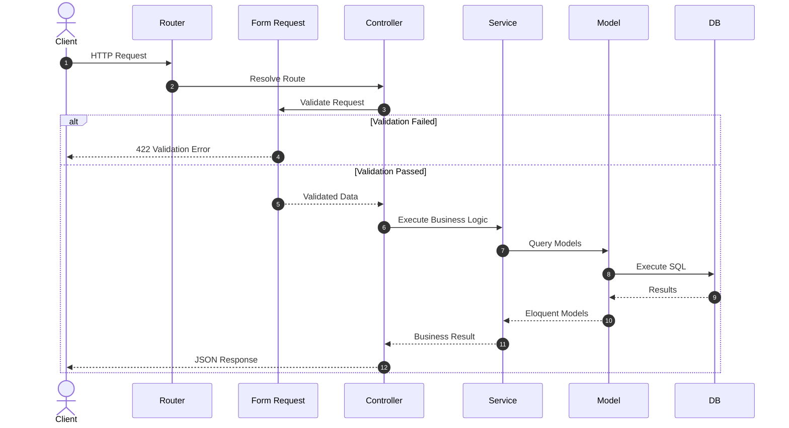
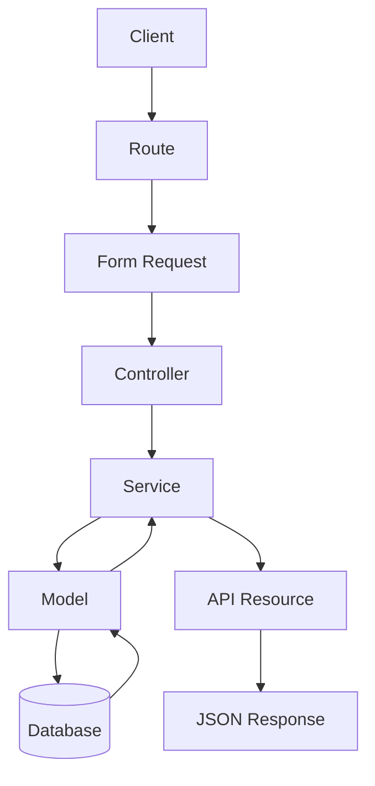

# 02. Architecture Overview

> **Goal:** Establish a consistent, scalable, and maintainable architecture by clearly defining the responsibilities of every layer in the application.

---

# Overview

This project follows a **Layered Architecture** built on top of Laravel's conventions.

Instead of allowing business logic to spread across controllers, models, helpers, and views, responsibilities are separated into dedicated layers.

The architecture emphasizes:

- Thin Controllers
- Form Request Validation
- Service Layer
- Eloquent Models
- Local Scopes
- Event-Driven Design
- Queue-Based Processing
- Dependency Injection
- Centralized Exception Handling

This approach makes the codebase easier to maintain, test, and extend.

---

# Design Goals

The architecture is designed to achieve the following objectives:

- Clear separation of concerns
- Predictable project structure
- High code reusability
- Low coupling
- High cohesion
- Easy testing
- Easy onboarding of developers
- Scalability
- Long-term maintainability

---

# High-Level Architecture

```text
                     Client
                        │
                        ▼
                 HTTP Request
                        │
                        ▼
                 Laravel Router
                        │
                        ▼
               Form Request Validation
                        │
                        ▼
                  Controller Layer
                        │
                        ▼
                   Service Layer
        ┌───────────────┼───────────────┐
        ▼               ▼               ▼
   Eloquent Models   External APIs    Cache
        │
        ▼
 Local Scopes & Relationships
        │
        ▼
      Database
        │
        ▼
     Service Layer
        │
        ▼
    API Resources
        │
        ▼
     HTTP Response
```

---

# Request Lifecycle

Every HTTP request follows the same predictable flow.



---

# Architectural Layers

The application is divided into logical layers.

```text
Presentation Layer
        │
Business Layer
        │
Persistence Layer
        │
Infrastructure Layer
```

Each layer has a specific responsibility.

---

# Presentation Layer

## Responsibility

Handle all HTTP communication.

Components include:

- Routes
- Controllers
- Form Requests
- API Resources
- Middleware

### Responsibilities

- Receive HTTP requests
- Validate user input
- Authenticate users
- Authorize requests
- Return responses

### Should NOT

- Write SQL
- Calculate business rules
- Send emails
- Process payments
- Generate reports

---

# Business Layer

## Responsibility

Implement all business rules.

Components:

- Services
- Domain Exceptions
- Business Validators
- Domain Actions

### Responsibilities

- Process business rules
- Execute workflows
- Coordinate models
- Dispatch events
- Send notifications
- Manage transactions

### Example

```text
Loan Approval

Validate Loan
        │
Calculate Interest
        │
Create Installments
        │
Dispatch Event
        │
Queue Notification
```

---

# Persistence Layer

## Responsibility

Manage application data.

Components:

- Models
- Relationships
- Local Scopes
- Casts
- Accessors
- Mutators

Models should focus on representing data and building reusable queries rather than coordinating business workflows.

---

# Infrastructure Layer

Provides technical capabilities required by the application.

Examples:

- Redis
- MySQL
- PostgreSQL
- Queue Workers
- Horizon
- Mail Server
- Storage
- External APIs

This layer supports the application but should not contain business rules.

---

# Directory Organization

```text
app/
│
├── Console/
├── Events/
├── Exceptions/
├── Helpers/
├── Http/
│   ├── Controllers/
│   ├── Middleware/
│   ├── Requests/
│   └── Resources/
├── Jobs/
├── Listeners/
├── Mail/
├── Models/
├── Notifications/
├── Observers/
├── Policies/
├── Providers/
├── Services/
├── Traits/
└── ViewModels/
```

---

# Component Responsibilities

| Component | Responsibility |
|------------|---------------|
| Routes | Map URLs to controllers |
| Middleware | Process requests before controllers |
| Form Requests | Validation and authorization |
| Controllers | Coordinate requests |
| Services | Business logic |
| Models | Data persistence |
| Local Scopes | Reusable query constraints |
| Policies | Authorization |
| Jobs | Background processing |
| Events | Publish application events |
| Listeners | React to events |
| Notifications | User communication |
| Mailables | Email generation |
| Exceptions | Business and application errors |

---

# Dependency Flow

Dependencies should always point downward.

```text
Controller
      │
      ▼
Service
      │
      ▼
Model
      │
      ▼
Database
```

Never reverse the dependency direction.

Bad

```text
Model
   │
   ▼
Controller
```

Bad

```text
Helper
   │
   ▼
Controller
```

Bad

```text
Model
   │
   ▼
Service
```

Models should not depend on Services.

---

# Data Flow



---

# Cross-Cutting Concerns

Some concerns apply across multiple layers.

These include:

- Logging
- Authentication
- Authorization
- Exception Handling
- Caching
- Transactions
- Queueing
- Event Dispatching
- Monitoring

They should remain centralized and reusable.

---

# Service Layer Philosophy

The Service Layer is the heart of the application.

Every significant business operation should begin here.

Examples:

```text
UserService
LoanService
PaymentService
InventoryService
OrderService
EmployeeService
CustomerService
```

Each service should represent a business domain.

---

# Local Scope Philosophy

Instead of duplicating query conditions:

```php
User::where('status', 'active')
    ->where('role', 'admin')
    ->whereNotNull('email_verified_at');
```

Create reusable scopes.

```php
User::active()
    ->verified()
    ->ofRole('admin');
```

Benefits:

- Readability
- Consistency
- Reusability

---

# Event-Driven Architecture

Whenever an action produces side effects, prefer events.

Example:

```text
Create User
      │
      ▼
UserCreated Event
      │
 ┌────┼──────────────┐
 ▼    ▼              ▼
Email Audit Log CRM Sync
```

The original action remains focused while listeners handle independent concerns.

---

# Queue Architecture

Long-running work should be asynchronous.

Examples:

- Email sending
- PDF generation
- Report exports
- Image processing
- Third-party synchronization
- SMS delivery

```text
HTTP Request
      │
      ▼
Controller
      │
      ▼
Dispatch Job
      │
      ▼
Redis Queue
      │
      ▼
Queue Worker
```

This keeps response times low and improves user experience.

---

# Dependency Injection

Services should be injected through Laravel's service container.

Good

```php
public function __construct(
    private readonly LoanService $loanService
) {}
```

Avoid manually instantiating services.

```php
$service = new LoanService();
```

Benefits include:

- Loose coupling
- Easier testing
- Better maintainability
- Automatic dependency resolution

---

# Guiding Principles

The architecture is based on established software engineering principles.

## SOLID

- Single Responsibility Principle
- Open/Closed Principle
- Liskov Substitution Principle
- Interface Segregation Principle
- Dependency Inversion Principle

---

## DRY

Don't Repeat Yourself.

Extract repeated logic into:

- Services
- Local Scopes
- Traits
- Components

---

## KISS

Keep solutions as simple as possible while meeting requirements.

---

## YAGNI

Avoid implementing functionality until it is genuinely needed.

---

# Benefits of This Architecture

By following this architecture consistently, the project gains:

- Predictable code organization
- Easier onboarding
- Better testability
- Improved scalability
- Reduced code duplication
- Clear ownership of responsibilities
- Easier debugging
- Higher code quality
- Faster feature development
- Lower maintenance costs

---

# Best Practices

- Keep Controllers thin.
- Validate using Form Requests.
- Place business logic in Services.
- Keep Models focused on persistence.
- Extract reusable queries into Local Scopes.
- Use Policies for authorization.
- Dispatch Events for side effects.
- Queue expensive tasks.
- Handle exceptions centrally.
- Return consistent API responses.

---

# Common Anti-Patterns

Avoid the following:

- Fat Controllers
- Fat Models containing business workflows
- Business logic in Helpers
- Duplicate query conditions
- Static service calls
- Direct SQL inside Controllers
- Sending emails from Controllers
- Large methods with multiple responsibilities
- Catching every exception inside Controllers

---

# Architecture Checklist

- [ ] Controllers contain only HTTP logic.
- [ ] Validation is handled by Form Requests.
- [ ] Services encapsulate business logic.
- [ ] Models define relationships and scopes.
- [ ] Policies handle authorization.
- [ ] Jobs process long-running tasks.
- [ ] Events decouple side effects.
- [ ] Transactions wrap multi-step operations.
- [ ] Exceptions are handled centrally.
- [ ] API responses follow a consistent format.

---

# Summary

A well-defined architecture enables teams to build Laravel applications that remain maintainable as they grow. By assigning clear responsibilities to each layer and following consistent patterns, the application becomes easier to extend, test, and evolve without introducing unnecessary complexity.

The next chapter explores the **Laravel Request Lifecycle** in detail, tracing a request from the moment it enters the application until the final response is returned.