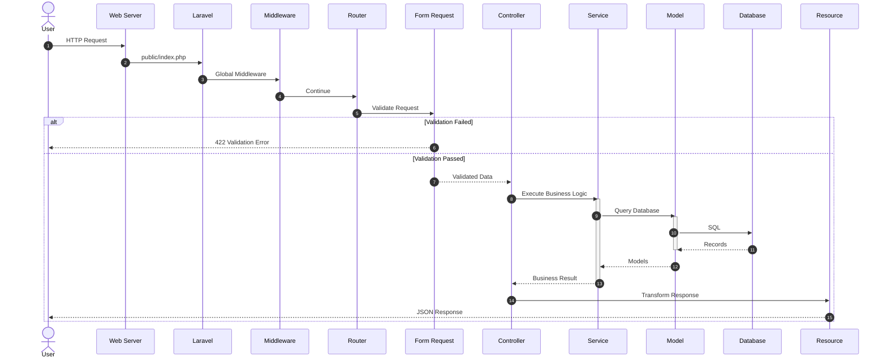
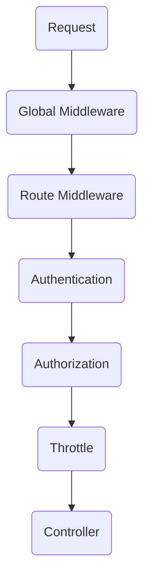
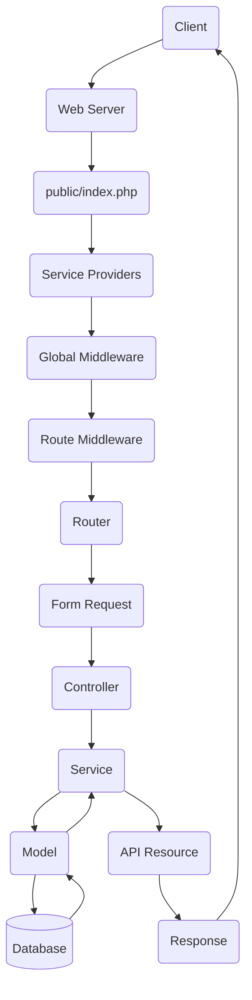
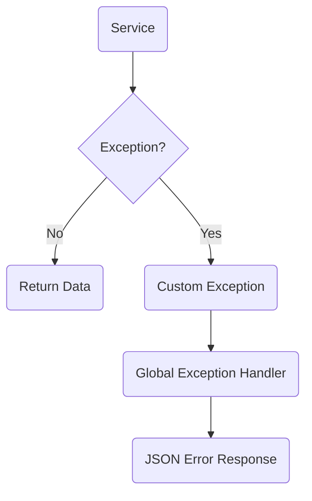

# 03. Request Lifecycle

> **Goal:** Understand how a request travels through a Laravel application, what happens at each stage, and where different responsibilities belong.

---

# Overview

Every HTTP request follows a predictable lifecycle before a response is returned to the client.

Understanding this lifecycle is essential because it determines **where code should be placed**.

A common mistake in many Laravel applications is placing logic in the wrong layer.

For example:

- Validation inside Services
- Business logic inside Controllers
- Authorization inside Models
- SQL inside Views
- Email sending inside Controllers

This documentation establishes a consistent request lifecycle that keeps responsibilities separated.

---

# Complete Request Lifecycle

```text
Client
   │
   ▼
Web Server (Nginx / Apache)
   │
   ▼
public/index.php
   │
   ▼
Laravel Bootstrap
   │
   ▼
Service Providers
   │
   ▼
HTTP Kernel
   │
   ▼
Global Middleware
   │
   ▼
Route Middleware
   │
   ▼
Router
   │
   ▼
Form Request
   │
   ▼
Controller
   │
   ▼
Service
   │
   ▼
Model
   │
   ▼
Database
   │
   ▼
Model
   │
   ▼
Service
   │
   ▼
API Resource
   │
   ▼
Response
```

---

# Request Lifecycle Diagram



---

# Step 1 — Client Sends Request

The lifecycle begins when a client sends an HTTP request.

Example

```http
POST /api/users

Content-Type: application/json
```

```json
{
    "name":"John Doe",
    "email":"john@example.com",
    "password":"secret123"
}
```

Possible clients:

- Browser
- Mobile App
- Postman
- Flutter
- React
- Vue
- Angular
- Third-party API

---

# Step 2 — Web Server

The request reaches:

- Nginx
- Apache

The web server forwards the request to:

```
public/index.php
```

This file is Laravel's entry point.

---

# Step 3 — Laravel Bootstrap

Laravel loads:

- Environment variables
- Configuration
- Composer Autoload
- Service Providers

Important files:

```
bootstrap/app.php
```

```
config/*.php
```

```
vendor/autoload.php
```

At this point the application container is created.

---

# Step 4 — Service Providers

Service Providers register application services.

Examples

```php
AppServiceProvider

AuthServiceProvider

RouteServiceProvider
```

Responsibilities:

- Register bindings
- Register singletons
- Register observers
- Register macros
- Configure packages

Example

```php
$this->app->bind(
    UserRepositoryInterface::class,
    UserRepository::class
);
```

---

# Step 5 — Middleware

Middleware filters requests before they reach controllers.

Example pipeline

```text
Request

↓

Maintenance Mode

↓

Trust Proxies

↓

CORS

↓

Authentication

↓

Authorization

↓

Throttle

↓

Localization

↓

Controller
```

---

## Middleware Responsibilities

Good examples

- Authentication

- Authorization

- Rate limiting

- Localization

- Tenant identification

- Logging

Bad examples

- Create Orders

- Calculate Loan

- Send Emails

- Process Payments

---

# Middleware Flow



---

# Step 6 — Routing

Laravel matches the incoming URL.

Example

```php
Route::post(
    '/users',
    [UserController::class, 'store']
);
```

Responsibilities

- URL matching

- Route model binding

- Middleware assignment

- Versioning

---

# Step 7 — Form Request

Before entering the Controller,

Laravel validates the request.

Example

```php
class UserStoreRequest extends FormRequest
{
    public function rules()
    {
        return [

            'name'=>'required',

            'email'=>'required|email',

            'password'=>'required|min:8'

        ];
    }
}
```

If validation fails:

Laravel immediately returns

```http
422 Unprocessable Entity
```

The Controller is never executed.

---

# Form Request Responsibilities

✔ Validate

✔ Authorize

✔ Prepare Input

✔ Sanitize Data

Should NOT

✘ Save Database

✘ Send Email

✘ Business Logic

---

# Step 8 — Controller

The Controller receives validated data.

Example

```php
public function store(
    UserStoreRequest $request
)
{
    return $this->service
        ->store(
            $request->validated()
        );
}
```

Controller Responsibilities

- Receive request

- Call service

- Return response

Nothing more.

---

# Controller Flow

```text
Receive Request

↓

Validated Data

↓

Call Service

↓

Return Response
```

---

# Step 9 — Service Layer

The Service executes business logic.

Example

```text
Register User

↓

Hash Password

↓

Create User

↓

Assign Role

↓

Dispatch Event

↓

Queue Welcome Email

↓

Return User
```

This is the heart of the application.

---

# Service Responsibilities

✔ Business Rules

✔ Transactions

✔ Notifications

✔ External APIs

✔ Events

✔ Jobs

✔ Calculations

✔ Domain Validation

Should NOT

✘ Return HTML

✘ Validate Request Structure

---

# Step 10 — Model

The Service communicates with Models.

Models handle

- Relationships

- Casts

- Local Scopes

- Accessors

- Mutators

Example

```php
User::active()
    ->verified()
    ->ofRole('admin')
    ->get();
```

---

# Step 11 — Database

Models generate SQL.

Laravel executes SQL against

- MySQL

- PostgreSQL

- SQLite

- SQL Server

Database returns rows.

Laravel hydrates Models.

---

# Step 12 — API Resource

Instead of returning Models directly,

Controllers should return API Resources.

Example

```php
return UserResource::make(
    $user
);
```

Resource transforms

```php
[
    'id'=>$this->id,

    'name'=>$this->name,

    'email'=>$this->email
]
```

Benefits

- Consistent API

- Hide private fields

- Easier versioning

---

# Step 13 — Response

Laravel serializes the response.

Example

```json
{
    "success": true,
    "message": "User created successfully.",
    "data": {
        "id":1,
        "name":"John"
    }
}
```

---

# Complete Flow



---

# Exception Flow



Services throw exceptions.

Controllers should rarely catch them.

Laravel handles unexpected errors globally.

---

# Event Flow

```text
User Registered

↓

UserRegistered Event

↓

Send Welcome Email

↓

Create Audit Log

↓

Sync CRM

↓

Notify Admin
```

Each action is independent.

---

# Queue Flow

```text
Controller

↓

Dispatch Job

↓

Redis Queue

↓

Queue Worker

↓

Email Sent
```

This prevents slow HTTP responses.

---

# Layer Responsibilities

| Layer | Responsibility |
|----------|----------------|
| Middleware | Request filtering |
| Router | Route resolution |
| Form Request | Validation |
| Controller | HTTP communication |
| Service | Business rules |
| Model | Data persistence |
| Resource | Response formatting |
| Job | Background work |
| Event | Publish actions |
| Listener | Handle actions |

---

# Best Practices

- Keep Controllers thin.
- Validate with Form Requests.
- Keep business logic inside Services.
- Keep Models focused on persistence.
- Return API Resources.
- Use Local Scopes.
- Dispatch Events.
- Queue long-running work.
- Throw domain exceptions.
- Keep responses consistent.

---

# Common Mistakes

❌ SQL inside Controllers

❌ Validation inside Services

❌ Business logic inside Middleware

❌ Email sending inside Controllers

❌ Returning Models directly

❌ Duplicated query conditions

❌ Static service calls

❌ Fat Controllers

❌ Catching every exception in Controllers

---

# Lifecycle Checklist

- [ ] Request validated
- [ ] User authorized
- [ ] Controller remains thin
- [ ] Service executes business logic
- [ ] Models use Local Scopes
- [ ] Transactions wrap multi-step writes
- [ ] Events dispatched when appropriate
- [ ] Jobs queued for slow tasks
- [ ] API Resource formats output
- [ ] Global exception handler manages errors

---

# Summary

A predictable request lifecycle is the foundation of a maintainable Laravel application. By ensuring each layer has a single responsibility, the application remains easier to test, debug, and extend.

The next chapter explores the **recommended folder structure**, explaining how to organize the codebase so every component has a clear and consistent location.