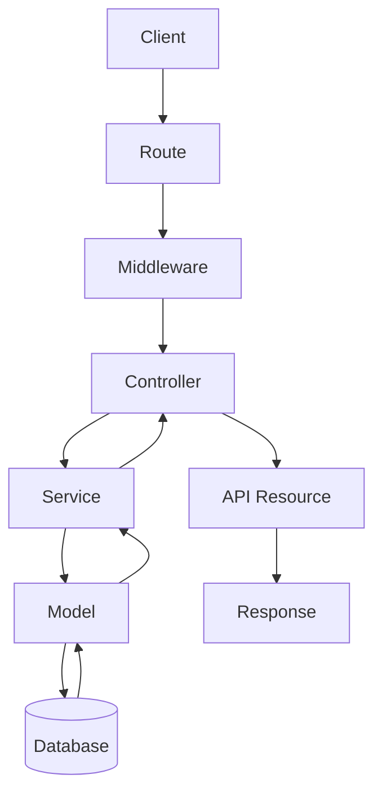

# 05. Routing

> **Goal:** Design a routing structure that is clean, scalable, versioned, secure, and easy to maintain.

---

# Overview

Routing is the entry point of every HTTP request in a Laravel application.

A route determines:

- Which URL is accessed
- Which HTTP method is used
- Which middleware is applied
- Which controller is executed
- Which permissions are required

A well-organized routing structure makes the application easier to navigate, easier to version, and simpler to maintain.

---

# Request Flow

```text
HTTP Request
      │
      ▼
routes/*.php
      │
      ▼
Middleware
      │
      ▼
Controller
      │
      ▼
Service
      │
      ▼
Model
      │
      ▼
Database
```

---

# Routing Principles

Our routing architecture follows these principles:

- Thin route definitions
- Controllers only
- No Closures for production routes
- Route groups
- Route versioning
- RESTful naming
- Middleware separation
- Route Model Binding
- Named routes

---

# Laravel Route Files

Laravel provides several route files by default.

```text
routes/
│
├── web.php
├── api.php
├── console.php
└── channels.php
```

Purpose:

| File | Responsibility |
|--------|----------------|
| web.php | Browser routes |
| api.php | REST API |
| console.php | Artisan commands |
| channels.php | Broadcasting |

---

# Enterprise Route Structure

As the project grows, split routes by feature.

```text
routes/
│
├── api.php
├── web.php
│
├── api/
│   ├── auth.php
│   ├── users.php
│   ├── customers.php
│   ├── loans.php
│   ├── payments.php
│   ├── reports.php
│   └── settings.php
│
└── web/
    ├── dashboard.php
    ├── users.php
    ├── loans.php
    └── reports.php
```

Instead of placing 2,000 routes inside one file:

```
api.php
```

Split them into logical domains.

---

# Loading Route Files

Example inside the Route Service Provider or `bootstrap/app.php` (Laravel 11/12).

```php
Route::middleware('api')
    ->prefix('api')
    ->group(base_path('routes/api/users.php'));

Route::middleware('api')
    ->prefix('api')
    ->group(base_path('routes/api/loans.php'));

Route::middleware('web')
    ->group(base_path('routes/web/dashboard.php'));
```

---

# Route Naming

Always name routes.

Good

```php
Route::get('/users', ...)
    ->name('users.index');
```

Good

```php
users.store

users.update

users.destroy

users.show
```

Avoid

```php
Route::get('/users', ...);
```

without names.

---

# RESTful Routes

Use Laravel resource naming.

| HTTP | URI | Action |
|--------|------|----------|
| GET | /users | index |
| GET | /users/create | create |
| POST | /users | store |
| GET | /users/{user} | show |
| GET | /users/{user}/edit | edit |
| PUT | /users/{user} | update |
| DELETE | /users/{user} | destroy |

---

# API Routes

APIs should not expose:

```
create

edit
```

Example

```php
Route::apiResource(
    'users',
    UserController::class
);
```

This automatically creates:

```
index

store

show

update

destroy
```

---

# Example Route Group

```php
Route::prefix('users')
    ->name('users.')
    ->controller(UserController::class)
    ->group(function () {

        Route::get('/', 'index')
            ->name('index');

        Route::post('/', 'store')
            ->name('store');

        Route::get('{user}', 'show')
            ->name('show');

        Route::put('{user}', 'update')
            ->name('update');

        Route::delete('{user}', 'destroy')
            ->name('destroy');

    });
```

---

# API Versioning

Version APIs from the beginning.

Example

```text
/api/v1/users

/api/v1/loans

/api/v2/users
```

Routes

```php
Route::prefix('v1')
    ->group(function () {

        require base_path(
            'routes/api/v1/users.php'
        );

    });
```

Folder

```text
routes/

api/

v1/

users.php

loans.php

payments.php
```

---

# Middleware Groups

Never apply middleware repeatedly.

Bad

```php
Route::get(...)
    ->middleware('auth');

Route::post(...)
    ->middleware('auth');

Route::put(...)
    ->middleware('auth');
```

Good

```php
Route::middleware('auth')
    ->group(function () {

        ...

    });
```

---

# Multiple Middleware

```php
Route::middleware([

    'auth',

    'verified',

    'permission:users.view'

])->group(function () {

    ...

});
```

---

# Prefix Groups

Good

```php
Route::prefix('admin')
    ->group(function () {

        ...

    });
```

Result

```
/admin/users

/admin/customers

/admin/loans
```

---

# Controller Groups

Instead of

```php
Route::get(...);

Route::post(...);

Route::put(...);

Route::delete(...);
```

Use

```php
Route::controller(UserController::class)
    ->group(function () {

        ...

    });
```

---

# Route Model Binding

Instead of

```php
public function show($id)
```

Use

```php
public function show(
    User $user
)
```

Laravel automatically resolves the model.

Benefits

- Cleaner code

- Automatic 404

- Type safety

---

# Implicit Binding

```php
Route::get(

'/users/{user}',

...

);
```

Laravel automatically performs

```php
User::findOrFail()
```

---

# Custom Route Keys

Instead of IDs

```
/users/1
```

Use UUID

```
/users/89faad23...
```

Example

```php
public function getRouteKeyName()
{
    return 'uuid';
}
```

---

# Route Constraints

Example

```php
Route::get(

'/users/{id}',

...

)->whereNumber('id');
```

UUID

```php
->whereUuid('uuid')
```

Slug

```php
->whereAlphaNumeric(
    'slug'
)
```

---

# Route Parameters

Example

```php
/users/{user}

/customers/{customer}

/loans/{loan}
```

Avoid

```
/users/{id}
```

Prefer model names.

---

# Nested Resources

Example

```text
Customers

└── Loans

        └── Payments
```

Routes

```php
Route::apiResource(

'customers.loans',

LoanController::class

);
```

Produces

```
customers/{customer}/loans
```

---

# Route Caching

Production

```bash
php artisan route:cache
```

Clear

```bash
php artisan route:clear
```

Benefits

- Faster application startup

---

# Route List

Useful command

```bash
php artisan route:list
```

Filter

```bash
php artisan route:list

--path=users
```

---

# Recommended Module Structure

```
Users

GET /users

POST /users

GET /users/{user}

PUT /users/{user}

DELETE /users/{user}
```

```
Loans

GET /loans

POST /loans

GET /loans/{loan}

PUT /loans/{loan}

DELETE /loans/{loan}
```

Keep consistency across all modules.

---

# Route Responsibilities

Routes should only:

- Define URLs
- Assign middleware
- Assign controller
- Assign names
- Assign prefixes

Routes should never:

- Execute SQL
- Send emails
- Call services directly
- Implement business logic

---

# Route Architecture



---

# Best Practices

- Keep routes small.
- Use Controllers.
- Never use Closure routes in production.
- Use route names.
- Group related routes.
- Use middleware groups.
- Version APIs.
- Use Route Model Binding.
- Prefer UUIDs over numeric IDs.
- Cache routes in production.

---

# Common Anti-Patterns

Avoid

```php
Route::get('/users', function () {

    ...

});
```

Avoid

```php
Route::get(...)

↓

DB::table(...)
```

Avoid

```php
Route::get(...)

↓

Mail::send(...)
```

Avoid

```
api.php

3,000 lines
```

Avoid duplicated middleware.

Avoid inconsistent route names.

---

# Routing Checklist

- [ ] Routes grouped by feature
- [ ] Route names defined
- [ ] Middleware grouped
- [ ] Route Model Binding used
- [ ] API versioning implemented
- [ ] UUID route keys configured
- [ ] Resource controllers used
- [ ] No Closure routes in production
- [ ] Routes cached in production
- [ ] Routes remain free of business logic

---

# Summary

Routes are the gateway into the application. Their responsibility is to map incoming requests to the correct controller while applying middleware, authorization, and versioning. By organizing routes by feature, using RESTful conventions, leveraging Route Model Binding, and keeping route definitions free of business logic, the application remains scalable, readable, and easy to maintain.

The next chapter explores **Controllers**, focusing on how to keep them thin, delegate business logic to services, and return consistent responses.