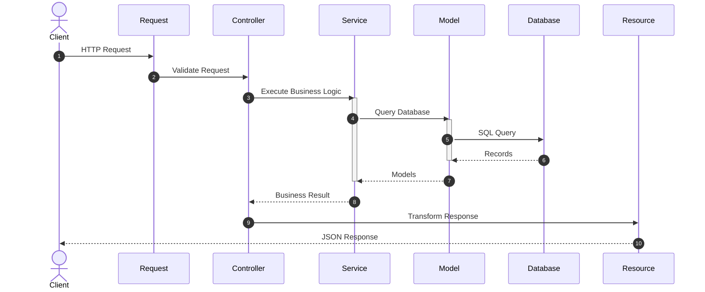
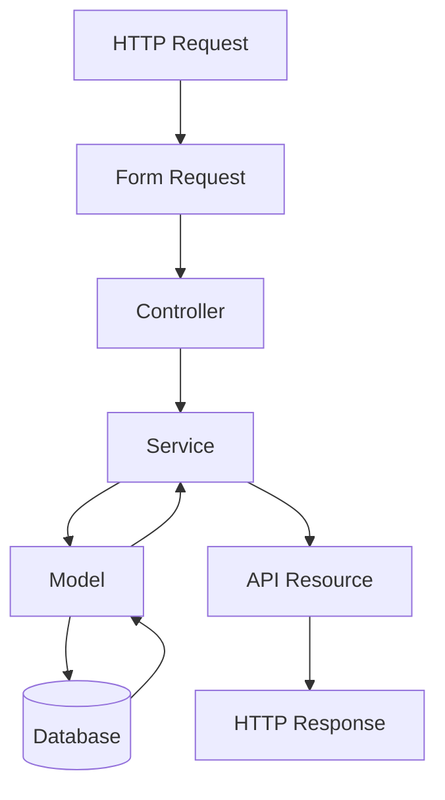

# 06. Controllers

> **Goal:** Build thin, maintainable controllers whose only responsibility is coordinating HTTP requests and responses.

---

# Overview

Controllers are the bridge between the HTTP layer and the application's business layer.

A Controller should **never** contain business logic.

Its job is simply to:

1. Receive an HTTP request
2. Validate the request
3. Authorize the request (when applicable)
4. Call the appropriate Service
5. Return an HTTP response

Controllers are coordinators—not business processors.

---

# Controller Responsibilities

A Controller is responsible for:

- Receiving HTTP requests
- Calling Form Requests
- Invoking Services
- Returning API Resources or Views
- Returning HTTP status codes
- Dispatching responses

A Controller is **NOT** responsible for:

- Business logic
- Database transactions
- SQL queries
- Email sending
- SMS sending
- External API integration
- Calculations
- Report generation
- File processing

---

# Controller Architecture

```text
                HTTP Request
                      │
                      ▼
             Form Request Validation
                      │
                      ▼
                 Controller
                      │
                      ▼
                 Service Layer
                      │
                      ▼
                    Model
                      │
                      ▼
                  Database
```

---

# Request Flow



---

# Controller Directory

```text
app/
└── Http/
    └── Controllers/
        ├── Controller.php
        ├── API/
        ├── Admin/
        ├── Auth/
        ├── Customer/
        └── Web/
```

Large projects should organize controllers by domain.

Example

```text
Controllers/

API/

    UserController.php

    LoanController.php

Admin/

    DashboardController.php

Customer/

    ProfileController.php
```

---

# Naming Convention

Always use:

```
UserController

LoanController

CustomerController

PaymentController
```

Avoid

```
Users

ManageUsers

UserLogic

ControllerUser
```

---

# Dependency Injection

Controllers should receive dependencies via constructor injection.

Example

```php
class UserController extends Controller
{
    public function __construct(
        private readonly UserService $service
    ) {
    }
}
```

Avoid

```php
$service = new UserService();
```

Laravel's Service Container resolves dependencies automatically.

---

# CRUD Controller Example

```php
class UserController extends Controller
{
    public function __construct(
        private readonly UserService $service
    ) {
    }

    public function index()
    {
        return UserResource::collection(
            $this->service->paginate()
        );
    }

    public function store(
        StoreUserRequest $request
    )
    {
        $user = $this->service->store(
            $request->validated()
        );

        return UserResource::make($user)
            ->response()
            ->setStatusCode(201);
    }

    public function show(User $user)
    {
        return UserResource::make($user);
    }

    public function update(
        UpdateUserRequest $request,
        User $user
    )
    {
        $user = $this->service->update(
            $user,
            $request->validated()
        );

        return UserResource::make($user);
    }

    public function destroy(User $user)
    {
        $this->service->delete($user);

        return response()->json([
            'success' => true,
            'message' => 'User deleted successfully.'
        ]);
    }
}
```

Notice:

- No SQL
- No transactions
- No business logic
- No validation arrays

---

# Constructor Injection

Good

```php
public function __construct(

    private readonly LoanService $loanService

) {}
```

Bad

```php
public function approve()
{
    $service = new LoanService();

    ...
}
```

---

# Method Injection

Laravel also supports method injection.

Example

```php
public function store(

    StoreUserRequest $request,

    UserService $service

)
{
    ...
}
```

Use constructor injection when the dependency is shared across multiple methods.

---

# Form Requests

Never validate directly inside Controllers.

Avoid

```php
$request->validate([

    ...

]);
```

Good

```php
public function store(

    StoreUserRequest $request

)
```

Benefits

- Cleaner Controller
- Reusable validation
- Easier testing

---

# Route Model Binding

Avoid

```php
public function show($id)
{
    User::findOrFail($id);
}
```

Use

```php
public function show(
    User $user
)
{
    return UserResource::make($user);
}
```

Laravel automatically resolves the model.

---

# Authorization

Controllers should delegate authorization to Policies.

Example

```php
public function update(
    UpdateUserRequest $request,
    User $user
)
{
    $this->authorize(
        'update',
        $user
    );

    ...
}
```

Avoid checking permissions manually.

Bad

```php
if(auth()->user()->role=='admin')
{
    ...
}
```

---

# Returning Resources

Instead of

```php
return response()->json($user);
```

Use

```php
return UserResource::make($user);
```

Benefits

- Consistent output
- Hide internal fields
- Easier API versioning

---

# Returning Collections

Example

```php
return UserResource::collection(
    $users
);
```

---

# Returning Views

Web Controllers may return Blade views.

Example

```php
return view(
    'users.index',
    compact('users')
);
```

Business logic should still remain in Services.

---

# HTTP Status Codes

Recommended responses

| Action | Status |
|----------|--------|
| GET | 200 OK |
| POST | 201 Created |
| PUT | 200 OK |
| PATCH | 200 OK |
| DELETE | 200 OK or 204 No Content |
| Validation Error | 422 |
| Unauthorized | 401 |
| Forbidden | 403 |
| Not Found | 404 |
| Server Error | 500 |

---

# Controller Responsibilities

Controllers should:

- Receive Requests
- Call Services
- Return Resources
- Return Views
- Trigger Authorization
- Trigger Validation

Controllers should NOT:

- Write SQL
- Hash Passwords
- Generate Reports
- Calculate Interest
- Create Installments
- Call External APIs
- Dispatch Notifications
- Send Emails
- Create Transactions

---

# API Controller Example

```php
class LoanController extends Controller
{
    public function __construct(
        private readonly LoanService $service
    ) {
    }

    public function approve(
        Loan $loan
    )
    {
        $loan = $this->service
            ->approve($loan);

        return LoanResource::make($loan);
    }
}
```

Notice how the Controller simply delegates work.

---

# Web Controller Example

```php
class DashboardController extends Controller
{
    public function __construct(
        private readonly DashboardService $service
    ) {
    }

    public function index()
    {
        return view(
            'dashboard.index',
            [
                'summary' => $this->service->summary()
            ]
        );
    }
}
```

---

# Exception Handling

Avoid wrapping every Controller method in a `try/catch`.

Bad

```php
try {

   ...

} catch (...) {

   ...

}
```

Instead:

- Throw domain exceptions in Services.
- Handle unexpected exceptions globally.

Only catch exceptions in a Controller when a custom response is required.

---

# Controller Size

A Controller should typically:

- Contain one responsibility
- Be under 200 lines
- Have small methods
- Have no duplicated logic

If a Controller becomes very large, move logic into:

- Services
- Policies
- Jobs
- Form Requests

---

# Controller Diagram



---

# Best Practices

- Keep Controllers thin.
- Use dependency injection.
- Always use Form Requests.
- Always use API Resources.
- Use Route Model Binding.
- Delegate business logic to Services.
- Authorize using Policies.
- Return correct HTTP status codes.
- Keep methods short and focused.
- Prefer constructor injection over manual instantiation.

---

# Common Anti-Patterns

Avoid:

```php
DB::table(...)
```

inside Controllers.

Avoid:

```php
Mail::send(...)
```

inside Controllers.

Avoid:

```php
Hash::make(...)
```

inside Controllers.

Avoid:

```php
Notification::send(...)
```

inside Controllers.

Avoid:

```php
Loan::where(...)
```

for complex business queries.

Those belong in the Service layer.

---

# Controller Checklist

- [ ] Uses dependency injection
- [ ] Uses Form Requests
- [ ] Uses Route Model Binding
- [ ] Uses API Resources
- [ ] Calls a Service
- [ ] Contains no SQL
- [ ] Contains no business logic
- [ ] Contains no transactions
- [ ] Uses Policies for authorization
- [ ] Returns proper HTTP status codes

---

# Summary

Controllers are responsible for coordinating the flow of an HTTP request—not implementing business logic. By keeping controllers thin, delegating work to Services, validating through Form Requests, authorizing through Policies, and formatting responses with API Resources, the application remains clean, maintainable, and easy to test.

The next chapter covers **Form Requests**, explaining how to centralize validation, authorization, input preparation, and custom validation rules.