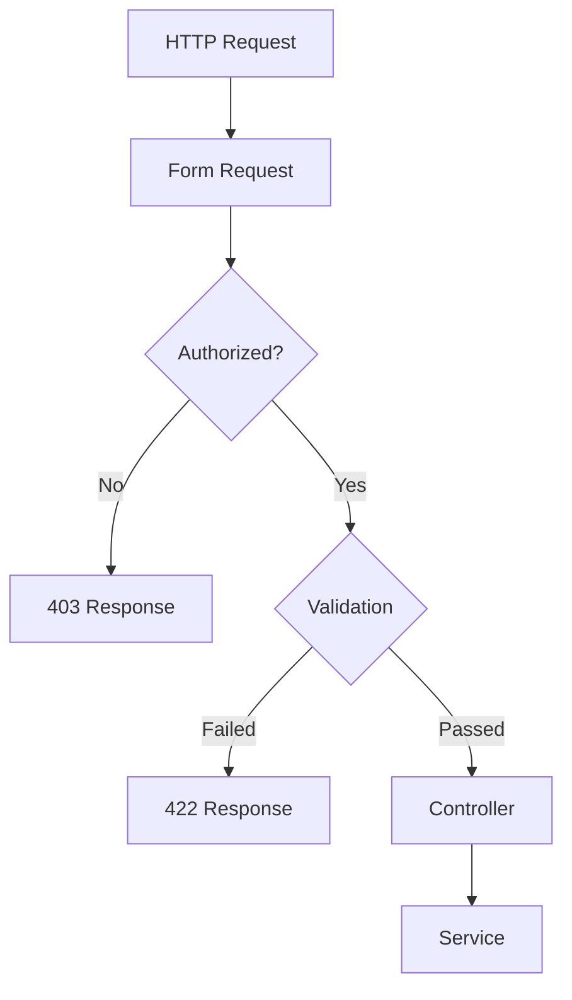

  # 07. Form Requests

> **Goal:** Centralize request validation, authorization, and input preparation while keeping Controllers completely free of validation logic.

---

# Overview

Form Requests are dedicated classes responsible for validating and authorizing incoming HTTP requests.

Instead of placing validation rules inside Controllers, Laravel allows validation to be encapsulated within reusable classes.

This provides:

- Cleaner Controllers
- Reusable validation
- Better testability
- Centralized authorization
- Better IDE support
- Easier maintenance

---

# Why Form Requests?

Without Form Requests:

```php
public function store(Request $request)
{
    $request->validate([
        'name' => 'required|string|max:255',
        'email' => 'required|email',
        'password' => 'required|min:8',
    ]);

    ...
}
```

Problems:

- Validation mixed with HTTP logic
- Hard to reuse
- Difficult to test
- Large controllers

With Form Requests:

```php
public function store(StoreUserRequest $request)
{
    $this->service->store(
        $request->validated()
    );
}
```

The Controller remains focused only on request coordination.

---

# Request Lifecycle

```text
Client
    │
    ▼
Route
    │
    ▼
Form Request
    │
    ├── Authorization
    │
    ├── Prepare Input
    │
    ├── Validation
    │
    ▼
Controller
    │
    ▼
Service
```

---

# Form Request Responsibilities

A Form Request is responsible for:

- Authorization
- Validation
- Input preparation
- Input sanitization
- Custom validation messages
- Custom attribute names

A Form Request should **NOT**:

- Save data
- Send emails
- Execute SQL
- Call Services
- Perform business logic

---

# Directory Structure

```text
app/
└── Http/
    └── Requests/
        ├── StoreUserRequest.php
        ├── UpdateUserRequest.php
        ├── LoginRequest.php
        ├── StoreLoanRequest.php
        └── ApproveLoanRequest.php
```

---

# Naming Convention

Use action-based names.

Good

```text
StoreUserRequest

UpdateUserRequest

LoginRequest

RegisterRequest

StoreLoanRequest

ApproveLoanRequest
```

Avoid

```text
UserRequest

LoanValidation

RequestUser
```

---

# Creating a Form Request

```bash
php artisan make:request StoreUserRequest
```

Generated:

```text
app/Http/Requests/StoreUserRequest.php
```

---

# Basic Structure

```php
class StoreUserRequest extends FormRequest
{
    public function authorize(): bool
    {
        return true;
    }

    public function rules(): array
    {
        return [

            'name' => [
                'required',
                'string',
                'max:255',
            ],

            'email' => [
                'required',
                'email',
                'unique:users,email',
            ],

            'password' => [
                'required',
                'min:8',
            ],

        ];
    }
}
```

---

# Authorization

The `authorize()` method determines whether the current user is allowed to make the request.

Example

```php
public function authorize(): bool
{
    return auth()->check();
}
```

Using Policies

```php
public function authorize(): bool
{
    return auth()->user()
        ->can('create', User::class);
}
```

If authorization fails:

Laravel automatically returns

```http
403 Forbidden
```

---

# Validation Rules

Rules should describe the structure of incoming data.

Example

```php
public function rules(): array
{
    return [

        'name' => [
            'required',
            'string',
            'max:255',
        ],

        'phone' => [
            'required',
            'string',
        ],

        'status' => [
            'required',
            Rule::in([
                'active',
                'inactive',
            ]),
        ],

    ];
}
```

---

# Rule Examples

| Rule | Description |
|-------|-------------|
| required | Field is required |
| nullable | Field is optional |
| string | Must be a string |
| integer | Must be an integer |
| numeric | Must be numeric |
| email | Valid email |
| uuid | UUID format |
| boolean | Boolean |
| array | Array |
| date | Valid date |
| exists | Must exist |
| unique | Must be unique |
| confirmed | Confirmation field required |
| min | Minimum value |
| max | Maximum value |
| between | Range validation |

---

# Conditional Validation

Example

```php
public function rules(): array
{
    return [

        'company_name' => [
            Rule::requiredIf(
                fn () => $this->business_account
            ),
        ],

    ];
}
```

---

# Array Validation

Example

```php
public function rules(): array
{
    return [

        'products' => [
            'required',
            'array',
        ],

        'products.*.id' => [
            'required',
            'exists:products,id',
        ],

        'products.*.quantity' => [
            'required',
            'integer',
            'min:1',
        ],

    ];
}
```

---

# File Validation

```php
'avatar' => [

    'nullable',

    'image',

    'max:2048',

    'mimes:jpg,jpeg,png'

]
```

---

# Password Validation

```php
use Illuminate\Validation\Rules\Password;

'password' => [

    'required',

    Password::defaults(),

]
```

---

# Custom Validation Rules

Example

```php
'phone' => [

    new ValidPhoneNumber()

]
```

Custom rule

```bash
php artisan make:rule ValidPhoneNumber
```

---

# Validation Messages

Override default messages.

```php
public function messages(): array
{
    return [

        'email.required' =>
            'Email is required.',

        'email.unique' =>
            'Email already exists.',

    ];
}
```

---

# Custom Attribute Names

```php
public function attributes(): array
{
    return [

        'phone' => 'phone number',

        'dob' => 'date of birth',

    ];
}
```

Laravel returns

```
The phone number field is required.
```

instead of

```
The phone field is required.
```

---

# Input Preparation

Sometimes incoming data needs to be normalized before validation.

Use

```php
prepareForValidation()
```

Example

```php
protected function prepareForValidation(): void
{
    $this->merge([

        'email' => strtolower(
            $this->email
        ),

    ]);
}
```

Another example

```php
protected function prepareForValidation(): void
{
    $this->merge([

        'phone' => preg_replace(
            '/\D/',
            '',
            $this->phone
        ),

    ]);
}
```

---

# Sanitization

Remove whitespace

```php
protected function prepareForValidation(): void
{
    $this->merge([

        'name' => trim($this->name),

    ]);
}
```

---

# Accessing Validated Data

Inside Controller

```php
$data = $request->validated();
```

Only validated fields are returned.

---

# Safe Input

```php
$request->safe();
```

Example

```php
$data = $request
    ->safe()
    ->only([
        'name',
        'email',
    ]);
```

Exclude fields

```php
$data = $request
    ->safe()
    ->except([
        'password',
    ]);
```

---

# Using DTOs (Optional)

Instead of passing arrays

```php
$data = $request->validated();
```

Convert into DTO

```php
UserData::fromRequest(
    $request
);
```

This provides stronger typing and clearer intent.

---

# Validation Flow



---

# Example Controller

```php
public function store(
    StoreUserRequest $request
)
{
    $user = $this->service->store(
        $request->validated()
    );

    return UserResource::make($user)
        ->response()
        ->setStatusCode(201);
}
```

Notice:

- No validation
- No authorization
- No business logic

---

# Best Practices

- One Form Request per action.
- Keep rules focused.
- Use `authorize()`.
- Use `prepareForValidation()`.
- Create custom Rule objects for reusable validation.
- Keep Controllers free of validation arrays.
- Return only validated input.
- Prefer Rule objects over complex inline rules.
- Use descriptive request class names.

---

# Common Anti-Patterns

Avoid

```php
$request->validate(...)
```

inside Controllers.

Avoid

```php
User::create(...)
```

inside Form Requests.

Avoid

```php
Mail::send(...)
```

inside Form Requests.

Avoid

```php
DB::transaction(...)
```

inside Form Requests.

Avoid business decisions such as:

```php
Approve Loan

Calculate Interest

Assign Customer
```

These belong in the Service layer.

---

# Form Request Checklist

- [ ] One request class per action
- [ ] Uses `authorize()`
- [ ] Uses `rules()`
- [ ] Uses `prepareForValidation()` when required
- [ ] Uses custom Rule classes where appropriate
- [ ] Defines custom messages if needed
- [ ] Defines custom attribute names if needed
- [ ] Returns only validated data
- [ ] Contains no business logic
- [ ] Contains no database operations

---

# Summary

Form Requests are responsible for validating, authorizing, and preparing incoming data before it reaches the Controller. By centralizing validation rules and keeping Controllers free of validation logic, the application becomes cleaner, more reusable, and easier to maintain.

The next chapter introduces the **Service Layer**, where all business logic, transactions, workflows, integrations, and domain operations are implemented.