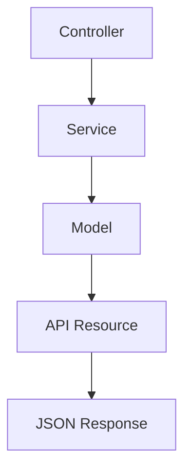

# 08. API Resources

> **Goal:** Standardize all API responses by transforming Eloquent Models into clean, secure, versionable, and consistent JSON structures using Laravel API Resources.

---

# Overview

API Resources are responsible for transforming Models into JSON responses.

They act as the **presentation layer** of your API.

Instead of returning Eloquent Models directly, Controllers should always return API Resources.

This provides:

- Consistent responses
- Better security
- Response versioning
- Cleaner controllers
- Separation of concerns
- Easier maintenance

---

# Why API Resources?

Returning models directly exposes your database structure.

Bad

```php
return User::find($id);
```

Possible response

```json
{
    "id": 1,
    "name": "John",
    "email": "john@example.com",
    "password": "...",
    "remember_token": "...",
    "created_at": "...",
    "updated_at": "..."
}
```

Problems

- Exposes unnecessary fields
- Difficult to change response structure
- No consistency
- Poor API design

Instead use:

```php
return UserResource::make($user);
```

---

# Request Flow

```text
HTTP Request
      │
      ▼
Controller
      │
      ▼
Service
      │
      ▼
Model
      │
      ▼
API Resource
      │
      ▼
JSON Response
```

---

# Resource Responsibilities

API Resources should:

- Transform Models
- Hide sensitive fields
- Rename fields
- Format dates
- Load relationships
- Build nested responses
- Conditionally include fields

API Resources should **NOT**:

- Query the database
- Perform business logic
- Validate requests
- Authorize users
- Send notifications

---

# Directory Structure

```text
app/
└── Http/
    └── Resources/
        ├── UserResource.php
        ├── LoanResource.php
        ├── CustomerResource.php
        ├── PaymentResource.php
        └── Collections/
```

---

# Creating a Resource

```bash
php artisan make:resource UserResource
```

Generated file

```text
app/Http/Resources/UserResource.php
```

---

# Basic Resource

```php
namespace App\Http\Resources;

use Illuminate\Http\Request;
use Illuminate\Http\Resources\Json\JsonResource;

class UserResource extends JsonResource
{
    /**
     * Transform the resource into an array.
     */
    public function toArray(Request $request): array
    {
        return [

            'id' => $this->id,

            'name' => $this->name,

            'email' => $this->email,

        ];
    }
}
```

---

# Returning a Resource

Controller

```php
public function show(User $user)
{
    return UserResource::make($user);
}
```

or

```php
return new UserResource($user);
```

---

# Returning Collections

Instead of

```php
return User::all();
```

Use

```php
return UserResource::collection(
    User::all()
);
```

Laravel automatically transforms every model.

---

# Example JSON

```json
{
    "data": [
        {
            "id": 1,
            "name": "John",
            "email": "john@example.com"
        }
    ]
}
```

---

# Nested Resources

Example

User

↓

Loans

↓

Payments

```php
return [

    'id' => $this->id,

    'name' => $this->name,

    'loans' => LoanResource::collection(
        $this->whenLoaded('loans')
    ),

];
```

Always use `whenLoaded()` to avoid unnecessary queries.

---

# Resource Relationships

Good

```php
'customer' => CustomerResource::make(
    $this->whenLoaded('customer')
)
```

Avoid

```php
'customer' => Customer::find(...)
```

Never query the database inside a Resource.

---

# Date Formatting

Instead of

```php
'created_at' => $this->created_at
```

Use

```php
'created_at' => $this->created_at?->toISOString()
```

or

```php
'created_at' => $this->created_at?->format(
    'Y-m-d H:i:s'
)
```

Choose one standard across the project.

---

# Formatting Money

Instead of

```php
'amount' => $this->amount
```

Use

```php
'amount' => (float) $this->amount
```

or

```php
'amount' => number_format(
    $this->amount,
    2,
    '.',
    ''
)
```

Keep the format consistent.

---

# Conditional Fields

Sometimes fields should only appear under certain conditions.

Example

```php
'phone' => $this->when(

    auth()->user()?->isAdmin(),

    $this->phone

)
```

---

# Conditional Relationships

```php
'payments' => PaymentResource::collection(

    $this->whenLoaded('payments')

)
```

This prevents unnecessary serialization.

---

# Merge Fields

```php
$this->mergeWhen(

    auth()->user()?->isAdmin(),

    [

        'internal_notes' => $this->notes,

        'cost_price' => $this->cost,

    ]

)
```

---

# Adding Computed Values

Resources may expose computed values.

```php
return [

    'id' => $this->id,

    'full_name' =>

        "{$this->first_name} {$this->last_name}",

];
```

Keep computations lightweight.

Heavy calculations belong in Services.

---

# API Resource Example

```php
class LoanResource extends JsonResource
{
    public function toArray($request): array
    {
        return [

            'id' => $this->id,

            'loan_number' => $this->loan_number,

            'amount' => (float) $this->amount,

            'status' => $this->status,

            'customer' => CustomerResource::make(

                $this->whenLoaded('customer')

            ),

            'created_at' =>

                $this->created_at?->toISOString(),

        ];
    }
}
```

---

# Loading Relationships

Controller

```php
$loan = Loan::with([

    'customer',

    'payments',

])

->findOrFail($id);

return LoanResource::make($loan);
```

Avoid lazy loading inside Resources.

---

# Resource Collections

Create

```bash
php artisan make:resource UserCollection
```

Example

```php
class UserCollection extends ResourceCollection
{
    public function toArray($request): array
    {
        return [

            'data' => UserResource::collection(
                $this->collection
            ),

        ];
    }
}
```

---

# Pagination

Example

```php
return UserResource::collection(

    User::paginate()

);
```

Laravel automatically returns

```json
{
    "data": [],
    "links": {},
    "meta": {}
}
```

---

# Response Wrapper

Recommended API structure

```json
{
    "success": true,
    "message": "Users retrieved successfully.",
    "data": []
}
```

Example

```php
return response()->json([

    'success' => true,

    'message' => 'Users retrieved successfully.',

    'data' => UserResource::collection($users),

]);
```

For consistency, use the same envelope across all endpoints or implement a common base resource/response helper.

---

# Resource Diagram



---

# Naming Convention

Good

```text
UserResource

LoanResource

CustomerResource

PaymentResource
```

Collections

```text
UserCollection

LoanCollection
```

Avoid

```text
Users

LoanJson

CustomerFormatter
```

---

# Best Practices

- Return Resources instead of Models.
- Use `whenLoaded()` for relationships.
- Eager load relationships in Services.
- Hide internal database fields.
- Format dates consistently.
- Format money consistently.
- Keep Resources lightweight.
- One Resource per Model.
- Use Collections for paginated data.

---

# Common Anti-Patterns

Avoid database queries

```php
Customer::find(...)
```

inside Resources.

Avoid

```php
Mail::send(...)
```

inside Resources.

Avoid

```php
DB::table(...)
```

inside Resources.

Avoid business logic

```php
Calculate Loan

Generate Installments

Approve Customer
```

Resources are presentation objects only.

---

# API Resource Checklist

- [ ] Every Model has a Resource
- [ ] Relationships use `whenLoaded()`
- [ ] No SQL queries
- [ ] No business logic
- [ ] Dates formatted consistently
- [ ] Money formatted consistently
- [ ] Sensitive fields hidden
- [ ] Pagination supported
- [ ] Collections used where appropriate
- [ ] Consistent JSON structure

---

# Summary

API Resources provide a clean separation between your application's internal data structures and the JSON exposed to clients. By transforming models into consistent, secure, and versionable responses, Resources improve maintainability, reduce accidental data exposure, and make API evolution much easier.

The next chapter introduces the **Service Layer**, where business rules, workflows, transactions, and domain operations are implemented.