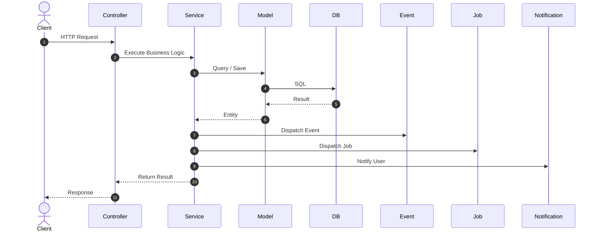
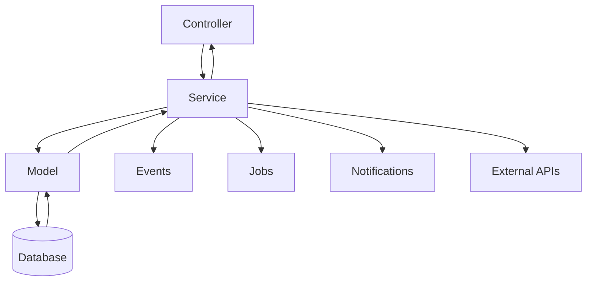

# 09. Service Layer

> **Goal:** Centralize all business logic inside dedicated Service classes, keeping Controllers thin, Models focused on persistence, and business workflows reusable across the application.

---

# Overview

The **Service Layer** is the heart of the application.

Every business operation should be implemented inside a Service.

Instead of Controllers performing calculations, managing transactions, sending notifications, or communicating with external APIs, Controllers simply delegate work to Services.

The Service Layer coordinates:

- Models
- Database Transactions
- Events
- Jobs
- Notifications
- External APIs
- Caching
- Business Rules

This creates a clean separation between the **HTTP Layer** and the **Business Layer**.

---

# Why Use Services?

Without a Service Layer, Controllers often become very large.

Example

```php
public function approve(Request $request)
{
    DB::beginTransaction();

    $loan = Loan::findOrFail($request->loan_id);

    if ($loan->status != 'PENDING') {
        throw new Exception();
    }

    $loan->status = 'APPROVED';
    $loan->save();

    InstallmentService::generate($loan);

    Notification::send(...);

    Mail::to(...);

    DB::commit();

    return response()->json(...);
}
```

Problems:

- Fat Controller
- Mixed responsibilities
- Hard to test
- Difficult to reuse
- Difficult to maintain

---

With Services

```php
public function approve(
    ApproveLoanRequest $request,
    Loan $loan
)
{
    $loan = $this->loanService->approve(
        $loan,
        $request->validated()
    );

    return LoanResource::make($loan);
}
```

Controller remains clean.

---

# Service Responsibilities

A Service is responsible for:

- Business Rules
- Workflow Coordination
- Transactions
- Calling Models
- Calling External APIs
- Dispatching Events
- Dispatching Jobs
- Sending Notifications
- Domain Validation
- Caching
- Integration with Third-party Services

A Service should **NOT**:

- Return HTML
- Validate HTTP Requests
- Perform Authorization
- Format JSON Responses

---

# Architecture

```text
Controller
      │
      ▼
Service
      │
      ├────────────┐
      ▼            ▼
 Models      External APIs
      │
      ▼
 Database
      │
      ▼
 Events
      │
      ▼
 Jobs
      │
      ▼
 Notifications
```

---

# Request Flow



---

# Directory Structure

```text
app/

Services/

    UserService.php

    LoanService.php

    CustomerService.php

    PaymentService.php

    InventoryService.php
```

Every Service should represent a business domain.

---

# Naming Convention

Good

```
UserService

LoanService

PaymentService

OrderService
```

Avoid

```
HelperService

CommonService

GeneralService

UtilsService
```

Service names should reflect a specific business capability.

---

# Creating a Service

Laravel does not include an Artisan command for Services by default.

Create the file manually.

```text
app/
└── Services/
    └── UserService.php
```

---

# Basic Service

```php
namespace App\Services;

use App\Models\User;

class UserService
{
    public function create(array $data): User
    {
        return User::create($data);
    }
}
```

---

# Dependency Injection

Controllers receive Services through constructor injection.

```php
class UserController extends Controller
{
    public function __construct(
        private readonly UserService $service
    ) {
    }
}
```

Never instantiate Services manually.

Bad

```php
$service = new UserService();
```

---

# Business Logic Example

```php
class UserService
{
    public function register(array $data): User
    {
        $data['password'] = Hash::make(
            $data['password']
        );

        return User::create($data);
    }
}
```

Notice that password hashing belongs in the Service—not the Controller.

---

# Transactions

Multi-step operations should always use transactions.

```php
public function createLoan(array $data): Loan
{
    return DB::transaction(function () use ($data) {

        $loan = Loan::create($data);

        InstallmentService::generate($loan);

        LoanCreated::dispatch($loan);

        return $loan;

    });
}
```

Never manage transactions inside Controllers.

---

# Calling Multiple Models

Services can coordinate multiple models.

Example

```text
Loan

↓

Installments

↓

Payment Schedule

↓

Audit Log

↓

Notification
```

The Controller only calls one Service.

---

# Service Example

```php
class LoanService
{
    public function approve(
        Loan $loan
    ): Loan {

        if ($loan->status !== LoanStatus::PENDING) {

            throw new LoanApprovalException(
                'Loan already processed.'
            );

        }

        return DB::transaction(function () use ($loan) {

            $loan->update([

                'status' => LoanStatus::APPROVED,

            ]);

            LoanApproved::dispatch($loan);

            SendLoanApprovedNotification::dispatch($loan);

            return $loan;

        });
    }
}
```

---

# Calling Local Scopes

Instead of

```php
User::where('status','active')
    ->where('role','admin');
```

Use

```php
User::active()
    ->ofRole('admin')
    ->get();
```

Services should always leverage reusable Local Scopes.

---

# Calling External APIs

External integrations belong inside Services.

```php
public function syncCustomer(Customer $customer)
{
    return Http::post(
        config('services.crm.url'),
        [
            'customer' => $customer,
        ]
    );
}
```

Never call external APIs from Controllers.

---

# Dispatching Events

Services should dispatch domain events.

```php
UserRegistered::dispatch(
    $user
);
```

Listeners then perform:

- Email
- Audit Logging
- CRM Sync
- Analytics

This keeps Services focused.

---

# Dispatching Jobs

Long-running tasks should be queued.

```php
GenerateStatementJob::dispatch(
    $loan
);
```

Examples:

- PDF generation
- Excel export
- SMS
- Email
- File uploads
- Synchronization

---

# Notifications

Example

```php
$user->notify(

    new WelcomeNotification()

);
```

or

```php
Notification::send(
    $users,
    new LoanReminderNotification()
);
```

---

# Exception Handling

Services should throw domain exceptions.

```php
throw new LoanApprovalException(
    'Loan already approved.'
);
```

Controllers should rarely catch them.

Laravel's exception handler should generate the response.

---

# Caching

Services may cache expensive queries.

```php
return Cache::remember(

    'dashboard-summary',

    now()->addMinutes(10),

    fn () => Dashboard::summary()

);
```

Invalidate cache after updates.

---

# Service Composition

Services may collaborate with other Services.

Example

```text
LoanService

↓

PaymentService

↓

AccountingService

↓

NotificationService
```

Avoid circular dependencies.

---

# Thin Controller Example

```php
public function store(
    StoreLoanRequest $request
)
{
    $loan = $this->service->store(
        $request->validated()
    );

    return LoanResource::make($loan);
}
```

Controller contains almost no business logic.

---

# Fat Service vs Small Services

Prefer cohesive Services.

Good

```text
LoanService

PaymentService

CustomerService
```

Avoid

```text
ApplicationService

GeneralService

EverythingService
```

Each Service should have a clear business purpose.

---

# Service Diagram



---

# Testing Services

Services should be unit tested independently.

Example

```php
it('approves a loan', function () {

    $loan = Loan::factory()->create();

    $service = app(LoanService::class);

    $approved = $service->approve($loan);

    expect($approved->status)
        ->toBe(LoanStatus::APPROVED);

});
```

Controllers should not be the primary place for testing business rules.

---

# Best Practices

- One Service per business domain.
- Keep Controllers thin.
- Use dependency injection.
- Wrap multi-step operations in transactions.
- Dispatch Events for side effects.
- Queue long-running tasks.
- Throw domain-specific exceptions.
- Reuse Local Scopes.
- Use configuration values instead of hardcoding.
- Keep methods small and focused.

---

# Common Anti-Patterns

Avoid

```php
DB::transaction(...)
```

inside Controllers.

Avoid

```php
Mail::send(...)
```

inside Controllers.

Avoid

```php
Notification::send(...)
```

inside Controllers.

Avoid

```php
Hash::make(...)
```

inside Controllers.

Avoid

```php
User::where(...)
```

repeated throughout multiple Services.

Extract reusable constraints into Local Scopes.

Avoid giant Services containing unrelated business domains.

---

# Service Checklist

- [ ] One Service per business domain
- [ ] Uses dependency injection
- [ ] Wraps multi-step operations in transactions
- [ ] Dispatches Events when appropriate
- [ ] Dispatches Jobs for long-running tasks
- [ ] Throws domain-specific exceptions
- [ ] Uses Local Scopes
- [ ] Uses configuration values
- [ ] Contains no HTTP-specific logic
- [ ] Fully unit tested

---

# Summary

The Service Layer is the core of the application's business logic. By moving workflows, transactions, integrations, and domain rules into dedicated Services, Controllers remain lightweight, Models remain persistence-focused, and business logic becomes reusable across HTTP requests, console commands, scheduled tasks, and queue workers.

The next chapter explores **Repositories (When Needed)**, explaining when the Repository Pattern adds value, when it introduces unnecessary complexity, and how to implement it effectively in Laravel.