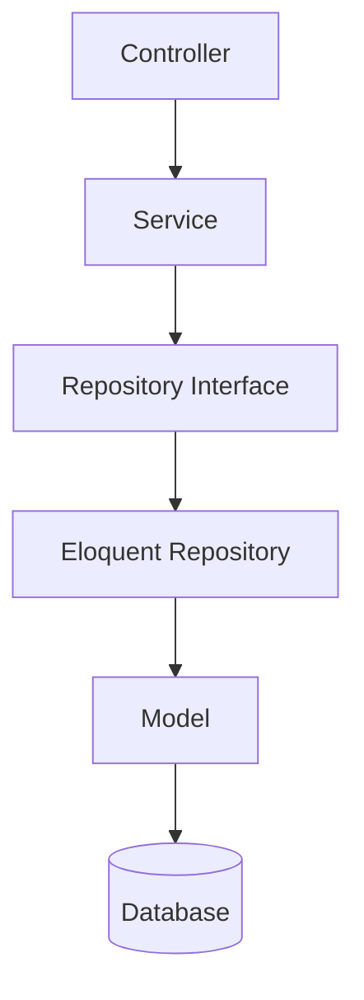

# 10. Repositories (When Needed)

> **Goal:** Understand when the Repository Pattern is beneficial in Laravel, when it introduces unnecessary complexity, and how to implement it correctly when it is truly needed.

---

# Overview

The **Repository Pattern** abstracts data access behind an interface.

Instead of querying Eloquent models directly, the application interacts with a Repository.

```text
Controller
      │
      ▼
Service
      │
      ▼
Repository
      │
      ▼
Eloquent Model
      │
      ▼
Database
```

The Repository acts as a data access layer between the Service and the persistence layer.

---

# Should Every Laravel Project Use Repositories?

**No.**

One of the biggest misconceptions in Laravel development is that every project should implement the Repository Pattern.

Laravel's Eloquent ORM already provides many repository-like capabilities:

- Query Builder
- Local Scopes
- Relationships
- Collections
- Pagination
- Model Events

Adding another repository layer for simple CRUD operations often duplicates existing functionality without providing additional value.

---

# When NOT to Use Repositories

For standard CRUD applications, **Eloquent + Services + Local Scopes** is usually sufficient.

Example

```php
public function users()
{
    return User::active()
        ->verified()
        ->paginate();
}
```

This is already clean, readable, and testable.

Creating:

```
UserRepository

UserRepositoryInterface

EloquentUserRepository
```

simply to call

```php
User::paginate();
```

adds unnecessary boilerplate.

---

# When Repositories ARE Useful

Repositories become valuable when the data source is not limited to Eloquent.

Examples:

- External REST APIs
- GraphQL APIs
- Elasticsearch
- Redis
- MongoDB
- Multiple databases
- Legacy systems
- File storage
- Third-party SDKs

or when combining several data sources.

Example

```text
CustomerRepository

↓

MySQL

↓

Redis Cache

↓

CRM API
```

The Service does not need to know where the data originates.

---

# Decision Guide

| Scenario | Repository? |
|-----------|-------------|
| Simple CRUD | ❌ No |
| Eloquent with Local Scopes | ❌ No |
| External API | ✅ Yes |
| Multiple Data Sources | ✅ Yes |
| Database + Cache | ✅ Yes |
| Legacy System Integration | ✅ Yes |
| Elasticsearch | ✅ Yes |
| Complex Query Composition | ✅ Sometimes |
| Multi-Tenant Storage Providers | ✅ Yes |

---

# Recommended Architecture

For most Laravel applications:

```text
Controller
      │
      ▼
Service
      │
      ▼
Model
      │
      ▼
Database
```

Only introduce a Repository when it provides a clear abstraction.

---

# Repository Architecture

```text
Controller
      │
      ▼
Service
      │
      ▼
Repository Interface
      │
      ▼
Repository Implementation
      │
      ▼
Model / API / Cache / Database
```

---

# Directory Structure

```text
app/
│
├── Repositories/
│   ├── Contracts/
│   │   ├── CustomerRepositoryInterface.php
│   │   └── ProductRepositoryInterface.php
│   │
│   ├── Eloquent/
│   │   ├── CustomerRepository.php
│   │   └── ProductRepository.php
│   │
│   └── Api/
│       └── CustomerApiRepository.php
```

---

# Repository Interface

Example

```php
namespace App\Repositories\Contracts;

use App\Models\Customer;

interface CustomerRepositoryInterface
{
    public function find(int $id): ?Customer;

    public function create(array $data): Customer;

    public function update(
        Customer $customer,
        array $data
    ): Customer;

    public function delete(Customer $customer): bool;
}
```

---

# Repository Implementation

```php
namespace App\Repositories\Eloquent;

use App\Models\Customer;
use App\Repositories\Contracts\CustomerRepositoryInterface;

class CustomerRepository implements CustomerRepositoryInterface
{
    public function find(int $id): ?Customer
    {
        return Customer::find($id);
    }

    public function create(array $data): Customer
    {
        return Customer::create($data);
    }

    public function update(
        Customer $customer,
        array $data
    ): Customer {

        $customer->update($data);

        return $customer;
    }

    public function delete(Customer $customer): bool
    {
        return $customer->delete();
    }
}
```

---

# Binding the Repository

Bind the interface to the implementation.

Example

```php
namespace App\Providers;

use Illuminate\Support\ServiceProvider;
use App\Repositories\Contracts\CustomerRepositoryInterface;
use App\Repositories\Eloquent\CustomerRepository;

class AppServiceProvider extends ServiceProvider
{
    public function register(): void
    {
        $this->app->bind(

            CustomerRepositoryInterface::class,

            CustomerRepository::class

        );
    }
}
```

Now Laravel automatically injects the correct implementation.

---

# Injecting into a Service

```php
class CustomerService
{
    public function __construct(
        private readonly CustomerRepositoryInterface $customers
    ) {
    }

    public function register(array $data)
    {
        return $this->customers->create($data);
    }
}
```

Notice that the Service depends on the **interface**, not the implementation.

---

# Switching Implementations

Example

Today

```text
CustomerRepository

↓

MySQL
```

Tomorrow

```text
CustomerApiRepository

↓

CRM API
```

The Service remains unchanged.

Only the binding changes.

---

# Multiple Data Sources

Example

```text
CustomerRepository

├── MySQL
├── Redis
└── CRM API
```

The Repository decides:

- Read from cache
- Read from database
- Synchronize with external system

The Service only asks for customer data.

---

# Example with Cache

```php
public function find(int $id): ?Customer
{
    return Cache::remember(

        "customer:$id",

        now()->addMinutes(10),

        fn () => Customer::find($id)

    );
}
```

Caching logic remains inside the Repository instead of spreading throughout the Service.

---

# Repository Diagram



---

# Repository vs Service

| Repository | Service |
|------------|---------|
| Retrieves data | Executes business rules |
| Handles persistence | Coordinates workflows |
| Knows data source | Knows business process |
| CRUD operations | Domain logic |
| Cache strategy | Transaction strategy |
| External storage | Events & Jobs |

---

# Common Mistake

Repository

```php
public function approveLoan(...)
{
    ...
}
```

❌ Wrong

Loan approval is business logic.

It belongs in

```
LoanService
```

Repositories should not know business workflows.

---

# Another Common Mistake

Repository

```php
public function sendEmail(...)
```

❌ Wrong

Repositories should never:

- Send emails
- Send notifications
- Dispatch jobs
- Dispatch events
- Calculate interest
- Process payments

---

# Good Repository Responsibilities

Repositories may:

- Retrieve Models
- Persist Models
- Delete Models
- Execute complex queries
- Integrate with cache
- Integrate with external storage
- Aggregate multiple data sources

---

# Bad Repository Responsibilities

Repositories should not:

- Perform validation
- Execute business rules
- Manage transactions
- Authorize users
- Return HTTP responses
- Format JSON
- Dispatch notifications

---

# Testing

Mock the Repository during Service tests.

```php
$repository = Mockery::mock(
    CustomerRepositoryInterface::class
);

$repository
    ->shouldReceive('find')
    ->once();

$service = new CustomerService(
    $repository
);
```

This isolates business logic from persistence.

---

# Best Practices

- Use Repositories only when they add value.
- Depend on interfaces.
- Keep Repositories focused on persistence.
- Keep business logic inside Services.
- Keep Controllers unaware of Repositories.
- Use Local Scopes inside Repository queries.
- Cache data where appropriate.
- Return Models or DTOs consistently.
- Document repository contracts.

---

# Common Anti-Patterns

Avoid creating repositories that only wrap:

```php
User::find()

User::create()

User::update()

User::delete()
```

without adding any abstraction.

Avoid:

```php
UserRepository

↓

User::all()
```

This duplicates Eloquent unnecessarily.

Avoid placing business rules inside repositories.

Avoid injecting repositories directly into Controllers.

Controllers should communicate with Services.

---

# Repository Checklist

- [ ] Repository solves a real abstraction problem
- [ ] Service depends on an interface
- [ ] Repository handles persistence only
- [ ] Business logic remains in Services
- [ ] No HTTP logic
- [ ] No validation
- [ ] No notifications
- [ ] No events
- [ ] Uses Local Scopes where appropriate
- [ ] Unit tested independently

---

# Summary

Laravel's Eloquent ORM is powerful enough that many applications do not require a Repository layer. Introducing repositories should be a deliberate architectural decision based on real needs such as multiple data sources, caching, or external integrations—not simply because the pattern exists.

When used appropriately, Repositories provide a clean abstraction over persistence while allowing Services to remain focused on business rules. When used unnecessarily, they introduce boilerplate without improving maintainability.

The next chapter explores **DTOs (Data Transfer Objects) and Actions**, demonstrating how strongly typed data objects and focused action classes can further improve code clarity and reduce coupling.