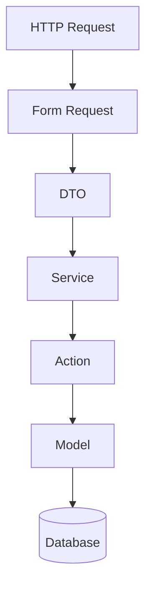
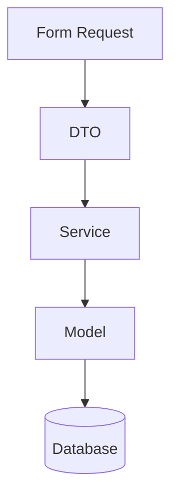
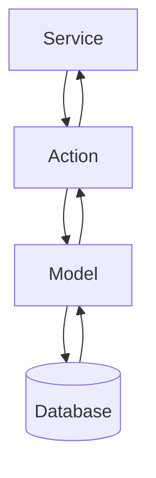

# 11. DTOs (Data Transfer Objects) and Actions

> **Goal:** Transfer structured data safely between application layers using DTOs and encapsulate single business operations using Actions to improve readability, type safety, and maintainability.

---

# Overview

As applications grow, passing raw arrays between Controllers, Services, Jobs, and Events becomes difficult to maintain.

Example

```php
$service->create([
    'name' => $request->name,
    'email' => $request->email,
    'phone' => $request->phone,
    'address' => $request->address,
    'role_id' => $request->role_id,
]);
```

Problems:

- No type safety
- No autocomplete
- Easy to miss required fields
- Difficult to refactor
- Hidden structure

Instead, encapsulate request data in a **Data Transfer Object (DTO)**.

```php
$user = UserData::fromRequest($request);

$this->service->create($user);
```

---

# What is a DTO?

A **Data Transfer Object (DTO)** is a simple object used to transfer data between application layers.

A DTO contains:

- Data
- Types
- Factory methods

A DTO should **NOT** contain:

- Database queries
- Business logic
- HTTP logic
- Validation
- Side effects

---

# What is an Action?

An **Action** represents **one business operation**.

Examples:

- RegisterUserAction
- ApproveLoanAction
- CalculateInstallmentAction
- GenerateInvoiceAction

Actions are useful when:

- A Service becomes too large.
- A workflow is reusable.
- One operation has a single responsibility.

---

# DTO vs Service vs Action

| Component | Responsibility |
|-----------|----------------|
| DTO | Transport data |
| Action | Execute one business operation |
| Service | Coordinate business workflows |

---

# Architecture

```text
Controller
      │
      ▼
Form Request
      │
      ▼
DTO
      │
      ▼
Service
      │
      ▼
Action(s)
      │
      ▼
Model
      │
      ▼
Database
```

---

# Request Flow



---

# Directory Structure

```text
app/
│
├── DTOs/
│   ├── UserData.php
│   ├── LoanData.php
│   ├── CustomerData.php
│   └── PaymentData.php
│
└── Actions/
    ├── RegisterUserAction.php
    ├── ApproveLoanAction.php
    ├── GenerateInstallmentsAction.php
    └── ProcessPaymentAction.php
```

---

# Naming Convention

DTOs

```text
UserData

LoanData

CustomerData

PaymentData
```

Actions

```text
RegisterUserAction

ApproveLoanAction

GenerateInvoiceAction

ProcessPaymentAction
```

Avoid

```text
UserDTO

DataUser

HelperAction

GeneralAction

EverythingAction
```

---

# Creating a DTO

Example

```php
namespace App\DTOs;

use App\Http\Requests\StoreUserRequest;

final readonly class UserData
{
    public function __construct(
        public string $name,
        public string $email,
        public string $password,
        public ?string $phone,
    ) {
    }

    public static function fromRequest(
        StoreUserRequest $request
    ): self {

        return new self(

            name: $request->string('name'),

            email: $request->string('email'),

            password: $request->string('password'),

            phone: $request->string('phone')

        );

    }
}
```

Notice:

- Strong typing
- Readonly
- Immutable
- Easy to understand

---

# Using DTO in Controller

Instead of

```php
$this->service->create(
    $request->validated()
);
```

Use

```php
$data = UserData::fromRequest(
    $request
);

$this->service->create($data);
```

The Controller no longer passes raw arrays.

---

# Service Example

```php
public function create(
    UserData $data
): User {

    return User::create([

        'name' => $data->name,

        'email' => $data->email,

        'password' => Hash::make(
            $data->password
        ),

        'phone' => $data->phone,

    ]);

}
```

Everything is strongly typed.

---

# DTO Factory Methods

A DTO may expose multiple factory methods.

Example

```php
UserData::fromRequest(...)

UserData::fromArray(...)

UserData::fromModel(...)
```

This makes the DTO reusable.

---

# DTO Example from Array

```php
public static function fromArray(
    array $data
): self {

    return new self(

        name: $data['name'],

        email: $data['email'],

        password: $data['password'],

        phone: $data['phone'] ?? null

    );

}
```

---

# Nested DTOs

Example

Customer

↓

Address

```php
final readonly class AddressData
{
    public function __construct(

        public string $city,

        public string $street

    ) {
    }
}
```

Customer

```php
final readonly class CustomerData
{
    public function __construct(

        public string $name,

        public AddressData $address

    ) {
    }
}
```

---

# DTO Benefits

- Strong typing
- Autocomplete
- Refactoring safety
- Immutable data
- Cleaner Services
- Better testing
- Easier documentation

---

# Actions

Actions encapsulate one business operation.

Example

```
Approve Loan

Generate Invoice

Register User

Calculate Interest
```

One Action

↓

One Responsibility

---

# Creating an Action

```php
namespace App\Actions;

use App\Models\User;
use App\DTOs\UserData;
use Illuminate\Support\Facades\Hash;

class RegisterUserAction
{
    public function execute(
        UserData $data
    ): User {

        return User::create([

            'name' => $data->name,

            'email' => $data->email,

            'password' => Hash::make(
                $data->password
            ),

            'phone' => $data->phone,

        ]);

    }
}
```

---

# Service Using Actions

Instead of

```text
LoanService

↓

400 lines
```

Split responsibilities.

```text
LoanService

↓

ApproveLoanAction

↓

GenerateInstallmentsAction

↓

CreateLedgerEntriesAction
```

Service

```php
class LoanService
{
    public function __construct(

        private readonly ApproveLoanAction $approve,

        private readonly GenerateInstallmentsAction $installments

    ) {
    }

    public function approve(
        Loan $loan
    ): Loan {

        $loan = $this->approve->execute($loan);

        $this->installments->execute($loan);

        return $loan;

    }
}
```

Each Action remains small.

---

# Action Responsibilities

Actions should:

- Perform one operation
- Be reusable
- Be testable
- Be dependency injected

Actions should **NOT**:

- Return HTTP responses
- Validate requests
- Perform authorization
- Format JSON

---

# Transaction Example

The Service owns the transaction.

```php
DB::transaction(function () use ($loan) {

    $loan = $this->approveAction
        ->execute($loan);

    $this->generateScheduleAction
        ->execute($loan);

});
```

Actions should not begin or commit transactions unless they are designed to be standalone operations.

---

# Events

Actions may dispatch Events.

Example

```php
UserRegistered::dispatch(
    $user
);
```

or

return the Model and let the Service decide whether to dispatch Events.

Choose one approach and apply it consistently across the project.

---

# Jobs

Actions may dispatch Jobs.

Example

```php
SendWelcomeEmailJob::dispatch(
    $user
);
```

Again, decide whether Actions or Services own side effects and remain consistent.

---

# DTO Diagram



---

# Action Diagram



---

# DTO vs Array

Array

```php
create([
    ...
]);
```

Problems

- Unknown structure
- Weak typing
- Runtime errors

DTO

```php
create(
    UserData $data
);
```

Benefits

- Compile-time safety
- Autocomplete
- Easier maintenance

---

# Testing DTO

```php
it('creates user dto', function () {

    $dto = new UserData(

        name: 'John',

        email: 'john@example.com',

        password: 'secret',

        phone: null

    );

    expect($dto->name)
        ->toBe('John');

});
```

DTOs require very little testing because they contain no behavior.

---

# Testing Actions

```php
it('registers a user', function () {

    $action = app(
        RegisterUserAction::class
    );

    $dto = new UserData(
        name: 'John',
        email: 'john@example.com',
        password: 'secret123',
        phone: null,
    );

    $user = $action->execute($dto);

    expect($user)->toBeInstanceOf(User::class);

});
```

Actions are ideal candidates for unit tests.

---

# Best Practices

- Use immutable DTOs (`readonly`).
- One DTO per use case.
- One Action per business operation.
- Keep Actions small.
- Use dependency injection.
- Keep DTOs free of business logic.
- Let Services orchestrate Actions.
- Prefer named arguments for readability.
- Use factory methods for DTO creation.

---

# Common Anti-Patterns

Avoid

```php
class UserData
{
    public function save()
    {
        ...
    }
}
```

DTOs should never persist data.

Avoid

```php
class RegisterUserAction
{
    public function execute()
    {
        return response()->json(...);
    }
}
```

Actions should never return HTTP responses.

Avoid placing validation inside DTOs or Actions.

Avoid creating a DTO for every tiny value object if it adds unnecessary complexity.

---

# DTO & Action Checklist

- [ ] DTOs are immutable
- [ ] DTOs contain only data
- [ ] DTOs use strong typing
- [ ] Services accept DTOs instead of arrays when appropriate
- [ ] Actions perform one responsibility
- [ ] Actions are reusable
- [ ] Actions are dependency injected
- [ ] Services orchestrate Actions
- [ ] No HTTP logic
- [ ] Unit tests cover Actions

---

# When Should You Use DTOs and Actions?

## Use DTOs when:

- Passing complex structured data
- Replacing large associative arrays
- Improving type safety
- Sharing data across layers

## Use Actions when:

- A Service becomes too large
- A business operation is reusable
- A workflow has a single responsibility
- The operation needs isolated unit testing

## Don't use them when:

- The operation is a simple one-line CRUD action
- They introduce more complexity than value
- The application is very small and unlikely to grow

---

# Summary

DTOs improve type safety and make data transfer between layers explicit, while Actions encapsulate individual business operations into small, reusable units. Used together with the Service Layer, they create a clean architecture where Controllers coordinate requests, Services orchestrate workflows, Actions execute focused operations, and DTOs provide strongly typed data contracts.

The next chapter introduces **Models**, covering Eloquent entities, relationships, attribute casting, accessors, mutators, and best practices for keeping models focused on persistence.