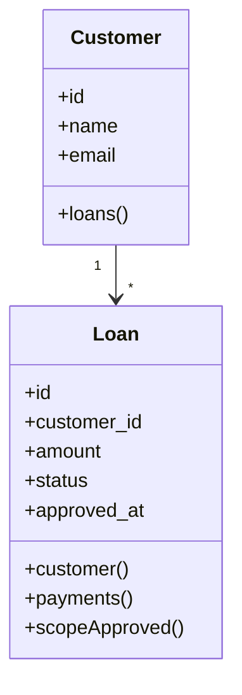

# 12. Models

> **Goal:** Design clean, maintainable, and reusable Eloquent Models that represent application entities, encapsulate data persistence, define relationships, and expose reusable query scopes while keeping business logic in the Service layer.

---

# Overview

Models represent the application's business entities.

Examples include:

- User
- Customer
- Loan
- Payment
- Installment
- Product
- Order

An Eloquent Model acts as the gateway between your application and the database.

It is responsible for:

- Mapping database tables
- Managing relationships
- Defining attribute casting
- Providing reusable query scopes
- Handling accessors and mutators
- Supporting model events

It is **not** responsible for implementing business workflows.

---

# Model Responsibilities

A Model should:

- Represent a database table
- Define relationships
- Define Local Scopes
- Cast attributes
- Define Accessors
- Define Mutators
- Handle model events
- Hide sensitive attributes

A Model should **NOT**:

- Send emails
- Call external APIs
- Execute business workflows
- Handle HTTP requests
- Validate user input
- Manage transactions
- Return JSON responses

---

# Architecture

```text
Controller
      │
      ▼
Service
      │
      ▼
Model
      │
      ▼
Database
```

The Model is responsible only for persistence.

---

# Directory Structure

```text
app/
└── Models/
    ├── User.php
    ├── Customer.php
    ├── Loan.php
    ├── Installment.php
    ├── Payment.php
    ├── Product.php
    └── Order.php
```

---

# Naming Convention

Always use singular nouns.

Good

```
User

Loan

Customer

Payment

Order
```

Avoid

```
Users

Loans

CustomerModel

PaymentEntity
```

---

# Creating a Model

```bash
php artisan make:model Loan
```

With migration

```bash
php artisan make:model Loan -m
```

With Factory

```bash
php artisan make:model Loan -mf
```

---

# Basic Model

```php
namespace App\Models;

use Illuminate\Database\Eloquent\Model;

class Loan extends Model
{
    protected $fillable = [

        'customer_id',

        'amount',

        'status',

        'interest_rate',

        'approved_at',

    ];
}
```

---

# Fillable

Use `$fillable` to protect against mass assignment vulnerabilities.

```php
protected $fillable = [

    'name',

    'email',

    'phone',

];
```

Avoid

```php
protected $guarded = [];
```

unless you fully understand the implications.

---

# Hidden Attributes

Sensitive fields should not appear in JSON responses.

```php
protected $hidden = [

    'password',

    'remember_token',

];
```

---

# Attribute Casting

Cast attributes into useful PHP types.

```php
protected $casts = [

    'email_verified_at' => 'datetime',

    'is_active' => 'boolean',

    'amount' => 'decimal:2',

    'approved_at' => 'datetime',

];
```

Benefits

- Strong typing
- Cleaner code
- Automatic conversion

---

# Relationships

Models should define relationships.

Example

Customer

↓

Loans

```php
public function loans()
{
    return $this->hasMany(
        Loan::class
    );
}
```

Loan

↓

Customer

```php
public function customer()
{
    return $this->belongsTo(
        Customer::class
    );
}
```

Relationships are covered in detail in the next chapter.

---

# Local Scopes

Local Scopes eliminate duplicated query logic.

Example

```php
public function scopeApproved($query)
{
    return $query->where(
        'status',
        'APPROVED'
    );
}
```

Usage

```php
Loan::approved()->get();
```

Never repeat the same query constraints throughout the application.

---

# Accessors

Accessors transform data when retrieving attributes.

Example

```php
protected function fullName(): Attribute
{
    return Attribute::make(

        get: fn () =>

            "{$this->first_name} {$this->last_name}"

    );
}
```

Usage

```php
$user->full_name;
```

---

# Mutators

Mutators transform data before saving.

Example

```php
protected function name(): Attribute
{
    return Attribute::make(

        set: fn ($value) =>

            ucfirst($value)

    );
}
```

Whenever the attribute is saved, it is automatically formatted.

---

# UUID Primary Keys

Example

```php
use Illuminate\Database\Eloquent\Concerns\HasUuids;

class User extends Model
{
    use HasUuids;
}
```

Route Model Binding

```php
public function getRouteKeyName()
{
    return 'uuid';
}
```

Recommended for public APIs.

---

# Soft Deletes

Enable soft deletes.

```php
use Illuminate\Database\Eloquent\SoftDeletes;

class Loan extends Model
{
    use SoftDeletes;
}
```

Migration

```php
$table->softDeletes();
```

Restore

```php
Loan::withTrashed()
    ->find($id)
    ->restore();
```

---

# Model Events

Laravel provides model lifecycle events.

```text
creating

created

updating

updated

saving

saved

deleting

deleted
```

Prefer Observers over placing event logic directly in Models.

---

# Model Observer

```php
LoanObserver

↓

creating()

↓

created()

↓

updated()
```

Observers keep Models focused.

---

# Table Name

Laravel automatically infers table names.

Example

```
Loan

↓

loans
```

Override when necessary.

```php
protected $table = 'loan_contracts';
```

---

# Primary Key

Default

```php
protected $primaryKey = 'id';
```

Custom

```php
protected $primaryKey = 'uuid';
```

---

# Incrementing

UUID

```php
public $incrementing = false;
```

---

# Key Type

UUID

```php
protected $keyType = 'string';
```

---

# Default Attribute Values

```php
protected $attributes = [

    'status' => 'PENDING',

];
```

---

# Eager Loading

Automatically eager load relationships.

```php
protected $with = [

    'customer',

];
```

Use carefully to avoid unnecessary queries.

---

# Touching Parent Models

```php
protected $touches = [

    'customer',

];
```

Parent timestamps update automatically.

---

# Model Diagram



---

# Model Example

```php
class Loan extends Model
{
    use HasFactory;

    protected $fillable = [

        'customer_id',

        'amount',

        'status',

        'approved_at',

    ];

    protected $casts = [

        'approved_at' => 'datetime',

        'amount' => 'decimal:2',

    ];

    public function customer()
    {
        return $this->belongsTo(
            Customer::class
        );
    }

    public function payments()
    {
        return $this->hasMany(
            Payment::class
        );
    }

    public function scopeApproved($query)
    {
        return $query->where(
            'status',
            'APPROVED'
        );
    }
}
```

---

# What Belongs in a Model?

Good

✔ Relationships

✔ Local Scopes

✔ Accessors

✔ Mutators

✔ Attribute Casting

✔ Hidden Fields

✔ Fillable

✔ Observers

---

# What Does NOT Belong?

Avoid

```php
Mail::send(...)
```

Avoid

```php
Notification::send(...)
```

Avoid

```php
Http::post(...)
```

Avoid

```php
Loan::approve()
```

if it performs an entire business workflow.

Approval belongs inside

```
LoanService
```

---

# Fat Models

Avoid

```php
Loan

↓

Approve

↓

Generate Schedule

↓

Create Ledger

↓

Send Email

↓

Notify Customer

↓

Sync CRM
```

This is business logic.

Move it into the Service layer.

---

# Thin Models vs Rich Models

The phrase

> "Fat Models, Skinny Controllers"

is often misunderstood.

Recommended architecture

```
Thin Controllers

↓

Rich Services

↓

Focused Models
```

Models should be **rich in persistence behavior**, not business workflows.

---

# Best Practices

- One Model per table.
- Use singular names.
- Define relationships.
- Use Local Scopes.
- Hide sensitive fields.
- Cast attributes.
- Use Accessors and Mutators.
- Prefer UUIDs for public APIs.
- Use Soft Deletes when appropriate.
- Keep Models persistence-focused.

---

# Common Anti-Patterns

Avoid

```php
DB::transaction(...)
```

inside Models.

Avoid

```php
Mail::send(...)
```

inside Models.

Avoid

```php
Http::post(...)
```

inside Models.

Avoid

```php
Notification::send(...)
```

inside Models.

Avoid business workflows inside Models.

Avoid duplicating query constraints instead of using Local Scopes.

---

# Model Checklist

- [ ] One Model per table
- [ ] Uses `$fillable`
- [ ] Hides sensitive fields
- [ ] Uses attribute casting
- [ ] Defines relationships
- [ ] Uses Local Scopes
- [ ] Uses Accessors where needed
- [ ] Uses Mutators where needed
- [ ] No business workflows
- [ ] No HTTP logic

---

# Summary

Models are responsible for representing application data and managing persistence. They define relationships, reusable query scopes, attribute casting, accessors, mutators, and model metadata while remaining independent of HTTP and business workflows.

A well-designed Model is simple, reusable, and persistence-focused, allowing the Service layer to orchestrate business processes without duplicating data access logic.

The next chapter explores **Local Scopes**, showing how to build reusable, expressive query methods that eliminate duplicated query conditions and improve readability throughout the application.