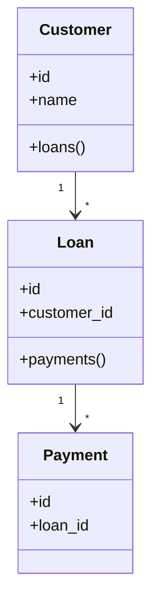

# 14. Eloquent Relationships

> **Goal:** Design efficient, expressive, and maintainable relationships between models while avoiding duplicate queries, N+1 problems, and poor database access patterns.

---

# Overview

One of Eloquent's greatest strengths is its relationship system.

Instead of writing manual SQL joins, Eloquent allows you to express relationships using PHP methods.

Example

```php
$loan->customer;

$customer->loans;

$loan->payments;

$user->roles;
```

Relationships make code:

- Cleaner
- More readable
- Easier to maintain
- Easier to test
- Database independent

---

# Relationship Philosophy

A relationship should describe **how two models are connected**.

A relationship should **NOT**:

- Perform business logic
- Send notifications
- Modify unrelated models
- Execute workflows

Good

```php
$loan->customer
```

Bad

```php
$loan->approve()
```

Approval belongs in the Service Layer.

---

# Relationship Architecture

```text
Controller
      │
      ▼
Service
      │
      ▼
Model
      │
      ▼
Relationship
      │
      ▼
Database
```

Relationships belong to the persistence layer.

---

# Relationship Types

Laravel supports:

| Relationship | Description |
|--------------|-------------|
| hasOne | One-to-One |
| belongsTo | Inverse One-to-One |
| hasMany | One-to-Many |
| belongsToMany | Many-to-Many |
| hasManyThrough | Indirect One-to-Many |
| hasOneThrough | Indirect One-to-One |
| morphOne | One-to-One Polymorphic |
| morphMany | One-to-Many Polymorphic |
| morphTo | Inverse Polymorphic |
| morphToMany | Many-to-Many Polymorphic |

---

# One-to-One

Example

```
User

↓

Profile
```

Database

```text
users

id
```

```text
profiles

id

user_id
```

Model

```php
class User extends Model
{
    public function profile()
    {
        return $this->hasOne(
            Profile::class
        );
    }
}
```

Inverse

```php
class Profile extends Model
{
    public function user()
    {
        return $this->belongsTo(
            User::class
        );
    }
}
```

Usage

```php
$user->profile;

$profile->user;
```

---

# One-to-Many

Example

```
Customer

↓

Loans
```

Customer

```php
public function loans()
{
    return $this->hasMany(
        Loan::class
    );
}
```

Loan

```php
public function customer()
{
    return $this->belongsTo(
        Customer::class
    );
}
```

Usage

```php
$customer->loans;

$loan->customer;
```

---

# Many-to-Many

Example

```
Users

↓

Roles

↓

role_user
```

Database

```text
users

roles

role_user
```

User

```php
public function roles()
{
    return $this->belongsToMany(
        Role::class
    );
}
```

Role

```php
public function users()
{
    return $this->belongsToMany(
        User::class
    );
}
```

Usage

```php
$user->roles;

$role->users;
```

---

# Pivot Data

Example

```text
role_user

user_id

role_id

assigned_by

assigned_at
```

Model

```php
public function roles()
{
    return $this->belongsToMany(
        Role::class
    )

    ->withPivot([

        'assigned_by',

        'assigned_at',

    ])

    ->withTimestamps();
}
```

Access

```php
$user->roles
    ->first()
    ->pivot
    ->assigned_by;
```

---

# Polymorphic Relationships

Example

```
Image

↓

User

OR

Loan

OR

Customer
```

Table

```text
images

id

imageable_type

imageable_id
```

Image

```php
public function imageable()
{
    return $this->morphTo();
}
```

Loan

```php
public function images()
{
    return $this->morphMany(
        Image::class,
        'imageable'
    );
}
```

Customer

```php
public function images()
{
    return $this->morphMany(
        Image::class,
        'imageable'
    );
}
```

---

# Has Many Through

Example

```
Country

↓

Customers

↓

Loans
```

Country

```php
public function loans()
{
    return $this->hasManyThrough(

        Loan::class,

        Customer::class

    );
}
```

Now

```php
$country->loans;
```

without manual joins.

---

# Custom Foreign Keys

Example

```php
public function customer()
{
    return $this->belongsTo(

        Customer::class,

        'customer_uuid',

        'uuid'

    );
}
```

Arguments

```text
Model

Foreign Key

Owner Key
```

---

# Eager Loading

Instead of

```php
$loans = Loan::all();

foreach ($loans as $loan) {

    $loan->customer;

}
```

Use

```php
Loan::with('customer')
    ->get();
```

This avoids the **N+1 Query Problem**.

---

# Multiple Relationships

```php
Loan::with([

    'customer',

    'payments',

    'guarantors',

    'product'

])->get();
```

---

# Nested Eager Loading

```php
Loan::with([

    'customer.address',

    'payments.createdBy'

])->get();
```

---

# Conditional Eager Loading

```php
Loan::with([

    'payments' => fn ($query)

        => $query->latest()

])->get();
```

---

# Lazy Loading

```php
$loan = Loan::find(1);

$loan->load(

    'payments'

);
```

Useful when relationships are needed later.

---

# Prevent Lazy Loading

Recommended for development.

```php
Model::preventLazyLoading();
```

Laravel throws an exception whenever an unloaded relationship is accessed.

This helps detect N+1 problems early.

---

# Relationship Counts

Instead of

```php
$loan->payments->count();
```

Use

```php
Loan::withCount(
    'payments'
)->get();
```

Result

```php
$loan->payments_count;
```

---

# Aggregate Relationships

Laravel supports aggregates.

```php
Loan::withSum(
    'payments',
    'amount'
);
```

```php
Loan::withAvg(
    'payments',
    'amount'
);
```

```php
Loan::withMax(
    'payments',
    'amount'
);
```

```php
Loan::withMin(
    'payments',
    'amount'
);
```

---

# Exists Relationships

```php
Loan::has(
    'payments'
);
```

Multiple

```php
Loan::has(

    'payments',

    '>=',

    3

);
```

---

# Where Has

Example

```php
Loan::whereHas(

    'customer',

    fn ($query)

        => $query->active()

)->get();
```

---

# Where Relation

```php
Loan::whereRelation(

    'customer',

    'status',

    'ACTIVE'

);
```

Cleaner than nested callbacks for simple conditions.

---

# Relationship Scopes

Relationships work perfectly with Local Scopes.

Example

```php
Customer::with([

    'loans' => fn ($query)

        => $query

            ->approved()

            ->latest()

]);
```

---

# Default Eager Loading

```php
protected $with = [

    'customer'

];
```

Useful for relationships that are almost always required.

Avoid loading large collections by default.

---

# Relationship Diagram



---

# Relationship Best Practices

- Define relationships only in Models.
- Use descriptive relationship names.
- Use singular names for `belongsTo`.
- Use plural names for `hasMany`.
- Always eager load frequently used relationships.
- Use Local Scopes inside eager loading callbacks.
- Prefer relationship methods over manual joins.
- Use aggregates instead of loading entire collections when only counts or sums are needed.

---

# Common Anti-Patterns

Avoid

```php
Customer::find(
    $loan->customer_id
);
```

Use

```php
$loan->customer;
```

Avoid

```php
DB::table(...)
```

when a relationship already exists.

Avoid

```php
foreach (...) {

    User::find(...)

}
```

This creates N+1 queries.

Avoid performing business logic inside relationship methods.

---

# Performance Tips

Good

```php
Loan::with([

    'customer',

    'payments'

]);
```

Good

```php
Loan::withCount(
    'payments'
);
```

Good

```php
Loan::withSum(
    'payments',
    'amount'
);
```

Avoid loading thousands of related models when only an aggregate value is required.

---

# Relationship Checklist

- [ ] Relationships defined in Models
- [ ] Uses correct relationship type
- [ ] Uses descriptive method names
- [ ] Eager loading applied where needed
- [ ] Avoids N+1 queries
- [ ] Uses relationship aggregates
- [ ] Uses Local Scopes with relationships
- [ ] No business logic inside relationships
- [ ] No SQL duplication
- [ ] Covered by tests

---

# Summary

Eloquent Relationships allow models to express how data is connected without manually writing joins. When combined with eager loading, Local Scopes, aggregates, and relationship constraints, they produce expressive, efficient, and maintainable data access.

Keep relationships focused on persistence, avoid embedding business logic, and always be mindful of query performance—especially the N+1 problem.

The next chapter explores **Model Observers**, demonstrating how to react to model lifecycle events while keeping Models clean and Services focused.