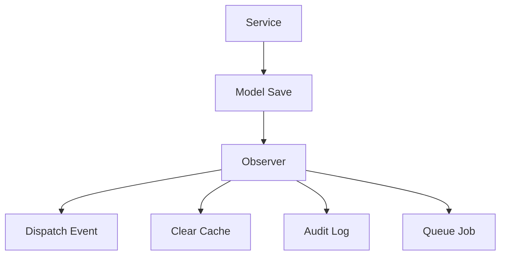

# 15. Model Observers

> **Goal:** Keep Models clean by moving model lifecycle logic into dedicated Observer classes while ensuring business workflows remain in the Service layer.

---

# Overview

Laravel provides **Model Observers** to listen for lifecycle events occurring on Eloquent models.

Instead of placing event-related logic inside Models, Observers separate these concerns into dedicated classes.

Examples:

- Generate UUIDs
- Write audit logs
- Update search indexes
- Clear cache
- Dispatch events
- Synchronize external systems

Observers make Models cleaner and easier to maintain.

---

# Why Use Observers?

Without Observers

```php
class User extends Model
{
    protected static function booted()
    {
        static::created(function ($user) {

            Mail::to($user)->send(
                new WelcomeMail()
            );

            Audit::create(...);

            Cache::forget(...);

        });
    }
}
```

Problems:

- Fat Model
- Mixed responsibilities
- Difficult testing
- Hard to maintain

Instead

```
UserObserver

↓

created()

↓

Dispatch Event

↓

Clear Cache

↓

Write Audit Log
```

---

# Observer Responsibilities

Observers should:

- React to Model events
- Generate UUIDs
- Set default values
- Clear cache
- Dispatch Events
- Update indexes
- Record audit logs

Observers should **NOT**:

- Handle HTTP requests
- Validate input
- Execute business workflows
- Return JSON
- Manage application transactions

---

# Architecture

```text
Controller
      │
      ▼
Service
      │
      ▼
Model
      │
      ▼
Observer
      │
      ▼
Event / Cache / Log
```

Observers react after Models change.

---

# Lifecycle Events

Laravel provides the following model events.

| Event | Description |
|--------|-------------|
| retrieved | Model loaded |
| creating | Before insert |
| created | After insert |
| updating | Before update |
| updated | After update |
| saving | Before create/update |
| saved | After create/update |
| deleting | Before delete |
| deleted | After delete |
| restoring | Before restore |
| restored | After restore |
| forceDeleting | Before permanent delete |
| forceDeleted | After permanent delete |

---

# Directory Structure

```text
app/
│
├── Models/
│
└── Observers/
    ├── UserObserver.php
    ├── LoanObserver.php
    ├── CustomerObserver.php
    └── PaymentObserver.php
```

---

# Creating an Observer

```bash
php artisan make:observer UserObserver --model=User
```

Generated

```text
app/

Observers/

UserObserver.php
```

---

# Basic Observer

```php
namespace App\Observers;

use App\Models\User;

class UserObserver
{
    public function created(
        User $user
    ): void
    {
        //
    }

    public function updated(
        User $user
    ): void
    {
        //
    }

    public function deleted(
        User $user
    ): void
    {
        //
    }
}
```

---

# Registering Observers

Laravel 11/12

Register in a service provider.

```php
use App\Models\User;
use App\Observers\UserObserver;

public function boot(): void
{
    User::observe(
        UserObserver::class
    );
}
```

Alternatively, use the `ObservedBy` attribute when appropriate.

```php
use App\Observers\UserObserver;
use Illuminate\Database\Eloquent\Attributes\ObservedBy;

#[ObservedBy([UserObserver::class])]
class User extends Model
{
    //
}
```

Choose one registration strategy and apply it consistently.

---

# Creating Event

```php
public function creating(
    User $user
): void {

    $user->uuid = Str::uuid();

}
```

Automatically generates UUID before insertion.

---

# Updated Event

Example

```php
public function updated(
    Loan $loan
): void {

    Cache::forget(

        "loan:{$loan->id}"

    );

}
```

---

# Deleted Event

```php
public function deleted(
    Customer $customer
): void {

    Cache::forget(

        "customer:{$customer->id}"

    );

}
```

---

# Dispatching Events

Observers may dispatch domain events.

Example

```php
public function created(
    Loan $loan
): void {

    LoanCreated::dispatch(
        $loan
    );

}
```

The Event then notifies:

- Listeners
- Jobs
- Notifications

---

# Audit Logging

Example

```php
public function updated(
    Loan $loan
): void {

    AuditLog::create([

        'user_id' => auth()->id(),

        'action' => 'Loan Updated',

        'reference_id' => $loan->id,

    ]);

}
```

Audit logging is a good Observer use case because it reacts to persistence changes.

---

# Search Indexing

Example

```php
public function saved(
    Product $product
): void {

    UpdateSearchIndexJob::dispatch(
        $product
    );

}
```

Observers integrate well with background jobs.

---

# Cache Invalidation

Example

```php
public function saved(
    User $user
): void {

    Cache::forget(

        "user:{$user->id}"

    );

}
```

---

# Multiple Events

One Observer handles all lifecycle events.

```text
UserObserver

↓

creating()

↓

created()

↓

updated()

↓

deleted()

↓

restored()
```

---

# Observer Diagram



---

# Observer vs Service

| Observer | Service |
|-----------|----------|
| Reacts to model events | Executes business workflows |
| Persistence-related actions | Business operations |
| Cache invalidation | Approval process |
| Audit logging | Interest calculation |
| Search indexing | Installment generation |

---

# Observer vs Event Listener

Observer

```text
User Saved

↓

Clear Cache
```

Listener

```text
UserRegistered Event

↓

Send Welcome Email

↓

Notify CRM

↓

Analytics
```

Use Observers for model lifecycle concerns.

Use Events for business/domain events.

---

# Business Logic

Avoid

```php
public function updated(
    Loan $loan
)
{
    $loan->approve();
}
```

Loan approval is a business workflow.

It belongs in

```
LoanService
```

---

# Notifications

Avoid

```php
Notification::send(...)
```

inside Observers for domain workflows.

Prefer

```
Observer

↓

Dispatch Event

↓

Listener

↓

Notification
```

This keeps responsibilities decoupled.

---

# Transactions

Observers execute within the lifecycle of model operations.

Be cautious when dispatching side effects before a transaction commits.

Prefer:

```php
LoanApproved::dispatch(
    $loan
)->afterCommit();
```

or configure listeners/jobs with:

```php
public bool $afterCommit = true;
```

This prevents notifications or jobs from executing if the transaction is rolled back.

---

# Infinite Loops

Avoid

```php
public function updated(
    User $user
)
{
    $user->update([
        ...
    ]);
}
```

This triggers another `updated` event.

Possible solutions:

```php
$user->saveQuietly();
```

or

```php
User::withoutEvents(function () use ($user) {

    ...

});
```

Use these techniques carefully.

---

# Performance

Keep Observers lightweight.

Good

```
Clear Cache

Dispatch Event

Generate UUID
```

Avoid

```
Large Reports

HTTP APIs

Image Processing

PDF Generation
```

Dispatch a Job instead.

---

# Testing Observers

Example

```php
Event::fake();

$user = User::factory()->create();

Event::assertDispatched(
    UserCreated::class
);
```

Test observable behavior rather than implementation details.

---

# Best Practices

- One Observer per Model.
- Keep Observers lightweight.
- Dispatch Events instead of sending notifications directly.
- Clear cache when persistence changes.
- Use Observers for audit logging.
- Register Observers centrally.
- Prefer after-commit dispatching for side effects.
- Keep business logic inside Services.

---

# Common Anti-Patterns

Avoid

```php
Mail::send(...)
```

inside Observers for business workflows.

Avoid

```php
DB::transaction(...)
```

inside Observers.

Avoid

```php
LoanService::approve(...)
```

inside Observers.

Avoid

```php
Http::post(...)
```

inside Observers.

Avoid updating the same model inside its own Observer without suppressing events.

---

# Observer Checklist

- [ ] One Observer per Model
- [ ] Registered correctly
- [ ] Handles lifecycle events only
- [ ] No business workflows
- [ ] Dispatches Events when appropriate
- [ ] Clears cache if needed
- [ ] Writes audit logs if needed
- [ ] Uses after-commit dispatching for side effects
- [ ] Avoids recursive updates
- [ ] Covered by automated tests

---

# Recommended Observer Use Cases

Use Observers for:

- UUID generation
- Slug generation
- Audit logging
- Cache invalidation
- Search indexing
- Synchronization triggers
- Dispatching domain events
- Recording metadata

Do **not** use Observers for:

- Loan approval
- Payment processing
- User registration workflows
- Report generation
- Complex business decisions

These belong in the Service layer.

---

# Summary

Model Observers provide a clean way to react to Eloquent lifecycle events without cluttering Models. They are ideal for persistence-related concerns such as cache invalidation, audit logging, UUID generation, and dispatching domain events. By keeping business workflows inside Services and using Observers only for lifecycle reactions, the application remains modular, testable, and easy to maintain.

The next chapter explores **Events and Listeners**, showing how to decouple business side effects using Laravel's event-driven architecture.