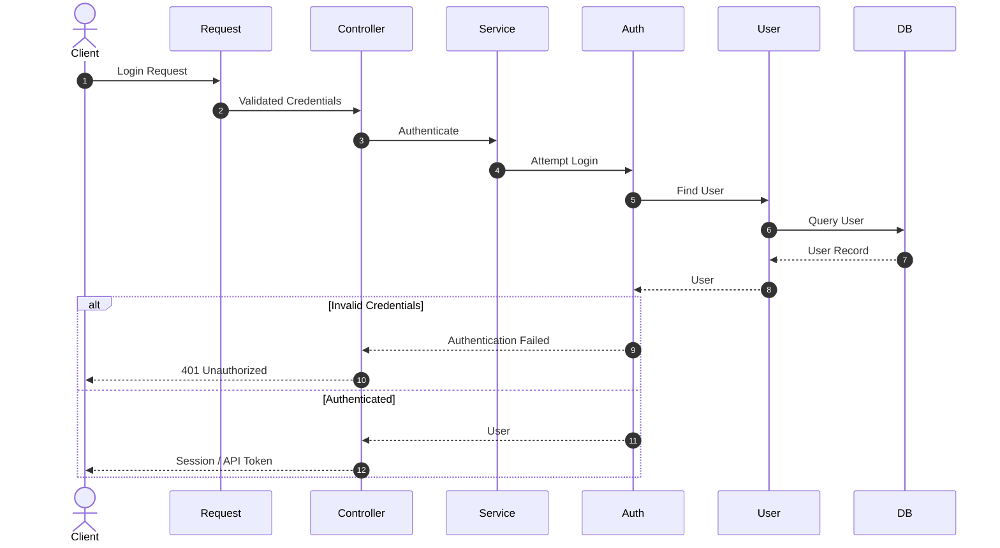
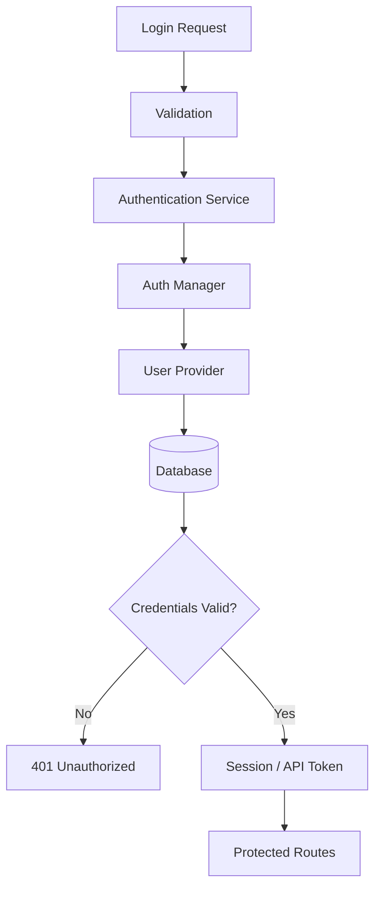

# 16. Authentication

> **Goal:** Implement secure, scalable, and maintainable authentication for both Web and API applications while keeping authentication separate from authorization and business logic.

---

# Overview

Authentication is the process of **verifying who a user is**.

It answers the question:

> **"Who are you?"**

Once a user is authenticated, Laravel can identify the current user throughout the request lifecycle.

Authentication is different from **Authorization**.

- **Authentication** → Who are you?
- **Authorization** → What are you allowed to do?

---

# Authentication Flow

```text
Client
    │
    ▼
Login Request
    │
    ▼
Validation
    │
    ▼
Authentication Service
    │
    ▼
User Provider
    │
    ▼
Database
    │
    ▼
Authenticated User
    │
    ▼
Session / Token
    │
    ▼
Protected Routes
```

---

# Authentication Architecture



---

# Authentication vs Authorization

| Authentication | Authorization |
|---------------|---------------|
| Who are you? | What can you do? |
| Login | Permissions |
| Session | Policies |
| Token | Gates |
| Identity | Access Control |

---

# Supported Authentication Methods

Laravel supports:

- Session Authentication
- Token Authentication
- API Tokens
- Personal Access Tokens
- OAuth2
- Social Login
- Multi-Factor Authentication (MFA)

---

# Common Authentication Packages

| Package | Purpose |
|----------|---------|
| Laravel Sanctum | SPA & API authentication |
| Laravel Passport | OAuth2 authentication |
| Laravel Breeze | Minimal authentication starter |
| Laravel Jetstream | Full authentication scaffolding |
| Laravel Fortify | Backend authentication services |
| Socialite | Social login (Google, GitHub, Facebook, etc.) |

---

# Recommended Authentication Strategy

| Application Type | Recommendation |
|------------------|---------------|
| Traditional Web | Session Authentication |
| Mobile API | Sanctum Personal Access Tokens |
| SPA | Sanctum |
| Third-party API | Passport (OAuth2) |
| Enterprise SSO | OAuth / SAML Integration |

---

# Directory Structure

```text
app/
│
├── Http/
│   ├── Controllers/
│   │   └── Auth/
│   │
│   ├── Middleware/
│   │
│   └── Requests/
│
├── Models/
│   └── User.php
│
├── Services/
│   └── AuthenticationService.php
│
└── Policies/
```

---

# User Model

Laravel authenticates users through the `Authenticatable` model.

Example

```php
namespace App\Models;

use Illuminate\Foundation\Auth\User as Authenticatable;

class User extends Authenticatable
{
    //
}
```

---

# Password Hashing

Never store plain-text passwords.

Good

```php
Hash::make(
    $password
);
```

Verify

```php
Hash::check(
    $password,
    $user->password
);
```

Laravel automatically uses a secure hashing algorithm.

---

# Login Request

Use a Form Request.

```php
class LoginRequest extends FormRequest
{
    public function rules(): array
    {
        return [

            'email' => [

                'required',

                'email',

            ],

            'password' => [

                'required',

            ],

        ];
    }
}
```

---

# Authentication Service

Business logic belongs in a Service.

```php
class AuthenticationService
{
    public function login(
        array $credentials
    ): bool {

        return Auth::attempt(
            $credentials
        );

    }
}
```

Controller

```php
public function login(
    LoginRequest $request
)
{
    $this->service->login(
        $request->validated()
    );

    return response()->json([
        'message' => 'Authenticated.'
    ]);
}
```

---

# Web Authentication

Session-based authentication.

```php
Auth::attempt([

    'email' => $email,

    'password' => $password,

]);
```

Logout

```php
Auth::logout();
```

Invalidate session

```php
$request->session()->invalidate();

$request->session()->regenerateToken();
```

---

# Session Security

After successful login

```php
$request->session()->regenerate();
```

This protects against session fixation attacks.

---

# API Authentication (Sanctum)

Generate token

```php
$token = $user
    ->createToken(
        'mobile-app'
    )
    ->plainTextToken;
```

Response

```json
{
    "token": "..."
}
```

Protect routes

```php
Route::middleware('auth:sanctum')
    ->group(function () {

        ...

    });
```

---

# Getting Authenticated User

```php
auth()->user();
```

or

```php
Auth::user();
```

or

```php
$request->user();
```

Use dependency injection where appropriate.

---

# Route Protection

```php
Route::middleware([

    'auth'

])->group(function () {

    ...

});
```

API

```php
Route::middleware([

    'auth:sanctum'

])->group(function () {

    ...

});
```

---

# Multiple Guards

Example

```php
guards

↓

web

admin

api

partner
```

Configuration

```php
config/auth.php
```

Use

```php
Auth::guard(
    'admin'
);
```

---

# Email Verification

Laravel provides email verification.

```php
implements MustVerifyEmail
```

Middleware

```php
verified
```

Route

```php
Route::middleware([

    'auth',

    'verified'

]);
```

---

# Password Reset

Laravel provides password reset functionality.

Flow

```text
Forgot Password

↓

Email Link

↓

Reset Form

↓

New Password
```

Passwords should always be hashed before storage.

---

# Remember Me

```php
Auth::attempt(

    $credentials,

    remember: true

);
```

Laravel manages the remember token automatically.

---

# Two-Factor Authentication

Recommended for:

- Admin users
- Financial systems
- Back-office users

Supported by:

- Jetstream
- Fortify

Flow

```text
Username

↓

Password

↓

OTP

↓

Authenticated
```

---

# Login Throttling

Prevent brute-force attacks.

Example

```php
RateLimiter::for('login', ...);
```

or use middleware.

Example

```
throttle:5,1
```

Five attempts per minute.

---

# Logout

Web

```php
Auth::logout();

$request->session()->invalidate();

$request->session()->regenerateToken();
```

API

```php
$request->user()

    ->currentAccessToken()

    ->delete();
```

Logout should invalidate the current session or token.

---

# Authentication Diagram



---

# Best Practices

- Always hash passwords.
- Use Form Requests for login validation.
- Keep authentication logic inside Services.
- Regenerate sessions after login.
- Protect routes with middleware.
- Use Sanctum for APIs.
- Enable email verification where appropriate.
- Enable rate limiting.
- Use HTTPS.
- Consider MFA for sensitive systems.

---

# Common Anti-Patterns

Avoid

```php
User::where(
    'email',
    ...
);
```

inside Controllers for authentication.

Avoid

```php
$password == $user->password
```

Always use hashing.

Avoid storing passwords in logs.

Avoid creating tokens manually.

Avoid implementing custom authentication unless absolutely necessary.

---

# Authentication Checklist

- [ ] Passwords hashed
- [ ] Login validated by Form Request
- [ ] Sessions regenerated
- [ ] API protected by Sanctum
- [ ] Logout invalidates session/token
- [ ] Email verification enabled if required
- [ ] Rate limiting configured
- [ ] HTTPS enforced
- [ ] MFA considered for privileged users
- [ ] Authentication logic isolated from Controllers

---

# Authentication vs Authorization Flow

```text
Login

↓

Authentication

↓

Authenticated User

↓

Authorization (Policies/Gates)

↓

Business Logic

↓

Response
```

Authentication always happens before authorization.

---

# Summary

Authentication establishes the identity of the current user and should remain isolated from business logic. By using Laravel's built-in authentication features, secure password hashing, session regeneration, API token management with Sanctum, and proper middleware protection, applications can provide a secure foundation for both web and API clients.

The next chapter explores **Authorization**, including Policies, Gates, Roles, Permissions, and access control best practices.