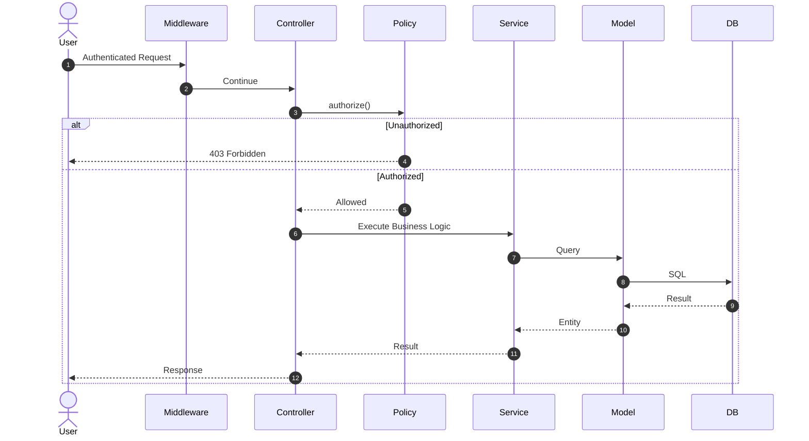
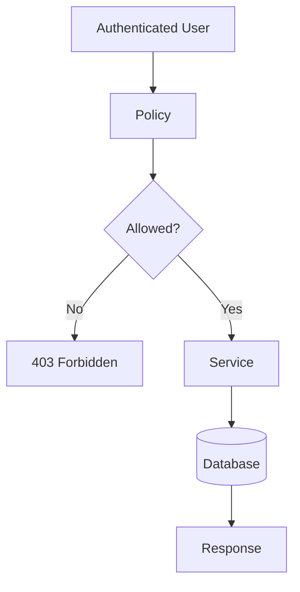

# 17. Authorization

> **Goal:** Implement a centralized, scalable, and maintainable authorization system using Policies, Gates, Roles, and Permissions while keeping authorization separate from authentication and business logic.

---

# Overview

Authorization determines **what an authenticated user is allowed to do**.

It answers the question:

> **"Can this user perform this action?"**

Authorization happens **after authentication**.

Example:

```text
Login

↓

Authenticated User

↓

Can approve loan?

↓

Yes / No
```

Laravel provides several authorization mechanisms:

- Policies
- Gates
- Middleware
- Custom Permission Systems

For enterprise applications, **Policies** should be the primary authorization mechanism.

---

# Authentication vs Authorization

| Authentication | Authorization |
|---------------|---------------|
| Who are you? | What are you allowed to do? |
| Login | Permission check |
| Session | Policy |
| Token | Gate |
| Identity | Access Control |

---

# Authorization Flow

```text
HTTP Request
      │
      ▼
Authentication
      │
      ▼
Policy / Gate
      │
      ▼
Service
      │
      ▼
Database
```

Authorization should happen **before** executing business logic.

---

# Authorization Architecture



---

# Authorization Layers

Laravel supports authorization at different layers.

```text
Middleware

↓

Policies

↓

Gates

↓

Business Logic
```

Recommended priority:

1. Middleware
2. Policies
3. Gates
4. Custom Permission Services (only when necessary)

---

# Directory Structure

```text
app/
│
├── Policies/
│   ├── UserPolicy.php
│   ├── LoanPolicy.php
│   ├── CustomerPolicy.php
│   └── PaymentPolicy.php
│
├── Providers/
│   └── AuthServiceProvider.php
│
└── Http/
    └── Middleware/
```

---

# Policies

Policies organize authorization logic for a model.

Example

```
Loan

↓

LoanPolicy
```

Contains

```
view()

create()

update()

delete()

approve()

reject()
```

---

# Creating a Policy

```bash
php artisan make:policy LoanPolicy --model=Loan
```

Generated

```text
app/

Policies/

LoanPolicy.php
```

---

# Basic Policy

```php
class LoanPolicy
{
    public function view(
        User $user,
        Loan $loan
    ): bool {

        return $user->company_id
            === $loan->company_id;

    }
}
```

---

# Registering Policies

Laravel 11/12 supports automatic policy discovery when models and policies follow standard naming conventions.

If manual registration is required, register policies in `AuthServiceProvider`.

```php
protected $policies = [

    Loan::class => LoanPolicy::class,

];
```

---

# Using Policies

Controller

```php
public function show(
    Loan $loan
)
{
    $this->authorize(
        'view',
        $loan
    );

    return LoanResource::make($loan);
}
```

If unauthorized

Laravel returns

```http
403 Forbidden
```

automatically.

---

# Policy Methods

Typical methods

```text
viewAny()

view()

create()

update()

delete()

restore()

forceDelete()
```

Business-specific

```text
approve()

reject()

assign()

cancel()
```

---

# Example

```php
public function approve(
    User $user,
    Loan $loan
): bool {

    return $user->canApproveLoans();

}
```

---

# Route Authorization

Laravel supports

```php
Route::resource(...)

↓

authorizeResource()
```

Controller

```php
public function __construct()
{
    $this->authorizeResource(
        Loan::class,
        'loan'
    );
}
```

Laravel automatically calls policy methods.

---

# Gates

Gates authorize actions not tied to a model.

Example

```php
Gate::define(

    'view-dashboard',

    function (User $user) {

        return $user->isAdmin();

    }

);
```

Usage

```php
Gate::allows(
    'view-dashboard'
);
```

---

# Middleware Authorization

Example

```php
Route::middleware([

    'auth',

    'can:view,loan'

]);
```

or

```php
Route::middleware([

    'permission:loan.view'

]);
```

when using a permission package.

---

# Roles and Permissions

Typical hierarchy

```text
User

↓

Role

↓

Permissions
```

Example

```
Admin

↓

Create Users

Delete Users

Approve Loans
```

```
Manager

↓

Approve Loans

View Reports
```

---

# Database Structure

```text
users

roles

permissions

role_user

permission_role
```

Or use a package like **spatie/laravel-permission**.

---

# Example Permission

```text
loan.view

loan.create

loan.update

loan.delete

loan.approve

loan.reject
```

Permission names should follow a consistent convention.

---

# Super Administrator

Example

```php
public function before(
    User $user,
    string $ability
): bool|null {

    return $user->isSuperAdmin()

        ? true

        : null;

}
```

All permissions are automatically granted.

---

# Authorization in Services?

Avoid

```php
if(auth()->user()->...)
```

inside Services.

Authorization belongs before business logic.

Services should receive only authorized requests.

If a Service may be called outside HTTP (Jobs, Commands, APIs), pass the acting user explicitly and perform domain authorization where appropriate.

---

# Authorization Diagram



---

# Multiple Policies

Example

```text
UserPolicy

LoanPolicy

CustomerPolicy

OrderPolicy

PaymentPolicy
```

One policy per model.

---

# Business Rules vs Authorization

Authorization

```
Can approve?
```

Business Logic

```
Approve loan
```

Do not mix them.

Example

Policy

```php
return $user->hasPermission(
    'loan.approve'
);
```

Service

```php
$loan->status = APPROVED;
```

---

# API Authorization

API

```php
Route::middleware([

    'auth:sanctum'

]);
```

Controller

```php
$this->authorize(

    'update',

    $loan

);
```

Works exactly the same as Web.

---

# Best Practices

- One Policy per Model.
- Keep authorization inside Policies.
- Use Gates for non-model actions.
- Use middleware for route protection.
- Keep Services authorization-agnostic where possible.
- Use permission names consistently.
- Prefer automatic policy discovery.
- Use a Super Admin override carefully.
- Return 403 for forbidden access.
- Keep Policies focused and readable.

---

# Common Anti-Patterns

Avoid

```php
if(auth()->user()->role=="Admin")
```

inside Controllers.

Avoid

```php
if(Auth::id()==...)
```

inside Services.

Avoid checking permissions in Blade templates only.

Always protect the backend.

Avoid duplicating permission logic across Controllers.

---

# Authorization Checklist

- [ ] Authentication required
- [ ] Policy created
- [ ] Policy discovered or registered
- [ ] Controller calls `authorize()`
- [ ] Middleware protects routes
- [ ] Gates used only when appropriate
- [ ] Roles and permissions standardized
- [ ] Super Admin handled consistently
- [ ] Services free of HTTP authorization logic
- [ ] Policies covered by tests

---

# Enterprise Permission Naming

Recommended format

```text
user.view

user.create

user.update

user.delete

loan.view

loan.create

loan.update

loan.delete

loan.approve

loan.reject

customer.view

customer.create

customer.update

payment.view

payment.create
```

Use lowercase with dot notation for consistency.

---

# Testing Policies

Example

```php
it('allows managers to approve loans', function () {

    $manager = User::factory()
        ->manager()
        ->create();

    $loan = Loan::factory()->create();

    expect(

        $manager->can(
            'approve',
            $loan
        )

    )->toBeTrue();

});
```

Authorization should be covered by automated tests.

---

# Summary

Authorization ensures that authenticated users can perform only the actions they are permitted to execute. By centralizing access control in Policies, using Gates for non-model abilities, and protecting routes with middleware, Laravel applications remain secure, maintainable, and easy to evolve.

Business workflows belong in Services, while authorization decisions belong in Policies. Keeping these concerns separate results in a clean, predictable architecture.

The next chapter explores **Middleware**, covering request pipelines, authentication, rate limiting, localization, tenant resolution, and custom middleware design.