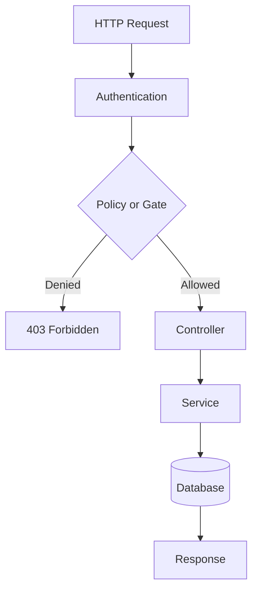
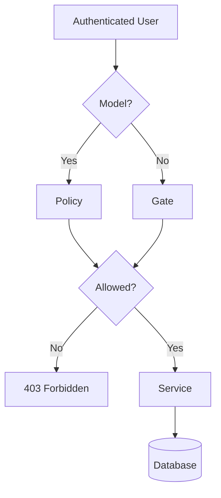

# 18. Policies and Gates

> **Goal:** Understand when to use Policies and when to use Gates, implement authorization consistently across the application, and keep authorization logic centralized and maintainable.

---

# Overview

Laravel provides two primary authorization mechanisms:

* **Policies**
* **Gates**

Both determine whether an authenticated user can perform a specific action.

The difference is **what they protect**.

| Feature                         | Policies | Gates |
| ------------------------------- | -------- | ----- |
| Model-based authorization       | ✅        | ❌     |
| General application permissions | ❌        | ✅     |
| CRUD operations                 | ✅        | ❌     |
| Dashboard access                | ❌        | ✅     |
| Feature toggles                 | ❌        | ✅     |
| Resource ownership              | ✅        | ❌     |

---

# Authorization Flow

```text
Authenticated User
        │
        ▼
Middleware (auth)
        │
        ▼
Policy / Gate
        │
        ▼
Service Layer
        │
        ▼
Business Logic
        │
        ▼
Response
```

Authorization should always occur **before** business logic executes.

---

# Architecture



---

# When to Use Policies

Policies should be used whenever authorization involves a Model.

Examples

* View User
* Update Customer
* Delete Product
* Approve Loan
* Reject Application
* Edit Payment

Example

```php
$this->authorize(
    'update',
    $user
);
```

Laravel automatically resolves:

```
UserPolicy::update()
```

---

# When to Use Gates

Gates are designed for actions that are **not tied to a specific Model**.

Examples

* Access Dashboard
* Access Reports
* View Analytics
* System Maintenance
* Export Data
* Manage Settings

Example

```php
Gate::allows('view-dashboard');
```

---

# Decision Guide

```
Does authorization involve a Model?

        │
   Yes ─────► Policy

        │
        No

        ▼

       Gate
```

---

# Policies Directory

```text
app/

Policies/

UserPolicy.php

LoanPolicy.php

CustomerPolicy.php

OrderPolicy.php

PaymentPolicy.php
```

One policy per model.

---

# Gates Registration

Gates are typically defined in `AppServiceProvider` (or `AuthServiceProvider` if your project uses one).

Example

```php
use Illuminate\Support\Facades\Gate;

public function boot(): void
{
    Gate::define(

        'view-dashboard',

        function (User $user) {

            return $user->is_admin;

        }

    );
}
```

---

# Creating Policies

```bash
php artisan make:policy LoanPolicy --model=Loan
```

Generated

```text
app/

Policies/

LoanPolicy.php
```

---

# Example Policy

```php
namespace App\Policies;

use App\Models\User;
use App\Models\Loan;

class LoanPolicy
{
    public function view(
        User $user,
        Loan $loan
    ): bool {

        return $loan->company_id
            === $user->company_id;

    }

    public function update(
        User $user,
        Loan $loan
    ): bool {

        return $user->hasPermission(
            'loan.update'
        );

    }

    public function delete(
        User $user,
        Loan $loan
    ): bool {

        return $user->isSuperAdmin();

    }
}
```

---

# Policy Methods

Laravel automatically recognizes common methods.

```text
viewAny()

view()

create()

update()

delete()

restore()

forceDelete()
```

Business-specific methods

```text
approve()

reject()

assign()

cancel()

verify()
```

---

# Registering Policies

Laravel automatically discovers Policies when naming conventions are followed.

If manual registration is required:

```php
protected $policies = [

    Loan::class => LoanPolicy::class,

];
```

---

# Controller Authorization

Example

```php
public function update(
    UpdateLoanRequest $request,
    Loan $loan
)
{
    $this->authorize(
        'update',
        $loan
    );

    $loan = $this->service->update(
        $loan,
        $request->validated()
    );

    return LoanResource::make($loan);
}
```

---

# Resource Authorization

Automatically authorize resource methods.

```php
public function __construct()
{
    $this->authorizeResource(
        Loan::class,
        'loan'
    );
}
```

Laravel maps:

```
index

↓

viewAny()

store

↓

create()

show

↓

view()

update

↓

update()

destroy

↓

delete()
```

---

# Route Middleware

Authorization can also be performed through middleware.

Policy

```php
Route::middleware([

    'can:view,loan'

]);
```

Gate

```php
Route::middleware([

    'can:view-dashboard'

]);
```

---

# Blade Directives

Show content conditionally.

```blade
@can('update', $loan)

<button>Edit</button>

@endcan
```

```blade
@cannot('delete', $loan)

<p>No permission.</p>

@endcannot
```

---

# Checking Permissions

Example

```php
if (

    Gate::allows(
        'view-dashboard'
    )

) {

    ...

}
```

Deny

```php
Gate::denies(
    'view-dashboard'
);
```

---

# Authorize Helper

Controller

```php
$this->authorize(
    'approve',
    $loan
);
```

Laravel automatically throws

```
403 Forbidden
```

when authorization fails.

---

# Gate Example

```php
Gate::define(

    'manage-settings',

    function (User $user) {

        return $user->is_admin;

    }

);
```

Usage

```php
if (

    Gate::allows(
        'manage-settings'
    )

) {

    ...

}
```

---

# Before Hook

Grant full access to Super Administrators.

```php
Gate::before(

    function (

        User $user,

        string $ability

    ) {

        return $user->isSuperAdmin()

            ? true

            : null;

    }

);
```

This executes before every authorization check.

---

# After Hook

Useful for auditing.

```php
Gate::after(

    function (

        User $user,

        string $ability,

        bool $result

    ) {

        //

    }

);
```

---

# Roles and Permissions

Most enterprise applications use:

```
User

↓

Role

↓

Permission
```

Example

```
Administrator

↓

loan.view

loan.create

loan.update

loan.delete

loan.approve
```

---

# Permission Naming

Recommended

```text
user.view

user.create

user.update

user.delete

loan.view

loan.create

loan.update

loan.delete

loan.approve

loan.reject

customer.view

customer.update
```

Keep naming consistent.

---

# Policy vs Gate

Policy

```php
$this->authorize(
    'update',
    $loan
);
```

Gate

```php
Gate::authorize(
    'view-dashboard'
);
```

---

# Authorization Diagram



---

# Best Practices

* Use Policies for model authorization.
* Use Gates for application-wide permissions.
* Keep authorization out of Controllers.
* Never duplicate authorization logic.
* Use middleware where possible.
* Keep Policy methods small.
* Use meaningful permission names.
* Test every Policy and Gate.
* Keep business logic inside Services.
* Use Super Admin overrides carefully.

---

# Common Anti-Patterns

Avoid

```php
if ($user->role == 'Admin')
```

throughout Controllers.

Avoid

```php
if (auth()->id() == ...)
```

inside Services.

Avoid mixing authorization with business logic.

Avoid checking permissions only in the frontend.

Backend authorization is always required.

---

# Policies & Gates Checklist

* [ ] Policies used for Models
* [ ] Gates used for non-model actions
* [ ] Policies automatically discovered or registered
* [ ] Routes protected by middleware
* [ ] Controllers call `authorize()`
* [ ] Super Admin handled consistently
* [ ] Permission names standardized
* [ ] No authorization logic inside Services
* [ ] Backend authorization enforced
* [ ] Policies and Gates covered by automated tests

---

# Summary

Policies and Gates are the foundation of Laravel's authorization system. Policies protect model-specific operations, while Gates secure application-level features that are not tied to a model. By centralizing authorization logic, applications become more secure, easier to maintain, and simpler to extend.

The next chapter explores **Middleware**, explaining how requests pass through Laravel's middleware pipeline for authentication, authorization, rate limiting, localization, tenant resolution, logging, and request preprocessing.
