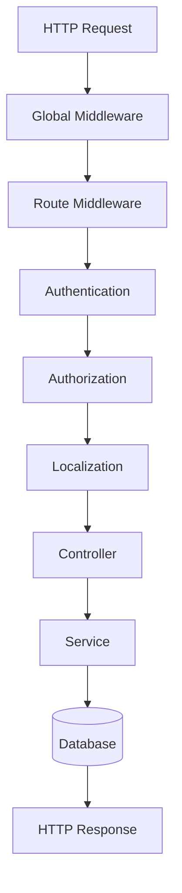
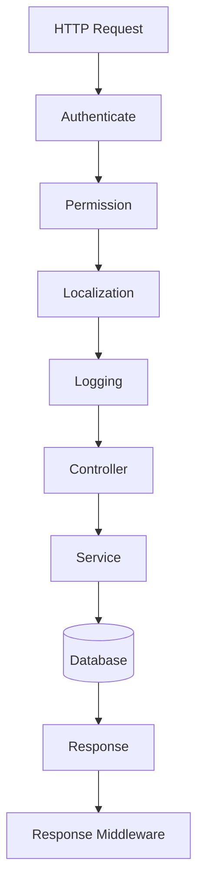

# 19. Middleware

> **Goal:** Build a clean, reusable, and maintainable request pipeline by leveraging Laravel Middleware for cross-cutting concerns such as authentication, authorization, rate limiting, localization, tenant resolution, logging, and request preprocessing.

---

# Overview

Middleware acts as a filter between an incoming HTTP request and your application's Controllers.

Every request passes through one or more middleware before reaching the Controller.

Middleware is ideal for handling concerns that apply across multiple routes without duplicating code.

Typical responsibilities include:

* Authentication
* Authorization
* Rate Limiting
* Logging
* Localization
* Tenant Resolution
* Maintenance Mode
* CORS
* Security Headers
* Request Transformation

---

# Request Pipeline

```text
Client
    │
    ▼
Global Middleware
    │
    ▼
Route Middleware
    │
    ▼
Controller
    │
    ▼
Service
    │
    ▼
Model
    │
    ▼
Database
```

Every request follows this pipeline.

---

# Middleware Architecture



---

# Middleware Responsibilities

Middleware should:

* Authenticate users
* Authorize requests
* Log requests
* Set application locale
* Validate tenant context
* Add security headers
* Throttle requests
* Modify requests
* Modify responses

Middleware should **NOT**:

* Execute business logic
* Save business data
* Send emails
* Process payments
* Generate reports
* Query unrelated models

---

# Middleware Types

Laravel supports three middleware types.

| Type              | Description                  |
| ----------------- | ---------------------------- |
| Global Middleware | Runs on every request        |
| Route Middleware  | Runs only on selected routes |
| Middleware Groups | Collection of middleware     |

---

# Global Middleware

Global middleware executes for every request.

Examples:

* Trust Proxies
* Handle CORS
* Maintenance Mode
* Trim Strings
* Convert Empty Strings to Null

Configured in Laravel's application bootstrap.

---

# Route Middleware

Route middleware executes only for selected routes.

Example

```php
Route::middleware([
    'auth'
])->group(function () {

    //
});
```

---

# Middleware Groups

Example

```php
Route::middleware([

    'auth',

    'verified',

    'permission:loan.view'

])->group(function () {

    //

});
```

Middleware executes in order.

---

# Middleware Directory

```text
app/
└── Http/
    └── Middleware/
        ├── Authenticate.php
        ├── CheckPermission.php
        ├── SetLocale.php
        ├── TenantMiddleware.php
        ├── LogRequest.php
        └── ForceJsonResponse.php
```

---

# Creating Middleware

```bash
php artisan make:middleware CheckPermission
```

Generated

```text
app/

Http/

Middleware/

CheckPermission.php
```

---

# Basic Middleware

```php
namespace App\Http\Middleware;

use Closure;
use Illuminate\Http\Request;

class CheckPermission
{
    public function handle(
        Request $request,
        Closure $next
    ) {
        return $next($request);
    }
}
```

Every middleware must return:

```php
return $next($request);
```

---

# Authentication Middleware

Example

```php
public function handle(
    Request $request,
    Closure $next
)
{
    if (! auth()->check()) {

        abort(401);

    }

    return $next($request);
}
```

Normally Laravel's built-in authentication middleware should be used.

---

# Permission Middleware

Example

```php
public function handle(
    Request $request,
    Closure $next,
    string $permission
)
{
    if (

        ! auth()->user()
            ->can($permission)

    ) {

        abort(403);

    }

    return $next($request);
}
```

Route

```php
Route::middleware(

    'permission:loan.approve'

);
```

---

# Localization Middleware

Example

```php
public function handle(
    Request $request,
    Closure $next
)
{
    app()->setLocale(

        $request->header(
            'Accept-Language',
            config('app.locale')
        )

    );

    return $next($request);
}
```

Useful for multilingual applications.

---

# Tenant Middleware

Multi-tenant applications often determine the tenant before the Controller executes.

Example

```text
Request

↓

TenantMiddleware

↓

Current Tenant

↓

Controller
```

Example

```php
$tenant = Tenant::where(

    'domain',

    $request->getHost()

)->firstOrFail();
```

The tenant context can then be shared across the application.

---

# Logging Middleware

Example

```php
public function handle(
    Request $request,
    Closure $next
)
{
    Log::info('Incoming Request', [

        'url' => $request->fullUrl(),

        'ip' => $request->ip(),

    ]);

    return $next($request);
}
```

Useful for:

* Auditing
* Debugging
* Security

---

# Force JSON Responses

Useful for APIs.

```php
public function handle(
    Request $request,
    Closure $next
)
{
    $request->headers->set(

        'Accept',

        'application/json'

    );

    return $next($request);
}
```

---

# Response Middleware

Middleware may modify outgoing responses.

Example

```php
$response = $next($request);

$response->headers->set(

    'X-App-Version',

    config('app.version')

);

return $response;
```

---

# Rate Limiting

Protect APIs against abuse.

Example

```php
Route::middleware(

    'throttle:60,1'

);
```

Meaning

```
60 requests

per minute
```

---

# CORS

Laravel provides built-in CORS support.

Typical configuration

```text
config/cors.php
```

Never disable CORS security without understanding the implications.

---

# HTTPS Enforcement

Example

```php
if (! $request->secure()) {

    return redirect()->secure(

        $request->getRequestUri()

    );

}
```

Alternatively, configure HTTPS at the web server or reverse proxy.

---

# Middleware Parameters

Middleware accepts parameters.

Example

```php
Route::middleware(

    'role:admin'

);
```

Middleware

```php
public function handle(

    Request $request,

    Closure $next,

    string $role

)
{
    ...

    return $next($request);
}
```

---

# Middleware Order

Execution order matters.

```text
Authenticate

↓

Tenant

↓

Permission

↓

Localization

↓

Controller
```

Incorrect ordering may produce unexpected behavior.

---

# Middleware Diagram



---

# Middleware vs Controller

| Middleware     | Controller          |
| -------------- | ------------------- |
| Authentication | Handle HTTP request |
| Authorization  | Call Services       |
| Localization   | Return Resources    |
| Logging        | Return Views        |
| Security       | HTTP Responses      |

---

# Middleware vs Service

| Middleware             | Service          |
| ---------------------- | ---------------- |
| Cross-cutting concerns | Business logic   |
| Request filtering      | Domain workflows |
| Security               | Transactions     |
| Localization           | Notifications    |
| Request transformation | Calculations     |

---

# Middleware vs Policies

| Middleware             | Policy               |
| ---------------------- | -------------------- |
| Route-level protection | Model authorization  |
| Authentication         | Ownership checks     |
| Rate limiting          | CRUD permissions     |
| Localization           | Business permissions |

---

# Registering Middleware

Laravel 11/12 registers middleware in `bootstrap/app.php`.

Example

```php
->withMiddleware(function ($middleware) {

    $middleware->alias([

        'permission' => CheckPermission::class,

        'tenant' => TenantMiddleware::class,

    ]);

})
```

---

# Best Practices

* Keep middleware focused.
* One responsibility per middleware.
* Return `$next($request)` exactly once.
* Keep middleware lightweight.
* Use middleware for cross-cutting concerns only.
* Use Policies for authorization.
* Use Services for business logic.
* Log only useful information.
* Keep middleware reusable.
* Document middleware parameters.

---

# Common Anti-Patterns

Avoid

```php
Loan::create(...)
```

inside middleware.

Avoid

```php
Mail::send(...)
```

inside middleware.

Avoid

```php
PaymentService::pay(...)
```

inside middleware.

Avoid long-running database operations.

Avoid business workflows.

Middleware is part of the HTTP pipeline—not the business layer.

---

# Middleware Checklist

* [ ] One responsibility per middleware
* [ ] Registered correctly
* [ ] Returns `$next($request)`
* [ ] No business logic
* [ ] No database workflows
* [ ] Reusable across routes
* [ ] Lightweight
* [ ] Parameters documented
* [ ] Tested independently
* [ ] Ordered correctly

---

# Recommended Middleware

A typical enterprise Laravel application may include:

```text
Authenticate

CheckPermission

CheckRole

SetLocale

TenantMiddleware

ForceJsonResponse

LogRequest

SecurityHeaders

VerifyApiVersion

RequestId

EnsureCompanySelected
```

Each middleware should solve one specific problem.

---

# Summary

Middleware forms Laravel's HTTP request pipeline, handling cross-cutting concerns before requests reach Controllers. By keeping middleware focused on authentication, authorization, localization, logging, request transformation, and security, Controllers remain clean and business logic stays inside the Service layer.

A well-designed middleware pipeline improves security, consistency, and maintainability while making request processing predictable and reusable.

The next chapter explores **Events and Listeners**, covering event-driven architecture, domain events, asynchronous processing, and decoupled application design.
