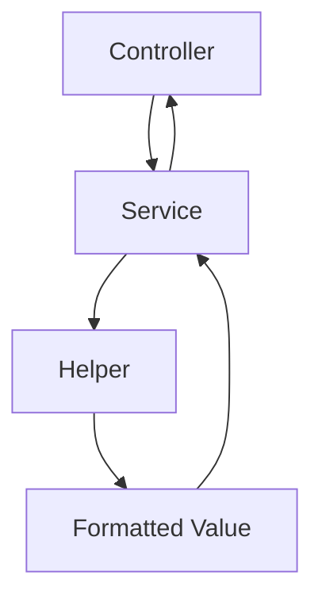

# 20. Helpers

> **Goal:** Create reusable, framework-independent utility functions while keeping business logic inside Services and avoiding code duplication throughout the application.

---

# Overview

Helpers are small, reusable functions that perform common tasks used across multiple parts of the application.

They simplify repetitive code and improve readability.

Examples:

* Currency formatting
* Date formatting
* UUID generation
* Phone number normalization
* File URL generation
* String manipulation
* Number formatting

Helpers should remain **stateless** and **side-effect free** whenever possible.

---

# Architecture

```text
Controller
      │
      ▼
Service
      │
      ▼
Helper
      │
      ▼
Utility Result
```

Helpers support application layers but do not replace Services.

---

# Helper Responsibilities

Helpers should:

* Format values
* Normalize data
* Convert units
* Build URLs
* Parse strings
* Generate identifiers
* Perform small calculations
* Encapsulate common utility functions

Helpers should **NOT**:

* Execute business workflows
* Perform authorization
* Query the database
* Send emails
* Dispatch jobs
* Manage transactions
* Return HTTP responses

---

# Directory Structure

```text
app/
├── Helpers/
│   ├── StringHelper.php
│   ├── MoneyHelper.php
│   ├── DateHelper.php
│   ├── PhoneHelper.php
│   ├── FileHelper.php
│   └── UrlHelper.php
│
bootstrap/
└── helpers.php
```

For larger projects, group helpers by responsibility instead of placing hundreds of functions in a single file.

---

# Recommended Organization

```text
app/
└── Helpers/
    ├── CommonHelper.php
    ├── CurrencyHelper.php
    ├── DateHelper.php
    ├── NumberHelper.php
    ├── PhoneHelper.php
    ├── StorageHelper.php
    ├── StringHelper.php
    └── UrlHelper.php
```

---

# Registering Helpers

Add the helper file to Composer.

```json
{
    "autoload": {
        "files": [
            "bootstrap/helpers.php"
        ]
    }
}
```

Refresh Composer.

```bash
composer dump-autoload
```

---

# Example Helper

```php
if (! function_exists('format_money')) {

    function format_money(
        float $amount
    ): string {

        return number_format(
            $amount,
            2,
            '.',
            ','
        );

    }

}
```

Usage

```php
format_money(150000.5);
```

Output

```text
150,000.50
```

---

# Phone Number Helper

Example

```php
if (! function_exists('normalize_phone')) {

    function normalize_phone(
        string $phone
    ): string {

        $phone = preg_replace(
            '/\D/',
            '',
            $phone
        );

        if (str_starts_with($phone, '0')) {

            return '255' . substr($phone, 1);

        }

        return $phone;

    }

}
```

Usage

```php
normalize_phone(
    '0712345678'
);
```

Result

```text
255712345678
```

---

# Date Helper

```php
function format_date(
    $date
): string {

    return $date->format(
        'd/m/Y'
    );

}
```

---

# Currency Helper

```php
function currency(
    float $amount
): string {

    return 'TZS ' .

        number_format(
            $amount,
            2
        );

}
```

---

# UUID Helper

Laravel already provides:

```php
Str::uuid();
```

Avoid creating duplicate helpers for functionality already provided by Laravel.

---

# URL Helper

```php
function asset_url(
    string $path
): string {

    return asset(
        "storage/{$path}"
    );

}
```

---

# String Helper

```php
function initials(
    string $name
): string {

    return collect(
        explode(' ', $name)
    )

    ->map(fn ($part) => strtoupper($part[0]))

    ->implode('');

}
```

Usage

```php
initials(
    'John Doe'
);
```

Output

```text
JD
```

---

# File Helper

```php
function storage_url(
    string $path
): string {

    return Storage::url(
        $path
    );

}
```

---

# Number Helper

```php
function percentage(
    float $value,
    float $total
): float {

    if ($total == 0) {

        return 0;

    }

    return ($value / $total) * 100;

}
```

---

# Enum Helper

Instead of hardcoding labels throughout the application.

```php
function loan_status_label(
    LoanStatus $status
): string {

    return match ($status) {

        LoanStatus::PENDING => 'Pending',

        LoanStatus::APPROVED => 'Approved',

        LoanStatus::REJECTED => 'Rejected',

    };

}
```

---

# Configuration Helper

Prefer Laravel's built-in helper.

```php
config(
    'app.name'
);
```

Do not wrap existing framework helpers unnecessarily.

---

# Using Helpers

Controllers

```php
return currency(
    $loan->amount
);
```

Services

```php
$phone = normalize_phone(
    $customer->phone
);
```

Resources

```php
'amount' => currency(
    $this->amount
)
```

Helpers are available everywhere after autoloading.

---

# Helper Diagram



---

# Helper vs Service

| Helper                  | Service           |
| ----------------------- | ----------------- |
| Stateless utility       | Business logic    |
| Formatting              | Workflow          |
| Conversion              | Transactions      |
| Parsing                 | Notifications     |
| Small reusable function | Domain operations |

---

# Helper vs Trait

| Helper          | Trait                 |
| --------------- | --------------------- |
| Global function | Shared class behavior |
| No object state | Works inside classes  |
| Utility         | Reusable methods      |
| Independent     | Requires a class      |

---

# Helper vs Model

| Helper     | Model           |
| ---------- | --------------- |
| Formatting | Persistence     |
| Conversion | Relationships   |
| Utility    | Query scopes    |
| Stateless  | Database access |

---

# Best Practices

* Keep helpers small.
* One responsibility per helper.
* Keep helpers stateless.
* Prefer pure functions.
* Group helpers by domain.
* Use descriptive names.
* Reuse Laravel's built-in helpers where possible.
* Document helper parameters and return types.
* Write unit tests for non-trivial helpers.

---

# Common Anti-Patterns

Avoid

```php
User::create(...)
```

inside helpers.

Avoid

```php
Mail::send(...)
```

inside helpers.

Avoid

```php
DB::table(...)
```

inside helpers.

Avoid

```php
Notification::send(...)
```

inside helpers.

Avoid placing business logic inside helper functions.

Helpers are utilities—not Services.

---

# Recommended Helpers

Common helpers found in enterprise applications:

```text
format_money()

currency()

normalize_phone()

format_date()

storage_url()

asset_url()

percentage()

initials()

slugify()

truncate()

mask_email()

mask_phone()

generate_reference()
```

Only add helpers that are reused across multiple modules.

---

# Testing Helpers

Example

```php
it('formats money correctly', function () {

    expect(

        format_money(12345.5)

    )->toBe('12,345.50');

});
```

Pure helper functions are simple to unit test.

---

# Helper Checklist

* [ ] One responsibility
* [ ] Stateless
* [ ] No business logic
* [ ] No database access
* [ ] No HTTP logic
* [ ] Reusable
* [ ] Properly autoloaded
* [ ] Documented
* [ ] Tested
* [ ] Uses existing Laravel helpers where appropriate

---

# Summary

Helpers provide small, reusable utility functions that eliminate repetitive code and improve readability across the application. They should remain simple, stateless, and independent of business workflows. Business logic belongs in Services, persistence belongs in Models, and Helpers should focus exclusively on reusable utility operations.

The next chapter explores **Traits**, covering reusable class behavior, code sharing, bootable traits, and best practices for avoiding inheritance-related complexity.
