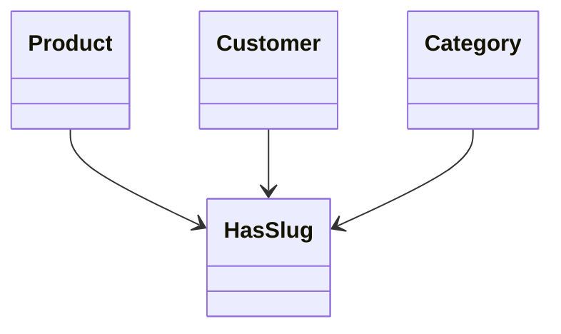

# 21. Traits

> **Goal:** Reuse common class behavior across Models, Services, Jobs, and other classes using PHP Traits while avoiding inheritance abuse and keeping responsibilities well defined.

---

# Overview

Traits are a PHP language feature that enables **horizontal code reuse**.

Instead of duplicating the same methods across multiple classes, a Trait allows those methods to be shared.

Laravel itself uses Traits extensively.

Examples:

* `HasFactory`
* `SoftDeletes`
* `HasUuids`
* `Notifiable`
* `HasApiTokens`
* `Dispatchable`
* `InteractsWithQueue`

Traits help reduce duplication while keeping classes focused.

---

# Trait Philosophy

Traits should provide:

* Shared behavior
* Reusable utilities
* Common model functionality
* Common service functionality

Traits should **NOT**:

* Replace Services
* Replace Models
* Become "God Objects"
* Contain unrelated functionality

A Trait should have **one responsibility**.

---

# Architecture

```text
Controller
      │
      ▼
Service
      │
      ▼
Model
      ▲
      │
    Trait
```

Traits extend class behavior without changing the application's architecture.

---

# When to Use Traits

Traits are appropriate when the same behavior is needed in multiple classes.

Examples

* UUID generation
* Audit logging
* Activity recording
* File uploads
* Search indexing
* Slug generation
* Status helpers
* Common query methods

---

# When NOT to Use Traits

Do **not** use Traits for:

* Business workflows
* Dependency injection
* Large services
* Cross-module orchestration
* Database transactions

Those belong in the Service layer.

---

# Directory Structure

```text
app/
├── Traits/
│   ├── HasUuid.php
│   ├── HasSlug.php
│   ├── HasStatus.php
│   ├── LogsActivity.php
│   ├── HasReferenceNumber.php
│   ├── Searchable.php
│   └── UploadsFiles.php
│
├── Models/
├── Services/
└── Jobs/
```

Organize Traits by responsibility.

---

# Creating a Trait

Example

```php
namespace App\Traits;

trait HasReferenceNumber
{
    //
}
```

File

```text
app/
└── Traits/
    └── HasReferenceNumber.php
```

---

# Using a Trait

```php
use App\Traits\HasReferenceNumber;

class Loan extends Model
{
    use HasReferenceNumber;
}
```

The class now gains every method defined by the Trait.

---

# Basic Trait Example

```php
namespace App\Traits;

trait HasReferenceNumber
{
    public function generateReference(): string
    {
        return now()->format('YmdHis')
            . random_int(1000, 9999);
    }
}
```

Usage

```php
$loan->generateReference();
```

---

# UUID Trait

Laravel already provides the built-in `HasUuids` trait.

If additional behavior is required:

```php
namespace App\Traits;

use Illuminate\Support\Str;

trait HasUuid
{
    protected static function bootHasUuid(): void
    {
        static::creating(function ($model) {

            if (! $model->uuid) {

                $model->uuid = (string) Str::uuid();

            }

        });
    }
}
```

Usage

```php
class Customer extends Model
{
    use HasUuid;
}
```

---

# Bootable Traits

Traits may define boot methods.

Naming convention

```php
bootTraitName()
```

Example

```php
bootHasSlug()
```

Laravel automatically executes the method when the model boots.

---

# Slug Trait

```php
namespace App\Traits;

use Illuminate\Support\Str;

trait HasSlug
{
    protected static function bootHasSlug(): void
    {
        static::creating(function ($model) {

            if (! $model->slug) {

                $model->slug = Str::slug(
                    $model->name
                );

            }

        });
    }
}
```

---

# Status Trait

```php
trait HasStatus
{
    public function isActive(): bool
    {
        return $this->status === 'ACTIVE';
    }

    public function isInactive(): bool
    {
        return $this->status === 'INACTIVE';
    }
}
```

Usage

```php
$user->isActive();
```

---

# Activity Logging Trait

```php
trait LogsActivity
{
    public function logActivity(
        string $action
    ): void {

        ActivityLog::create([

            'model' => static::class,

            'model_id' => $this->id,

            'action' => $action,

        ]);

    }
}
```

If activity logging becomes more complex, move it to Events or Observers.

---

# Searchable Trait

```php
trait Searchable
{
    public function scopeSearch(
        $query,
        ?string $search
    ) {
        return $query->when(

            $search,

            fn ($query) =>

                $query->where(

                    'name',

                    'LIKE',

                    "%{$search}%"

                )

        );
    }
}
```

Any model using the trait automatically gains the scope.

---

# File Upload Trait

```php
trait UploadsFiles
{
    public function uploadFile(
        UploadedFile $file,
        string $path
    ): string {

        return $file->store(
            $path
        );

    }
}
```

If uploads involve validation, image processing, or external storage providers, consider a dedicated Service instead.

---

# Trait Diagram



---

# Traits vs Services

| Trait              | Service             |
| ------------------ | ------------------- |
| Shared behavior    | Business workflows  |
| Utility methods    | Domain logic        |
| Reusable methods   | Transactions        |
| Mixed into classes | Dependency injected |

---

# Traits vs Helpers

| Trait                   | Helper            |
| ----------------------- | ----------------- |
| Used inside classes     | Global function   |
| Can access `$this`      | No object context |
| Object behavior         | Stateless utility |
| Can define boot methods | Cannot            |

---

# Traits vs Inheritance

Inheritance

```text
BaseModel

↓

Loan
```

Trait

```text
Loan

↓

HasSlug

↓

HasUuid
```

Traits provide flexible composition without deep inheritance trees.

---

# Multiple Traits

```php
class Product extends Model
{
    use HasSlug;

    use HasUuid;

    use LogsActivity;
}
```

Traits can be combined safely when responsibilities remain distinct.

---

# Trait Conflicts

If two Traits contain methods with the same name:

```php
trait A
{
    public function save()
    {
    }
}

trait B
{
    public function save()
    {
    }
}
```

Resolve using `insteadof` and `as`.

```php
use A, B {

    A::save insteadof B;

    B::save as saveFromB;

}
```

Avoid method conflicts whenever possible.

---

# Best Practices

* One responsibility per Trait.
* Keep Traits small.
* Use descriptive names.
* Use bootable Traits when appropriate.
* Keep Traits reusable.
* Prefer composition over inheritance.
* Document Trait behavior.
* Reuse Laravel's built-in Traits before creating new ones.
* Keep business logic out of Traits.

---

# Common Anti-Patterns

Avoid

```php
trait EverythingTrait
{
    ...
}
```

Avoid mixing unrelated functionality.

Avoid database transactions inside Traits.

Avoid HTTP request handling.

Avoid Controllers using Traits for business logic.

Avoid injecting dependencies into Traits.

If a Trait becomes very large, it probably belongs in a Service.

---

# Recommended Traits

Enterprise applications commonly use Traits such as:

```text
HasUuid

HasSlug

HasStatus

LogsActivity

Searchable

UploadsFiles

HasReferenceNumber

HasCompany

HasCreator

HasUpdater
```

Each Trait should represent a single reusable capability.

---

# Testing Traits

Traits should be tested through the classes that use them.

Example

```php
it('generates a slug automatically', function () {

    $product = Product::create([

        'name' => 'Laravel Book'

    ]);

    expect($product->slug)

        ->toBe('laravel-book');

});
```

Focus on observable behavior rather than the Trait itself.

---

# Trait Checklist

* [ ] One responsibility
* [ ] Reusable
* [ ] Small and focused
* [ ] No business workflows
* [ ] No HTTP logic
* [ ] Uses boot methods correctly
* [ ] No duplicated functionality
* [ ] Documented
* [ ] Tested through consuming classes
* [ ] Named descriptively

---

# Summary

Traits provide a clean way to share behavior across multiple classes without relying on deep inheritance. They are ideal for reusable model features, utility methods, bootable functionality, and common behaviors. Keep Traits focused on one responsibility, avoid embedding business workflows, and prefer Services whenever coordination, transactions, or domain logic are involved.

The next chapter explores **Events and Listeners**, demonstrating how to decouple business side effects using Laravel's event-driven architecture.
