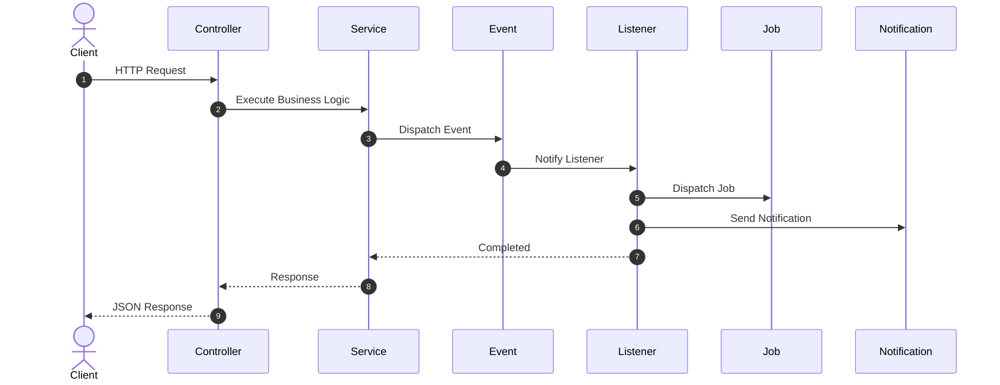
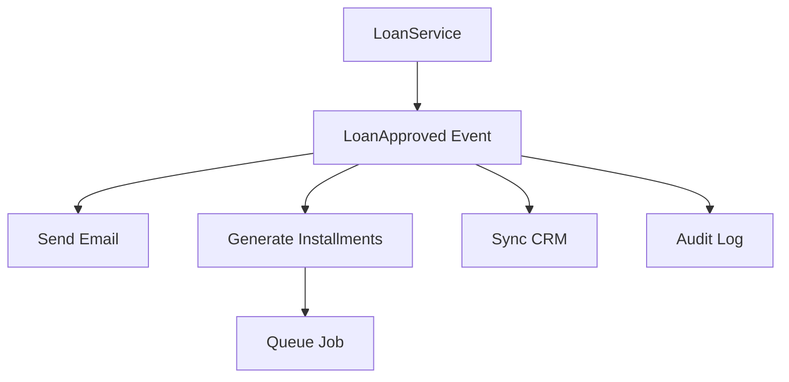

# 22. Events and Listeners

> **Goal:** Build loosely coupled, scalable, and maintainable applications by using Laravel's Event-Driven Architecture to separate business actions from their side effects.

---

# Overview

An **Event** represents something significant that has happened in the application.

A **Listener** reacts to that event.

Instead of one class doing everything, an Event announces **what happened**, while one or more Listeners decide **what to do next**.

Example

```text
Loan Approved

↓

Generate Schedule

↓

Send SMS

↓

Send Email

↓

Update CRM

↓

Write Audit Log
```

Without Events, all of this logic would be placed inside one Service.

---

# Why Events?

Without Events

```php
LoanService

↓

Approve Loan

↓

Generate Installments

↓

Send SMS

↓

Send Email

↓

Update CRM

↓

Create Audit Log

↓

Update Statistics
```

Problems

* Large Service
* Tight coupling
* Difficult testing
* Difficult maintenance
* Poor extensibility

With Events

```text
LoanService

↓

LoanApproved Event

↓

Listener 1

↓

Listener 2

↓

Listener 3

↓

Listener 4
```

Every responsibility becomes independent.

---

# Event-Driven Architecture

```text
Controller
      │
      ▼
Service
      │
      ▼
Business Event
      │
      ├───────────────┐
      ▼               ▼
Listener A      Listener B
      │               │
      ▼               ▼
 Job           Notification
```

---

# Request Flow



---

# Event Responsibilities

Events should:

* Describe what happened
* Carry relevant data
* Be immutable where practical
* Contain minimal logic

Events should **NOT**:

* Query the database
* Execute business logic
* Send notifications
* Perform calculations

An Event is simply a message.

---

# Listener Responsibilities

Listeners should:

* React to Events
* Dispatch Jobs
* Send Notifications
* Write Audit Logs
* Synchronize external systems
* Update search indexes
* Clear cache

Listeners should **NOT**:

* Handle HTTP requests
* Validate input
* Execute primary business workflows

---

# Directory Structure

```text
app/
├── Events/
│   ├── UserRegistered.php
│   ├── LoanApproved.php
│   ├── PaymentReceived.php
│   └── CustomerCreated.php
│
├── Listeners/
│   ├── SendWelcomeEmail.php
│   ├── GenerateInstallments.php
│   ├── SyncCRM.php
│   ├── LogLoanApproval.php
│   └── SendApprovalNotification.php
│
└── Providers/
    └── EventServiceProvider.php
```

---

# Creating an Event

```bash
php artisan make:event LoanApproved
```

Generated

```text
app/

Events/

LoanApproved.php
```

---

# Basic Event

```php
namespace App\Events;

use App\Models\Loan;
use Illuminate\Foundation\Events\Dispatchable;
use Illuminate\Queue\SerializesModels;

class LoanApproved
{
    use Dispatchable;
    use SerializesModels;

    public function __construct(
        public Loan $loan
    ) {
    }
}
```

The Event carries the Loan object.

---

# Dispatching an Event

Service

```php
LoanApproved::dispatch(
    $loan
);
```

or

```php
event(
    new LoanApproved($loan)
);
```

Dispatch Events only after the business operation succeeds.

---

# Creating a Listener

```bash
php artisan make:listener SendApprovalNotification --event=LoanApproved
```

Generated

```text
app/

Listeners/

SendApprovalNotification.php
```

---

# Basic Listener

```php
namespace App\Listeners;

use App\Events\LoanApproved;

class SendApprovalNotification
{
    public function handle(
        LoanApproved $event
    ): void {

        $event->loan
            ->customer
            ->notify(
                new LoanApprovedNotification()
            );

    }
}
```

The Listener reacts to the Event.

---

# Registering Listeners

Laravel 11/12 supports event discovery.

If manual registration is preferred:

```php
protected $listen = [

    LoanApproved::class => [

        SendApprovalNotification::class,

        GenerateInstallments::class,

        SyncCRM::class,

    ],

];
```

---

# Multiple Listeners

One Event

↓

Many Listeners

```text
LoanApproved

↓

GenerateInstallments

↓

SendSMS

↓

SendEmail

↓

SyncCRM

↓

LogAudit
```

Each Listener has one responsibility.

---

# Queueing Listeners

Long-running Listeners should be queued.

```php
class SendApprovalNotification
    implements ShouldQueue
{
    //
}
```

Laravel automatically executes the Listener asynchronously.

---

# After Commit

Dispatch Events after successful database commits.

```php
LoanApproved::dispatch(
    $loan
)->afterCommit();
```

or

```php
public bool $afterCommit = true;
```

on queued Listeners.

This prevents side effects when a transaction rolls back.

---

# Event Subscribers

Subscribers group multiple event handlers.

Example

```bash
php artisan make:listener UserEventSubscriber
```

```php
class UserEventSubscriber
{
    public function subscribe(
        Dispatcher $events
    ): void {

        $events->listen(

            UserRegistered::class,

            [self::class, 'handleRegistration']

        );

        $events->listen(

            UserDeleted::class,

            [self::class, 'handleDeletion']

        );

    }
}
```

Useful when many related events share the same class.

---

# Events vs Observers

Observer

```text
Model Saved

↓

Clear Cache
```

Event

```text
Loan Approved

↓

Generate Schedule

↓

Notify Customer
```

Observers react to **model lifecycle**.

Events react to **business occurrences**.

---

# Events vs Jobs

| Event                   | Job                 |
| ----------------------- | ------------------- |
| Something happened      | Perform work        |
| Notification            | Processing          |
| Broadcast information   | Execute task        |
| May have many listeners | One executable task |

Events often dispatch Jobs.

---

# Events vs Services

| Event                  | Service                 |
| ---------------------- | ----------------------- |
| Announces change       | Executes business logic |
| Passive                | Active                  |
| Decouples side effects | Coordinates workflow    |

---

# Example Workflow

```text
Approve Loan

↓

LoanService

↓

LoanApproved Event

↓

GenerateInstallments Listener

↓

CreateRepaymentScheduleJob

↓

Queue Worker
```

Each layer has one responsibility.

---

# Event Diagram



---

# Event Payload

Events should carry only the data required by Listeners.

Good

```php
new LoanApproved(
    $loan
);
```

Avoid

```php
new LoanApproved(
    auth(),
    request(),
    response(),
    ...
);
```

Keep payloads focused.

---

# Best Practices

* Name Events in the past tense.
* Keep Events immutable.
* One Listener per responsibility.
* Queue expensive Listeners.
* Dispatch Events after successful transactions.
* Use event discovery where appropriate.
* Keep Listeners lightweight.
* Prefer Events over tightly coupled service calls for side effects.

---

# Common Anti-Patterns

Avoid

```php
LoanApproved

↓

Approve Loan
```

Events should not execute the business action they describe.

Avoid putting business logic inside Events.

Avoid large Listeners that perform unrelated work.

Avoid sending emails directly from Services when an Event is more appropriate.

Avoid dispatching Events before database transactions commit.

---

# Recommended Events

Enterprise applications commonly use:

```text
UserRegistered

UserVerified

PasswordReset

LoanCreated

LoanApproved

LoanRejected

PaymentReceived

PaymentFailed

CustomerCreated

CustomerUpdated

OrderPlaced

OrderCancelled

InvoiceGenerated
```

Name Events using the past tense because they represent completed actions.

---

# Testing Events

```php
Event::fake();

$this->service->approve($loan);

Event::assertDispatched(
    LoanApproved::class
);
```

---

# Testing Listeners

```php
Notification::fake();

$listener = new SendApprovalNotification();

$listener->handle(
    new LoanApproved($loan)
);

Notification::assertSentTo(
    $loan->customer,
    LoanApprovedNotification::class
);
```

Test Listeners independently.

---

# Events & Listeners Checklist

* [ ] Events represent completed business actions
* [ ] Events contain minimal data
* [ ] Listeners have one responsibility
* [ ] Expensive Listeners are queued
* [ ] Events dispatched after commit
* [ ] Event names use past tense
* [ ] No business logic inside Events
* [ ] Listeners remain lightweight
* [ ] Events and Listeners are tested
* [ ] Event discovery or registration configured

---

# Summary

Events and Listeners enable a clean event-driven architecture by separating business operations from their side effects. Services execute the core workflow, Events announce what happened, and Listeners independently respond by sending notifications, dispatching jobs, updating external systems, or writing audit logs. This approach keeps the application modular, extensible, and easy to maintain.

The next chapter explores **Jobs and Queues**, covering asynchronous processing, queue workers, retries, failed jobs, scheduling, and background task management.
