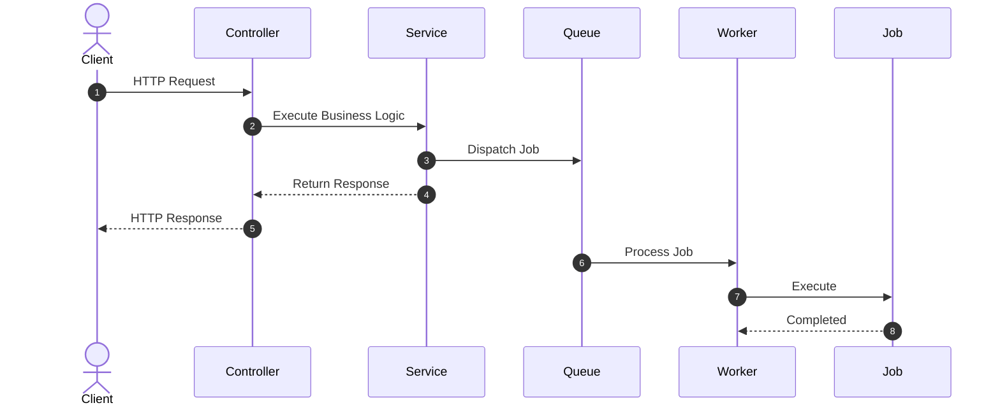
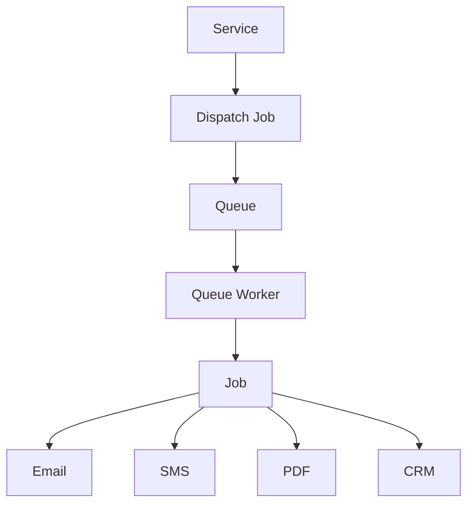

# 23. Jobs and Queues

> **Goal:** Offload long-running and resource-intensive tasks to background workers using Laravel Jobs and Queues, improving application responsiveness, scalability, and reliability.

---

# Overview

A **Job** represents a unit of work that can be executed immediately or later.

A **Queue** stores pending Jobs until a Queue Worker processes them.

Instead of making users wait for slow operations, the application responds immediately while background workers complete the remaining work.

Typical queued operations include:

* Sending emails
* Sending SMS
* Push notifications
* PDF generation
* Excel exports
* Image processing
* Video processing
* API synchronization
* Report generation
* Search indexing

---

# Why Queues?

Without Queues

```text id="s4b8y9"
Client

↓

Controller

↓

Service

↓

Generate PDF

↓

Send Email

↓

Resize Images

↓

Sync CRM

↓

Response (15 seconds)
```

Poor user experience.

---

With Queues

```text id="v3z1cn"
Client

↓

Controller

↓

Service

↓

Dispatch Jobs

↓

Immediate Response

↓

Queue Worker

↓

Background Processing
```

Users receive a response immediately.

---

# Queue Architecture

```text id="m8q4hx"
HTTP Request
      │
      ▼
Controller
      │
      ▼
Service
      │
      ▼
Dispatch Job
      │
      ▼
Queue
      │
      ▼
Queue Worker
      │
      ▼
Execute Job
```

---

# Queue Flow



---

# Queue Drivers

Laravel supports multiple queue backends.

| Driver     | Use Case                      |
| ---------- | ----------------------------- |
| Database   | Small applications            |
| Redis      | Recommended production driver |
| Amazon SQS | AWS cloud                     |
| Beanstalkd | High-performance queue        |
| Sync       | Development only              |

Production systems should avoid the `sync` driver because jobs execute immediately.

---

# Directory Structure

```text id="j3w8pv"
app/
├── Jobs/
│   ├── SendWelcomeEmailJob.php
│   ├── GenerateInvoiceJob.php
│   ├── SyncCustomerJob.php
│   ├── GenerateStatementJob.php
│   └── ProcessPaymentJob.php
│
└── Console/
```

---

# Creating a Job

```bash id="s5c2ku"
php artisan make:job SendWelcomeEmailJob
```

Generated

```text id="t4g8ne"
app/

Jobs/

SendWelcomeEmailJob.php
```

---

# Basic Job

```php id="x6r2fy"
namespace App\Jobs;

use App\Models\User;
use Illuminate\Contracts\Queue\ShouldQueue;
use Illuminate\Foundation\Queue\Queueable;

class SendWelcomeEmailJob implements ShouldQueue
{
    use Queueable;

    public function __construct(
        public User $user
    ) {
    }

    public function handle(): void
    {
        $this->user->notify(
            new WelcomeNotification()
        );
    }
}
```

Implementing `ShouldQueue` tells Laravel to queue the Job.

---

# Dispatching Jobs

Service

```php id="w1n7kc"
SendWelcomeEmailJob::dispatch(
    $user
);
```

Delayed

```php id="r7m3tz"
SendWelcomeEmailJob::dispatch(
    $user
)->delay(
    now()->addMinutes(5)
);
```

---

# Dispatch After Response

Useful for very short tasks.

```php id="p5e0ra"
SendWelcomeEmailJob::dispatchAfterResponse(
    $user
);
```

The HTTP response is sent before the Job executes.

---

# Dispatch After Commit

When using database transactions.

```php id="q9l2su"
SendWelcomeEmailJob::dispatch(
    $user
)->afterCommit();
```

Ensures the Job runs only after the transaction commits successfully.

---

# Queue Worker

Start a worker.

```bash id="n4u5ox"
php artisan queue:work
```

Continuous mode

```bash id="c7i6vw"
php artisan queue:listen
```

Production should use `queue:work`.

---

# Queue Configuration

Configuration file

```text id="k0b8lh"
config/queue.php
```

Environment

```env id="j2c9mq"
QUEUE_CONNECTION=redis
```

Common values

```text id="m9e1qp"
redis

database

sqs

sync
```

---

# Database Queue

Create tables.

```bash id="y5z7gb"
php artisan queue:table

php artisan migrate
```

Failed jobs

```bash id="a3n4hr"
php artisan queue:failed-table

php artisan migrate
```

---

# Queue Names

Separate workloads.

Example

```php id="g2v5dx"
GenerateInvoiceJob::dispatch(
    $invoice
)->onQueue(
    'reports'
);
```

Another

```php id="v0r1bs"
SendSmsJob::dispatch(
    $customer
)->onQueue(
    'sms'
);
```

---

# Priority Workers

Example

```bash id="o8p6ju"
php artisan queue:work \
--queue=high,default,low
```

High-priority jobs execute first.

---

# Retry Attempts

Specify retry count.

```php id="z7k3ie"
public int $tries = 5;
```

Retry delay

```php id="r5x9ht"
public function backoff(): array
{
    return [

        10,

        30,

        60

    ];
}
```

---

# Timeout

Prevent runaway jobs.

```php id="h4w8qa"
public int $timeout = 120;
```

Job fails after 120 seconds.

---

# Failed Jobs

View

```bash id="n1m5zc"
php artisan queue:failed
```

Retry

```bash id="u3y7fo"
php artisan queue:retry all
```

Delete

```bash id="l9d2ev"
php artisan queue:flush
```

---

# Job Middleware

Jobs may use middleware.

Example

```php id="t6o4yn"
public function middleware(): array
{
    return [

        new WithoutOverlapping(

            $this->user->id

        ),

    ];
}
```

Prevents duplicate execution.

---

# Job Batching

Execute many jobs together.

```php id="w8i1kg"
Bus::batch([

    new GenerateInvoiceJob(),

    new SendEmailJob(),

    new SyncCrmJob(),

])->dispatch();
```

Useful for imports and bulk processing.

---

# Chained Jobs

Execute sequentially.

```php id="e4f9bs"
Bus::chain([

    new GenerateInvoiceJob(),

    new SendInvoiceJob(),

    new ArchiveInvoiceJob(),

])->dispatch();
```

Each job starts after the previous one succeeds.

---

# Job Diagram



---

# Supervisor

Production workers should run under Supervisor.

Example configuration

```ini id="g7s4nr"
[program:laravel-worker]

command=php artisan queue:work redis --sleep=3 --tries=3 --timeout=120

numprocs=4

autostart=true

autorestart=true

stopwaitsecs=3600
```

Restart workers after deployment.

```bash id="y9q2de"
php artisan queue:restart
```

---

# Jobs vs Events

| Job           | Event                        |
| ------------- | ---------------------------- |
| Performs work | Announces something happened |
| Executable    | Passive message              |
| One task      | Many listeners               |
| Queueable     | May dispatch Jobs            |

---

# Jobs vs Listeners

| Job                      | Listener         |
| ------------------------ | ---------------- |
| Performs background work | Reacts to Events |
| Queueable                | May be queued    |
| Executable               | Event handler    |

---

# Jobs vs Commands

| Job              | Command             |
| ---------------- | ------------------- |
| Queue processing | CLI execution       |
| Background       | Manual or scheduled |
| Worker executes  | User executes       |

---

# Idempotency

Jobs should be safe to retry.

Example

```php id="k1m8wv"
if ($invoice->emailed_at) {

    return;

}
```

Avoid duplicate processing.

---

# Best Practices

* Queue slow operations.
* Keep Jobs small.
* One responsibility per Job.
* Use Redis in production.
* Dispatch after database commit.
* Configure retries.
* Set timeouts.
* Use Supervisor.
* Design Jobs to be idempotent.
* Monitor failed jobs.

---

# Common Anti-Patterns

Avoid

```php id="d7q5pa"
GenerateInvoice

↓

Send Email

↓

Update CRM

↓

Create Audit

↓

Resize Images
```

inside one large Job.

Split into multiple Jobs.

Avoid querying unrelated models repeatedly.

Avoid returning HTTP responses from Jobs.

Avoid business orchestration inside Jobs.

Complex workflows belong in Services.

---

# Recommended Jobs

Enterprise applications commonly use:

```text id="m6v4hk"
SendWelcomeEmailJob

SendSmsJob

GenerateInvoiceJob

GeneratePdfJob

GenerateStatementJob

SyncCustomerJob

SyncInventoryJob

UpdateSearchIndexJob

ExportExcelJob

ImportCsvJob

ProcessWebhookJob

ResizeImageJob
```

Each Job should perform one task.

---

# Testing Jobs

```php id="u5r2eo"
Bus::fake();

$this->service->register($userData);

Bus::assertDispatched(
    SendWelcomeEmailJob::class
);
```

Test Job execution separately.

---

# Jobs & Queues Checklist

* [ ] One responsibility per Job
* [ ] Implements `ShouldQueue`
* [ ] Uses queue driver suitable for production
* [ ] Uses retries and backoff
* [ ] Sets timeout
* [ ] Dispatches after commit when appropriate
* [ ] Idempotent
* [ ] No HTTP logic
* [ ] Supervisor configured
* [ ] Covered by automated tests

---

# Summary

Jobs and Queues allow Laravel applications to move expensive or time-consuming work into the background, improving response times and scalability. Services should dispatch Jobs for asynchronous work, while Queue Workers process them independently. Combined with Events, Listeners, and Supervisor, Laravel's queue system provides a robust foundation for reliable background processing in enterprise applications.

The next chapter explores **Notifications**, covering email, SMS, database, broadcast, Slack, and custom notification channels with queued delivery and best practices.
