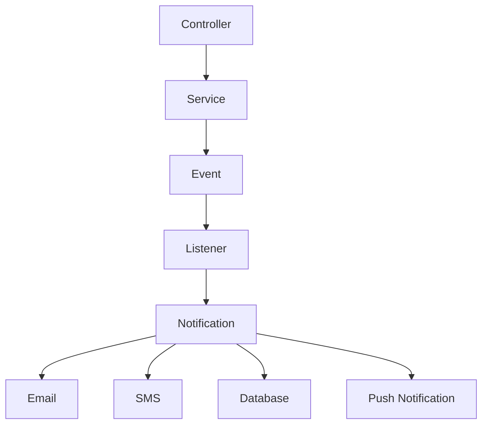
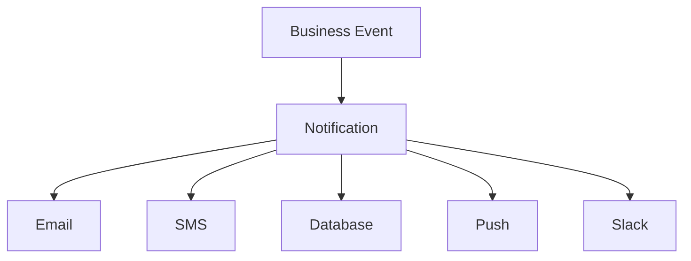

# 24. Notifications

> **Goal:** Deliver consistent, scalable, and maintainable notifications across multiple channels (Email, SMS, Database, Push, Slack, Broadcast, and custom providers) while keeping business logic inside Services and using queued notifications for better performance.

---

# Overview

Notifications inform users when important events occur.

Examples include:

* Welcome emails
* Password reset emails
* Loan approval SMS
* Payment reminders
* Push notifications
* Invoice generated alerts
* Order shipped notifications
* Security alerts

Laravel provides a unified notification system that supports multiple delivery channels from a single Notification class.

---

# Notification Flow

```text
Business Action
        │
        ▼
Service
        │
        ▼
Event
        │
        ▼
Listener
        │
        ▼
Notification
        │
        ├─────────────┬─────────────┬─────────────┐
        ▼             ▼             ▼             ▼
     Email          SMS        Database        Push
```

Notifications are usually triggered by Events or dispatched directly from the Service layer.

---

# Architecture



---

# Notification Responsibilities

Notifications should:

* Format notification content
* Select delivery channels
* Deliver messages
* Queue delivery
* Personalize messages

Notifications should **NOT**:

* Execute business logic
* Query unrelated models
* Handle HTTP requests
* Manage transactions
* Calculate business rules

---

# Directory Structure

```text
app/
├── Notifications/
│   ├── WelcomeNotification.php
│   ├── LoanApprovedNotification.php
│   ├── PaymentReminderNotification.php
│   ├── PasswordResetNotification.php
│   ├── InvoiceGeneratedNotification.php
│   └── SmsNotification.php
│
├── Events/
├── Listeners/
└── Jobs/
```

---

# Creating a Notification

```bash
php artisan make:notification LoanApprovedNotification
```

Generated

```text
app/

Notifications/

LoanApprovedNotification.php
```

---

# Basic Notification

```php
namespace App\Notifications;

use Illuminate\Notifications\Notification;
use Illuminate\Notifications\Messages\MailMessage;

class LoanApprovedNotification extends Notification
{
    public function via(
        object $notifiable
    ): array {

        return [

            'mail'

        ];

    }

    public function toMail(
        object $notifiable
    ): MailMessage {

        return (new MailMessage)

            ->subject('Loan Approved')

            ->line('Your loan has been approved.')

            ->action(
                'View Loan',
                url('/loans')
            );

    }
}
```

---

# Sending Notifications

Using the model.

```php
$user->notify(

    new LoanApprovedNotification()

);
```

Multiple users.

```php
Notification::send(

    $users,

    new LoanApprovedNotification()

);
```

---

# Notifiable Trait

Models receiving notifications must use:

```php
use Illuminate\Notifications\Notifiable;
```

Example

```php
class User extends Authenticatable
{
    use Notifiable;
}
```

---

# Mail Notifications

```php
public function toMail(
    object $notifiable
): MailMessage {

    return (new MailMessage)

        ->subject('Welcome')

        ->greeting('Hello!')

        ->line('Thank you for joining.')

        ->action(
            'Login',
            route('login')
        );

}
```

---

# Database Notifications

Channel

```php
public function via(
    object $notifiable
): array {

    return [

        'database'

    ];

}
```

Payload

```php
public function toDatabase(
    object $notifiable
): array {

    return [

        'title' => 'Loan Approved',

        'loan_id' => $this->loan->id,

    ];

}
```

Migration

```bash
php artisan notifications:table

php artisan migrate
```

---

# SMS Notifications

Example using a custom channel.

```php
public function via(
    object $notifiable
): array {

    return [

        SmsChannel::class

    ];

}
```

Payload

```php
public function toSms(
    object $notifiable
): array {

    return [

        'phone' => $notifiable->phone,

        'message' => 'Your payment is due tomorrow.'

    ];

}
```

The custom channel handles communication with the SMS provider.

---

# Push Notifications

Example

```php
public function via(
    object $notifiable
): array {

    return [

        PushChannel::class

    ];

}
```

Works with providers such as:

* Firebase Cloud Messaging (FCM)
* OneSignal
* APNs
* Expo

---

# Slack Notifications

```php
public function via(
    object $notifiable
): array {

    return [

        'slack'

    ];

}
```

Useful for:

* Deployment alerts
* System monitoring
* Failed jobs
* Security notifications

---

# Broadcast Notifications

```php
public function via(
    object $notifiable
): array {

    return [

        'broadcast'

    ];

}
```

Real-time notifications using WebSockets.

---

# Multiple Channels

Example

```php
public function via(
    object $notifiable
): array {

    return [

        'mail',

        'database',

        SmsChannel::class,

    ];

}
```

One Notification

↓

Multiple delivery channels.

---

# Queue Notifications

Notifications should usually be queued.

```php
class LoanApprovedNotification
    extends Notification
    implements ShouldQueue
{
    use Queueable;
}
```

This prevents users from waiting while notifications are delivered.

---

# Delayed Notifications

```php
$user->notify(

    (new PaymentReminderNotification())

        ->delay(
            now()->addHour()
        )

);
```

---

# Routing Notifications

Example

```php
Notification::route(

    'mail',

    'admin@example.com'

)

->notify(

    new SystemAlertNotification()

);
```

Useful when no User model exists.

---

# Notification Diagram



---

# Notifications vs Events

| Notification       | Event                        |
| ------------------ | ---------------------------- |
| Sends messages     | Announces something happened |
| Delivery mechanism | Domain occurrence            |
| User communication | Application communication    |

Events often trigger Notifications.

---

# Notifications vs Jobs

| Notification       | Job                   |
| ------------------ | --------------------- |
| User communication | Background processing |
| Multiple channels  | One task              |
| Queueable          | Queueable             |

Queued Notifications internally become queued Jobs.

---

# Notifications vs Mailables

| Notification      | Mailable        |
| ----------------- | --------------- |
| Multiple channels | Email only      |
| Database support  | Email templates |
| SMS support       | Email content   |
| Push support      | HTML emails     |

Use Mailables when only email is required.

Use Notifications when multiple delivery channels may be needed.

---

# Notification Preferences

Allow users to choose channels.

Example

```php
public function via(
    object $notifiable
): array {

    return $notifiable

        ->preferred_channels;

}
```

Store preferences in the database.

---

# Localization

Notifications support translations.

```php
return (new MailMessage)

    ->subject(

        __('Loan Approved')

    );
```

Supports multilingual applications.

---

# Best Practices

* Queue notifications.
* Keep notifications focused on presentation.
* Use Events to trigger notifications.
* Support multiple channels.
* Personalize messages.
* Use localization.
* Respect user notification preferences.
* Use custom channels for external providers.
* Keep notifications idempotent.

---

# Common Anti-Patterns

Avoid

```php
LoanService

↓

Send Email

↓

Send SMS

↓

Send Push
```

Instead

```text
LoanService

↓

LoanApproved Event

↓

Notification
```

Avoid querying unrelated models inside Notifications.

Avoid business logic.

Avoid long-running API calls directly in Controllers.

---

# Recommended Notifications

Enterprise applications commonly include:

```text
WelcomeNotification

LoanApprovedNotification

LoanRejectedNotification

PaymentReminderNotification

PaymentReceivedNotification

PasswordResetNotification

InvoiceGeneratedNotification

SecurityAlertNotification

FailedJobNotification

SystemMaintenanceNotification
```

Each Notification should represent one communication.

---

# Testing Notifications

```php
Notification::fake();

$this->service->approve($loan);

Notification::assertSentTo(

    $loan->customer,

    LoanApprovedNotification::class

);
```

Test notification delivery independently from business logic.

---

# Notifications Checklist

* [ ] One responsibility per Notification
* [ ] Uses appropriate channels
* [ ] Queue enabled
* [ ] Supports localization
* [ ] Personalizes content
* [ ] Uses Events where appropriate
* [ ] No business logic
* [ ] No database workflows
* [ ] Tested
* [ ] Respects user preferences

---

# Summary

Laravel Notifications provide a unified way to communicate with users across multiple channels, including email, SMS, push notifications, database records, Slack, and broadcast events. By keeping Notifications focused on message delivery, triggering them through Events or Services, and queueing them for asynchronous execution, applications remain responsive, scalable, and easy to maintain.

The next chapter explores **Mailables**, covering email templates, Markdown emails, attachments, queues, and best practices for transactional email delivery.
