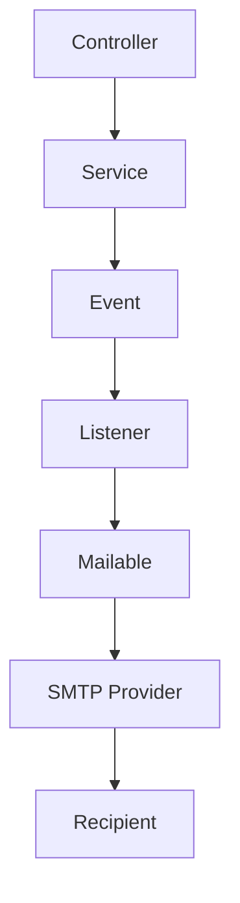
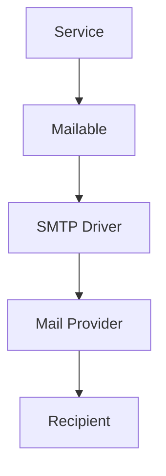

# 25. Mailables

> **Goal:** Build reusable, maintainable, and professional email templates using Laravel Mailables while keeping email composition separate from business logic and supporting queued delivery.

---

# Overview

A **Mailable** represents an email message.

It is responsible for:

* Email subject
* Email recipients
* Email content
* Email attachments
* Email headers
* Markdown or Blade templates

Mailables should focus **only on email presentation**.

Business logic belongs in the Service layer.

---

# Mail Flow

```text
Business Action
        │
        ▼
Service
        │
        ▼
Event
        │
        ▼
Listener
        │
        ▼
Mailable
        │
        ▼
Mail Driver
        │
        ▼
SMTP / Mail Provider
```

Email delivery should usually happen asynchronously using queues.

---

# Architecture



---

# Mailable Responsibilities

Mailables should:

* Build email content
* Define subject
* Select email view
* Attach files
* Add headers
* Format data for email templates

Mailables should **NOT**:

* Execute business logic
* Query unrelated models
* Update the database
* Perform authorization
* Handle HTTP requests

---

# Directory Structure

```text
app/
├── Mail/
│   ├── WelcomeMail.php
│   ├── LoanApprovedMail.php
│   ├── InvoiceMail.php
│   ├── PasswordResetMail.php
│   └── PaymentReminderMail.php
│
resources/
└── views/
    └── emails/
        ├── welcome.blade.php
        ├── loan-approved.blade.php
        ├── invoice.blade.php
        └── payment-reminder.blade.php
```

---

# Creating a Mailable

```bash
php artisan make:mail LoanApprovedMail
```

Generated

```text
app/

Mail/

LoanApprovedMail.php
```

---

# Basic Mailable

```php
namespace App\Mail;

use App\Models\Loan;
use Illuminate\Mail\Mailable;

class LoanApprovedMail extends Mailable
{
    public function __construct(
        public Loan $loan
    ) {
    }

    public function build()
    {
        return $this

            ->subject('Loan Approved')

            ->view(
                'emails.loan-approved'
            );
    }
}
```

---

# Sending Mail

Example

```php
Mail::to(
    $user->email
)->send(

    new LoanApprovedMail(
        $loan
    )

);
```

---

# Queueing Mail

Mail should generally be queued.

```php
Mail::to(
    $user
)->queue(

    new LoanApprovedMail(
        $loan
    )

);
```

Or implement

```php
ShouldQueue
```

inside the Mailable.

---

# Delayed Mail

```php
Mail::to(
    $user
)->later(

    now()->addMinutes(10),

    new PaymentReminderMail(
        $payment
    )

);
```

---

# Using Blade Views

Example

```php
public function build()
{
    return $this

        ->subject('Welcome')

        ->view(
            'emails.welcome'
        );
}
```

Blade

```blade
<h2>Hello {{ $user->name }}</h2>

<p>

Welcome to our platform.

</p>
```

---

# Markdown Mail

Create

```bash
php artisan make:mail WelcomeMail --markdown=emails.welcome
```

Build

```php
return $this

    ->markdown(
        'emails.welcome'
    );
```

Markdown provides responsive email layouts out of the box.

---

# Passing Data

```php
public function build()
{
    return $this

        ->view(

            'emails.invoice'

        )

        ->with([

            'invoice' => $this->invoice,

        ]);
}
```

---

# Attachments

Attach files.

```php
return $this

    ->attach(

        storage_path(
            'app/invoice.pdf'
        )

    );
```

---

# Attachment from Storage

```php
return $this

    ->attachFromStorage(

        $invoice->path

    );
```

---

# Attachment with Name

```php
return $this

    ->attach(

        storage_path(
            'app/report.pdf'
        ),

        [

            'as' => 'Monthly Report.pdf',

            'mime' => 'application/pdf',

        ]

    );
```

---

# Inline Images

```blade
embed($path) }}">
```

Useful for logos and signatures.

---

# Dynamic Subject

```php
return $this

    ->subject(

        "Invoice #{$invoice->number}"

    );
```

---

# Mail Configuration

Environment

```env
MAIL_MAILER=smtp

MAIL_HOST=smtp.mailgun.org

MAIL_PORT=587

MAIL_USERNAME=...

MAIL_PASSWORD=...

MAIL_ENCRYPTION=tls

MAIL_FROM_ADDRESS=noreply@example.com

MAIL_FROM_NAME="Example App"
```

Supported mailers include:

* SMTP
* Mailgun
* Postmark
* Amazon SES
* Resend
* Log
* Array

---

# Mail Drivers

| Driver     | Purpose              |
| ---------- | -------------------- |
| SMTP       | Generic SMTP servers |
| Mailgun    | Production email     |
| Postmark   | Transactional email  |
| Amazon SES | AWS email service    |
| Resend     | Modern email API     |
| Log        | Development          |
| Array      | Testing              |

---

# Mail Diagram



---

# Mailables vs Notifications

| Mailable           | Notification                |
| ------------------ | --------------------------- |
| Email only         | Multiple channels           |
| Rich email content | Email, SMS, Push, Database  |
| Blade/Markdown     | Channel-specific formatting |

Use a Mailable when only email is required.

Use a Notification when multiple delivery channels may be needed.

---

# Mailables vs Events

| Mailable      | Event               |
| ------------- | ------------------- |
| Email content | Business occurrence |

Events often trigger Mailables through Listeners.

---

# Mailables vs Jobs

| Mailable          | Job                   |
| ----------------- | --------------------- |
| Email composition | Background processing |

Queued Mailables internally become queued Jobs.

---

# Localization

```php
return $this

    ->subject(

        __('Welcome')

    );
```

Blade

```blade
{{ __('Hello') }}
```

Supports multilingual email templates.

---

# Best Practices

* Queue emails.
* Use Markdown when appropriate.
* Keep Mailables presentation-focused.
* Pass only required data.
* Keep templates reusable.
* Attach files only when necessary.
* Use localization.
* Use environment variables for configuration.
* Test email rendering.

---

# Common Anti-Patterns

Avoid

```php
Mail::send(...)
```

inside Controllers.

Avoid querying unrelated models inside Mailables.

Avoid business logic inside Mailables.

Avoid generating PDFs inside Mailables.

Generate attachments before sending.

---

# Recommended Mailables

```text
WelcomeMail

LoanApprovedMail

InvoiceMail

PaymentReminderMail

PasswordResetMail

VerificationMail

StatementMail

OrderConfirmationMail

ReceiptMail

MonthlyReportMail
```

Each Mailable should represent one email type.

---

# Testing Mail

```php
Mail::fake();

$this->service->approve($loan);

Mail::assertQueued(
    LoanApprovedMail::class
);
```

Render email

```php
$mail = new LoanApprovedMail($loan);

$html = $mail->render();
```

Verify rendered content in feature tests.

---

# Mailables Checklist

* [ ] One Mailable per email type
* [ ] Queue enabled
* [ ] Subject defined
* [ ] Blade or Markdown template used
* [ ] Minimal data passed
* [ ] No business logic
* [ ] Attachments handled correctly
* [ ] Localization supported
* [ ] Tested
* [ ] Configuration externalized

---

# Summary

Mailables provide a clean and reusable way to compose emails in Laravel. By separating email presentation from business logic, queueing delivery, using Blade or Markdown templates, and integrating Mailables with Events and Listeners, applications can deliver reliable transactional emails while remaining responsive and maintainable.

The next chapter explores **Caching**, covering cache drivers, cache invalidation, tagged caches, distributed caching, and performance optimization strategies.
