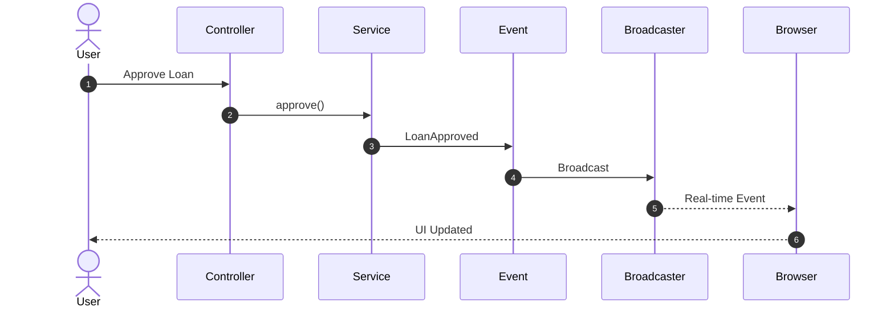
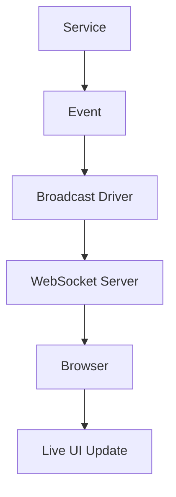

# 26. Broadcasting

> **Goal:** Build real-time Laravel applications using Event Broadcasting, allowing the server to instantly push updates to connected clients without requiring continuous polling.

---

# Overview

Broadcasting allows Laravel to send events from the server to connected clients in real time.

Instead of repeatedly asking the server for updates (polling), clients receive updates immediately whenever an event occurs.

Common use cases include:

* Live notifications
* Chat applications
* Order tracking
* Loan status updates
* Live dashboards
* Real-time analytics
* Online user presence
* Stock price updates
* Auction systems
* Team collaboration

---

# Traditional Request vs Broadcasting

Without Broadcasting

```text id="5v6khy"
Browser

↓

Every 5 Seconds

↓

HTTP Request

↓

Server

↓

Database

↓

Response
```

This wastes resources.

---

With Broadcasting

```text id="uq7m41"
Server

↓

Broadcast Event

↓

WebSocket Server

↓

Connected Clients

↓

Instant Update
```

Clients receive updates immediately.

---

# Broadcasting Architecture

```text id="hr3fwb"
Controller
      │
      ▼
Service
      │
      ▼
Event
      │
      ▼
Broadcast Driver
      │
      ▼
WebSocket Server
      │
      ▼
Connected Clients
```

---

# Real-Time Flow



---

# Broadcasting Components

Laravel broadcasting consists of:

* Events
* Channels
* Drivers
* Authorization
* JavaScript Client

---

# Directory Structure

```text id="2o2ej5"
app/
├── Events/
│   ├── LoanApproved.php
│   ├── PaymentReceived.php
│   ├── OrderCreated.php
│   └── UserTyping.php
│
├── Broadcasting/
│
routes/
└── channels.php
```

---

# Supported Drivers

Laravel supports:

| Driver | Description                       |
| ------ | --------------------------------- |
| Reverb | Official Laravel WebSocket server |
| Pusher | Hosted WebSocket service          |
| Ably   | Managed real-time platform        |
| Redis  | Internal broadcasting             |
| Log    | Development                       |
| Null   | Disabled broadcasting             |

For new Laravel applications, **Laravel Reverb** is the recommended self-hosted solution.

---

# Creating a Broadcast Event

```bash id="yixpjr"
php artisan make:event LoanApproved
```

Implement

```php id="v2zbxo"
ShouldBroadcast
```

---

# Example Event

```php id="mcltv7"
namespace App\Events;

use App\Models\Loan;
use Illuminate\Contracts\Broadcasting\ShouldBroadcast;
use Illuminate\Foundation\Events\Dispatchable;

class LoanApproved implements ShouldBroadcast
{
    use Dispatchable;

    public function __construct(
        public Loan $loan
    ) {
    }

    public function broadcastOn(): array
    {
        return [

            new PrivateChannel(
                'loans'
            )

        ];
    }
}
```

---

# Broadcasting Event

```php id="n8wxzl"
LoanApproved::dispatch(
    $loan
);
```

Laravel automatically broadcasts the event.

---

# Public Channels

```php id="g2cgo0"
new Channel(
    'news'
)
```

Anyone can subscribe.

Examples

* News
* Announcements
* Public statistics

---

# Private Channels

```php id="qn8m0n"
new PrivateChannel(
    'loans.'.$loan->id
)
```

Authentication required.

Examples

* Customer account
* Loan details
* User profile
* Internal dashboard

---

# Presence Channels

Presence channels include user information.

```php id="rwhbd0"
new PresenceChannel(
    'chat'
)
```

Useful for:

* Online users
* Team collaboration
* Chat rooms
* Video meetings

---

# Channel Authorization

File

```text id="jbrz3z"
routes/

channels.php
```

Example

```php id="q0wcdw"
Broadcast::channel(

    'loans.{loan}',

    function (

        User $user,

        Loan $loan

    ) {

        return $loan->customer_id
            === $user->customer_id;

    }

);
```

Only authorized users may subscribe.

---

# Event Name

Override default event name.

```php id="jlwmv5"
public function broadcastAs(): string
{
    return 'loan.approved';
}
```

Client listens for:

```text id="mruocn"
loan.approved
```

---

# Broadcast Payload

Customize transmitted data.

```php id="l77syv"
public function broadcastWith(): array
{
    return [

        'id' => $this->loan->id,

        'status' => $this->loan->status,

    ];
}
```

Avoid broadcasting entire models when only a few fields are required.

---

# Queueing Broadcasts

Broadcast events are queued by default when they implement `ShouldBroadcast`.

To broadcast immediately:

```php id="5b7gvw"
ShouldBroadcastNow
```

Use only when low latency is essential.

---

# JavaScript Client

Laravel Echo

```javascript id="x3f9n7"
Echo.private('loans')

.listen('.loan.approved', event => {

    console.log(event);

});
```

Echo supports:

* Reverb
* Pusher
* Ably

---

# Broadcasting Diagram



---

# Broadcasting vs Notifications

| Broadcasting            | Notifications      |
| ----------------------- | ------------------ |
| Real-time UI updates    | User communication |
| Browser receives events | Email, SMS, Push   |
| Live synchronization    | Alerts             |

Use broadcasting for application state updates.

Use notifications for communicating with users.

---

# Broadcasting vs Events

| Broadcast Event | Domain Event               |
| --------------- | -------------------------- |
| Sent to clients | Internal application event |
| Real-time       | Business workflow          |

Many applications use a domain Event that triggers a broadcast Event through a Listener.

---

# Broadcasting vs Polling

| Polling                | Broadcasting           |
| ---------------------- | ---------------------- |
| Repeated HTTP requests | Persistent connection  |
| Higher server load     | Efficient              |
| Delayed updates        | Instant updates        |
| Simpler setup          | Better user experience |

---

# Security

Always authorize:

* Private channels
* Presence channels

Never expose confidential data through public channels.

Broadcast only the data clients actually need.

---

# Performance

Good

```php id="i6vftd"
broadcastWith()
```

Return only:

* IDs
* Status
* Timestamps

Avoid sending:

* Large collections
* Entire relationships
* Sensitive information

---

# Best Practices

* Use private channels for user-specific data.
* Use presence channels for collaborative features.
* Broadcast minimal payloads.
* Keep Events lightweight.
* Use Laravel Echo on the frontend.
* Queue broadcast events.
* Secure channel authorization.
* Use descriptive event names.
* Separate domain events from broadcast events when appropriate.

---

# Common Anti-Patterns

Avoid broadcasting:

* Passwords
* API tokens
* Financial secrets
* Entire models with unnecessary relationships

Avoid placing business logic inside broadcast Events.

Avoid broadcasting every database update unnecessarily.

Broadcast only meaningful application events.

---

# Recommended Broadcast Events

Enterprise applications commonly broadcast:

```text id="6rw9wc"
LoanApproved

PaymentReceived

OrderCreated

OrderStatusUpdated

MessageReceived

UserTyping

UserOnline

InvoiceGenerated

NotificationCreated

DashboardUpdated
```

Each event should represent a meaningful real-time occurrence.

---

# Testing Broadcasting

```php id="vlg6lm"
Broadcast::fake();

LoanApproved::dispatch($loan);

Broadcast::assertDispatched(
    LoanApproved::class
);
```

Test event dispatching independently from frontend behavior.

---

# Broadcasting Checklist

* [ ] Uses appropriate broadcast driver
* [ ] Event implements `ShouldBroadcast`
* [ ] Private channels secured
* [ ] Presence channels authorized
* [ ] Minimal payload broadcast
* [ ] Event names descriptive
* [ ] Queue enabled
* [ ] No sensitive data exposed
* [ ] Frontend listens correctly
* [ ] Broadcast events tested

---

# Summary

Broadcasting enables Laravel applications to deliver real-time updates without relying on inefficient polling. By broadcasting lightweight Events through secure channels and consuming them with Laravel Echo, applications can provide responsive user experiences for dashboards, messaging, notifications, and collaborative features.

Keep broadcast Events focused on real-time communication, secure private channels with proper authorization, and transmit only the minimum data necessary.

The next chapter explores **Caching**, covering cache drivers, cache invalidation, cache tags, distributed caching, and strategies for improving application performance.
