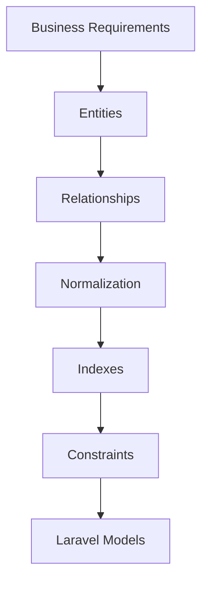
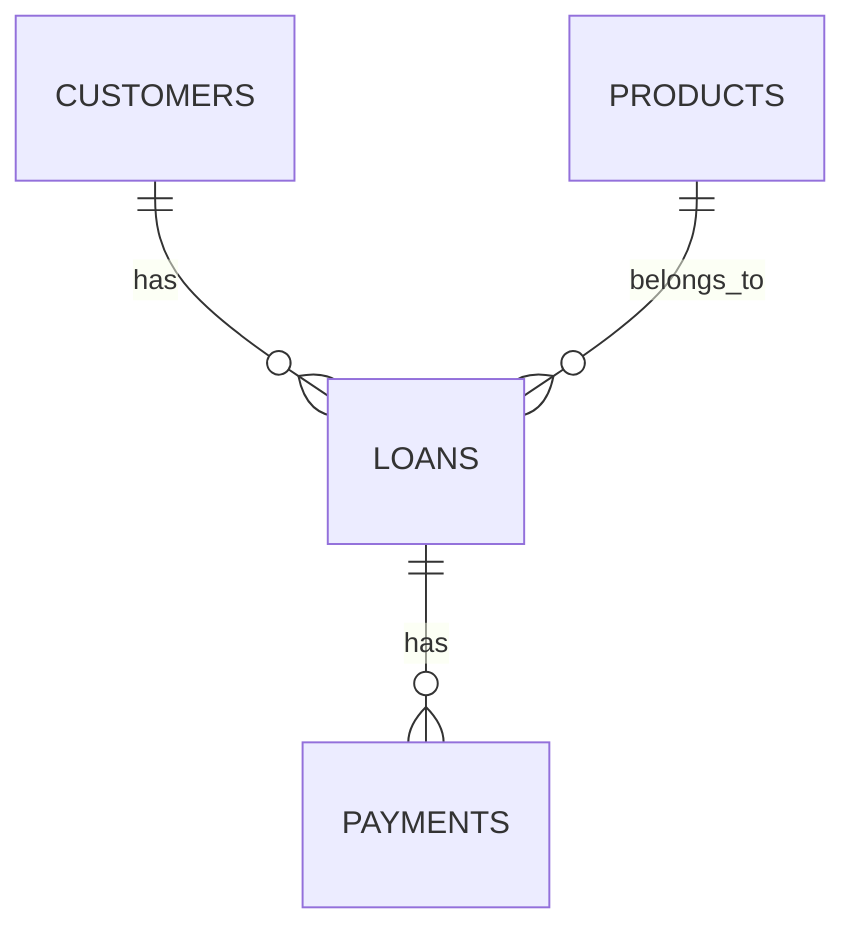
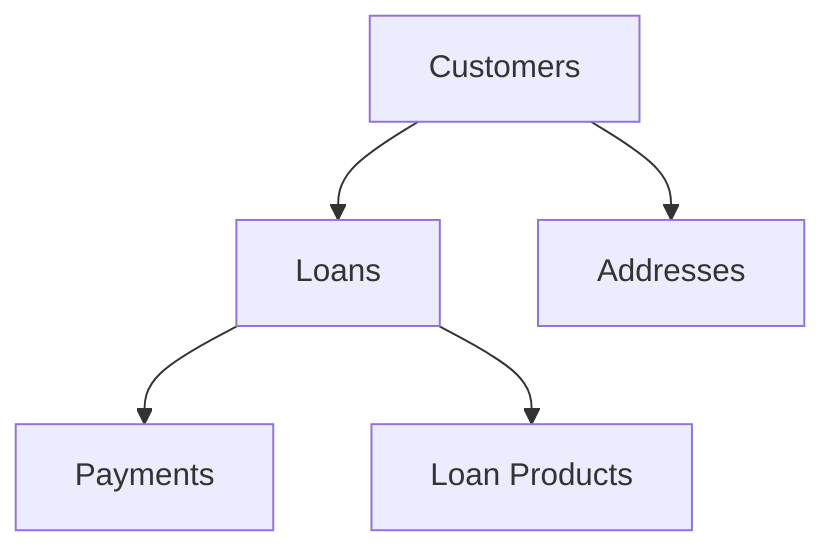

# 27. Database Design

> **Goal:** Design a scalable, maintainable, and high-performance relational database that supports enterprise Laravel applications through proper normalization, indexing, relationships, constraints, and naming conventions.

---

# Overview

A well-designed database is the foundation of every Laravel application.

Poor database design leads to:

* Slow queries
* Duplicate data
* Difficult maintenance
* Broken relationships
* Complex business logic
* Poor scalability

Good database design makes the application:

* Faster
* Easier to understand
* Easier to extend
* Easier to maintain

Laravel works best when the database follows consistent relational design principles.

---

# Database Architecture

```text
Application
      │
      ▼
Service Layer
      │
      ▼
Eloquent Models
      │
      ▼
Database
      │
      ├── Tables
      ├── Relationships
      ├── Indexes
      ├── Constraints
      └── Transactions
```

---

# Design Principles

Every table should have:

* One responsibility
* One primary key
* Proper foreign keys
* Appropriate indexes
* Clear naming
* Audit timestamps

Avoid storing unrelated information in the same table.

---

# Database Design Workflow



---

# Naming Conventions

## Tables

Use:

* Lowercase
* Snake case
* Plural nouns

Good

```text
users

loan_contracts

loan_payments

customer_addresses

company_settings
```

Avoid

```text
User

tbl_users

LoanPayment

LoanPayments

customerAddress
```

---

# Primary Keys

Laravel defaults to:

```sql
id BIGINT UNSIGNED
```

Migration

```php
$table->id();
```

For distributed systems, UUIDs or ULIDs are excellent alternatives.

```php
$table->uuid('id')->primary();
```

or

```php
$table->ulid('id')->primary();
```

---

# Foreign Keys

Always define foreign keys.

Example

```php
$table

    ->foreignId('customer_id')

    ->constrained()

    ->cascadeOnDelete();
```

Benefits:

* Data integrity
* Automatic joins
* Faster development
* Prevent orphan records

---

# Table Example

```text
customers

---------------------

id

name

phone

email

status

created_at

updated_at
```

Loan table

```text
loans

---------------------

id

customer_id

product_id

amount

status

approved_at

created_at

updated_at
```

---

# Relationships

```text
Customer

↓

Loans

↓

Payments
```

Database

```text
customers

1

↓

loans

1

↓

payments
```

---

# Relationship Diagram



---

# Normalization

Normalize data to reduce duplication.

Instead of

```text
Loan

customer_name

customer_phone

customer_email
```

Use

```text
customers

↓

loans
```

Reference the customer through a foreign key.

---

# Normal Forms

Most applications should satisfy:

* First Normal Form (1NF)
* Second Normal Form (2NF)
* Third Normal Form (3NF)

Denormalization should only be introduced after measuring performance.

---

# Lookup Tables

Instead of

```text
status

↓

Approved

Rejected

Pending
```

consider a lookup table when statuses are user-configurable or require metadata.

For fixed application states, PHP Enums are often preferable.

---

# Soft Deletes

Laravel provides:

```php
$table->softDeletes();
```

Benefits:

* Recover deleted records
* Audit history
* Restore functionality

Avoid soft deletes for immutable transaction tables if regulatory requirements demand permanent history.

---

# Timestamps

Always include:

```php
$table->timestamps();
```

Columns

```text
created_at

updated_at
```

Useful for:

* Auditing
* Reporting
* Synchronization

---

# UUID Columns

Useful for APIs.

```php
$table->uuid('uuid')
      ->unique();
```

Advantages:

* Harder to guess
* Better for public APIs
* Easier system integration

---

# Status Columns

Instead of

```text
status

↓

1

2

3
```

Prefer descriptive values or enums.

```php
enum LoanStatus: string
{
    case Pending = 'PENDING';
    case Approved = 'APPROVED';
    case Rejected = 'REJECTED';
}
```

---

# Money Columns

Always use:

```php
$table->decimal(
    'amount',
    15,
    2
);
```

Avoid

```php
float

double
```

Decimal prevents precision loss.

---

# Boolean Columns

Example

```php
$table->boolean(
    'is_active'
)
->default(true);
```

Use boolean columns only for true/false values.

---

# JSON Columns

Example

```php
$table->json(
    'metadata'
);
```

Suitable for:

* Dynamic settings
* Third-party payloads
* Optional structured data

Do not use JSON to replace relational design.

---

# Indexes

Index frequently searched columns.

Example

```php
$table->index(
    'status'
);
```

Composite index

```php
$table->index([

    'customer_id',

    'status'

]);
```

Unique

```php
$table->unique(
    'email'
);
```

---

# When to Index

Index columns used in:

* WHERE
* JOIN
* ORDER BY
* GROUP BY
* Foreign Keys

Avoid indexing every column because indexes increase storage and write cost.

---

# Composite Index Example

Instead of

```sql
WHERE company_id=1

AND status='ACTIVE'
```

Use

```php
$table->index([

    'company_id',

    'status'

]);
```

---

# Cascading Deletes

```php
->cascadeOnDelete()
```

Alternatives

```php
->restrictOnDelete()

->nullOnDelete()
```

Choose the option that matches the business rules.

---

# Transactions Table

Example

```text
payments

----------------

id

loan_id

amount

payment_date

reference

created_at
```

Transactions should generally be immutable.

Avoid updating historical payment records unless the business process explicitly requires corrections.

---

# Audit Columns

Useful fields

```text
created_by

updated_by

deleted_by
```

Provide accountability for changes.

---

# Multi-Tenant Design

Include tenant ownership.

```php
$table

    ->foreignId('company_id')

    ->constrained();
```

Almost every business table belongs to a tenant.

---

# Large Tables

For millions of records:

* Index properly
* Archive historical data
* Use pagination
* Select only required columns
* Avoid `SELECT *`

Example

```php
Loan::select([

    'id',

    'customer_id',

    'status'

]);
```

---

# Database Diagram



---

# Best Practices

* One responsibility per table.
* Use foreign keys.
* Normalize data.
* Use indexes wisely.
* Use decimal for money.
* Use timestamps.
* Use soft deletes when appropriate.
* Keep lookup data separate.
* Use descriptive column names.
* Prefer UUIDs for public APIs.

---

# Common Anti-Patterns

Avoid

```text
customer_name

customer_phone

customer_email
```

inside the `loans` table.

Avoid

```php
float
```

for currency.

Avoid storing comma-separated values.

Example

```text
1,2,3,4
```

Use pivot tables instead.

Avoid excessive nullable columns that represent multiple entity types in one table.

Avoid missing foreign key constraints.

---

# Recommended Table Structure

Enterprise applications commonly include:

```text
users

roles

permissions

customers

addresses

products

loans

loan_installments

payments

payment_methods

notifications

jobs

failed_jobs

activity_logs

audit_logs

attachments

settings
```

Keep each table focused on a single domain concept.

---

# Database Design Checklist

* [ ] Singular responsibility per table
* [ ] Primary key defined
* [ ] Foreign keys enforced
* [ ] Proper indexes added
* [ ] Decimal used for money
* [ ] Timestamps included
* [ ] Soft deletes evaluated
* [ ] Naming conventions followed
* [ ] Relationships normalized
* [ ] Query performance considered

---

# Summary

A well-designed relational database is the backbone of every enterprise Laravel application. Proper normalization, meaningful relationships, foreign keys, indexing strategies, and consistent naming conventions produce a database that is fast, reliable, and easy to evolve. By designing the database carefully before implementing Models and Services, the entire application becomes simpler to maintain and scale.

The next chapter explores **Database Migrations**, covering schema versioning, migration organization, rollback strategies, zero-downtime changes, and enterprise migration best practices.
