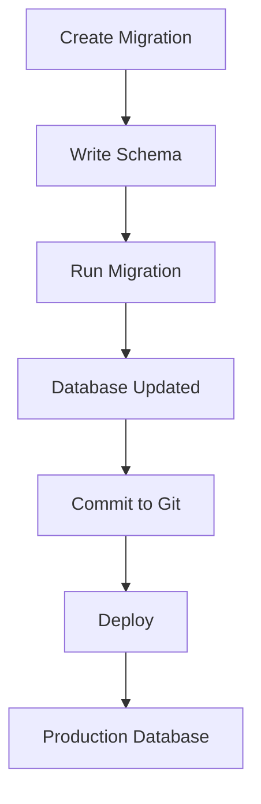
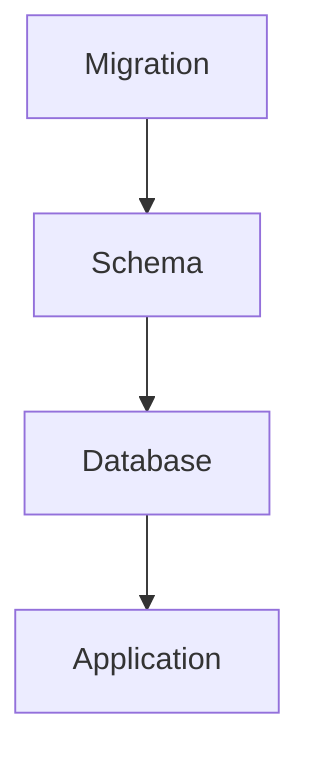

# 28. Database Migrations

> **Goal:** Manage database schema changes safely, consistently, and collaboratively using Laravel Migrations while supporting version control, deployment automation, and zero-downtime database evolution.

---

# Overview

A **Migration** is a version-controlled PHP class that defines changes to the database schema.

Instead of manually executing SQL statements, migrations allow every environment to build and evolve the database consistently.

Benefits include:

* Version-controlled schema
* Repeatable deployments
* Team collaboration
* Rollbacks
* Automated CI/CD
* Consistent environments

---

# Migration Architecture

```text id="0yqkz7"
Developer
      │
      ▼
Migration
      │
      ▼
Git Repository
      │
      ▼
Deployment
      │
      ▼
Database
```

Every schema change should be committed to source control.

---

# Migration Workflow



---

# Directory Structure

```text id="jqdmdn"
database/
├── factories/
├── migrations/
│   ├── 2026_01_01_000000_create_users_table.php
│   ├── 2026_01_02_000001_create_customers_table.php
│   ├── 2026_01_03_000002_create_loans_table.php
│   └── 2026_01_04_000003_create_payments_table.php
│
└── seeders/
```

Each migration should perform one schema change.

---

# Creating a Migration

Create a new table.

```bash id="myo6zv"
php artisan make:migration create_customers_table
```

Modify a table.

```bash id="hyiuwl"
php artisan make:migration add_phone_to_customers_table --table=customers
```

Rename a table.

```bash id="y3vup0"
php artisan make:migration rename_clients_to_customers_table
```

---

# Basic Migration

```php id="s0e80l"
use Illuminate\Database\Migrations\Migration;
use Illuminate\Database\Schema\Blueprint;
use Illuminate\Support\Facades\Schema;

return new class extends Migration
{
    public function up(): void
    {
        Schema::create('customers', function (Blueprint $table) {

            $table->id();

            $table->string('name');

            $table->string('email')->unique();

            $table->timestamps();

        });
    }

    public function down(): void
    {
        Schema::dropIfExists('customers');
    }
};
```

---

# Migration Lifecycle

Every migration contains two methods.

| Method   | Purpose                |
| -------- | ---------------------- |
| `up()`   | Apply schema changes   |
| `down()` | Reverse schema changes |

Always implement both methods whenever practical.

---

# Running Migrations

Run pending migrations.

```bash id="t9w4lx"
php artisan migrate
```

Migration status.

```bash id="cscjhu"
php artisan migrate:status
```

Rollback last batch.

```bash id="w1g91l"
php artisan migrate:rollback
```

Rollback multiple batches.

```bash id="4q7z8s"
php artisan migrate:rollback --step=3
```

Reset all migrations.

```bash id="k41tq7"
php artisan migrate:reset
```

Fresh database.

```bash id="qv8qk2"
php artisan migrate:fresh
```

Fresh with seeders.

```bash id="qvprn2"
php artisan migrate:fresh --seed
```

---

# Creating Columns

```php id="jlwmjj"
$table->string('name');

$table->text('description');

$table->integer('quantity');

$table->decimal('amount', 15, 2);

$table->boolean('is_active');

$table->date('payment_date');

$table->timestamp('approved_at');

$table->json('metadata');

$table->uuid('uuid');

$table->ulid('ulid');
```

---

# Foreign Keys

```php id="sht41l"
$table

    ->foreignId('customer_id')

    ->constrained()

    ->cascadeOnDelete();
```

Alternative actions.

```php id="1shb4m"
->restrictOnDelete()

->nullOnDelete()
```

---

# Indexes

Single index.

```php id="6hy0yz"
$table->index('status');
```

Composite index.

```php id="jpnr5l"
$table->index([
    'company_id',
    'status'
]);
```

Unique index.

```php id="gl8iq5"
$table->unique('email');
```

---

# Renaming Columns

```php id="9gxtgi"
Schema::table('customers', function (Blueprint $table) {

    $table->renameColumn(
        'fullname',
        'name'
    );

});
```

---

# Dropping Columns

```php id="vjlwmm"
Schema::table('customers', function (Blueprint $table) {

    $table->dropColumn('phone');

});
```

Multiple columns.

```php id="mxlcf9"
$table->dropColumn([
    'phone',
    'address'
]);
```

---

# Renaming Tables

```php id="gs5vxv"
Schema::rename(
    'clients',
    'customers'
);
```

---

# Dropping Tables

```php id="wycqj2"
Schema::dropIfExists(
    'customers'
);
```

---

# Soft Deletes

```php id="f3h9b8"
$table->softDeletes();
```

Adds

```text id="lyyz8d"
deleted_at
```

column.

---

# Timestamps

```php id="ru6t7v"
$table->timestamps();
```

Adds

```text id="h0y88m"
created_at

updated_at
```

---

# UUID Primary Keys

```php id="hfwjlwm"
$table->uuid('id')->primary();
```

ULID

```php id="wjjlwm"
$table->ulid('id')->primary();
```

Useful for distributed systems and public APIs.

---

# Enum Columns

Prefer application enums.

Example

```php id="t9vjlwm"
$table->string('status');
```

PHP Enum

```php id="jlwm11"
LoanStatus::Approved
```

Avoid database-specific ENUM types unless required.

---

# Migration Naming

Good

```text id="jlwm12"
create_customers_table

create_loans_table

create_payments_table

add_phone_to_customers_table

drop_old_reports_table
```

Avoid generic names.

---

# Migration Diagram



---

# Zero-Downtime Migrations

For production systems:

Avoid

```text id="jlwm14"
Rename large columns

Drop large columns

Rewrite huge tables
```

Instead

```text id="jlwm15"
Add new column

↓

Backfill data

↓

Deploy code

↓

Remove old column
```

This minimizes downtime.

---

# Data Migrations

Schema migrations should **not** contain complex business data updates.

Instead:

* Use Seeders
* Use Artisan Commands
* Use dedicated data migration scripts

Example

```bash id="jlwm16"
php artisan app:migrate-loan-status
```

---

# Seeders vs Migrations

| Migration | Seeder          |
| --------- | --------------- |
| Schema    | Data            |
| Tables    | Default records |
| Columns   | Roles           |
| Indexes   | Permissions     |

Keep responsibilities separate.

---

# Transactions

Laravel automatically wraps some schema operations where supported by the database.

Avoid performing complex application transactions inside migrations.

---

# Migration Order

Recommended order.

```text id="’wini17"
users

roles

permissions

companies

customers

products

loans

loan_installments

payments

notifications
```

Create referenced tables before dependent tables.

---

# CI/CD

Typical deployment.

```text id="jo18"
Deploy Code

↓

php artisan migrate

↓

Restart Queue

↓

Clear Cache
```

Never edit old migrations after they have been executed in shared environments.

Create a new migration instead.

---

# Migration Best Practices

* One migration per schema change.
* Keep migrations small.
* Always implement `down()`.
* Use foreign keys.
* Use indexes.
* Use decimal for money.
* Keep schema changes backward compatible during deployments.
* Commit migrations to Git.
* Test migrations before deployment.

---

# Common Anti-Patterns

Avoid

```php id="jo19"
User::create(...)
```

inside migrations.

Avoid

```php id="jo20"
Mail::send(...)
```

inside migrations.

Avoid

```php id="jo21"
Notification::send(...)
```

inside migrations.

Avoid embedding business logic.

Avoid modifying production data without a controlled migration strategy.

---

# Recommended Migration Sequence

```text id="jo22"
Users

Roles

Permissions

Companies

Customers

Addresses

Products

Loans

Installments

Payments

Notifications

Activity Logs

Audit Logs
```

Maintain logical dependencies.

---

# Testing Migrations

Run on a clean database.

```bash id="jo23"
php artisan migrate:fresh
```

Run with seeders.

```bash id="jo24"
php artisan migrate:fresh --seed
```

Verify rollback.

```bash id="jo25"
php artisan migrate

php artisan migrate:rollback
```

Every migration should be reversible unless there is a documented reason otherwise.

---

# Migration Checklist

* [ ] One responsibility per migration
* [ ] Proper name
* [ ] `up()` implemented
* [ ] `down()` implemented
* [ ] Foreign keys added
* [ ] Indexes added
* [ ] Decimal used for currency
* [ ] Timestamps included
* [ ] Soft deletes evaluated
* [ ] Tested before deployment

---

# Summary

Laravel Migrations provide a reliable, version-controlled approach to managing database schema evolution. By creating small, focused migrations, enforcing relationships and indexes, and following zero-downtime deployment practices, teams can safely evolve production databases while maintaining consistency across all environments.

The next chapter explores **Database Seeders and Factories**, covering test data generation, environment-specific seeders, model factories, and realistic dataset creation for development and automated testing.
