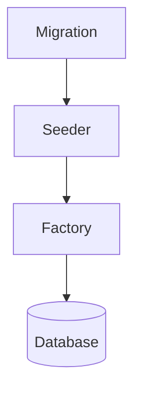
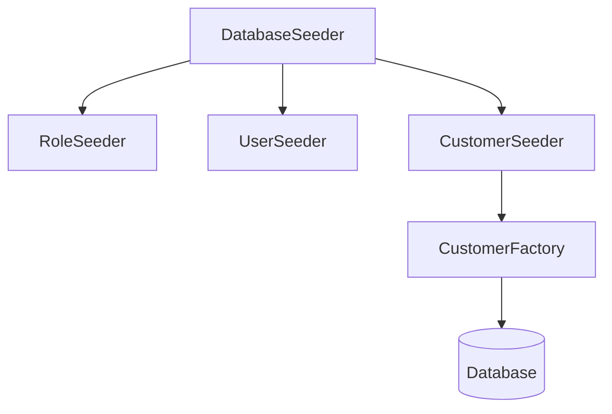

# 29. Seeders and Factories

> **Goal:** Generate consistent, realistic, and reusable data for development, testing, demos, and local environments using Laravel Seeders and Model Factories while keeping production data safe.

---

# Overview

Laravel provides two powerful tools for populating databases:

* **Seeders** – Insert predefined or reference data.
* **Factories** – Generate realistic fake model data.

Together they allow developers to:

* Prepare development environments
* Create automated test data
* Populate demo systems
* Benchmark application performance
* Build reproducible datasets

---

# Architecture

```text id="p3m9qx"
Migration
      │
      ▼
Database Schema
      │
      ▼
Seeder
      │
      ▼
Factory
      │
      ▼
Fake Data
      │
      ▼
Database
```

---

# Seeder vs Factory

| Seeder             | Factory             |
| ------------------ | ------------------- |
| Inserts known data | Generates fake data |
| Roles              | Users               |
| Permissions        | Customers           |
| Settings           | Orders              |
| Countries          | Payments            |
| Static             | Dynamic             |

Use both together.

---

# Directory Structure

```text id="k8vz0m"
database/
├── factories/
│   ├── UserFactory.php
│   ├── CustomerFactory.php
│   ├── LoanFactory.php
│   ├── PaymentFactory.php
│   └── ProductFactory.php
│
├── seeders/
│   ├── DatabaseSeeder.php
│   ├── RoleSeeder.php
│   ├── PermissionSeeder.php
│   ├── UserSeeder.php
│   ├── CustomerSeeder.php
│   ├── LoanSeeder.php
│   └── ProductSeeder.php
```

Each Seeder should have one responsibility.

---

# Seeder Flow



---

# Creating a Seeder

```bash id="m7z8lu"
php artisan make:seeder CustomerSeeder
```

Generated

```text id="r4bwqp"
database/

seeders/

CustomerSeeder.php
```

---

# Basic Seeder

```php id="w1k9jt"
namespace Database\Seeders;

use Illuminate\Database\Seeder;
use App\Models\Customer;

class CustomerSeeder extends Seeder
{
    public function run(): void
    {
        Customer::factory()

            ->count(100)

            ->create();
    }
}
```

---

# DatabaseSeeder

The entry point for all seeders.

```php id="f6w3rx"
public function run(): void
{
    $this->call([

        RoleSeeder::class,

        PermissionSeeder::class,

        UserSeeder::class,

        CustomerSeeder::class,

        ProductSeeder::class,

        LoanSeeder::class,

    ]);
}
```

---

# Running Seeders

Run all seeders.

```bash id="q0c7na"
php artisan db:seed
```

Specific seeder.

```bash id="b9l2hv"
php artisan db:seed --class=CustomerSeeder
```

Fresh database.

```bash id="v8n1oe"
php artisan migrate:fresh --seed
```

---

# Creating a Factory

```bash id="d4q5zy"
php artisan make:factory CustomerFactory --model=Customer
```

Generated

```text id="p6m2tr"
database/

factories/

CustomerFactory.php
```

---

# Basic Factory

```php id="a1h6nk"
namespace Database\Factories;

use Illuminate\Database\Eloquent\Factories\Factory;

class CustomerFactory extends Factory
{
    public function definition(): array
    {
        return [

            'name' => fake()->name(),

            'email' => fake()->unique()->safeEmail(),

            'phone' => fake()->phoneNumber(),

        ];
    }
}
```

---

# Creating Records

```php id="g7m4qe"
Customer::factory()->create();
```

Multiple

```php id="w3t9kl"
Customer::factory()

    ->count(100)

    ->create();
```

---

# Factory States

States generate variations.

```php id="e0x8pj"
public function active(): Factory
{
    return $this->state(function () {

        return [

            'status' => 'ACTIVE',

        ];

    });
}
```

Usage

```php id="m4y2fd"
Customer::factory()

    ->active()

    ->create();
```

---

# Multiple States

```php id="p1r7ws"
Customer::factory()

    ->active()

    ->verified()

    ->create();
```

States can be chained.

---

# Relationships

Customer

↓

Loans

```php id="u5v8qm"
Customer::factory()

    ->hasLoans(5)

    ->create();
```

Nested

```php id="k2n6xa"
Customer::factory()

    ->has(

        Loan::factory()

            ->count(3)

            ->hasPayments(12)

    )

    ->create();
```

Factories can build complete object graphs.

---

# Factory Callbacks

```php id="s3h4bf"
public function configure(): static
{
    return $this

        ->afterCreating(function (

            Customer $customer

        ) {

            //

        });
}
```

Useful for related setup.

---

# Seeding Reference Data

Good candidates:

* Countries
* Currencies
* Languages
* Roles
* Permissions
* Loan Products
* Settings

These should be deterministic rather than randomly generated.

---

# Faker

Laravel uses Faker.

Examples

```php id="r5w9cv"
fake()->name()

fake()->email()

fake()->phoneNumber()

fake()->company()

fake()->date()

fake()->address()

fake()->sentence()

fake()->uuid()
```

Generate realistic development data.

---

# Large Datasets

Generate many records.

```php id="q8v2pb"
Customer::factory()

    ->count(100000)

    ->create();
```

For very large datasets, prefer chunked inserts or bulk loading to reduce memory usage.

---

# Seeder Order

Recommended

```text id="o9j4tr"
Roles

Permissions

Users

Companies

Customers

Products

Loans

Installments

Payments
```

Seed parent records before dependent records.

---

# Production Seeders

Avoid generating fake production data.

Good

```text id="h3b7nm"
Roles

Permissions

Settings

Countries

Currencies
```

Avoid

```text id="j5z8ls"
10,000 Fake Customers
```

in production.

---

# Environment-Based Seeding

```php id="x6c2hv"
if (

    app()->environment('local')

) {

    Customer::factory()

        ->count(500)

        ->create();

}
```

Protect production environments.

---

# Seeder Diagram



---

# Seeders vs Factories

| Seeder                 | Factory                    |
| ---------------------- | -------------------------- |
| Organizes data loading | Generates model attributes |
| Calls factories        | Creates records            |
| Static data            | Fake data                  |
| Orchestrates           | Produces models            |

---

# Seeders vs Migrations

| Migration | Seeder   |
| --------- | -------- |
| Schema    | Data     |
| Tables    | Records  |
| Columns   | Defaults |

Keep responsibilities separate.

---

# Factories vs Fixtures

Factories

* Dynamic
* Flexible
* Reusable
* Realistic

Fixtures

* Static
* Difficult to maintain
* Repetitive

Factories are generally preferred.

---

# Testing

Factories simplify testing.

```php id="z4p8qn"
$user = User::factory()->create();

$this->actingAs($user);
```

Relationship example.

```php id="v7k5mr"
$loan = Loan::factory()

    ->for(Customer::factory())

    ->create();
```

Factories make tests isolated and repeatable.

---

# Performance Tips

For large seed operations:

* Disable unnecessary events when appropriate.
* Use bulk inserts where practical.
* Seed in batches.
* Avoid loading every model into memory.
* Queue heavy post-processing separately.

---

# Best Practices

* One Seeder per responsibility.
* Keep factories realistic.
* Use factory states.
* Seed reference data separately.
* Never generate fake production data.
* Use environment checks.
* Keep seeders deterministic where appropriate.
* Test factories regularly.
* Organize seeders logically.

---

# Common Anti-Patterns

Avoid

```php id="e8w4tv"
DB::table(...)
```

throughout many seeders without a clear reason.

Prefer models and factories unless performance requires bulk operations.

Avoid business logic inside seeders.

Avoid API calls inside factories.

Avoid random production configuration values.

---

# Recommended Seeders

Enterprise applications commonly include:

```text id="g6x9lr"
RoleSeeder

PermissionSeeder

CountrySeeder

CurrencySeeder

CompanySeeder

UserSeeder

CustomerSeeder

ProductSeeder

LoanSeeder

PaymentSeeder

SettingsSeeder
```

---

# Recommended Factories

```text id="p4k1mf"
UserFactory

CustomerFactory

LoanFactory

PaymentFactory

ProductFactory

InvoiceFactory

OrderFactory

CompanyFactory

NotificationFactory
```

---

# Testing Seeders

```php id="b2q6yw"
$this->seed(

    RoleSeeder::class

);
```

Run all.

```php id="x7r5hn"
$this->seed();
```

Factories and seeders should support automated tests.

---

# Seeders & Factories Checklist

* [ ] One Seeder per responsibility
* [ ] One Factory per model
* [ ] Uses Faker appropriately
* [ ] Uses factory states
* [ ] Relationships generated correctly
* [ ] Production-safe
* [ ] Environment-aware
* [ ] Deterministic reference data
* [ ] Organized execution order
* [ ] Covered by automated tests

---

# Summary

Seeders and Factories provide a reliable way to populate databases with both reference data and realistic test data. Seeders organize data loading, while Factories generate reusable model instances with flexible states and relationships. Together they simplify local development, automated testing, demonstrations, and performance testing while keeping production environments safe and predictable.

The next chapter explores **Database Transactions**, covering atomic operations, nested transactions, deadlock handling, retries, and best practices for maintaining data consistency.
