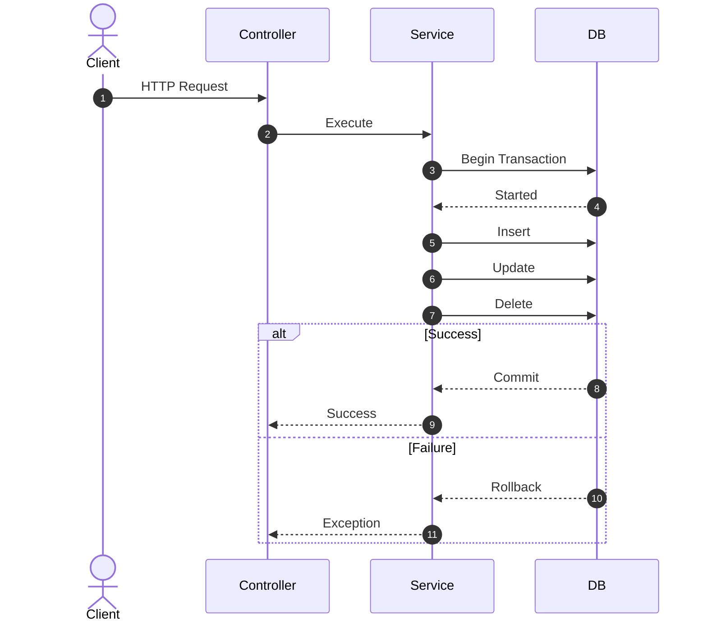
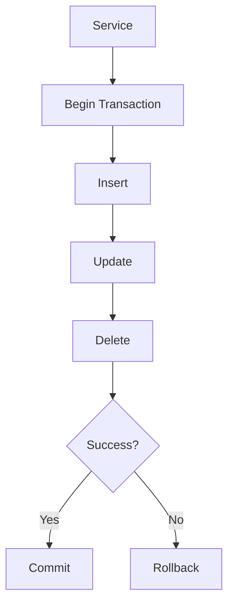

# 30. Database Transactions

> **Goal:** Ensure data consistency, integrity, and reliability by executing related database operations atomically using Laravel Database Transactions.

---

# Overview

A **Database Transaction** groups multiple database operations into a single unit of work.

A transaction guarantees that:

* **All operations succeed**, or
* **All operations fail**

There is no partial completion.

Transactions are critical in enterprise systems such as:

* Banking
* Loan Management
* Payroll
* Accounting
* Inventory
* E-commerce
* Insurance
* ERP Systems

---

# Why Transactions?

Imagine loan approval.

Steps:

1. Create Loan
2. Generate Installments
3. Update Customer Balance
4. Record Audit Log

Without a transaction:

```text id="x2qv1r"
Create Loan         ✅

Generate Schedule   ✅

Update Balance      ❌

Audit Log           ❌
```

Database becomes inconsistent.

---

With Transaction

```text id="n8w6kt"
Create Loan

↓

Generate Schedule

↓

Update Balance

↓

Audit Log

↓

Commit
```

If one step fails

↓

Everything rolls back.

---

# Transaction Architecture

```text id="j9r4wm"
Controller
      │
      ▼
Service
      │
      ▼
Database Transaction
      │
      ▼
Models
      │
      ▼
Database
```

Transactions belong in the **Service Layer** because they coordinate business workflows.

---

# Transaction Flow



---

# Using Transactions

Recommended approach.

```php id="x4m8dp"
use Illuminate\Support\Facades\DB;

DB::transaction(function () {

    //

});
```

Laravel automatically:

* Begins transaction
* Commits on success
* Rolls back on exception

---

# Example

```php id="y1t6sw"
DB::transaction(function () use ($loanData) {

    $loan = Loan::create($loanData);

    InstallmentService::generate($loan);

    AuditLog::create([

        'loan_id' => $loan->id,

        'action' => 'Created',

    ]);

});
```

Everything succeeds or nothing is saved.

---

# Service Example

```php id="d5w2hr"
class LoanService
{
    public function approve(
        Loan $loan
    ): Loan {

        return DB::transaction(

            function () use ($loan) {

                $loan->approve();

                InstallmentService::generate($loan);

                LoanApproved::dispatch(
                    $loan
                )->afterCommit();

                return $loan;

            }

        );

    }
}
```

Transactions belong inside Services—not Controllers.

---

# Manual Transactions

Sometimes explicit control is needed.

```php id="m9v3qx"
DB::beginTransaction();

try {

    //

    DB::commit();

} catch (Throwable $e) {

    DB::rollBack();

    throw $e;

}
```

Useful when multiple exception paths require custom handling.

---

# Rollback

Rollback manually.

```php id="n6c4zt"
DB::rollBack();
```

All changes since `beginTransaction()` are discarded.

---

# Commit

```php id="v8p2ks"
DB::commit();
```

Changes become permanent.

---

# Nested Transactions

Laravel supports nested transaction calls.

```php id="q3h5wf"
DB::transaction(function () {

    //

    DB::transaction(function () {

        //

    });

});
```

Laravel manages nesting using transaction levels where supported.

Avoid unnecessary nesting.

---

# Deadlock Retry

Automatic retries.

```php id="z7j4ne"
DB::transaction(

    function () {

        //

    },

    5

);
```

Laravel retries the transaction up to five times if a deadlock occurs.

---

# Exception Handling

Example

```php id="f1r8my"
try {

    DB::transaction(function () {

        //

    });

} catch (Throwable $e) {

    Log::error($e);

    throw $e;

}
```

Always log unexpected failures.

---

# Events After Commit

Avoid dispatching events before commit.

Good

```php id="r2t9lx"
LoanApproved::dispatch(

    $loan

)->afterCommit();
```

This prevents notifications from being sent when the transaction ultimately fails.

---

# Queue Jobs After Commit

```php id="g4v6pc"
GenerateInvoiceJob::dispatch(

    $invoice

)->afterCommit();
```

Jobs execute only after successful commit.

---

# Notifications After Commit

```php id="w7m2na"
$user->notify(

    (new LoanApprovedNotification())

        ->afterCommit()

);
```

Avoid notifying users about rolled-back operations.

---

# External APIs

Avoid

```text id="h9c7sr"
Transaction

↓

HTTP API

↓

Waiting...
```

Instead

```text id="y3p8ev"
Transaction

↓

Commit

↓

Dispatch Job

↓

HTTP API
```

Keep transactions short.

---

# Long Transactions

Avoid

```text id="f8r1wx"
Transaction

↓

Generate PDF

↓

Resize Images

↓

HTTP Request

↓

Commit
```

Long-running work increases lock contention.

Instead

```text id="t2m5qv"
Transaction

↓

Commit

↓

Queue Job
```

---

# Transaction Diagram



---

# Transactions vs Jobs

| Transaction          | Job                    |
| -------------------- | ---------------------- |
| Atomic database work | Background processing  |
| Short-lived          | Long-running           |
| Data consistency     | Asynchronous execution |

---

# Transactions vs Events

| Transaction          | Event                 |
| -------------------- | --------------------- |
| Database consistency | Business notification |
| Commit or rollback   | Something happened    |

Events should generally be dispatched **after commit**.

---

# Transactions vs Locks

Transactions ensure consistency.

Locks control concurrent access.

Use transactions first.

Use locks only when necessary.

---

# Pessimistic Locking

Prevent concurrent updates.

```php id="u8n6gx"
$loan = Loan::lockForUpdate()

    ->find($id);
```

Useful for:

* Banking
* Wallets
* Loan balances
* Inventory

---

# Shared Lock

```php id="j1w4by"
Loan::sharedLock()

    ->find($id);
```

Allows concurrent reads while preventing conflicting writes.

---

# Idempotency

Transactions do not prevent duplicate requests.

Example

```text id="b4c8yu"
Double Click

↓

Two Requests

↓

Two Transactions
```

Combine transactions with idempotency keys or unique constraints.

---

# Best Practices

* Keep transactions short.
* Use `DB::transaction()` whenever possible.
* Dispatch Events after commit.
* Queue expensive work after commit.
* Log failures.
* Retry deadlocks.
* Avoid external API calls inside transactions.
* Use locking only when required.
* Keep business workflows inside Services.

---

# Common Anti-Patterns

Avoid

```php id="m2q9ha"
Mail::send(...)
```

inside transactions.

Avoid

```php id="t8v4yn"
Http::post(...)
```

inside transactions.

Avoid

```php id="y5p7kr"
sleep(10);
```

inside transactions.

Avoid wrapping unrelated operations in a single transaction.

Avoid placing transaction logic inside Controllers.

---

# Recommended Transaction Use Cases

Use transactions for:

```text id="w6h3dp"
Loan Approval

Payment Processing

Wallet Transfer

Invoice Creation

Order Placement

Stock Deduction

Insurance Purchase

Payroll Processing

Membership Registration
```

Any workflow involving multiple related database writes should be transactional.

---

# Testing Transactions

```php id="x8j1nv"
$this->expectException(
    Exception::class
);

$this->service->approve($loan);
```

Verify database state.

```php id="v3c6sq"
$this->assertDatabaseMissing([
    'status' => 'APPROVED',
]);
```

Test both commit and rollback scenarios.

---

# Transactions Checklist

* [ ] Transaction located in Service
* [ ] Uses `DB::transaction()`
* [ ] Short execution time
* [ ] Events dispatched after commit
* [ ] Jobs dispatched after commit
* [ ] Notifications sent after commit
* [ ] Deadlock retries configured where appropriate
* [ ] Exceptions logged
* [ ] No external API calls inside transaction
* [ ] Rollback behavior tested

---

# Summary

Database Transactions are essential for preserving data integrity across multiple related operations. By placing transactions inside the Service layer, keeping them short, dispatching side effects only after successful commits, and combining them with proper locking and retry strategies, Laravel applications can safely handle complex financial and business workflows without risking inconsistent data.

The next chapter explores **Caching**, covering cache drivers, cache invalidation, tagged caches, distributed caching, cache warming, and performance optimization strategies.
