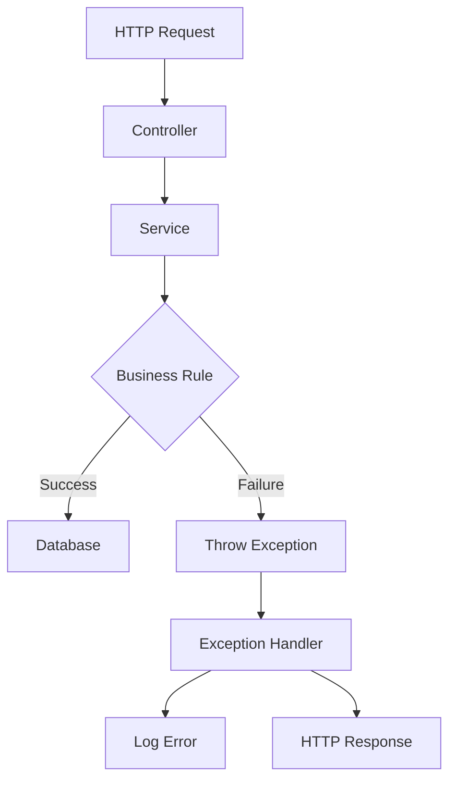
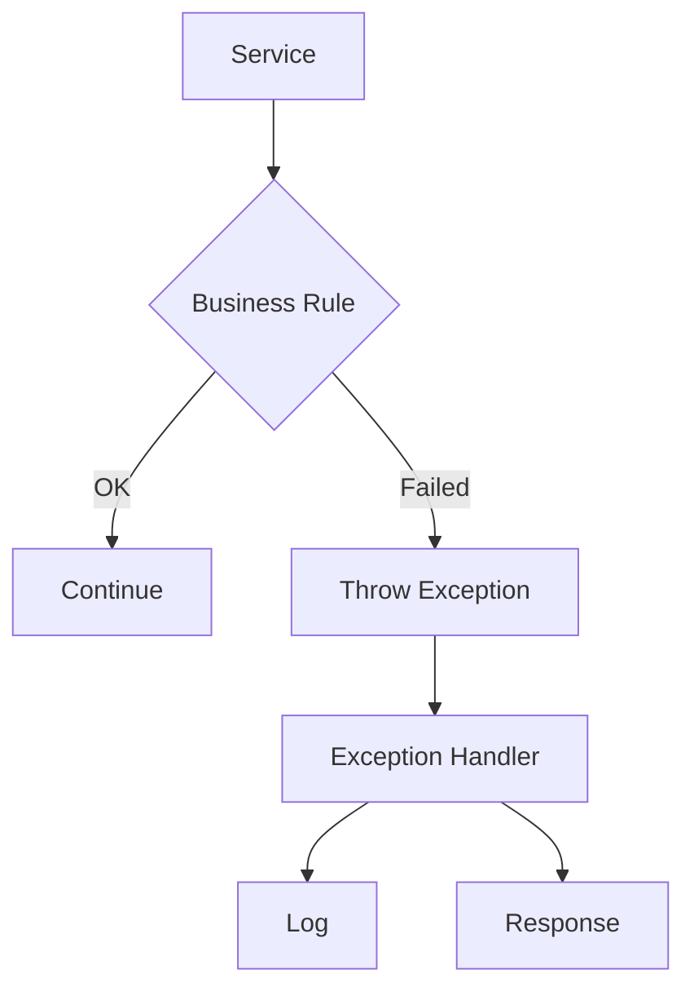

# 31. Exception Handling

> **Goal:** Build reliable, maintainable, and predictable error handling by using custom Exceptions, centralized exception rendering, structured logging, and consistent API responses while keeping business logic free from HTTP concerns.

---

# Overview

Exceptions represent **unexpected situations** that prevent an operation from completing successfully.

Instead of returning error codes or nested conditional statements, Laravel encourages throwing Exceptions and handling them centrally.

Examples:

* Customer not found
* Loan already approved
* Insufficient balance
* Invalid payment
* Unauthorized access
* External API failure
* Business rule violation

Proper exception handling makes applications:

* Easier to debug
* Easier to maintain
* More reliable
* More testable
* More secure

---

# Exception Flow

```text
Client
    │
    ▼
Controller
    │
    ▼
Service
    │
    ▼
Business Logic
    │
    ▼
Exception Thrown
    │
    ▼
Laravel Exception Handler
    │
    ▼
JSON / View Response
```

---

# Architecture



---

# Exception Philosophy

Exceptions should represent **unexpected failures** or **business rule violations**.

Good examples:

* LoanAlreadyApprovedException
* InsufficientBalanceException
* CustomerNotFoundException
* PaymentExpiredException

Avoid using generic exceptions when a meaningful custom exception improves clarity.

---

# Directory Structure

```text
app/
├── Exceptions/
│   ├── BusinessException.php
│   ├── LoanAlreadyApprovedException.php
│   ├── CustomerNotFoundException.php
│   ├── InsufficientBalanceException.php
│   ├── InvalidPaymentException.php
│   ├── ExternalApiException.php
│   └── PolicyException.php
│
├── Services/
├── Http/
└── Models/
```

---

# Exception Lifecycle

```text
Service

↓

Validation

↓

Business Rule

↓

Throw Exception

↓

Handler

↓

Response
```

Services throw Exceptions.

Laravel renders responses.

---

# Creating an Exception

```bash
php artisan make:exception LoanAlreadyApprovedException
```

Generated

```text
app/

Exceptions/

LoanAlreadyApprovedException.php
```

---

# Basic Exception

```php
namespace App\Exceptions;

use Exception;

class LoanAlreadyApprovedException extends Exception
{
    //
}
```

---

# Throwing Exceptions

Service

```php
if (

    $loan->isApproved()

) {

    throw new LoanAlreadyApprovedException();

}
```

Avoid returning `false` for exceptional situations.

---

# Exception with Message

```php
throw new LoanAlreadyApprovedException(

    'Loan has already been approved.'

);
```

---

# Exception with Code

```php
throw new LoanAlreadyApprovedException(

    'Loan has already been approved.',

    409

);
```

Use HTTP status codes only when they are meaningful for the exception's eventual response.

---

# Custom Business Exception

Example

```php
namespace App\Exceptions;

use Exception;

class BusinessException extends Exception
{
}
```

Other exceptions may extend it.

```php
class InsufficientBalanceException
    extends BusinessException
{
}
```

This provides a common type for domain-related errors.

---

# Exception Handler

Laravel centralizes exception rendering.

Laravel 11/12

```php
bootstrap/app.php
```

Example

```php
->withExceptions(function ($exceptions) {

    $exceptions->render(

        function (

            LoanAlreadyApprovedException $e,

            $request

        ) {

            return response()->json([

                'message' => $e->getMessage(),

            ], 409);

        }

    );

});
```

Older Laravel versions use `app/Exceptions/Handler.php`.

---

# API Error Response

Recommended format.

```json
{
    "success": false,
    "message": "Loan has already been approved.",
    "errors": [],
    "code": 409
}
```

Keep API error responses consistent.

---

# Web Error Response

Example

```php
return redirect()

    ->back()

    ->withErrors(

        $e->getMessage()

    );
```

Rendering should occur in the exception handler or controller boundary, not inside Services.

---

# Validation Exceptions

Laravel automatically throws

```text
ValidationException
```

when Form Request validation fails.

Avoid manual validation inside Services unless required for non-HTTP workflows.

---

# Authorization Exceptions

Laravel automatically throws

```text
AuthorizationException
```

Result

```http
403 Forbidden
```

---

# Authentication Exceptions

Laravel automatically throws

```text
AuthenticationException
```

Result

```http
401 Unauthorized
```

---

# Model Not Found

Example

```php
Customer::findOrFail(
    $id
);
```

Throws

```text
ModelNotFoundException
```

Laravel converts it to:

```http
404 Not Found
```

---

# External API Exception

Example

```php
$response = Http::post(...);

if (

    $response->failed()

) {

    throw new ExternalApiException(

        'CRM synchronization failed.'

    );

}
```

Wrap external failures with meaningful domain exceptions when appropriate.

---

# Database Exception

```php
try {

    DB::transaction(function () {

        //

    });

} catch (Throwable $e) {

    Log::error($e);

    throw $e;

}
```

Always preserve the original exception unless intentionally translating it.

---

# Logging Exceptions

```php
Log::error(

    $e->getMessage(),

    [

        'exception' => $e,

    ]

);
```

Avoid logging sensitive information such as passwords, tokens, or personal data.

---

# Exception Diagram



---

# Exception vs Validation

| Validation   | Exception        |
| ------------ | ---------------- |
| User input   | Business failure |
| Form Request | Service          |
| HTTP layer   | Domain layer     |

Validation prevents invalid input.

Exceptions signal runtime failures.

---

# Exception vs Return False

Avoid

```php
return false;
```

Instead

```php
throw new PaymentFailedException();
```

Exceptions provide clear intent and preserve stack traces.

---

# Exception vs Notifications

Do not send notifications directly from Exceptions.

Instead

```text
Service

↓

Catch Exception

↓

Dispatch Event

↓

Notification
```

---

# Exception vs Logging

Exceptions should not automatically log themselves.

The central handler should determine:

* What to log
* Where to log
* How much to log

This keeps logging consistent.

---

# Retry Logic

Some exceptions are retryable.

Examples:

* Network timeout
* Deadlock
* Temporary API outage

Example

```php
retry(

    3,

    fn () => Http::get(...)

);
```

Do not retry permanent business rule failures.

---

# Sensitive Information

Never expose:

* SQL queries
* Stack traces
* File paths
* API keys
* Database credentials

Production responses should contain user-friendly messages.

---

# Best Practices

* Create meaningful custom Exceptions.
* Throw Exceptions from Services.
* Handle rendering centrally.
* Keep API responses consistent.
* Log unexpected failures.
* Avoid generic exceptions when possible.
* Translate infrastructure exceptions into domain exceptions where appropriate.
* Never expose sensitive information.
* Test failure scenarios.

---

# Common Anti-Patterns

Avoid

```php
catch (

    Exception $e

) {

}
```

without handling or rethrowing.

Avoid

```php
return false;
```

for exceptional situations.

Avoid swallowing exceptions.

Avoid HTTP responses inside Services.

Avoid throwing generic `Exception` everywhere.

---

# Recommended Exceptions

Enterprise applications commonly include:

```text
BusinessException

CustomerNotFoundException

LoanAlreadyApprovedException

LoanRejectedException

PaymentFailedException

PaymentExpiredException

InsufficientBalanceException

InvalidOtpException

ExternalApiException

PolicyException

DuplicateReferenceException

ResourceLockedException
```

Each exception should represent one failure scenario.

---

# Testing Exceptions

```php
$this->expectException(

    LoanAlreadyApprovedException::class

);

$this->service->approve($loan);
```

Verify message.

```php
$this->expectExceptionMessage(

    'Loan has already been approved.'

);
```

Test both success and failure paths.

---

# Exception Handling Checklist

* [ ] Custom Exceptions created where appropriate
* [ ] Exceptions thrown from Services
* [ ] Centralized rendering configured
* [ ] Consistent API responses
* [ ] Sensitive data hidden
* [ ] Errors logged
* [ ] Generic exceptions minimized
* [ ] Failure scenarios tested
* [ ] Business logic separated from HTTP responses
* [ ] Retry strategy considered for transient failures

---

# Summary

Exception handling is essential for building resilient Laravel applications. Services should throw meaningful domain-specific Exceptions whenever business rules fail or unexpected situations occur. Laravel's centralized exception handling then converts those Exceptions into consistent HTTP responses while logging unexpected failures. By separating business logic from error presentation, applications remain clean, secure, and easy to maintain.

The next chapter explores **Logging and Monitoring**, covering structured logging, log channels, observability, performance monitoring, alerting, and production troubleshooting.
