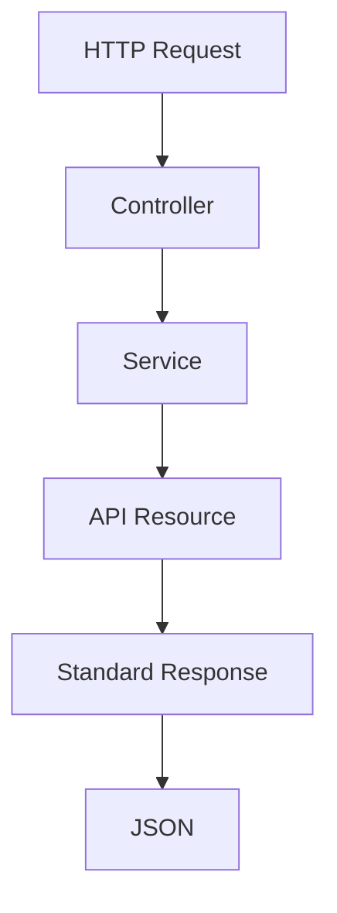
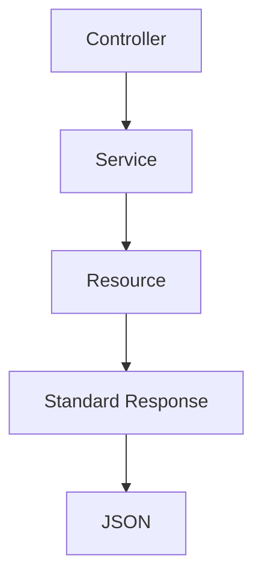

# 32. API Response Standard

> **Goal:** Establish a consistent, predictable, and maintainable API response format across the entire application for both successful and failed requests.

---

# Overview

Every API endpoint should return a **standardized JSON response** regardless of the module.

A consistent response format provides:

* Easier frontend integration
* Better API documentation
* Predictable error handling
* Cleaner mobile applications
* Easier debugging
* Better third-party integrations

Never return inconsistent structures between endpoints.

---

# API Response Flow

```text
HTTP Request
      │
      ▼
Form Request
      │
      ▼
Controller
      │
      ▼
Service
      │
      ▼
Resource
      │
      ▼
Standard JSON Response
```

---

# Response Architecture



---

# Standard Success Response

Every successful response should follow:

```json
{
    "success": true,
    "message": "Operation completed successfully.",
    "data": {},
    "meta": null,
    "errors": null
}
```

---

# Collection Response

```json
{
    "success": true,
    "message": "Customers retrieved successfully.",
    "data": [],
    "meta": {
        "current_page": 1,
        "last_page": 12,
        "per_page": 20,
        "total": 234
    },
    "errors": null
}
```

---

# Error Response

```json
{
    "success": false,
    "message": "Validation failed.",
    "data": null,
    "errors": {
        "email": [
            "The email field is required."
        ]
    }
}
```

---

# Response Structure

| Field   | Description                   |
| ------- | ----------------------------- |
| success | Boolean result                |
| message | Human-readable message        |
| data    | Response payload              |
| meta    | Pagination or metadata        |
| errors  | Validation or business errors |

---

# HTTP Status Codes

| Code | Meaning               |
| ---- | --------------------- |
| 200  | Success               |
| 201  | Resource Created      |
| 202  | Accepted              |
| 204  | No Content            |
| 400  | Bad Request           |
| 401  | Unauthorized          |
| 403  | Forbidden             |
| 404  | Not Found             |
| 409  | Conflict              |
| 422  | Validation Error      |
| 429  | Too Many Requests     |
| 500  | Internal Server Error |
| 503  | Service Unavailable   |

Always return the appropriate HTTP status code.

---

# Successful GET

```http
200 OK
```

```json
{
    "success": true,
    "message": "Customer retrieved successfully.",
    "data": {
        "id": 1,
        "name": "John Doe"
    },
    "meta": null,
    "errors": null
}
```

---

# Successful POST

```http
201 Created
```

```json
{
    "success": true,
    "message": "Customer created successfully.",
    "data": {
        "id": 15
    },
    "meta": null,
    "errors": null
}
```

---

# Successful DELETE

```http
204 No Content
```

No response body is required.

Alternatively

```http
200 OK
```

```json
{
    "success": true,
    "message": "Customer deleted successfully."
}
```

Choose one convention and use it consistently.

---

# Validation Errors

Laravel automatically returns

```http
422 Unprocessable Entity
```

Example

```json
{
    "success": false,
    "message": "Validation failed.",
    "errors": {
        "email": [
            "The email field is required."
        ]
    }
}
```

---

# Business Errors

Example

```http
409 Conflict
```

```json
{
    "success": false,
    "message": "Loan has already been approved.",
    "errors": null
}
```

---

# Unauthorized

```http
401 Unauthorized
```

```json
{
    "success": false,
    "message": "Unauthenticated."
}
```

---

# Forbidden

```http
403 Forbidden
```

```json
{
    "success": false,
    "message": "You do not have permission."
}
```

---

# Not Found

```http
404 Not Found
```

```json
{
    "success": false,
    "message": "Customer not found."
}
```

---

# Server Error

```http
500 Internal Server Error
```

Production

```json
{
    "success": false,
    "message": "An unexpected error occurred."
}
```

Never expose:

* Stack traces
* SQL queries
* File paths
* API keys

---

# Pagination Response

```json
{
    "success": true,
    "message": "Loans retrieved successfully.",
    "data": [],
    "meta": {
        "current_page": 2,
        "last_page": 15,
        "per_page": 20,
        "total": 293,
        "from": 21,
        "to": 40
    }
}
```

---

# Resource Example

Controller

```php
public function index()
{
    $customers = $this->service->paginate();

    return CustomerResource::collection(
        $customers
    );
}
```

Resource

```php
public function toArray($request)
{
    return [

        'id' => $this->id,

        'name' => $this->name,

        'email' => $this->email,

    ];
}
```

Resources should transform models, not build response envelopes.

---

# Response Helper

Example helper.

```php
function api_success(

    mixed $data = null,

    string $message = 'Success.',

    int $status = 200,

    ?array $meta = null

) {

    return response()->json([

        'success' => true,

        'message' => $message,

        'data' => $data,

        'meta' => $meta,

        'errors' => null,

    ], $status);

}
```

---

# Error Helper

```php
function api_error(

    string $message,

    mixed $errors = null,

    int $status = 400

) {

    return response()->json([

        'success' => false,

        'message' => $message,

        'data' => null,

        'meta' => null,

        'errors' => $errors,

    ], $status);

}
```

Many teams implement these as a reusable response service or trait instead of global helpers.

---

# API Resource Diagram



---

# API Response vs Resource

| Resource         | Response               |
| ---------------- | ---------------------- |
| Transforms model | Wraps output           |
| Defines fields   | Defines JSON structure |
| Data only        | Entire response        |

Resources and standardized responses complement each other.

---

# Versioning

Include versioning in URLs or headers.

Example

```text
/api/v1/customers
```

Future

```text
/api/v2/customers
```

Avoid breaking existing clients.

---

# API Documentation

Document every endpoint.

Include:

* URL
* Method
* Request body
* Success response
* Error response
* Status codes

Tools:

* OpenAPI
* Swagger
* Stoplight

---

# Best Practices

* Use one response format.
* Use correct HTTP status codes.
* Transform data with Resources.
* Return consistent error structures.
* Never expose internal exceptions.
* Include pagination metadata.
* Keep messages user-friendly.
* Version APIs.
* Document endpoints.

---

# Common Anti-Patterns

Avoid

```json
{
    "status": true
}
```

on one endpoint and

```json
{
    "success": true
}
```

on another.

Avoid returning raw Eloquent models.

Avoid mixing pagination formats.

Avoid returning HTTP 200 for validation errors.

Avoid exposing stack traces.

---

# Enterprise Response Example

```json
{
    "success": true,
    "message": "Loan approved successfully.",
    "data": {
        "id": 125,
        "status": "APPROVED"
    },
    "meta": {
        "request_id": "req_01JXYZABC123",
        "timestamp": "2026-07-09T12:30:45Z",
        "version": "v1"
    },
    "errors": null
}
```

Useful metadata may include:

* Request ID
* API version
* Timestamp

---

# Testing Responses

```php
$response = $this->getJson('/api/v1/customers');

$response

    ->assertOk()

    ->assertJsonStructure([

        'success',

        'message',

        'data',

        'meta',

        'errors',

    ]);
```

Every endpoint should follow the same structure.

---

# API Response Checklist

* [ ] Consistent response format
* [ ] Correct HTTP status codes
* [ ] Uses API Resources
* [ ] Pagination metadata included
* [ ] Validation errors standardized
* [ ] Business errors standardized
* [ ] Sensitive information hidden
* [ ] API versioned
* [ ] Documented
* [ ] Tested

---

# Summary

A standardized API response format is essential for building reliable, maintainable, and developer-friendly APIs. By combining Laravel API Resources with a consistent response envelope, correct HTTP status codes, and centralized error handling, every endpoint behaves predictably for web, mobile, and third-party clients.

The next chapter explores **Logging and Monitoring**, covering structured logging, log channels, observability, performance monitoring, centralized logging, and production troubleshooting.
