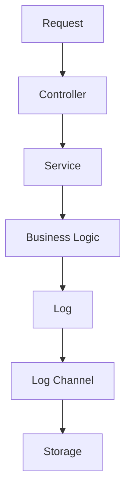
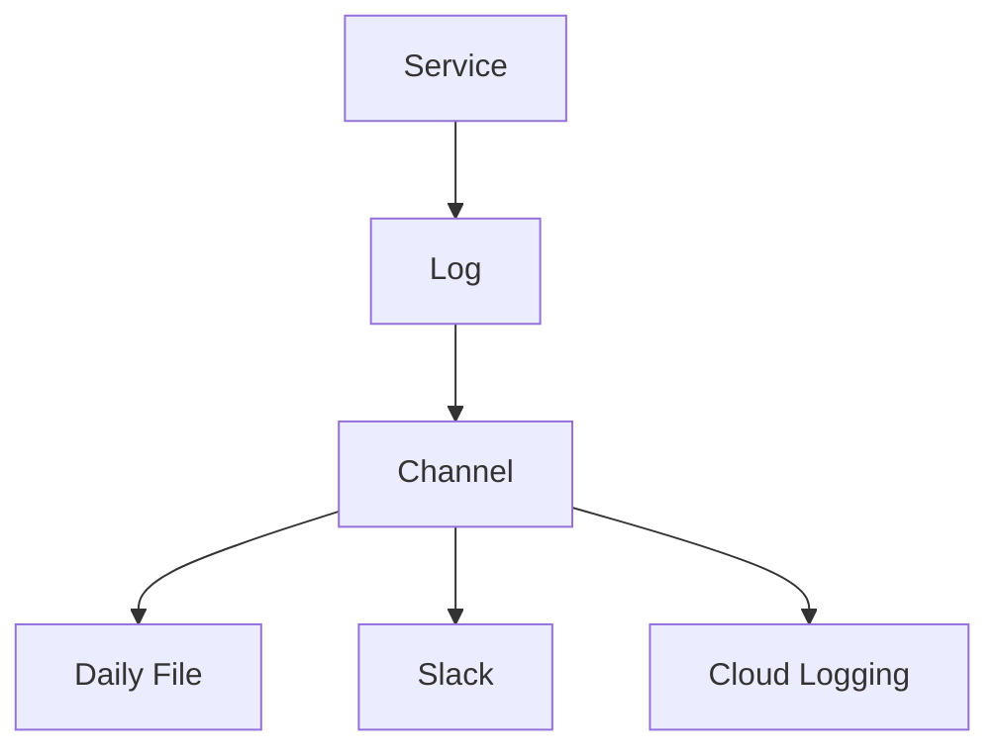

# 33. Logging

> **Goal:** Build observable, debuggable, and production-ready Laravel applications by implementing structured logging, centralized log management, and meaningful log messages while avoiding sensitive data exposure.

---

# Overview

Logging records important application events, errors, and operational information.

Logs help developers:

* Debug issues
* Monitor production systems
* Investigate failures
* Audit application behavior
* Measure performance
* Troubleshoot integrations

A good logging strategy answers:

* What happened?
* When did it happen?
* Who triggered it?
* Which request caused it?
* What was the result?

---

# Logging Architecture

```text id="k2j7fp"
HTTP Request
      │
      ▼
Controller
      │
      ▼
Service
      │
      ▼
Log Event
      │
      ▼
Log Channel
      │
      ▼
Storage / External Service
```

Logging should support—not replace—application monitoring and auditing.

---

# Logging Flow



---

# Log Levels

Laravel follows the PSR-3 logging standard.

| Level     | Purpose                         |
| --------- | ------------------------------- |
| emergency | System unusable                 |
| alert     | Immediate action required       |
| critical  | Critical failure                |
| error     | Runtime error                   |
| warning   | Unexpected but recoverable      |
| notice    | Normal but significant event    |
| info      | General application information |
| debug     | Development and troubleshooting |

Choose the lowest level that accurately describes the event.

---

# Logging Philosophy

Log:

* Business events
* System failures
* External API failures
* Security events
* Unexpected exceptions
* Performance bottlenecks

Avoid logging:

* Passwords
* Tokens
* API secrets
* Credit card numbers
* Personally sensitive information
* Entire request payloads unless required and sanitized

---

# Directory Structure

```text id="hnq4xr"
storage/
└── logs/
    ├── laravel.log
    ├── daily-2026-07-09.log
    └── horizon.log

config/
└── logging.php
```

---

# Basic Logging

```php id="txd7aw"
use Illuminate\Support\Facades\Log;

Log::info(
    'Customer created.'
);
```

---

# Logging with Context

Always include useful context.

```php id="ik3r5u"
Log::info(

    'Loan approved.',

    [

        'loan_id' => $loan->id,

        'customer_id' => $loan->customer_id,

    ]

);
```

Context makes logs searchable and actionable.

---

# Debug Logging

```php id="dc5jzu"
Log::debug(

    'Processing payment.',

    [

        'payment_id' => $payment->id,

    ]

);
```

Use for development and troubleshooting.

---

# Warning

```php id="0czjwg"
Log::warning(

    'Customer exceeded credit limit.',

    [

        'customer_id' => $customer->id,

    ]

);
```

---

# Error

```php id="dbx17v"
Log::error(

    'Payment failed.',

    [

        'payment_id' => $payment->id,

        'gateway' => 'Stripe',

    ]

);
```

---

# Critical

```php id="7vlqhi"
Log::critical(

    'Database connection lost.'
);
```

Reserved for severe failures.

---

# Exception Logging

```php id="pvk73o"
try {

    //

} catch (Throwable $e) {

    Log::error(

        'Loan approval failed.',

        [

            'exception' => $e,

            'loan_id' => $loan->id,

        ]

    );

    throw $e;

}
```

Log meaningful context in addition to the exception.

---

# Structured Logging

Prefer

```php id="8bof7h"
Log::info(

    'Customer updated.',

    [

        'customer_id' => 15,

        'user_id' => 2,

    ]

);
```

Avoid

```php id="z6p8nh"
Log::info(

    'Customer updated successfully by administrator.'
);
```

Structured data is easier to search and analyze.

---

# Log Channels

Laravel supports multiple channels.

Examples:

```text id="u6h1vb"
stack

single

daily

slack

stderr

syslog

errorlog
```

Configure channels in:

```text id="vk0cq4"
config/logging.php
```

---

# Daily Logs

Environment

```env id="vq9o5w"
LOG_CHANNEL=daily

LOG_LEVEL=info
```

Creates rotating log files.

---

# Stack Channel

Example

```env id="pryq1k"
LOG_CHANNEL=stack
```

Stack channels send logs to multiple destinations.

---

# Custom Channel

Example

```php id="uqg37j"
Log::channel(

    'slack'

)->critical(

    'Payment gateway offline.'

);
```

Useful for operational alerts.

---

# Log Context

Global request context.

```php id="bw3jmk"
Log::withContext([

    'request_id' => $requestId,

    'user_id' => auth()->id(),

]);
```

Every subsequent log entry includes this information.

---

# Request IDs

Generate a unique identifier per request.

```text id="q4twki"
Request

↓

req_01HXYZABC123
```

Include it in:

* Logs
* Responses
* Monitoring tools

This simplifies troubleshooting across distributed systems.

---

# External API Logging

```php id="gm0y18"
Log::info(

    'Sending CRM request.',

    [

        'customer_id' => $customer->id,

    ]

);
```

If it fails:

```php id="1c4uok"
Log::error(

    'CRM synchronization failed.',

    [

        'response' => $response->body(),

    ]

);
```

Mask or remove sensitive payload fields.

---

# Performance Logging

Example

```php id="2l3g7e"
$start = microtime(true);

//

Log::info(

    'Report generated.',

    [

        'duration_ms' =>

            (microtime(true) - $start) * 1000,

    ]

);
```

Useful for identifying slow operations.

---

# Logging Diagram



---

# Logging vs Activity Logs

| Logging               | Activity Log          |
| --------------------- | --------------------- |
| System diagnostics    | User/business history |
| Developer focused     | Business focused      |
| Temporary retention   | Long-term retention   |
| Files or log services | Database              |

Use logging for diagnostics.

Use activity logs for auditing business actions.

---

# Logging vs Exceptions

| Logging         | Exception       |
| --------------- | --------------- |
| Records failure | Signals failure |
| Diagnostic      | Control flow    |

Exceptions may be logged, but logging does not replace exception handling.

---

# Logging vs Monitoring

| Logging        | Monitoring     |
| -------------- | -------------- |
| Records events | Detects trends |
| Historical     | Real-time      |
| Detailed       | Aggregated     |

Monitoring systems consume logs and metrics.

---

# Recommended Log Events

Applications commonly log:

```text id="f2krwp"
User Login

User Logout

Failed Login

Loan Approved

Payment Failed

External API Failure

Queue Failure

Database Error

Permission Denied

Unexpected Exception
```

Avoid logging every routine operation.

---

# Log Rotation

Use daily logs.

```env id="r0d7sh"
LOG_CHANNEL=daily

LOG_DAILY_DAYS=14
```

Retain logs only as long as necessary.

---

# Production Monitoring

Common integrations:

* ELK Stack
* OpenSearch
* Graylog
* Datadog
* New Relic
* Grafana Loki
* CloudWatch
* Sentry (for exception tracking)

Centralized logging improves observability across multiple servers.

---

# Best Practices

* Use structured logging.
* Include contextual information.
* Use appropriate log levels.
* Log exceptions once.
* Generate request IDs.
* Rotate logs.
* Protect sensitive information.
* Keep log messages concise.
* Centralize production logs.
* Review logs regularly.

---

# Common Anti-Patterns

Avoid

```php id="2mwgav"
Log::info($request->all());
```

Avoid logging passwords or authentication tokens.

Avoid excessive debug logging in production.

Avoid logging the same exception multiple times.

Avoid vague messages.

Example

```php id="brltx8"
Log::error('Something failed.');
```

Prefer descriptive messages with structured context.

---

# Testing Logging

```php id="b2q1md"
Log::spy();

$this->service->approve($loan);

Log::shouldHaveReceived('info');
```

Focus tests on significant logging behavior rather than every log entry.

---

# Logging Checklist

* [ ] Appropriate log levels
* [ ] Structured context included
* [ ] Request IDs supported
* [ ] Sensitive data excluded
* [ ] Exceptions logged consistently
* [ ] Daily or centralized logging configured
* [ ] Performance events monitored
* [ ] External API failures logged
* [ ] Production rotation configured
* [ ] Logging strategy documented

---

# Summary

Logging is a critical part of operating enterprise Laravel applications. By using structured log messages, appropriate severity levels, meaningful context, and centralized log management, development and operations teams can diagnose issues quickly and maintain reliable systems. Logging should complement exception handling, monitoring, and auditing while never exposing sensitive information.

The next chapter explores **Caching**, covering cache drivers, cache invalidation, cache tags, distributed caching, cache warming, and performance optimization techniques.
