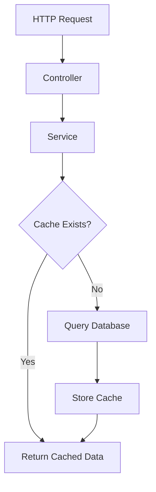
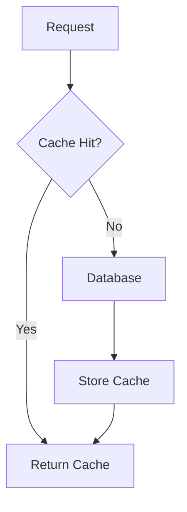

# 34. Caching

> **Goal:** Improve application performance, reduce database load, and increase scalability by implementing an effective caching strategy using Laravel's Cache system while ensuring data consistency through proper cache invalidation.

---

# Overview

Caching stores frequently accessed data in fast storage so it can be retrieved without repeatedly querying the database or external services.

Benefits include:

* Faster response times
* Reduced database load
* Lower infrastructure costs
* Improved scalability
* Better user experience

Enterprise Laravel applications should treat caching as a performance optimization layer, not as the primary source of truth.

---

# Cache Architecture

```text id="mp7g4v"
HTTP Request
      │
      ▼
Controller
      │
      ▼
Service
      │
      ▼
Cache Check
      │
      ├───────────────┐
      │               │
      ▼               ▼
Cache Hit       Cache Miss
      │               │
      ▼               ▼
Return Data     Database
      │               │
      └───────Store Cache───────┘
```

---

# Request Flow



---

# Cache Drivers

Laravel supports multiple cache drivers.

| Driver    | Recommended Use             |
| --------- | --------------------------- |
| Redis     | Production (recommended)    |
| Memcached | High-performance production |
| Database  | Small applications          |
| File      | Local development           |
| Array     | Testing                     |
| DynamoDB  | AWS environments            |

Redis is generally the preferred production cache backend.

---

# Configuration

Environment

```env id="j2n4kp"
CACHE_STORE=redis
```

Configuration file

```text id="b9h1cm"
config/cache.php
```

---

# Basic Cache Operations

Store a value.

```php id="c3v5ta"
Cache::put(

    'settings',

    $settings,

    now()->addHour()

);
```

Retrieve a value.

```php id="y7k8dx"
Cache::get(
    'settings'
);
```

Retrieve with default.

```php id="e1r2fv"
Cache::get(

    'theme',

    'light'

);
```

---

# Cache Remember

The most common pattern.

```php id="k4t6jw"
$customers = Cache::remember(

    'customers',

    now()->addMinutes(30),

    function () {

        return Customer::all();

    }

);
```

If the cache exists, Laravel returns it.

Otherwise, it executes the closure and stores the result.

---

# Remember Forever

```php id="x9q7sn"
Cache::rememberForever(

    'countries',

    function () {

        return Country::all();

    }

);
```

Suitable for rarely changing reference data.

---

# Cache::has()

```php id="t2c8vm"
if (

    Cache::has('settings')

) {

    //

}
```

---

# Cache::forget()

Remove one item.

```php id="h8v1pg"
Cache::forget(
    'customers'
);
```

---

# Cache::flush()

Clear the entire cache.

```php id="a5k3jy"
Cache::flush();
```

Use with caution because it removes all cached items for the configured store.

---

# Cache Keys

Use descriptive keys.

Good

```text id="y4m6nd"
customers

customer:15

loan:125

dashboard:admin

settings

countries
```

Avoid

```text id="q7n2bh"
abc

cache1

temp

test
```

Consistent naming improves maintenance.

---

# Cache Naming Convention

Recommended format.

```text id="w8t1fp"
resource:id

loan:15

customer:22

invoice:80

settings:system

dashboard:admin
```

---

# Tagged Cache

Redis and Memcached support cache tags.

```php id="s3p6ru"
Cache::tags([

    'customers'

])->put(

    'customer:15',

    $customer,

    now()->addHour()

);
```

Clear all tagged entries.

```php id="o5v2mq"
Cache::tags([

    'customers'

])->flush();
```

---

# Cache Invalidation

Cache must be refreshed when data changes.

Example

```php id="u7d1ca"
$customer->update($data);

Cache::forget(

    "customer:{$customer->id}"

);
```

Invalidation is one of the most important aspects of caching.

---

# Service Example

```php id="g6x8yt"
class CustomerService
{
    public function find(
        int $id
    ): Customer {

        return Cache::remember(

            "customer:{$id}",

            now()->addMinutes(30),

            fn () => Customer::findOrFail($id)

        );

    }
}
```

Caching belongs in the Service layer, not in Controllers.

---

# Cache Aside Pattern

The recommended Laravel strategy.

```text id="z1p5kh"
Request

↓

Cache

↓

Database

↓

Store Cache

↓

Response
```

The application manages cache population.

---

# Write Through Pattern

```text id="w3g8eu"
Update Database

↓

Update Cache

↓

Return
```

Ensures cache is always synchronized.

---

# Cache Warming

Preload frequently used data.

Example

```php id="m9h2qb"
Cache::rememberForever(

    'countries',

    fn () => Country::all()

);
```

Often executed during deployment or scheduled tasks.

---

# Cache Locks

Prevent duplicate processing.

```php id="r5k7sx"
Cache::lock(

    'generate-report',

    60

)->get(function () {

    //

});
```

Useful for scheduled jobs and distributed systems.

---

# Distributed Cache

Multiple application servers.

```text id="n2w6jt"
Server A

↓

Redis

↑

Server B

↑

Server C
```

All servers share the same cache.

---

# Cache Diagram



---

# What to Cache

Good candidates:

* System settings
* Countries
* Currencies
* Permissions
* Roles
* Product catalogs
* Dashboard statistics
* Configuration
* Exchange rates
* Frequently accessed reports

---

# What NOT to Cache

Avoid caching:

* Frequently changing balances
* Active financial transactions
* One-time passwords (unless using a secure purpose-built store)
* Authentication state outside Laravel's intended mechanisms
* Sensitive personal information without appropriate controls

Always consider freshness and security requirements.

---

# Cache vs Session

| Cache            | Session             |
| ---------------- | ------------------- |
| Shared           | Per user            |
| Performance      | User state          |
| Application data | Authentication data |

---

# Cache vs Database

| Cache     | Database        |
| --------- | --------------- |
| Temporary | Permanent       |
| Fast      | Durable         |
| Volatile  | Source of truth |

The database remains the authoritative data source.

---

# Cache vs Queue

| Cache       | Queue                 |
| ----------- | --------------------- |
| Stores data | Executes work         |
| Performance | Background processing |

---

# Cache TTL

Short-lived

```php id="x1b4kd"
now()->addMinutes(5)
```

Long-lived

```php id="m8c6jf"
now()->addHours(24)
```

Choose a TTL that matches how frequently the data changes.

---

# Performance Tips

* Cache expensive queries.
* Cache aggregated statistics.
* Cache configuration.
* Cache API responses where appropriate.
* Cache lookup tables.
* Use Redis in production.
* Invalidate cache promptly after updates.
* Avoid unnecessary cache duplication.

---

# Best Practices

* Cache only expensive operations.
* Use meaningful cache keys.
* Keep TTLs appropriate.
* Invalidate stale entries.
* Use Redis for production.
* Keep cache logic inside Services.
* Use tags when supported.
* Warm important caches.
* Monitor cache hit rates.

---

# Common Anti-Patterns

Avoid

```php id="z9q3tv"
Cache::rememberForever(

    'customer',

    ...
);
```

for frequently changing data.

Avoid caching every database query.

Avoid placing cache logic in Controllers.

Avoid using `Cache::flush()` during normal application operations.

Avoid stale data by forgetting cache after updates.

---

# Recommended Cached Data

Enterprise applications commonly cache:

```text id="p5t8rw"
Application Settings

Roles

Permissions

Countries

Currencies

Tax Rates

Product Categories

Dashboard Metrics

Exchange Rates

Feature Flags
```

---

# Testing Cache

```php id="v2m7hc"
Cache::shouldReceive('remember')

    ->once();
```

Or

```php id="a6r9ke"
Cache::fake();
```

Verify caching behavior independently from database logic.

---

# Cache Checklist

* [ ] Uses Redis in production
* [ ] Meaningful cache keys
* [ ] Appropriate TTL
* [ ] Cache invalidation implemented
* [ ] Service-layer caching
* [ ] No stale business data
* [ ] Tagged cache used where appropriate
* [ ] Performance monitored
* [ ] Cache warmed when beneficial
* [ ] Tested

---

# Summary

Caching is one of the most effective ways to improve Laravel application performance. By storing frequently accessed or computationally expensive data in fast storage, applications reduce database load and respond more quickly. Successful caching strategies depend not only on storing data but also on choosing appropriate TTLs, invalidating stale entries, and keeping cache management inside the Service layer.

The next chapter explores **Testing**, covering unit tests, feature tests, integration tests, database testing, mocking, fakes, and building a comprehensive automated testing strategy for enterprise Laravel applications.
