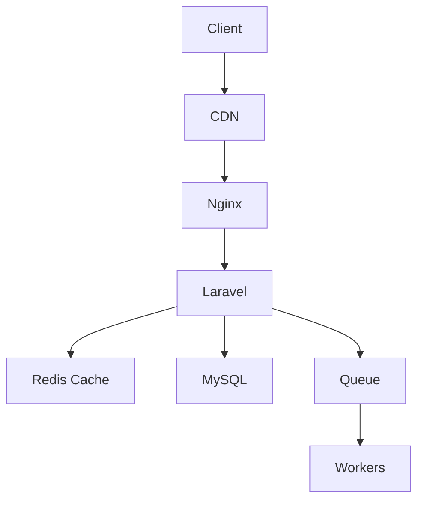
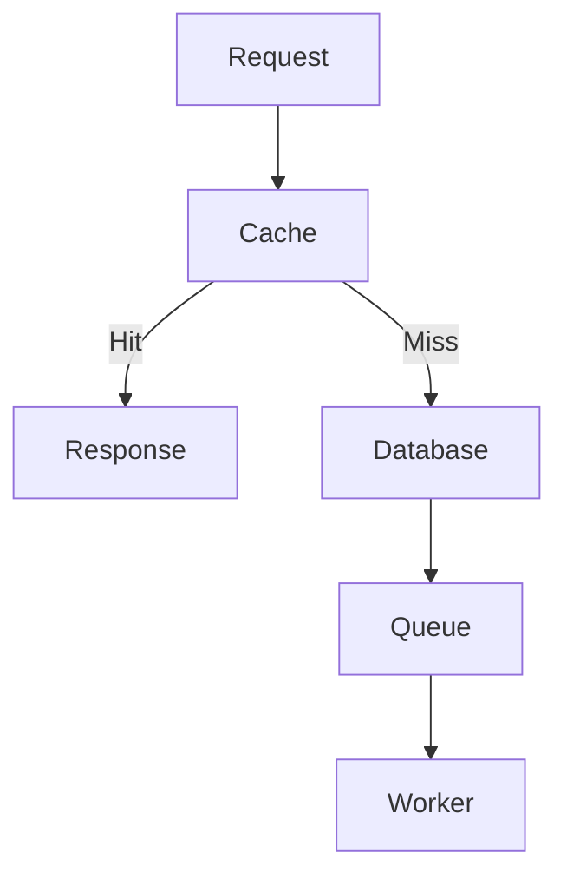

# 35. Performance Optimization

> **Goal:** Build high-performance Laravel applications by optimizing database queries, application architecture, caching, queues, HTTP responses, and infrastructure while maintaining code readability and scalability.

---

# Overview

Performance is not achieved by a single optimization—it is the result of good architecture, efficient database design, proper caching, background processing, and continuous measurement.

A high-performance Laravel application should:

* Respond quickly
* Scale efficiently
* Minimize database load
* Use server resources effectively
* Handle high traffic reliably

Performance optimization should be **measured**, not guessed.

---

# Performance Architecture

```text id="k3v8mx"
HTTP Request
      │
      ▼
Routing
      │
      ▼
Controller
      │
      ▼
Service
      │
      ▼
Cache
      │
      ├─────────────┐
      ▼             ▼
Cache Hit      Database
      │             │
      ▼             ▼
Response      Queue Jobs
```

---

# Performance Layers



Every layer contributes to overall performance.

---

# Performance Checklist

Optimize:

* Database
* Queries
* Cache
* Queues
* Sessions
* Assets
* Images
* APIs
* Logging
* PHP
* Web Server

---

# Database Optimization

## Select Only Required Columns

Avoid

```php id="g4m2vx"
User::all();
```

Prefer

```php id="w8p5nr"
User::select([

    'id',

    'name',

    'email'

])->get();
```

Retrieve only the data you need.

---

## Avoid N+1 Queries

Bad

```php id="f3z7ja"
foreach ($loans as $loan) {

    echo $loan->customer->name;

}
```

Good

```php id="x6t1bc"
Loan::with(

    'customer'

)->get();
```

Always eager load required relationships.

---

## Use Pagination

Avoid

```php id="a9n4yv"
Customer::all();
```

Use

```php id="p5j8lh"
Customer::paginate(20);
```

Or

```php id="n1r6gd"
Customer::cursorPaginate(20);
```

Cursor pagination performs well on large datasets.

---

## Use Chunking

Large updates.

```php id="q2k7sm"
Customer::chunk(

    1000,

    function ($customers) {

        //

    }

);
```

Keeps memory usage low.

---

## Lazy Collections

```php id="d5x3qw"
Customer::lazy()
```

Ideal for processing very large datasets.

---

# Indexing

Index columns used in:

* WHERE
* JOIN
* ORDER BY
* GROUP BY
* Foreign Keys

Example

```php id="r8h4mf"
$table->index([

    'company_id',

    'status'

]);
```

Measure query performance before and after adding indexes.

---

# Caching

Cache expensive queries.

```php id="u4v7kn"
Cache::remember(

    'settings',

    now()->addHour(),

    fn () => Setting::all()

);
```

Use Redis in production.

---

# Queue Heavy Tasks

Move slow operations into Jobs.

Examples:

* Emails
* SMS
* PDF generation
* Reports
* Image processing
* External APIs

Instead of

```text id="m3c8fy"
Request

↓

Generate PDF

↓

Response
```

Use

```text id="t7j2bd"
Request

↓

Dispatch Job

↓

Immediate Response
```

---

# Eager Loading

Multiple relationships.

```php id="b9m5xq"
Loan::with([

    'customer',

    'payments',

    'product'

])->get();
```

Reduces repeated database queries.

---

# Aggregate Queries

Instead of

```php id="h6q4vp"
Loan::all()

    ->count();
```

Use

```php id="k1s8jw"
Loan::count();
```

Other aggregates.

```php id="r2g7fh"
sum()

avg()

max()

min()

exists()
```

Push work to the database whenever possible.

---

# Exists Instead of Count

Avoid

```php id="z3n6mk"
Loan::where(...)

    ->count() > 0;
```

Use

```php id="q5c1tr"
Loan::where(...)

    ->exists();
```

More efficient.

---

# Local Scopes

Instead of repeating queries.

```php id="h8k2yv"
Loan::active()

    ->approved()

    ->get();
```

Keeps queries readable and reusable.

---

# API Resources

Only expose required fields.

Avoid

```php id="j4n9lu"
return $loan;
```

Use

```php id="u6m5ec"
return LoanResource::make(
    $loan
);
```

Reduces payload size and improves API stability.

---

# Lazy Loading Prevention

Enable during development.

```php id="e9x3ga"
Model::preventLazyLoading();
```

Detects accidental N+1 queries early.

---

# Configuration Cache

```bash id="t2r6nh"
php artisan config:cache
```

Production only.

---

# Route Cache

```bash id="q8y4pw"
php artisan route:cache
```

Improves route registration performance.

---

# View Cache

```bash id="n7c5ks"
php artisan view:cache
```

Pre-compiles Blade templates.

---

# Event Cache

```bash id="m5v1qd"
php artisan event:cache
```

Optimizes event discovery.

---

# Optimize Command

Laravel 11+

```bash id="p4g8wf"
php artisan optimize
```

Clears

```bash id="d1q9zc"
php artisan optimize:clear
```

Use during deployments.

---

# OPcache

Enable OPcache in production.

Benefits:

* Faster PHP execution
* Reduced CPU usage
* Lower memory allocation

Typical configuration

```ini id="a8w3te"
opcache.enable=1

opcache.memory_consumption=256

opcache.validate_timestamps=0
```

Adjust values based on deployment strategy.

---

# Redis

Use Redis for:

* Cache
* Queues
* Sessions
* Rate limiting

Avoid file-based cache and sessions in multi-server production environments.

---

# Database Connections

Reuse connections through Laravel's database layer.

Avoid repeatedly reconnecting during the same request.

Monitor connection pool limits in managed database services.

---

# HTTP Client

Set reasonable timeouts.

```php id="f6p2rn"
Http::timeout(10)

    ->retry(3, 500)

    ->get(...);
```

Never allow external services to block requests indefinitely.

---

# Image Optimization

Store optimized images.

Generate thumbnails.

Use modern formats where supported:

* WebP
* AVIF

Serve appropriately sized images.

---

# Asset Optimization

Use:

```bash id="v2m8gx"
npm run build
```

Minify:

* CSS
* JavaScript

Serve compressed assets.

---

# Compression

Enable:

* Gzip
* Brotli

Configured at the web server or CDN level.

---

# CDN

Serve:

* Images
* CSS
* JavaScript
* Downloads

through a Content Delivery Network.

Benefits:

* Lower latency
* Reduced server load
* Better global performance

---

# Background Processing

Use queues for:

* Emails
* Notifications
* Reports
* Imports
* Exports
* Synchronization

Increase worker count based on workload.

---

# Performance Diagram



---

# Monitoring Performance

Track:

* Response time
* Database query time
* Cache hit ratio
* Queue length
* Failed jobs
* Memory usage
* CPU usage
* Slow queries

Use application and infrastructure monitoring tools.

---

# Benchmarking

Measure before optimizing.

Useful tools include:

* Laravel Telescope (development)
* Laravel Pulse
* Blackfire
* Xdebug Profiler
* Database slow query logs

---

# Performance vs Readability

Do not sacrifice maintainability for tiny performance gains.

Example

Good

```php id="g7n5we"
Loan::approved()
```

Avoid premature micro-optimizations that make the code difficult to understand.

---

# Best Practices

* Use eager loading.
* Cache expensive queries.
* Queue slow operations.
* Use Redis.
* Use pagination.
* Optimize database indexes.
* Enable OPcache.
* Cache routes and configuration.
* Measure performance continuously.
* Optimize only verified bottlenecks.

---

# Common Anti-Patterns

Avoid

```php id="m9x2jd"
Model::all();
```

for very large tables.

Avoid N+1 queries.

Avoid unnecessary loops that trigger database queries.

Avoid caching frequently changing transactional data.

Avoid synchronous external API calls in user-facing requests when background processing is appropriate.

Avoid premature optimization without profiling.

---

# Enterprise Performance Checklist

* [ ] Database indexed
* [ ] Eager loading used
* [ ] N+1 queries eliminated
* [ ] Redis configured
* [ ] Queues enabled
* [ ] Route cache enabled
* [ ] Config cache enabled
* [ ] View cache enabled
* [ ] OPcache enabled
* [ ] CDN configured
* [ ] Compression enabled
* [ ] Monitoring in place
* [ ] Slow query log reviewed
* [ ] Performance tests executed

---

# Performance Testing

Measure response time.

```php id="y6p3kt"
$start = microtime(true);

// Execute operation

$duration = microtime(true) - $start;
```

Validate database efficiency.

```php id="n8v4rh"
DB::enableQueryLog();

// Execute query

DB::getQueryLog();
```

Performance improvements should always be supported by measurements.

---

# Summary

Performance optimization is an ongoing process rather than a one-time task. By combining efficient database design, eager loading, caching, background processing, optimized infrastructure, and continuous monitoring, Laravel applications can scale to handle large workloads while maintaining fast response times. Measure first, optimize verified bottlenecks, and preserve clean architecture throughout the optimization process.

The next chapter explores **Testing**, covering unit testing, feature testing, integration testing, mocking, fakes, database testing, and strategies for building a reliable automated test suite.
