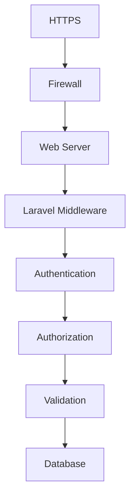
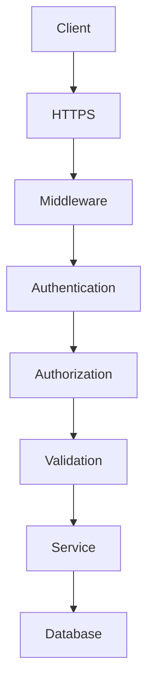

# 36. Security

> **Goal:** Build secure Laravel applications by following defense-in-depth principles, protecting user data, preventing common vulnerabilities, and implementing secure authentication, authorization, validation, encryption, and infrastructure practices.

---

# Overview

Security is not a single feature—it is a continuous process integrated into every layer of the application.

Enterprise Laravel applications should protect against:

* Unauthorized access
* Data leaks
* SQL Injection
* Cross-Site Scripting (XSS)
* Cross-Site Request Forgery (CSRF)
* Broken authentication
* Broken authorization
* Session hijacking
* API abuse
* Credential theft
* File upload attacks

Laravel provides secure defaults, but developers must use them correctly.

---

# Security Architecture

```text id="8skq2p"
Client
      │
      ▼
HTTPS
      │
      ▼
Middleware
      │
      ▼
Authentication
      │
      ▼
Authorization
      │
      ▼
Validation
      │
      ▼
Business Logic
      │
      ▼
Database
```

Every layer contributes to application security.

---

# Security Layers



---

# Security Principles

Every application should implement:

* Least privilege
* Defense in depth
* Secure defaults
* Input validation
* Output escaping
* Principle of minimal exposure
* Logging and auditing
* Secure secret management

---

# Authentication

Authenticate every protected request.

Laravel supports:

* Session authentication
* Sanctum
* Passport
* Token authentication
* Social authentication

Never build custom authentication when Laravel provides a secure solution.

---

# Authorization

Always authorize business actions.

Examples

```php id="q4hx7k"
$this->authorize(

    'update',

    $loan

);
```

or

```php id="e7tv4b"
Gate::authorize(

    'approve-loan'

);
```

Authentication identifies the user.

Authorization determines what the user can do.

---

# Form Requests

Validate all user input.

```php id="u1rw6g"
public function rules(): array
{
    return [

        'email' => [

            'required',

            'email'

        ],

    ];
}
```

Never trust client-side validation alone.

---

# SQL Injection

Unsafe

```php id="g5jq8v"
DB::select(

    "SELECT * FROM users WHERE email = '$email'"

);
```

Safe

```php id="s3z1wf"
User::where(

    'email',

    $email

)->first();
```

Use Eloquent or the Query Builder with parameter binding.

---

# Cross-Site Scripting (XSS)

Safe

```blade id="z8tp4c"
{{ $customer->name }}
```

Escapes output automatically.

Avoid

```blade id="k1vm7e"
{!! $customer->name !!}
```

unless the content has been sanitized and trusted.

---

# Cross-Site Request Forgery (CSRF)

Blade forms

```blade id="n6w2jy"
@csrf
```

Laravel automatically validates the CSRF token.

Do not disable CSRF protection for standard web forms.

---

# Password Hashing

Always hash passwords.

```php id="p7x5ru"
Hash::make(
    $password
);
```

Never store plain-text passwords.

Never implement custom hashing algorithms.

---

# Password Verification

```php id="a4mz8n"
Hash::check(

    $password,

    $user->password

);
```

---

# Encryption

Encrypt sensitive values.

```php id="d9rv3k"
encrypt(
    $value
);
```

Decrypt

```php id="w2pn5h"
decrypt(
    $value
);
```

Use encryption for confidential application data, not passwords.

---

# Environment Variables

Store secrets in

```text id="r8gs6x"
.env
```

Examples

```env id="c4ny1m"
APP_KEY=

DB_PASSWORD=

MAIL_PASSWORD=

REDIS_PASSWORD=
```

Never commit `.env` files to version control.

---

# File Upload Security

Validate uploads.

```php id="t7vb9q"
'image' => [

    'required',

    'image',

    'max:2048'

]
```

Store uploads outside the public web root when appropriate.

Generate random filenames.

Never trust client-provided filenames.

---

# File Storage

Good

```php id="v5hz8t"
Storage::putFile(

    'documents',

    $file

);
```

Avoid directly moving uploaded files into publicly accessible directories without validation.

---

# API Authentication

Protect APIs using:

* Sanctum
* Passport
* OAuth2

Avoid building custom token systems.

---

# Rate Limiting

Protect against abuse.

Example

```php id="b3q4yv"
RateLimiter::for(
    'api',
    ...
);
```

Apply limits to:

* Login
* OTP
* Password reset
* Public APIs

---

# Session Security

Enable:

* Secure cookies
* HTTP-only cookies
* SameSite protection

Environment

```env id="j6n8wc"
SESSION_SECURE_COOKIE=true
```

Always use HTTPS in production.

---

# HTTPS

Force HTTPS.

Benefits:

* Encryption
* Integrity
* Identity verification

Never transmit credentials over HTTP.

---

# Secure Headers

Examples:

* HSTS
* X-Frame-Options
* X-Content-Type-Options
* Referrer-Policy
* Content-Security-Policy

These can be configured through middleware or the web server.

---

# Mass Assignment

Safe

```php id="g8q3sx"
protected $fillable = [

    'name',

    'email'

];
```

Avoid

```php id="p2k9md"
protected $guarded = [];
```

unless there is a well-understood reason.

---

# Authorization Policies

Always protect sensitive resources.

```php id="m5w7qa"
$this->authorize(

    'delete',

    $customer

);
```

Never rely solely on hidden frontend buttons.

---

# Sensitive Logging

Avoid

```php id="r1n4tv"
Log::info(

    $request->all()

);
```

Instead

```php id="q8h2yg"
Log::info(

    'Customer updated.',

    [

        'customer_id' => $customer->id,

    ]

);
```

Never log passwords, tokens, or secrets.

---

# External APIs

Store credentials securely.

```env id="d4v9mx"
CRM_API_KEY=

CRM_SECRET=
```

Set:

* Timeouts
* Retries
* TLS verification

Handle failures gracefully.

---

# Security Diagram



---

# Security vs Validation

| Validation       | Security               |
| ---------------- | ---------------------- |
| Data correctness | Application protection |
| Form Requests    | Entire application     |
| Input            | System                 |

Validation is one layer of security.

---

# Security vs Authorization

| Authentication | Authorization    |
| -------------- | ---------------- |
| Who are you?   | What can you do? |

Both are required.

---

# Secrets Management

Never hardcode:

```php id="x3t7nr"
$token = "secret";
```

Instead

```php id="n1v8mq"
config(

    'services.crm.key'

);
```

Read secrets from configuration backed by environment variables or a dedicated secret manager.

---

# Dependency Security

Regularly:

```bash id="h4q5zs"
composer audit
```

Keep dependencies updated.

Monitor security advisories.

---

# Production Security

Disable debugging.

```env id="m9y2wj"
APP_DEBUG=false
```

Use

```env id="v6t4rp"
APP_ENV=production
```

Never expose stack traces in production.

---

# Database Security

Use:

* Least privilege database accounts
* Strong passwords
* Encrypted connections where available
* Regular backups
* Access controls

Avoid using administrative database accounts for application connections.

---

# Security Monitoring

Monitor:

* Failed logins
* Permission violations
* Rate limit triggers
* Unexpected exceptions
* Suspicious API traffic

Integrate logs with centralized monitoring.

---

# Best Practices

* Always use HTTPS.
* Validate every request.
* Authorize every protected action.
* Hash passwords.
* Encrypt sensitive data.
* Protect secrets.
* Use Laravel security features.
* Enable rate limiting.
* Audit dependencies.
* Keep Laravel updated.

---

# Common Anti-Patterns

Avoid

```php id="y7w3qn"
APP_DEBUG=true
```

in production.

Avoid raw SQL with user input.

Avoid disabling CSRF protection unnecessarily.

Avoid storing passwords in plain text.

Avoid logging sensitive information.

Avoid trusting client-side validation.

Avoid custom authentication implementations without a strong reason.

---

# Security Checklist

* [ ] HTTPS enforced
* [ ] Authentication configured
* [ ] Authorization implemented
* [ ] Form Requests used
* [ ] Passwords hashed
* [ ] Secrets protected
* [ ] CSRF enabled
* [ ] XSS prevented
* [ ] SQL injection prevented
* [ ] Rate limiting enabled
* [ ] File uploads validated
* [ ] Secure headers configured
* [ ] APP_DEBUG disabled in production
* [ ] Dependencies audited
* [ ] Logging sanitized

---

# Testing Security

Verify:

* Unauthorized requests return **401**
* Forbidden requests return **403**
* Validation failures return **422**
* Passwords are hashed
* Policies deny unauthorized access
* Rate limiting works correctly
* Sensitive data is not exposed in responses

Security testing should be part of every release process.

---

# Summary

Security is a foundational concern that spans every layer of a Laravel application. By leveraging Laravel's built-in authentication, authorization, validation, encryption, CSRF protection, secure file handling, and rate limiting, teams can significantly reduce common vulnerabilities. Combined with secure infrastructure, proper secret management, dependency auditing, and continuous monitoring, these practices create resilient, enterprise-ready applications.

The next chapter explores **Testing**, covering unit tests, feature tests, integration tests, database testing, mocking, fakes, and building a comprehensive automated testing strategy.
