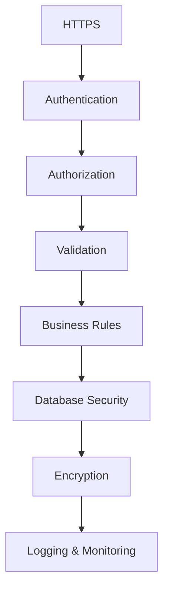

# 36. Security

> **Goal:** Build secure Laravel applications by implementing defense-in-depth across authentication, authorization, validation, encryption, secure coding practices, infrastructure, and operational security.

---

# Overview

Security is not a single feature—it is a collection of practices that protect the application, its users, and its data.

Every Laravel application should protect against:

* Unauthorized access
* SQL Injection
* Cross-Site Scripting (XSS)
* Cross-Site Request Forgery (CSRF)
* Broken Authentication
* Sensitive Data Exposure
* File Upload Attacks
* Mass Assignment
* Session Hijacking
* Brute Force Attacks
* Insecure APIs
* Server Misconfiguration

Security should be considered during design, development, testing, deployment, and maintenance.

---

# Security Architecture

```text id="b3k8qp"
Client
      │
      ▼
HTTPS
      │
      ▼
Nginx / Apache
      │
      ▼
Laravel Middleware
      │
      ▼
Authentication
      │
      ▼
Authorization
      │
      ▼
Validation
      │
      ▼
Business Logic
      │
      ▼
Database
```

Every layer contributes to security.

---

# Defense in Depth



Security should never rely on a single
