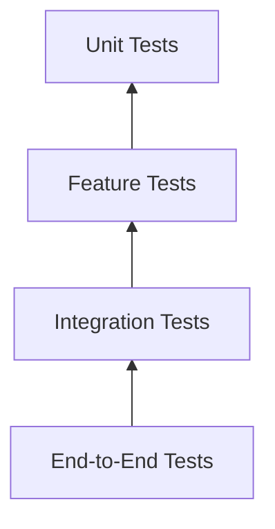
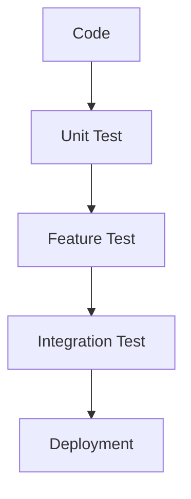

# 37. Testing

> **Goal:** Build reliable, maintainable, and production-ready Laravel applications through comprehensive automated testing, ensuring that business logic, APIs, database operations, authentication, authorization, and integrations behave correctly.

---

# Overview

Testing verifies that the application behaves as expected.

A comprehensive testing strategy helps:

* Prevent regressions
* Detect bugs early
* Enable safe refactoring
* Increase deployment confidence
* Improve code quality
* Document expected behavior

Testing should be an integral part of the development process—not an afterthought.

---

# Testing Architecture

```text id="m8k2vy"
Application
      │
      ▼
Unit Tests
      │
      ▼
Feature Tests
      │
      ▼
Integration Tests
      │
      ▼
End-to-End Tests
```

Each layer verifies different aspects of the application.

---

# Testing Pyramid



The majority of tests should be Unit and Feature Tests.

---

# Types of Tests

| Test        | Purpose                      |
| ----------- | ---------------------------- |
| Unit        | Test individual classes      |
| Feature     | Test HTTP requests           |
| Integration | Test multiple components     |
| Database    | Test persistence             |
| API         | Test REST endpoints          |
| Browser     | Test UI interactions         |
| Performance | Measure speed                |
| Security    | Verify protection mechanisms |

---

# Directory Structure

```text id="j1r6hg"
tests/
├── Feature/
│   ├── Auth/
│   ├── Customer/
│   ├── Loan/
│   ├── Payment/
│   └── Api/
│
├── Unit/
│   ├── Services/
│   ├── Helpers/
│   ├── Policies/
│   └── Models/
│
└── Pest.php
```

Organize tests by feature or domain.

---

# Running Tests

Run all tests.

```bash id="q6m9pd"
php artisan test
```

Using PHPUnit.

```bash id="g2v4wf"
vendor/bin/phpunit
```

Run a single file.

```bash id="u8x5nc"
php artisan test tests/Feature/LoanTest.php
```

Filter by test name.

```bash id="d3r7qt"
php artisan test --filter=approveLoan
```

---

# Unit Tests

Unit tests verify small, isolated units of code.

Example:

* Service methods
* Helpers
* DTOs
* Policies
* Actions

Avoid testing HTTP requests in unit tests.

---

# Example Unit Test

```php id="v1m8kj"
test('formats money correctly', function () {

    expect(

        format_money(1000)

    )->toBe('1,000.00');

});
```

Unit tests should execute quickly.

---

# Feature Tests

Feature tests verify application behavior.

Example

```php id="r9t4bz"
$response = $this

    ->postJson(

        '/api/customers',

        $payload

    );

$response

    ->assertCreated();
```

Feature tests simulate real HTTP requests.

---

# Database Testing

Laravel provides:

```php id="x2p5gv"
use RefreshDatabase;
```

Each test starts with a clean database.

```php id="a6h1tm"
uses(

    RefreshDatabase::class

);
```

---

# Factories

Generate test data.

```php id="k4r8pj"
$customer = Customer::factory()

    ->create();
```

Relationships.

```php id="q8m3yx"
Loan::factory()

    ->for($customer)

    ->create();
```

Factories make tests predictable and reusable.

---

# Seeders

Seed required reference data.

```php id="b1t7qn"
$this->seed(
    RoleSeeder::class
);
```

Avoid loading unnecessary data in every test.

---

# Authentication Testing

```php id="n5v2rk"
$user = User::factory()

    ->create();

$this->actingAs($user);
```

Sanctum.

```php id="m7p9dz"
Sanctum::actingAs(
    $user
);
```

---

# Authorization Testing

```php id="e4w6hf"
$response

    ->assertForbidden();
```

Verify policies correctly allow and deny access.

---

# Validation Testing

```php id="v8c3ky"
$response

    ->assertUnprocessable();
```

Check errors.

```php id="u2h9gm"
$response

    ->assertJsonValidationErrors([

        'email'

    ]);
```

---

# API Testing

Example

```php id="f7n4tx"
$response = $this

    ->getJson(

        '/api/v1/customers'

    );

$response

    ->assertOk();
```

Verify response structure.

```php id="n3q6pj"
$response

    ->assertJsonStructure([

        'success',

        'message',

        'data',

    ]);
```

---

# Database Assertions

Exists.

```php id="g5k8wr"
$this->assertDatabaseHas(

    'customers',

    [

        'email' => 'john@example.com'

    ]

);
```

Missing.

```php id="y1m4cp"
$this->assertDatabaseMissing(

    'customers',

    [

        'email' => 'john@example.com'

    ]

);
```

---

# Exception Testing

```php id="h9p6rv"
$this->expectException(

    LoanAlreadyApprovedException::class

);
```

Verify message.

```php id="u4x8kj"
$this->expectExceptionMessage(

    'Loan has already been approved.'

);
```

---

# Event Testing

```php id="k2t5zw"
Event::fake();

//

Event::assertDispatched(

    LoanApproved::class

);
```

---

# Job Testing

```php id="m6r9hd"
Bus::fake();

//

Bus::assertDispatched(

    GenerateInvoiceJob::class

);
```

---

# Notification Testing

```php id="c8y4nv"
Notification::fake();

//

Notification::assertSentTo(

    $user,

    LoanApprovedNotification::class

);
```

---

# Mail Testing

```php id="d5v7qx"
Mail::fake();

//

Mail::assertQueued(

    LoanApprovedMail::class

);
```

---

# Queue Testing

```php id="w3n1tb"
Queue::fake();

//

Queue::assertPushed(

    SendSmsJob::class

);
```

---

# Storage Testing

```php id="r7m5cy"
Storage::fake('public');
```

Assert.

```php id="x1k8zh"
Storage::disk('public')

    ->assertExists(

        'avatar.jpg'

    );
```

---

# HTTP Client Testing

```php id="b9q3lf"
Http::fake();
```

Verify requests.

```php id="f6v2pr"
Http::assertSent(
    fn () => true
);
```

Avoid calling external APIs during automated tests.

---

# Time Testing

```php id="t4h8mn"
Carbon::setTestNow(
    now()
);
```

Useful for scheduled logic and expiration rules.

---

# Performance Testing

Measure execution.

```php id="w2k7pg"
$start = microtime(true);

// Execute code

$duration = microtime(true) - $start;
```

Performance tests complement functional tests.

---

# Browser Testing

Laravel Dusk supports browser automation.

Example

```bash id="j5v1rx"
php artisan dusk
```

Use for critical user journeys.

---

# Coverage

Generate coverage.

```bash id="z8p6ct"
php artisan test --coverage
```

Aim for meaningful coverage rather than a specific percentage.

Focus on critical business logic.

---

# Continuous Integration

Typical workflow.

```text id="q7h2my"
Push Code

↓

Run Tests

↓

Build

↓

Deploy
```

Deploy only after automated tests pass.

---

# Test Naming

Good

```text id="v1t4kr"
it_can_create_customer

it_rejects_invalid_email

it_dispatches_notification

it_generates_installments
```

Names should describe expected behavior.

---

# Testing Diagram



---

# Unit vs Feature

| Unit      | Feature        |
| --------- | -------------- |
| One class | Entire request |
| Fast      | Slower         |
| No HTTP   | HTTP           |
| Isolated  | Integrated     |

Both are essential.

---

# Mocking

Mock dependencies.

```php id="r5x2qw"
$this->mock(

    PaymentGateway::class

);
```

Mock external systems, not the code under test.

---

# Fakes

Laravel provides:

* Mail::fake()
* Bus::fake()
* Queue::fake()
* Event::fake()
* Notification::fake()
* Http::fake()
* Storage::fake()

Prefer framework fakes over custom implementations.

---

# Best Practices

* Write tests for every feature.
* Use factories.
* Keep tests isolated.
* Test behavior, not implementation.
* Avoid shared state.
* Use descriptive names.
* Mock external services.
* Run tests in CI.
* Keep tests fast.
* Fix failing tests immediately.

---

# Common Anti-Patterns

Avoid:

* Testing framework internals.
* Calling real external APIs.
* Depending on test execution order.
* Reusing mutable global state.
* Sleeping inside tests.
* Ignoring flaky tests.

Tests should be deterministic and repeatable.

---

# Enterprise Testing Checklist

* [ ] Unit tests implemented
* [ ] Feature tests implemented
* [ ] API tests implemented
* [ ] Database assertions used
* [ ] Authentication tested
* [ ] Authorization tested
* [ ] Validation tested
* [ ] Notifications tested
* [ ] Jobs tested
* [ ] Events tested
* [ ] Mail tested
* [ ] External APIs mocked
* [ ] CI configured
* [ ] Coverage monitored

---

# Recommended Test Coverage

| Module        | Recommended Coverage |
| ------------- | -------------------: |
| Services      |                 High |
| Controllers   |               Medium |
| Policies      |                 High |
| Form Requests |                 High |
| Helpers       |                 High |
| Jobs          |                 High |
| Events        |               Medium |
| Notifications |               Medium |
| Models        |                 High |
| API Endpoints |                 High |

Prioritize critical business workflows over coverage percentages.

---

# Summary

Automated testing is one of the most important investments in a Laravel application. A balanced testing strategy combines Unit, Feature, Integration, and Browser tests to verify business logic, APIs, security, and user workflows. By using factories, fakes, database refreshes, and continuous integration, teams can deliver reliable software with confidence while reducing regressions and enabling safe refactoring.

The next chapter explores **Deployment**, covering CI/CD pipelines, zero-downtime deployments, environment management, queue workers, caching, monitoring, rollback strategies, and production best practices.
