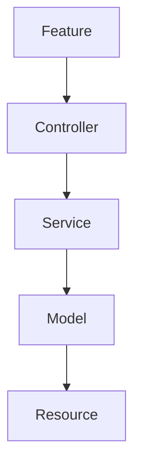
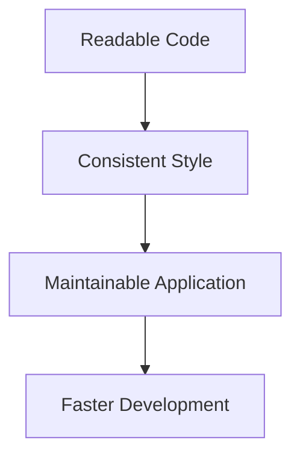

# 38. Code Style & Coding Standards

> **Goal:** Establish a consistent coding standard across the entire Laravel application to improve readability, maintainability, collaboration, and long-term scalability.

---

# Overview

Code is read far more often than it is written.

A consistent code style enables developers to:

* Read code quickly
* Review pull requests efficiently
* Reduce bugs
* Maintain consistency
* Improve onboarding
* Simplify refactoring

This project follows:

* **[https://www.php-fig.org/psr/psr-1/](PSR-1)**
* **[https://www.php-fig.org/psr/psr-12/](PSR-12)**
* Laravel Coding Style
* Laravel Pint
* PHPStan recommendations

Consistency is more important than personal preference.

---

# Coding Philosophy

Write code that is:

* Simple
* Readable
* Predictable
* Reusable
* Testable
* Self-documenting

Good code communicates intent clearly.

---

# Architecture

```text id="b3f9xt"
Readable Code
      │
      ▼
Maintainable Code
      │
      ▼
Reliable System
```

---

# Code Organization



Each class should have one responsibility.

---

# General Rules

Always:

* Follow PSR-12.
* Use strict typing where appropriate.
* Keep methods short.
* Use dependency injection.
* Write expressive code.
* Prefer composition over inheritance.
* Keep business logic in Services.

Avoid:

* Duplicate code
* Long methods
* Large classes
* Deep nesting
* Magic numbers
* Magic strings

---

# File Structure

Recommended class order.

```php id="m6h4zd"
namespace ...

use ...

class CustomerService
{
    // Constants

    // Properties

    // Constructor

    // Public Methods

    // Protected Methods

    // Private Methods
}
```

Maintain a consistent structure across all classes.

---

# Strict Types

Enable strict typing.

```php id="q5t8kn"
declare(strict_types=1);
```

Recommended for new PHP files where compatible with the project.

---

# Namespace Organization

Good

```text id="x4v9pw"
App\Services

App\Models

App\Policies

App\Http\Requests
```

Avoid unnecessary nesting.

---

# Imports

Good

```php id="c1m5jq"
use App\Models\User;

use Illuminate\Support\Facades\DB;
```

Avoid fully qualified class names throughout the code.

---

# Class Naming

Good

```text id="d7q2xr"
CustomerService

LoanController

PaymentResource

LoanApprovedEvent

CustomerSeeder
```

Use PascalCase.

---

# Method Naming

Good

```text id="y2n4hg"
approveLoan()

calculateInterest()

sendReminder()

generateSchedule()
```

Use camelCase.

Methods should describe actions.

---

# Variable Naming

Good

```php id="u8w3cl"
$customer

$loan

$payment

$totalAmount
```

Avoid

```php id="r4m6zs"
$a

$x

$data1
```

Use descriptive names.

---

# Constant Naming

```php id="h9k1qx"
public const MAX_RETRY = 3;
```

Use uppercase with underscores.

---

# Enum Naming

```php id="t5v8rp"
LoanStatus

PaymentMethod

CustomerType
```

Use singular PascalCase.

---

# Boolean Variables

Good

```php id="v3q7mn"
$isApproved

$hasPermission

$canDelete

$isExpired
```

Names should read naturally.

---

# Method Length

Good

```text id="j6w2pv"
10–30 lines
```

If a method grows significantly larger, consider extracting private methods or moving logic to another class.

---

# Class Length

Aim for focused classes.

If a class becomes very large, consider splitting responsibilities into:

* Services
* Actions
* Traits
* Value Objects

---

# Constructor Injection

Good

```php id="n4t8qy"
public function __construct(

    CustomerService $service

) {

    $this->service = $service;

}
```

Avoid service location through the container when dependency injection is appropriate.

---

# Early Return

Avoid

```php id="f2m7hw"
if (...) {

    if (...) {

        if (...) {

        }

    }

}
```

Prefer

```php id="w8r3jc"
if (! $customer) {

    return;

}
```

Reduces nesting.

---

# Single Responsibility

Bad

```text id="g1x9pt"
Controller

↓

Validation

↓

Business Logic

↓

Email

↓

Database

↓

Logging
```

Good

```text id="q6m4zd"
Controller

↓

Service

↓

Event

↓

Listener
```

Each class should have one responsibility.

---

# Comments

Comment **why**, not **what**.

Good

```php id="a3k8yn"
/*
|--------------------------------------------------------------------------
| Prevent duplicate loan approval when concurrent requests occur.
|--------------------------------------------------------------------------
*/
```

Avoid

```php id="n5v1tr"
// Increment i
$i++;
```

Code should be self-explanatory whenever possible.

---

# PHPDoc

Useful for complex methods.

```php id="c8r2mw"
/**
 * Generate monthly repayment schedule.
 */
```

Avoid redundant PHPDoc that simply repeats method signatures.

---

# Return Types

Always specify return types.

```php id="x7m4kp"
public function approve(): Loan
{
}
```

Avoid omitting return types where possible.

---

# Parameter Types

Good

```php id="v1h9tc"
public function create(

    CustomerData $data

): Customer
```

Type declarations improve reliability.

---

# Nullable Types

```php id="u6q3pj"
?Customer
```

Use only when `null` is a valid result.

---

# Collections

Prefer Collection methods.

Good

```php id="r8n5gx"
$customers

    ->filter(...)

    ->map(...)

    ->values();
```

Avoid unnecessary manual loops for simple transformations.

---

# Strings

Prefer interpolation.

```php id="j2v6wh"
"Customer {$customer->id}"
```

Over unnecessary concatenation.

---

# Configuration

Avoid

```php id="z3p8kt"
env('APP_NAME');
```

outside configuration files.

Use

```php id="g7x1nr"
config('app.name');
```

throughout the application.

---

# Formatting

Use Laravel Pint.

Install

```bash id="m9k4zd"
composer require laravel/pint --dev
```

Run

```bash id="n1t7qy"
./vendor/bin/pint
```

Include Pint in CI pipelines.

---

# Static Analysis

Recommended tools:

* PHPStan
* Larastan
* Psalm (optional)

Run regularly.

```bash id="w5r2pc"
vendor/bin/phpstan analyse
```

---

# IDE Helpers

Useful packages:

* Laravel Idea
* barryvdh/laravel-ide-helper

Improve autocompletion and static analysis.

---

# Folder Naming

Good

```text id="y8v3mh"
Services

Models

Policies

Requests

Resources

Jobs

Notifications
```

Avoid inconsistent naming conventions.

---

# Code Review Checklist

Review:

* Naming
* Readability
* Architecture
* Performance
* Security
* Tests
* Error handling
* Documentation

---

# Style Diagram



---

# Recommended Line Length

Aim for approximately:

```text id="x6q2wd"
120 characters
```

Wrap long method chains for readability.

---

# Blank Lines

Separate logical sections.

Good

```php id="t3m8vr"
$customer = ...

$loan = ...

$this->approve($loan);
```

Avoid excessive blank lines.

---

# Magic Values

Avoid

```php id="q1n6tx"
$status == 2
```

Prefer

```php id="m5k9ph"
$status === LoanStatus::Approved
```

Enums improve readability and reduce bugs.

---

# Fluent Code

Good

```php id="w2v7qn"
Loan::approved()

    ->active()

    ->latest()

    ->paginate();
```

Readable query chains improve maintainability.

---

# Best Practices

* Follow PSR-12.
* Use Laravel Pint.
* Keep methods focused.
* Use dependency injection.
* Prefer Enums over magic values.
* Use descriptive names.
* Specify types.
* Keep comments meaningful.
* Use static analysis.
* Review code regularly.

---

# Common Anti-Patterns

Avoid:

* 500-line classes
* 100-line methods
* Duplicate code
* Deep nesting
* Generic variable names
* Business logic in Controllers
* `env()` outside configuration files
* Unused imports
* Commented-out code committed to source control

---

# Enterprise Code Style Checklist

* [ ] PSR-12 compliant
* [ ] Laravel Pint passes
* [ ] Descriptive naming
* [ ] Strong typing
* [ ] Constructor injection
* [ ] Small methods
* [ ] Small classes
* [ ] No duplicate code
* [ ] Static analysis passes
* [ ] Code reviewed before merge

---

# Tooling

Recommended development tools:

| Tool               | Purpose               |
| ------------------ | --------------------- |
| Laravel Pint       | Code formatting       |
| PHPStan + Larastan | Static analysis       |
| Rector             | Automated refactoring |
| PHP CS Fixer       | Alternative formatter |
| PHP Insights       | Code quality metrics  |
| Composer Audit     | Dependency security   |
| GitHub Actions     | CI validation         |

Run these tools automatically before deployments whenever possible.

---

# Summary

Consistent coding standards are essential for long-term project success. By following PSR-12, Laravel conventions, strong typing, descriptive naming, dependency injection, and automated quality tools such as Laravel Pint and PHPStan, development teams produce code that is easier to understand, review, test, and maintain. A shared coding standard improves collaboration and reduces technical debt as the application grows.

The next chapter explores **Deployment**, covering production environments, CI/CD pipelines, zero-downtime deployments, queue workers, cache optimization, rollback strategies, and operational best practices.
