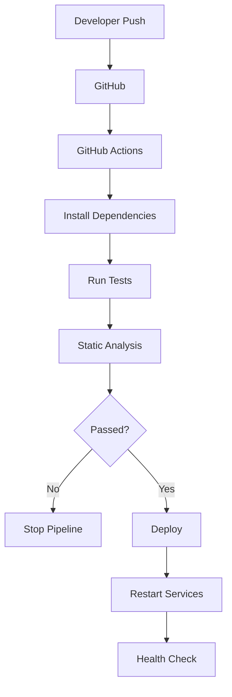
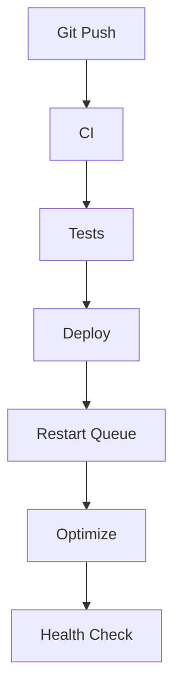

# 39. Continuous Integration & Continuous Deployment (CI/CD)

> **Goal:** Automate building, testing, quality assurance, and deployment to deliver Laravel applications safely, consistently, and with minimal downtime.

---

# Overview

Continuous Integration (CI) and Continuous Deployment (CD) automate the software delivery lifecycle.

A modern Laravel application should automatically:

* Validate code
* Run tests
* Check coding standards
* Analyze code quality
* Build assets
* Deploy safely
* Restart services
* Monitor deployment success

CI/CD reduces manual errors and enables frequent, reliable releases.

---

# CI/CD Pipeline

```text id="q7h3mw"
Developer
      │
      ▼
Git Push
      │
      ▼
GitHub
      │
      ▼
CI Pipeline
      │
      ▼
Build
      │
      ▼
Tests
      │
      ▼
Quality Checks
      │
      ▼
Deployment
      │
      ▼
Production
```

---

# Deployment Flow



---

# CI/CD Goals

A successful pipeline should:

* Build automatically
* Detect failures early
* Prevent broken deployments
* Produce repeatable releases
* Support rollback
* Minimize downtime

---

# Typical Project Structure

```text id="z2m6wn"
.github/
└── workflows/
    ├── laravel.yml
    ├── deploy-staging.yml
    ├── deploy-production.yml
    └── security.yml
```

---

# Git Workflow

Recommended branch strategy.

```text id="p9v1rf"
main

↓

production

develop

↓

feature/*
```

Example:

```text id="j3n5cx"
feature/customer-api

feature/payment-module

feature/report-export
```

Protect production branches from direct pushes.

---

# Continuous Integration

CI validates every:

* Push
* Pull Request
* Merge

Typical CI tasks:

* Install dependencies
* Build assets
* Run Pint
* Run PHPStan
* Run PHPUnit
* Scan dependencies

---

# Install Dependencies

```bash id="y7m2vk"
composer install --no-interaction --prefer-dist

npm ci
```

Use `npm ci` instead of `npm install` in CI for deterministic builds.

---

# Build Assets

```bash id="b4r9tw"
npm run build
```

Compile production-ready frontend assets.

---

# Code Formatting

Run Laravel Pint.

```bash id="m8x3qh"
./vendor/bin/pint --test
```

Fail the pipeline if formatting rules are violated.

---

# Static Analysis

```bash id="c6w1pn"
vendor/bin/phpstan analyse
```

Identify potential issues before deployment.

---

# Security Audit

```bash id="h2k8zs"
composer audit
```

Check for vulnerable dependencies.

---

# Run Tests

```bash id="t5n4qy"
php artisan test
```

Run the full automated test suite.

---

# Example GitHub Actions Workflow

```yaml id="v9m7kp"
name: Laravel CI

on:
  push:
    branches:
      - main
      - develop

  pull_request:

jobs:
  test:

    runs-on: ubuntu-latest

    steps:

      - uses: actions/checkout@v4

      - uses: shivammathur/setup-php@v2
        with:
          php-version: "8.3"

      - run: composer install --no-interaction --prefer-dist

      - run: php artisan test
```

Extend this workflow with quality checks and deployment stages.

---

# Continuous Deployment

Deploy automatically after successful CI.

Typical flow.

```text id="g8q4hy"
Tests Pass

↓

Deploy

↓

Run Migrations

↓

Restart Queue

↓

Optimize

↓

Health Check
```

---

# Deployment Script

Typical commands.

```bash id="r5w7nt"
php artisan down

php artisan migrate --force

php artisan optimize

php artisan queue:restart

php artisan up
```

Consider zero-downtime strategies instead of maintenance mode for high-availability systems.

---

# Zero-Downtime Deployment

Recommended workflow.

```text id="k1v6pr"
Upload Release

↓

Install Dependencies

↓

Run Migrations

↓

Switch Symlink

↓

Restart Workers

↓

Health Check
```

Users experience little or no downtime.

---

# Environment Variables

Never commit:

```text id="s3n9bd"
.env
```

Configure secrets through:

* GitHub Secrets
* GitLab Variables
* Cloud secret managers

---

# Queue Workers

Restart after deployment.

```bash id="u4m2cx"
php artisan queue:restart
```

Ensures workers load the latest code.

---

# Configuration Cache

```bash id="x7r5wp"
php artisan config:cache
```

---

# Route Cache

```bash id="b2v8ny"
php artisan route:cache
```

---

# View Cache

```bash id="n6k1tf"
php artisan view:cache
```

---

# Event Cache

```bash id="q5m3jr"
php artisan event:cache
```

---

# Optimize

```bash id="t9p7wc"
php artisan optimize
```

---

# Health Check

Verify deployment.

Example endpoint.

```text id="m4q2zh"
/health
```

Checks may include:

* Database connectivity
* Cache
* Queue
* Storage
* Application version

---

# Rollback

Keep previous releases.

Rollback process.

```text id="d8w6pf"
Current Release

↓

Previous Release

↓

Switch Symlink

↓

Restart Workers
```

Always maintain a rollback strategy.

---

# Deployment Diagram



---

# Infrastructure

Typical production stack.

```text id="c9m2tw"
Nginx

↓

PHP-FPM

↓

Laravel

↓

Redis

↓

MySQL

↓

Supervisor

↓

Queue Workers
```

Scale components independently where needed.

---

# Monitoring After Deployment

Monitor:

* HTTP errors
* Queue failures
* Response time
* CPU
* Memory
* Disk usage
* Slow queries
* Failed logins

Detect issues immediately after deployment.

---

# Deployment Environments

Recommended:

```text id="w7k5hv"
Local

↓

Development

↓

Staging

↓

Production
```

Test releases in staging before production.

---

# Release Versioning

Use semantic versioning.

Examples:

```text id="z1p8mg"
v1.0.0

v1.2.5

v2.0.0
```

Tag production releases.

---

# Backup Strategy

Before deployment:

* Backup database
* Backup uploaded files
* Verify restore procedure

Backups are only useful if restoration is tested.

---

# Secrets Management

Store securely:

* API keys
* Database passwords
* Mail credentials
* OAuth secrets
* Cloud credentials

Never hardcode secrets.

---

# Best Practices

* Automate deployments.
* Run tests before deployment.
* Enforce code quality checks.
* Use staging environments.
* Restart queue workers.
* Cache configuration.
* Keep deployments repeatable.
* Monitor production.
* Maintain rollback procedures.
* Protect deployment credentials.

---

# Common Anti-Patterns

Avoid:

* Deploying directly from a local machine.
* Skipping automated tests.
* Running production migrations manually without a deployment process.
* Editing production code directly.
* Committing `.env` files.
* Deploying without backups.
* Restarting services unnecessarily during every deployment.

---

# Enterprise CI/CD Checklist

* [ ] Automated builds
* [ ] Automated tests
* [ ] Laravel Pint executed
* [ ] PHPStan executed
* [ ] Security audit executed
* [ ] Assets built
* [ ] Database migrations automated
* [ ] Queue workers restarted
* [ ] Configuration optimized
* [ ] Health checks completed
* [ ] Rollback strategy available
* [ ] Monitoring enabled

---

# Recommended Pipeline

```text id="a6n3px"
Git Push

↓

Composer Install

↓

NPM Build

↓

Laravel Pint

↓

PHPStan

↓

PHPUnit

↓

Composer Audit

↓

Deploy to Staging

↓

Smoke Tests

↓

Deploy to Production

↓

Health Check

↓

Monitoring
```

Each stage should fail fast if an issue is detected.

---

# Summary

CI/CD is a fundamental practice for delivering high-quality Laravel applications. By automating builds, testing, static analysis, security audits, deployments, and health checks, teams can release software more frequently and with greater confidence. A robust CI/CD pipeline minimizes human error, supports rapid recovery through rollbacks, and forms the foundation of reliable, enterprise-grade software delivery.

The next chapter explores **Deployment & Production Infrastructure**, covering server architecture, Nginx, PHP-FPM, Supervisor, Redis, load balancing, SSL, backups, monitoring, and production operations.
