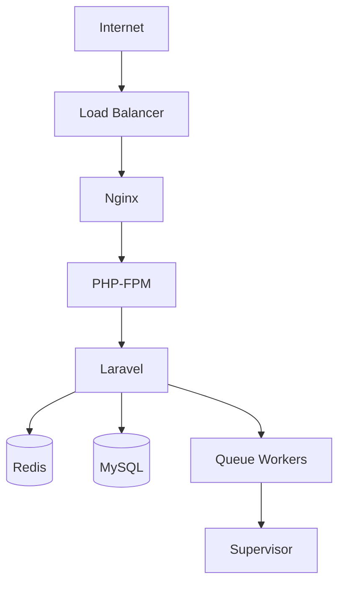
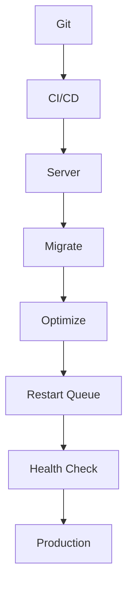

# 40. Deployment

> **Goal:** Deploy Laravel applications to production safely, securely, and with minimal downtime by following enterprise deployment practices, infrastructure standards, automation, monitoring, backup strategies, and rollback procedures.

---

# Overview

Deployment is the process of releasing a tested Laravel application into a production environment.

A production deployment should be:

* Repeatable
* Automated
* Secure
* Fast
* Observable
* Recoverable

Deployment is not only about copying files—it also includes infrastructure preparation, database migrations, queue management, caching, monitoring, and validation.

---

# Deployment Architecture

```text id="x7m2vp"
Developer
      │
      ▼
Git Repository
      │
      ▼
CI/CD Pipeline
      │
      ▼
Application Server
      │
      ▼
PHP-FPM
      │
      ▼
Laravel
      │
      ▼
Redis / MySQL
```

---

# Production Infrastructure



A production environment consists of multiple cooperating services.

---

# Deployment Workflow

```text id="z5n3cq"
Git Push

↓

CI/CD

↓

Build

↓

Tests

↓

Deploy

↓

Migrate

↓

Optimize

↓

Restart Workers

↓

Health Check
```

Each stage should complete successfully before continuing.

---

# Recommended Server Stack

| Component        | Recommendation                                        |
| ---------------- | ----------------------------------------------------- |
| Operating System | Ubuntu LTS                                            |
| Web Server       | Nginx                                                 |
| PHP              | PHP 8.3+                                              |
| Database         | MySQL or PostgreSQL                                   |
| Cache            | Redis                                                 |
| Queue            | Redis + Supervisor                                    |
| SSL              | Let's Encrypt or managed certificate                  |
| Process Manager  | Supervisor                                            |
| Scheduler        | Cron                                                  |
| Monitoring       | Pulse, Horizon, Grafana, Prometheus, Cloud monitoring |

---

# Laravel Directory Structure

```text id="h8p6ry"
/var/www/

└── project/

    ├── app/

    ├── bootstrap/

    ├── config/

    ├── public/

    ├── resources/

    ├── routes/

    ├── storage/

    ├── vendor/

    └── .env
```

Store uploaded files and logs outside version control.

---

# Environment Variables

Store secrets in:

```text id="w3v5km"
.env
```

Examples

```env id="q1t8jn"
APP_ENV=production

APP_DEBUG=false

APP_URL=https://example.com

DB_HOST=

DB_DATABASE=

DB_USERNAME=

DB_PASSWORD=

CACHE_STORE=redis

QUEUE_CONNECTION=redis
```

Never commit `.env` files to Git.

---

# Application Key

Generate once.

```bash id="k9r2fx"
php artisan key:generate
```

Do not regenerate an application key on an existing production installation unless you understand the impact on encrypted data.

---

# Composer Installation

Production install.

```bash id="y4n7pq"
composer install \
    --no-dev \
    --optimize-autoloader \
    --prefer-dist
```

Exclude development dependencies.

---

# Frontend Assets

Build production assets.

```bash id="n5v1cz"
npm ci

npm run build
```

Deploy only compiled assets to production.

---

# Database Migration

```bash id="t7m4rd"
php artisan migrate --force
```

`--force` is required for non-interactive production deployments.

Always review migrations before release.

---

# Cache Optimization

```bash id="a2q9kx"
php artisan optimize
```

This prepares:

* Configuration
* Routes
* Events
* Views

Clear caches if necessary.

```bash id="b6r3wf"
php artisan optimize:clear
```

---

# Queue Workers

Restart workers.

```bash id="c8t5yn"
php artisan queue:restart
```

Supervisor automatically reloads workers with the new code.

---

# Supervisor Example

```ini id="j4m7pv"
[program:laravel-worker]

command=php artisan queue:work

autostart=true

autorestart=true

numprocs=4
```

Scale the number of workers based on workload.

---

# Scheduler

Cron

```cron id="g9k2ts"
* * * * * php /var/www/project/artisan schedule:run >> /dev/null 2>&1
```

Laravel executes scheduled tasks every minute.

---

# File Permissions

Typical ownership.

```bash id="u1r8cm"
sudo chown -R www-data:www-data storage bootstrap/cache
```

Writable directories:

* storage
* bootstrap/cache

Avoid overly permissive permissions such as `777`.

---

# Nginx

Typical flow.

```text id="v5n4px"
Internet

↓

Nginx

↓

PHP-FPM

↓

Laravel
```

Enable:

* HTTPS
* Gzip/Brotli
* HTTP/2 or HTTP/3 where supported
* Security headers

---

# HTTPS

Always enable SSL.

Benefits:

* Encryption
* Authentication
* Data integrity

Redirect all HTTP traffic to HTTPS.

---

# Health Checks

Create an endpoint.

```text id="m2q6jy"
/health
```

Verify:

* Database
* Redis
* Queue
* Storage
* Application version

Health checks are useful for load balancers and monitoring.

---

# Zero-Downtime Deployment

Recommended process.

```text id="f7k3rd"
Upload New Release

↓

Install Dependencies

↓

Build Assets

↓

Run Migrations

↓

Switch Symlink

↓

Restart Queue

↓

Health Check
```

This approach minimizes service interruption.

---

# Rollback

Maintain previous releases.

```text id="r8v5qt"
Current

↓

Previous

↓

Restore

↓

Restart Workers
```

Rollback should be tested periodically.

---

# Backup Strategy

Before deployment:

* Database backup
* Uploaded files backup
* Configuration backup

Backups should be automated and restoration procedures regularly verified.

---

# Logging

Monitor:

* Laravel logs
* Nginx logs
* PHP-FPM logs
* Queue logs
* System logs

Centralize production logs where possible.

---

# Monitoring

Track:

* CPU
* Memory
* Disk
* Queue length
* Response time
* Error rate
* Slow queries
* Cache hit rate

Use monitoring to detect issues before users report them.

---

# Deployment Diagram



---

# Multi-Server Deployment

```text id="q9m6hv"
Load Balancer

↓

App Server 1

↓

Redis

↓

MySQL

↓

App Server 2

↓

App Server 3
```

Use shared:

* Cache
* Queue
* Sessions
* File storage (or object storage such as S3)

---

# Deployment Validation

Verify:

* Homepage
* Authentication
* APIs
* Queue workers
* Scheduled tasks
* Cache
* File uploads
* Email
* Notifications

Perform smoke tests immediately after deployment.

---

# Maintenance Mode

Enable.

```bash id="w2k9pc"
php artisan down
```

Disable.

```bash id="v1r7jt"
php artisan up
```

Use only when necessary. Prefer zero-downtime deployments for production systems.

---

# Production Security

Always:

* Disable debug mode
* Enable HTTPS
* Rotate secrets when needed
* Limit SSH access
* Use firewalls
* Keep software updated
* Monitor failed logins

Protect both the application and the infrastructure.

---

# Disaster Recovery

Document:

* Backup process
* Restore process
* Recovery time objective (RTO)
* Recovery point objective (RPO)
* Incident contacts

Regularly test recovery procedures.

---

# Best Practices

* Automate deployments.
* Use CI/CD.
* Use Redis.
* Restart queue workers.
* Optimize caches.
* Keep secrets out of Git.
* Enable HTTPS.
* Monitor production continuously.
* Maintain rollback procedures.
* Test every deployment.

---

# Common Anti-Patterns

Avoid:

* Deploying manually over FTP.
* Editing production files directly.
* Skipping automated tests.
* Running production with `APP_DEBUG=true`.
* Using file-based cache or queues for large production systems.
* Ignoring failed migrations.
* Deploying without backups.

---

# Enterprise Deployment Checklist

* [ ] CI/CD pipeline configured
* [ ] Tests passed
* [ ] Assets compiled
* [ ] Composer optimized
* [ ] Database migrated
* [ ] Cache optimized
* [ ] Queue workers restarted
* [ ] Supervisor running
* [ ] Scheduler configured
* [ ] HTTPS enabled
* [ ] Monitoring active
* [ ] Backups verified
* [ ] Health checks passed
* [ ] Rollback plan available

---

# Production Readiness Checklist

| Component        | Status |
| ---------------- | ------ |
| Nginx            | ✓      |
| PHP-FPM          | ✓      |
| Redis            | ✓      |
| MySQL/PostgreSQL | ✓      |
| Supervisor       | ✓      |
| Scheduler        | ✓      |
| SSL              | ✓      |
| Queue Workers    | ✓      |
| Monitoring       | ✓      |
| Backups          | ✓      |

Review this checklist before every production release.

---

# Summary

Successful Laravel deployments require more than copying application files. A production-ready deployment process includes automated CI/CD pipelines, optimized dependencies, secure environment management, database migrations, queue worker restarts, monitoring, backups, health checks, and tested rollback procedures. By following these practices, teams can deliver reliable, scalable, and secure applications with confidence and minimal downtime.

The next chapter explores **Maintenance & Operations**, covering production monitoring, scheduled maintenance, incident response, scaling strategies, routine operational tasks, and long-term application management.
