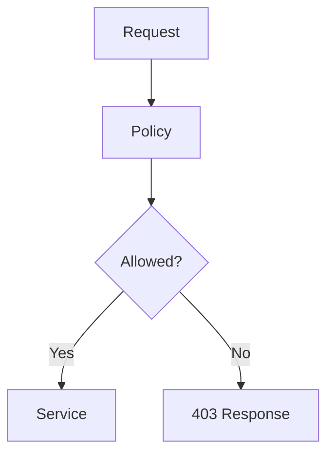
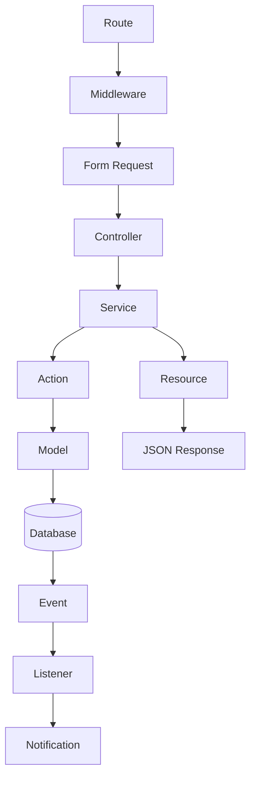

# 41. Example User Module

> **Goal:** Demonstrate how all architectural layers work together by implementing a complete production-ready **User Module** following the architecture defined throughout this documentation. This example shows the recommended project structure, request flow, validation, services, policies, events, jobs, notifications, API resources, testing, and best practices.

---

# Overview

This chapter brings together everything covered in the previous chapters by building a complete **User Management Module**.

The module demonstrates:

* Routing
* Controller
* Form Request
* Service Layer
* DTO
* Action
* Model
* Local Scopes
* Policy
* Middleware
* Events
* Listeners
* Jobs
* Notifications
* API Resources
* Transactions
* Exception Handling
* Logging
* Testing

This is the recommended architecture for every business module in the application.

---

# Complete Architecture

```text id="v9k4tm"
HTTP Request

        │

        ▼

Route

        │

        ▼

Middleware

        │

        ▼

Form Request

        │

        ▼

Controller

        │

        ▼

Service

        │

        ▼

DTO

        │

        ▼

Action

        │

        ▼

Model

        │

        ▼

Database

        │

        ▼

Event

        │

        ▼

Listener

        │

        ▼

Notification / Job

        │

        ▼

API Resource

        │

        ▼

JSON Response
```

---

# Request Lifecycle

```mermaid id="q7n2zw"
sequenceDiagram

autonumber

actor Client

participant Route

participant Middleware

participant Request

participant Controller

participant Service

participant Action

participant Model

database DB

participant Event

participant Listener

participant Notification

participant Resource

Client->>Route: POST /api/users

Route->>Middleware: Authenticate

Middleware->>Request: Validate

Request->>Controller: Validated Data

Controller->>Service: create()

Service->>Action: Execute

Action->>Model: Create User

Model->>DB: INSERT

DB-->>Model: User

Model-->>Action: User

Action-->>Service: User

Service->>Event: UserCreated

Event->>Listener: Handle

Listener->>Notification: Send Welcome Notification

Service-->>Controller: User

Controller->>Resource: Transform

Resource-->>Client: JSON Response
```

---

# Folder Structure

```text id="x5m8qy"
app/
├── Actions/
│   └── User/
│       └── CreateUserAction.php
│
├── DTOs/
│   └── User/
│       └── UserData.php
│
├── Events/
│   └── UserCreated.php
│
├── Exceptions/
│   └── UserAlreadyExistsException.php
│
├── Http/
│   ├── Controllers/
│   │   └── Api/
│   │       └── UserController.php
│   │
│   ├── Requests/
│   │   └── UserStoreRequest.php
│   │
│   └── Resources/
│       └── UserResource.php
│
├── Jobs/
│   └── SyncUserToCrmJob.php
│
├── Listeners/
│   └── SendWelcomeNotification.php
│
├── Models/
│   └── User.php
│
├── Notifications/
│   └── WelcomeNotification.php
│
├── Policies/
│   └── UserPolicy.php
│
├── Services/
│   └── UserService.php
│
└── Traits/
```

Every layer has one clear responsibility.

---

# Database Table

```text id="r2t9wh"
users

----------------------

id

uuid

name

email

password

phone

status

email_verified_at

remember_token

created_at

updated_at
```

---

# API Endpoints

| Method | Endpoint             | Description |
| ------ | -------------------- | ----------- |
| GET    | `/api/v1/users`      | List users  |
| GET    | `/api/v1/users/{id}` | Show user   |
| POST   | `/api/v1/users`      | Create user |
| PUT    | `/api/v1/users/{id}` | Update user |
| DELETE | `/api/v1/users/{id}` | Delete user |

---

# Route

```php id="p3n6jx"
Route::apiResource(

    'users',

    UserController::class

);
```

---

# Form Request

Responsibilities:

* Validation
* Authorization
* Input normalization

Example rules

```php id="y7m4kv"
public function rules(): array
{
    return [

        'name' => [

            'required',

            'string',

            'max:255'

        ],

        'email' => [

            'required',

            'email',

            'unique:users,email'

        ],

        'password' => [

            'required',

            'min:8'

        ],

    ];
}
```

---

# DTO

```php id="m1v8qh"
UserData

↓

Validated Input

↓

Immutable Object
```

DTOs isolate validated data from the HTTP layer.

---

# Controller

Responsibilities:

* Receive request
* Call Service
* Return Resource

Never:

* Write business logic
* Open transactions
* Send notifications
* Query the database directly

---

# Service

Responsibilities:

* Business logic
* Transactions
* Coordination
* Logging
* Event dispatching

Example flow.

```text id="t5k3pw"
Validate Business Rules

↓

Transaction

↓

Create User

↓

Dispatch Event

↓

Return User
```

---

# Action

Responsibilities:

* Perform one business operation

Example

```text id="v6q1yr"
CreateUserAction

↓

User::create()
```

Actions should remain small and focused.

---

# Model

Responsibilities:

* Relationships
* Local Scopes
* Casts
* Accessors
* Mutators

Avoid placing business workflows in Models.

---

# Local Scopes

Example

```php id="c8r4nt"
User::active()

    ->verified()

    ->latest()

    ->paginate();
```

Reusable query logic belongs in Local Scopes.

---

# Policy

Protect:

* Create
* Update
* Delete
* View

Example

```php id="g2m7vh"
$this->authorize(

    'create',

    User::class

);
```

---

# Event

Example

```text id="r4w8cp"
UserCreated
```

Represents a completed business event.

---

# Listener

Example responsibilities:

* Send email
* Queue CRM synchronization
* Audit logging

Listeners keep Services focused on core business logic.

---

# Job

Example

```text id="y1n5kz"
SyncUserToCrmJob
```

Background work:

* CRM
* ERP
* Analytics

Jobs should be queued after the database transaction commits.

---

# Notification

Example

```text id="k7v2rm"
WelcomeNotification
```

Possible channels:

* Mail
* SMS
* Database
* Push

---

# API Resource

Transforms

```text id="h3m8wp"
User Model

↓

UserResource

↓

JSON
```

Resources prevent exposing internal model details.

---

# Transaction

Service

```text id="j5r1qt"
Begin Transaction

↓

Create User

↓

Commit

↓

Dispatch Event
```

Use `afterCommit()` for events, jobs, and notifications when appropriate.

---

# Exception Handling

Example

```text id="u9w6ny"
Duplicate Email

↓

UserAlreadyExistsException

↓

409 Conflict
```

Business failures should use meaningful custom exceptions.

---

# Logging

Log:

```text id="x2m4kc"
User Created

↓

user_id

↓

performed_by

↓

request_id
```

Use structured logging.

---

# Cache

Possible cached data:

* Permissions
* Roles
* User profile
* Settings

Invalidate cache after updates.

---

# Authorization Flow



---

# Validation Flow

```text id="n6r2vd"
Client

↓

Form Request

↓

Validation

↓

Controller
```

Validation belongs in Form Requests.

---

# Testing

Recommended tests.

## Unit

* UserService
* CreateUserAction
* Policy
* Local Scopes

## Feature

* Create user
* Update user
* Delete user
* Unauthorized access
* Validation errors

## API

* Success response
* Validation response
* Pagination
* Authorization

---

# Module Diagram



---

# Enterprise Request Flow

```text id="q3v8mn"
HTTP Request

↓

Authentication

↓

Authorization

↓

Validation

↓

Controller

↓

Service

↓

Transaction

↓

Database

↓

Event

↓

Listener

↓

Job

↓

Notification

↓

Resource

↓

API Response
```

This is the recommended request lifecycle for all business modules.

---

# Best Practices

* Keep Controllers thin.
* Use Form Requests for validation.
* Use DTOs for validated data.
* Keep business logic in Services.
* Use Actions for reusable operations.
* Keep Models focused on persistence.
* Use Local Scopes for reusable queries.
* Protect endpoints with Policies.
* Dispatch Events after successful commits.
* Move long-running tasks to Jobs.
* Use API Resources for responses.
* Log important business events.
* Cover every module with automated tests.

---

# Common Anti-Patterns

Avoid:

* Business logic in Controllers.
* Database queries inside Blade views.
* Sending emails directly from Controllers.
* Long Models containing workflow logic.
* Duplicated validation rules.
* Repeated query constraints instead of Local Scopes.
* Returning raw Eloquent models from APIs.
* Performing slow external API calls inside transactions.

---

# Module Development Checklist

* [ ] Migration created
* [ ] Model created
* [ ] Factory created
* [ ] Seeder created
* [ ] Form Requests created
* [ ] DTO created
* [ ] Actions created
* [ ] Service created
* [ ] Policy created
* [ ] Controller created
* [ ] API Resource created
* [ ] Events created
* [ ] Listeners created
* [ ] Jobs created
* [ ] Notifications created
* [ ] Tests completed
* [ ] API documented

---

# Recommended Module Template

Every new module should follow this structure:

```text id="t8m4qy"
Migration

↓

Model

↓

Factory

↓

Seeder

↓

Form Request

↓

DTO

↓

Action

↓

Service

↓

Policy

↓

Controller

↓

API Resource

↓

Event

↓

Listener

↓

Job

↓

Notification

↓

Tests

↓

Documentation
```

Using this template across all modules creates a consistent, scalable, and maintainable architecture.

---

# Summary

The User Module demonstrates how every architectural component introduced throughout this documentation works together in a real Laravel feature. By consistently applying Form Requests, DTOs, Services, Actions, Policies, Local Scopes, Events, Jobs, Notifications, API Resources, and automated testing, every module follows the same predictable structure. This approach improves readability, simplifies onboarding, supports large development teams, and provides a strong foundation for enterprise-scale Laravel applications.

The next chapter explores **Project Checklist & Best Practices**, providing a comprehensive review checklist to ensure every Laravel project meets architectural, security, performance, testing, and deployment standards before release.
