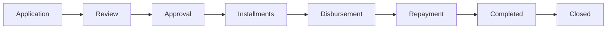
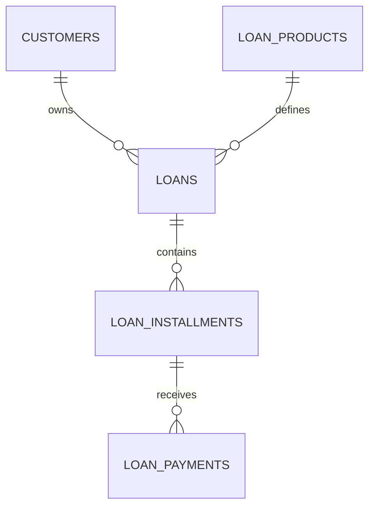
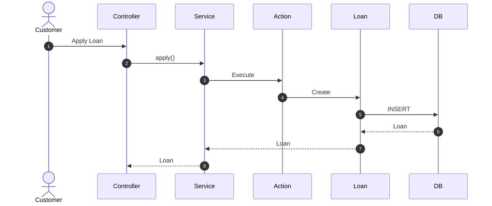
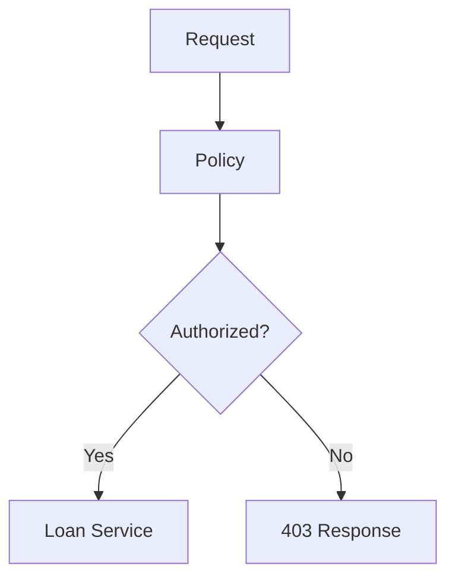
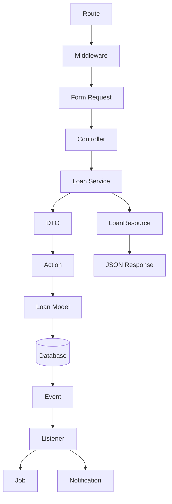

# 42. Example Loan Module

> **Goal:** Demonstrate how to build a complete enterprise-grade **Loan Management Module** using the architecture defined throughout this documentation. This example covers the full loan lifecycle from application to repayment while applying Services, Actions, DTOs, Policies, Local Scopes, Events, Jobs, Notifications, Transactions, API Resources, and Testing.

---

# Overview

The Loan Module is one of the most common business modules in financial systems.

This example demonstrates a production-ready implementation following the project's architectural standards.

The loan lifecycle includes:

* Loan Application
* Loan Review
* Loan Approval
* Installment Generation
* Loan Disbursement
* Payment Processing
* Penalty Calculation
* Loan Completion
* Loan Closure

Every stage is implemented using the appropriate architectural layer.

---

# Complete Architecture

```text id="r7p2mx"
HTTP Request

        │

        ▼

API Route

        │

        ▼

Authentication

        │

        ▼

Authorization

        │

        ▼

Form Request

        │

        ▼

Controller

        │

        ▼

Loan Service

        │

        ▼

DTO

        │

        ▼

Action

        │

        ▼

Loan Model

        │

        ▼

Database Transaction

        │

        ▼

Events

        │

        ▼

Listeners

        │

        ▼

Jobs

        │

        ▼

Notifications

        │

        ▼

API Resource

        │

        ▼

JSON Response
```

---

# Loan Lifecycle



Each stage represents a business state.

---

# Folder Structure

```text id="w6n8ph"
app/
├── Actions/
│   └── Loan/
│       ├── ApplyLoanAction.php
│       ├── ApproveLoanAction.php
│       ├── RejectLoanAction.php
│       ├── GenerateInstallmentsAction.php
│       ├── RecordPaymentAction.php
│       └── CloseLoanAction.php
│
├── DTOs/
│   └── Loan/
│       ├── LoanApplicationData.php
│       ├── LoanApprovalData.php
│       └── LoanPaymentData.php
│
├── Events/
│   ├── LoanApplied.php
│   ├── LoanApproved.php
│   ├── LoanRejected.php
│   ├── PaymentReceived.php
│   └── LoanClosed.php
│
├── Http/
│   ├── Controllers/
│   │   └── Api/
│   │       └── LoanController.php
│   │
│   ├── Requests/
│   │   ├── LoanStoreRequest.php
│   │   ├── LoanApprovalRequest.php
│   │   └── LoanPaymentRequest.php
│   │
│   └── Resources/
│       ├── LoanResource.php
│       └── LoanCollection.php
│
├── Jobs/
│   ├── SyncLoanToCrmJob.php
│   ├── GenerateLoanDocumentsJob.php
│   └── SendRepaymentReminderJob.php
│
├── Listeners/
│   ├── NotifyCustomerLoanApproved.php
│   ├── QueueLoanDocuments.php
│   └── SyncLoanCreated.php
│
├── Models/
│   ├── Loan.php
│   ├── LoanInstallment.php
│   └── LoanPayment.php
│
├── Notifications/
│   ├── LoanApprovedNotification.php
│   ├── PaymentReceivedNotification.php
│   └── LoanClosedNotification.php
│
├── Policies/
│   └── LoanPolicy.php
│
└── Services/
    └── LoanService.php
```

---

# Database Design

```text id="a8m5vz"
loans

----------------------------

id

uuid

customer_id

loan_product_id

reference

principal_amount

interest_amount

total_amount

outstanding_amount

status

approved_at

disbursed_at

closed_at

created_at

updated_at
```

---

# Installments

```text id="k3q9hj"
loan_installments

----------------------------

id

loan_id

installment_no

due_date

principal

interest

penalty

paid_amount

outstanding_amount

status
```

---

# Payments

```text id="y5n4cr"
loan_payments

----------------------------

id

loan_id

installment_id

amount

payment_date

payment_method

reference

created_by
```

---

# Relationships



---

# API Endpoints

| Method | Endpoint                        | Description    |
| ------ | ------------------------------- | -------------- |
| GET    | `/api/v1/loans`                 | List loans     |
| GET    | `/api/v1/loans/{loan}`          | Loan details   |
| POST   | `/api/v1/loans`                 | Apply for loan |
| POST   | `/api/v1/loans/{loan}/approve`  | Approve loan   |
| POST   | `/api/v1/loans/{loan}/reject`   | Reject loan    |
| POST   | `/api/v1/loans/{loan}/disburse` | Disburse loan  |
| POST   | `/api/v1/payments`              | Record payment |
| POST   | `/api/v1/loans/{loan}/close`    | Close loan     |

---

# Request Flow



---

# Form Requests

Each operation has its own request.

Examples:

```text id="u4m8rp"
LoanStoreRequest

LoanApprovalRequest

LoanPaymentRequest

LoanDisbursementRequest
```

Validation belongs exclusively in Form Requests.

---

# DTOs

Separate DTOs for:

* Application
* Approval
* Payment
* Disbursement

DTOs prevent HTTP-specific data from leaking into business logic.

---

# Services

The `LoanService` coordinates all workflows.

Responsibilities:

* Business rules
* Transactions
* Actions
* Event dispatching
* Logging
* Cache invalidation

The Service never formats HTTP responses.

---

# Actions

Recommended Actions.

```text id="g8p1mx"
ApplyLoanAction

ApproveLoanAction

RejectLoanAction

GenerateInstallmentsAction

RecordPaymentAction

CalculatePenaltyAction

CloseLoanAction
```

Each Action performs one business operation.

---

# Transaction Flow

```text id="h6v9kt"
Begin Transaction

↓

Validate Rules

↓

Create Loan

↓

Generate Installments

↓

Commit

↓

Dispatch Events
```

Events and Jobs should be dispatched using `afterCommit()` where applicable.

---

# Loan Status

Recommended Enum.

```text id="q3n5fw"
DRAFT

PENDING

UNDER_REVIEW

APPROVED

REJECTED

DISBURSED

ACTIVE

OVERDUE

COMPLETED

CLOSED

CANCELLED
```

Avoid magic strings throughout the codebase.

---

# Local Scopes

Example.

```php id="d5m8qy"
Loan::approved()

    ->active()

    ->overdue()

    ->latest();
```

Recommended scopes:

* approved()
* rejected()
* active()
* overdue()
* completed()
* disbursed()

---

# Policies

Protect actions.

```text id="w2k7rb"
Apply

Approve

Reject

Disburse

Record Payment

View

Delete
```

Every sensitive action should be authorized.

---

# Events

Domain events.

```text id="j9p4cn"
LoanApplied

LoanApproved

LoanRejected

LoanDisbursed

PaymentReceived

LoanCompleted

LoanClosed
```

Events describe completed business actions.

---

# Listeners

Examples.

```text id="f4v6mq"
Send Approval SMS

Send Email

Generate Documents

Sync CRM

Update Dashboard

Write Audit Log
```

Listeners keep the Service focused.

---

# Jobs

Background processing.

```text id="v8n2hk"
GenerateLoanDocumentsJob

GenerateRepaymentSchedulePdfJob

SyncLoanToCrmJob

SendReminderJob

GenerateStatementJob
```

Jobs execute asynchronously.

---

# Notifications

Customer notifications.

```text id="b5r7wp"
Loan Approved

Loan Rejected

Payment Received

Payment Due

Loan Closed
```

Channels:

* Email
* SMS
* Push
* Database

---

# API Resource

Transforms.

```text id="n3m8zt"
Loan

↓

LoanResource

↓

JSON
```

Resources expose only required fields.

---

# Logging

Recommended context.

```text id="x1q6pv"
loan_id

customer_id

performed_by

request_id

status
```

Log meaningful business events.

---

# Cache

Good cache candidates.

* Loan Products
* Interest Rates
* Settings
* Dashboard Statistics

Invalidate cache when related data changes.

---

# Authorization Flow



---

# Business Rules

Examples:

* Customer must be active.
* Customer must not exceed credit limit.
* Loan product must be available.
* Loan amount must be within product limits.
* Outstanding loans may block new applications.
* Approval requires reviewer permission.
* Closed loans cannot receive payments.

Keep business rules inside the Service layer.

---

# Testing Strategy

## Unit Tests

* LoanService
* Actions
* Local Scopes
* Penalty calculations
* Installment generation

## Feature Tests

* Apply loan
* Approve loan
* Reject loan
* Record payment
* Close loan

## API Tests

* Validation
* Authorization
* Response structure
* Pagination

## Database Tests

* Loan creation
* Installments
* Payments
* Transactions

---

# Complete Module Diagram



---

# Development Checklist

* [ ] Migrations created
* [ ] Models created
* [ ] Factories created
* [ ] Seeders created
* [ ] Form Requests created
* [ ] DTOs created
* [ ] Actions created
* [ ] Services created
* [ ] Policies created
* [ ] Controllers created
* [ ] Resources created
* [ ] Events created
* [ ] Listeners created
* [ ] Jobs created
* [ ] Notifications created
* [ ] Local Scopes implemented
* [ ] Transactions implemented
* [ ] Logging implemented
* [ ] Tests completed
* [ ] API documented

---

# Enterprise Best Practices

* Keep Controllers thin.
* Keep business logic inside Services.
* Use one Action per business operation.
* Validate with Form Requests.
* Use DTOs for validated data.
* Wrap multi-step workflows in transactions.
* Dispatch Events after commit.
* Queue long-running operations.
* Return API Resources.
* Test every business workflow.
* Log important business events.
* Protect all sensitive operations with Policies.

---

# Common Anti-Patterns

Avoid:

* Approving loans directly in Controllers.
* Sending notifications inside transactions.
* Calculating penalties inside Blade views.
* Duplicating installment logic.
* Returning raw Eloquent models.
* Repeating query filters instead of Local Scopes.
* Performing synchronous CRM calls during user requests.

---

# Summary

The Loan Module demonstrates a complete enterprise-grade implementation of a complex financial workflow using the architectural patterns defined throughout this guide. By combining Form Requests, DTOs, Services, Actions, Local Scopes, Transactions, Policies, Events, Jobs, Notifications, API Resources, and automated testing, every loan operation remains modular, secure, testable, and scalable. This architecture can be applied to other business modules such as Orders, Invoices, Inventory, Payroll, Insurance, and Membership systems.

The next chapter explores **Final Project Architecture & Enterprise Checklist**, bringing together all architectural standards into a single reference for production-ready Laravel applications.
