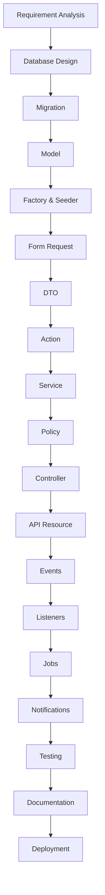

# 43. Development Checklist

> **Goal:** Provide a comprehensive checklist that every developer can follow while building a Laravel module to ensure consistency, maintainability, security, performance, and production readiness.

---

# Overview

Every feature developed in this project should follow the same architecture and quality standards.

This checklist serves as a practical guide during development and code reviews.

Following it consistently ensures that every module is:

* Well structured
* Easy to maintain
* Secure
* Testable
* Performant
* Production ready

---

# Development Workflow



Every module should follow the same development lifecycle.

---

# Module Creation Checklist

## Database

* [ ] Database schema designed
* [ ] Relationships identified
* [ ] Foreign keys added
* [ ] Indexes created
* [ ] Naming conventions followed
* [ ] Soft deletes evaluated
* [ ] UUID/ULID considered where appropriate

---

## Migrations

* [ ] Migration created
* [ ] Rollback (`down()`) implemented
* [ ] Foreign keys configured
* [ ] Indexes added
* [ ] Decimal used for money
* [ ] Timestamps included
* [ ] Migration tested

---

## Model

* [ ] `$fillable` defined
* [ ] Relationships implemented
* [ ] Local Scopes created
* [ ] Attribute casts defined
* [ ] Accessors/Mutators added where needed
* [ ] Business logic excluded

---

## Factory

* [ ] Factory created
* [ ] Realistic fake data
* [ ] Factory states implemented
* [ ] Relationships supported

---

## Seeder

* [ ] Seeder created
* [ ] Registered in `DatabaseSeeder`
* [ ] Environment-safe
* [ ] Deterministic reference data

---

## Routes

* [ ] API routes created
* [ ] Route names follow conventions
* [ ] Middleware applied
* [ ] Route model binding used
* [ ] API versioning applied

---

## Form Requests

* [ ] Store request created
* [ ] Update request created
* [ ] Validation rules implemented
* [ ] Authorization implemented
* [ ] Input normalization added if needed

---

## DTOs

* [ ] DTO created
* [ ] Immutable design
* [ ] Used by Service layer
* [ ] HTTP layer isolated

---

## Actions

* [ ] One Action per business operation
* [ ] Single responsibility
* [ ] Reusable
* [ ] Independently testable

---

## Services

* [ ] Business logic implemented
* [ ] Transactions used
* [ ] Logging added
* [ ] Events dispatched
* [ ] Cache invalidation implemented
* [ ] No HTTP response logic

---

## Policies

* [ ] View policy
* [ ] Create policy
* [ ] Update policy
* [ ] Delete policy
* [ ] Custom permissions implemented

---

## Controllers

* [ ] Thin Controller
* [ ] Uses Form Requests
* [ ] Calls Services only
* [ ] Returns API Resources
* [ ] No business logic

---

## API Resources

* [ ] Resource created
* [ ] Collection resource created
* [ ] Response standardized
* [ ] Sensitive fields hidden

---

## Events

* [ ] Domain events created
* [ ] Descriptive names
* [ ] Dispatched after commit
* [ ] Focused responsibility

---

## Listeners

* [ ] Notification listeners
* [ ] Audit listeners
* [ ] CRM listeners
* [ ] Analytics listeners

---

## Jobs

* [ ] Long-running tasks queued
* [ ] Queue retry strategy defined
* [ ] Idempotent execution
* [ ] Failure handling implemented

---

## Notifications

* [ ] Email notifications
* [ ] SMS notifications
* [ ] Push notifications
* [ ] Database notifications
* [ ] Queue enabled

---

## Exceptions

* [ ] Custom exceptions created
* [ ] Business exceptions separated
* [ ] Exception rendering configured
* [ ] Messages standardized

---

## Logging

* [ ] Structured logging
* [ ] Context included
* [ ] Request ID logged
* [ ] Sensitive data excluded

---

## Caching

* [ ] Cache expensive queries
* [ ] Cache keys standardized
* [ ] TTL configured
* [ ] Cache invalidation implemented

---

## Performance

* [ ] N+1 queries eliminated
* [ ] Eager loading used
* [ ] Pagination implemented
* [ ] Database indexes verified
* [ ] Query performance reviewed

---

## Security

* [ ] Authentication applied
* [ ] Authorization verified
* [ ] Form Requests used
* [ ] SQL injection prevented
* [ ] XSS prevented
* [ ] CSRF enabled (web routes)
* [ ] Secrets protected
* [ ] File uploads validated

---

## Testing

### Unit Tests

* [ ] Services
* [ ] Actions
* [ ] Policies
* [ ] Helpers
* [ ] Local Scopes

### Feature Tests

* [ ] CRUD operations
* [ ] Validation
* [ ] Authorization
* [ ] API responses

### Integration Tests

* [ ] Events
* [ ] Jobs
* [ ] Notifications
* [ ] External APIs

### Database Tests

* [ ] Transactions
* [ ] Relationships
* [ ] Constraints
* [ ] Rollbacks

---

## Documentation

* [ ] API documented
* [ ] Module documented
* [ ] README updated
* [ ] Architecture diagrams added
* [ ] Business rules documented

---

## Deployment

* [ ] Migration reviewed
* [ ] Environment variables updated
* [ ] Queue workers restarted
* [ ] Cache optimized
* [ ] Health checks passed

---

# Pull Request Checklist

Before opening a Pull Request:

* [ ] Branch rebased or updated
* [ ] Tests passing
* [ ] Laravel Pint passes
* [ ] PHPStan passes
* [ ] No debug code
* [ ] No commented code
* [ ] No unused imports
* [ ] Documentation updated
* [ ] Code reviewed locally

---

# Code Review Checklist

Review:

* [ ] Naming
* [ ] Readability
* [ ] Architecture
* [ ] Security
* [ ] Performance
* [ ] Validation
* [ ] Authorization
* [ ] Logging
* [ ] Testing
* [ ] Documentation

---

# Production Readiness Checklist

* [ ] `APP_DEBUG=false`
* [ ] HTTPS enabled
* [ ] Redis configured
* [ ] Queue workers running
* [ ] Scheduler configured
* [ ] Configuration cached
* [ ] Routes cached
* [ ] Views cached
* [ ] Monitoring enabled
* [ ] Backups verified
* [ ] Health endpoint working

---

# CI/CD Checklist

* [ ] Composer install
* [ ] NPM build
* [ ] Pint executed
* [ ] PHPStan executed
* [ ] PHPUnit executed
* [ ] Composer audit executed
* [ ] Deployment automated
* [ ] Rollback available

---

# Release Checklist

Before every production release:

* [ ] Business requirements verified
* [ ] Acceptance testing completed
* [ ] Database backup completed
* [ ] Smoke tests executed
* [ ] Monitoring enabled
* [ ] Team notified
* [ ] Rollback plan confirmed

---

# Recommended Development Flow

```text id="v4r7zn"
Requirement

↓

Database Design

↓

Migration

↓

Model

↓

Factory

↓

Seeder

↓

Form Request

↓

DTO

↓

Action

↓

Service

↓

Policy

↓

Controller

↓

API Resource

↓

Event

↓

Listener

↓

Job

↓

Notification

↓

Testing

↓

Documentation

↓

CI/CD

↓

Deployment
```

---

# Team Standards

Every team member should:

* Follow the project architecture.
* Follow PSR-12.
* Use Laravel Pint.
* Use PHPStan.
* Write automated tests.
* Keep Controllers thin.
* Use Services for business logic.
* Use Local Scopes for reusable queries.
* Use API Resources.
* Keep documentation up to date.

---

# Module Quality Score

Evaluate every module before release.

| Area          | Status |
| ------------- | ------ |
| Architecture  | □      |
| Validation    | □      |
| Security      | □      |
| Performance   | □      |
| Logging       | □      |
| Testing       | □      |
| Documentation | □      |
| Deployment    | □      |

A module should satisfy every category before being merged into the main branch.

---

# Development Principles

Remember these principles throughout development:

* One class, one responsibility.
* Keep Controllers thin.
* Keep business logic in Services.
* Use DTOs for validated input.
* Use Actions for reusable business operations.
* Use Local Scopes for query reuse.
* Dispatch Events after successful transactions.
* Queue long-running work.
* Return API Resources.
* Test everything that matters.

---

# Summary

This Development Checklist serves as the project's implementation guide and quality gate. By following the same sequence—from database design to deployment—every module remains consistent, secure, testable, and maintainable. Teams can use this document during development, pull requests, code reviews, QA, and production releases to ensure enterprise-level quality across the entire Laravel application.

The next chapter concludes the documentation with the **Enterprise Laravel Architecture Summary & Best Practices**, bringing together all concepts into a single reference for long-term project success.
