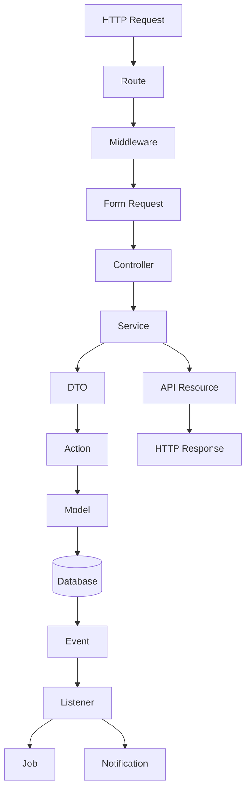
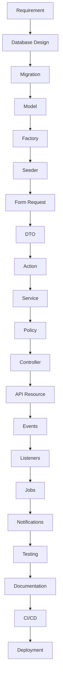
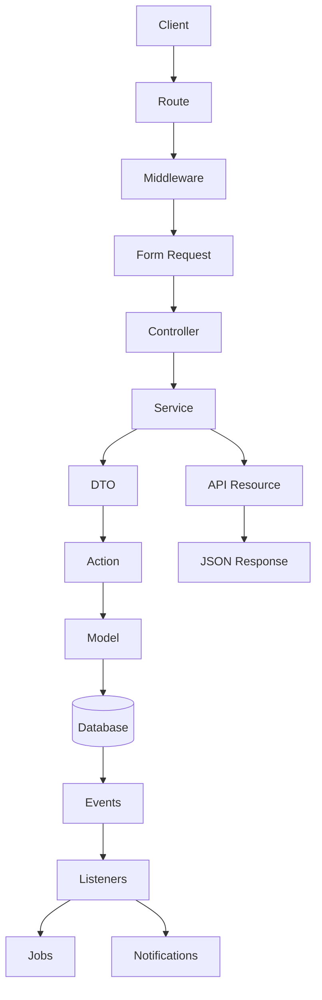

# 44. Summary

> **Goal:** Summarize the architectural principles, development workflow, coding standards, and best practices presented throughout this documentation, providing a single reference for building enterprise-grade Laravel applications.

---

# Introduction

This documentation defines a complete architecture for building scalable, maintainable, testable, and production-ready Laravel applications.

The architecture is based on one fundamental principle:

> **Every class should have a single responsibility, and every layer should focus on one concern.**

Following this principle produces applications that are:

* Easy to understand
* Easy to extend
* Easy to test
* Easy to deploy
* Easy to maintain

---

# Architecture Overview

The application follows a layered architecture.

```text id="n4v7kx"
HTTP Request

        │

        ▼

Route

        │

        ▼

Middleware

        │

        ▼

Form Request

        │

        ▼

Controller

        │

        ▼

Service

        │

        ▼

DTO

        │

        ▼

Action

        │

        ▼

Model

        │

        ▼

Database

        │

        ▼

Event

        │

        ▼

Listener

        │

        ▼

Job

        │

        ▼

Notification

        │

        ▼

API Resource

        │

        ▼

JSON Response
```

Every request should follow this predictable lifecycle.

---

# Complete Request Lifecycle



This flow should remain consistent across all modules.

---

# Core Architectural Principles

## Thin Controllers

Controllers should only:

* Receive requests
* Call Services
* Return responses

Controllers should never contain:

* Business logic
* Transactions
* Database queries
* Notifications
* External API calls

---

## Form Requests

Validation belongs in Form Requests.

Responsibilities:

* Validation
* Authorization
* Input normalization

---

## DTOs

DTOs isolate validated data from the HTTP layer.

Benefits:

* Strong typing
* Immutability
* Reusability
* Better testing

---

## Services

Services contain business logic.

Responsibilities:

* Business rules
* Transactions
* Coordination
* Logging
* Event dispatching
* Cache invalidation

Services never return HTTP responses.

---

## Actions

Actions perform one business operation.

Examples:

* CreateCustomerAction
* ApproveLoanAction
* RecordPaymentAction

Small Actions are easier to reuse and test.

---

## Models

Models represent database entities.

Responsibilities:

* Relationships
* Local Scopes
* Casts
* Accessors
* Mutators

Models should avoid business workflows.

---

## Local Scopes

Reusable query logic belongs in Local Scopes.

Example

```php id="y2k7qn"
Loan::approved()

    ->active()

    ->latest();
```

This keeps Services clean and expressive.

---

## Policies

Policies protect business operations.

Always authorize:

* View
* Create
* Update
* Delete

Never rely only on frontend restrictions.

---

## API Resources

Resources transform Models into consistent API responses.

Benefits:

* Hide internal fields
* Stable API contracts
* Consistent serialization

---

## Events

Events represent completed business actions.

Examples:

* LoanApproved
* UserCreated
* PaymentReceived

Events decouple the application.

---

## Listeners

Listeners react to Events.

Responsibilities:

* Notifications
* Audit logging
* CRM synchronization
* Analytics

Listeners keep Services focused.

---

## Jobs

Jobs execute long-running tasks.

Examples:

* Send emails
* Generate PDFs
* CRM synchronization
* Report generation

Queue background work whenever possible.

---

## Notifications

Notifications communicate with users.

Channels:

* Email
* SMS
* Push
* Database

Dispatch notifications after successful transactions.

---

# Database Principles

Every table should:

* Have one responsibility
* Use foreign keys
* Be indexed appropriately
* Use timestamps
* Follow naming conventions

Normalize data before considering denormalization.

---

# Security Principles

Always:

* Authenticate users
* Authorize actions
* Validate input
* Escape output
* Hash passwords
* Encrypt sensitive data
* Protect secrets
* Use HTTPS
* Enable rate limiting

Security should exist at every layer.

---

# Performance Principles

Optimize:

* Database queries
* Eager loading
* Caching
* Queue processing
* Redis
* Indexes
* Pagination

Measure performance before optimizing.

---

# Testing Strategy

Recommended testing pyramid.

```text id="r4v8tz"
Unit Tests

↓

Feature Tests

↓

Integration Tests

↓

Browser Tests
```

Test:

* Services
* Policies
* Requests
* Actions
* APIs
* Jobs
* Events
* Notifications

Automated testing is mandatory for critical business logic.

---

# Development Workflow



Use the same workflow for every module.

---

# Code Quality Standards

Every module should:

* Follow PSR-12
* Use Laravel Pint
* Use PHPStan
* Use descriptive names
* Keep methods small
* Keep classes focused
* Use dependency injection
* Avoid duplicated code

Consistency is more valuable than individual preferences.

---

# CI/CD

Every deployment should automatically:

* Install dependencies
* Build assets
* Run Pint
* Run PHPStan
* Run tests
* Run security audits
* Deploy
* Restart workers
* Verify health

Manual deployments should be avoided whenever possible.

---

# Production Infrastructure

Recommended stack.

```text id="p6n4qw"
Internet

↓

Load Balancer

↓

Nginx

↓

PHP-FPM

↓

Laravel

↓

Redis

↓

MySQL

↓

Supervisor

↓

Queue Workers
```

This architecture supports scalability and high availability.

---

# Project Folder Structure

```text id="z1m7rk"
app/

├── Actions/

├── DTOs/

├── Events/

├── Exceptions/

├── Helpers/

├── Http/

├── Jobs/

├── Listeners/

├── Models/

├── Notifications/

├── Policies/

├── Providers/

├── Services/

└── Traits/
```

Organize code by responsibility, not by convenience.

---

# Development Principles

Always remember:

* One class, one responsibility.
* One Action, one operation.
* One Service, one business workflow.
* One Event, one completed action.
* One Job, one background task.

Small components are easier to maintain than large, multipurpose classes.

---

# Enterprise Checklist

Every production module should satisfy:

* [ ] Architecture implemented
* [ ] Validation completed
* [ ] Authorization enforced
* [ ] Transactions implemented
* [ ] Logging added
* [ ] Exceptions handled
* [ ] Events dispatched
* [ ] Jobs queued
* [ ] Notifications implemented
* [ ] API Resources used
* [ ] Tests passing
* [ ] Documentation updated
* [ ] CI/CD passing
* [ ] Deployment verified

---

# Recommended Module Template

Every new feature should follow this sequence.

```text id="w8q3mv"
Migration

↓

Model

↓

Factory

↓

Seeder

↓

Form Request

↓

DTO

↓

Action

↓

Service

↓

Policy

↓

Controller

↓

API Resource

↓

Event

↓

Listener

↓

Job

↓

Notification

↓

Testing

↓

Documentation
```

Using a common template makes the codebase predictable and easier to maintain.

---

# Common Anti-Patterns

Avoid:

* Fat Controllers
* Fat Models
* Business logic in Blade templates
* Database queries in views
* Repeated validation rules
* Duplicate query logic
* Returning raw models from APIs
* Long-running work during HTTP requests
* Generic exceptions
* Skipping automated tests
* Direct production edits

---

# Team Guidelines

Every developer should:

* Follow the documented architecture.
* Respect coding standards.
* Write tests before merging.
* Keep documentation updated.
* Review code constructively.
* Prioritize readability.
* Prefer reusable components.
* Continuously improve the codebase.

Consistency across the team is essential for long-term success.

---

# Final Architecture Diagram



This represents the complete enterprise request lifecycle.

---

# Final Thoughts

Enterprise software is not built by writing more code—it is built by writing **well-structured code**.

A successful Laravel application is characterized by:

* Clear architecture
* Consistent conventions
* Strong separation of concerns
* Automated testing
* Secure development practices
* Performance optimization
* Reliable deployments
* Continuous improvement

By following the standards in this guide, development teams can build applications that remain maintainable as they grow from small projects to large enterprise platforms.

The patterns described throughout this documentation are intended to serve as a long-term architectural foundation that encourages consistency, simplifies onboarding, supports team collaboration, and enables confident evolution of the codebase over time.
