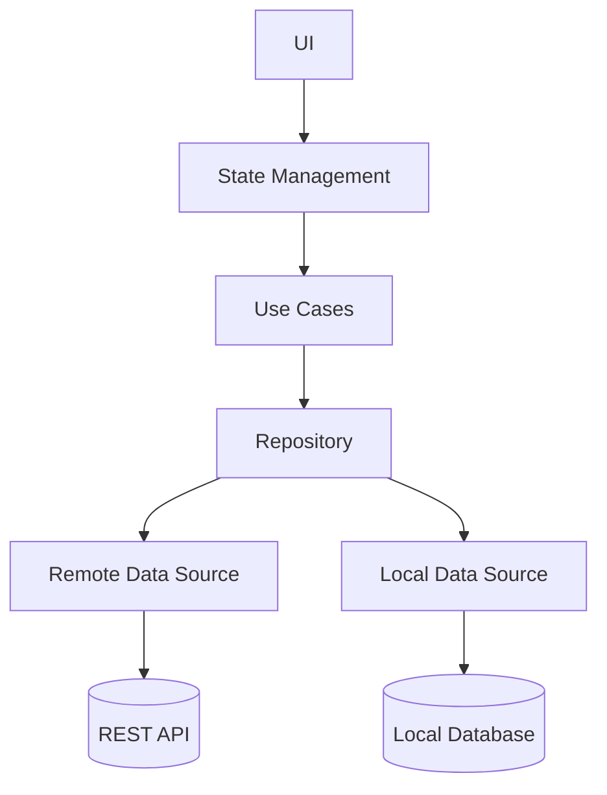
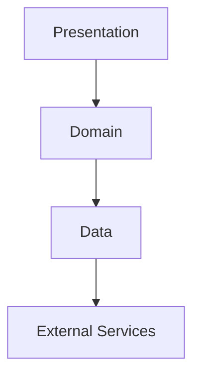
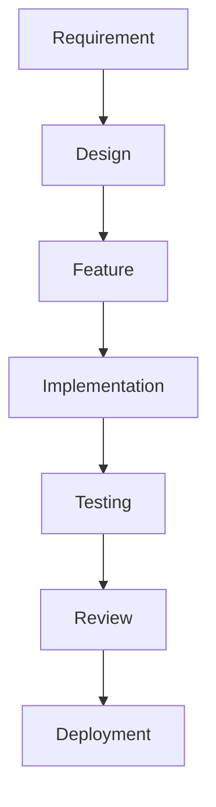

# 01. Introduction

> **Goal:** Introduce the architecture, philosophy, design principles, and development standards that will be followed throughout this documentation and every Flutter project built using this architecture.

---

# Overview

Flutter is one of the most powerful cross-platform frameworks for building high-performance applications from a single codebase.

As applications grow, maintaining code quality becomes increasingly difficult without a well-defined architecture.

This documentation introduces a standardized architecture that enables teams to build Flutter applications that are:

* Scalable
* Maintainable
* Testable
* Modular
* Reusable
* Performant
* Secure
* Production-ready

The architecture presented in this guide is suitable for:

* Small applications
* Startup MVPs
* Medium-sized business applications
* Enterprise mobile platforms

Every feature follows the same predictable architecture, making the codebase easier to understand and maintain.

---

# Why Architecture Matters

Without a proper architecture, applications often suffer from:

* Large widget files
* Business logic inside UI
* Duplicate code
* Tight coupling
* Difficult testing
* Difficult onboarding
* Poor scalability

A good architecture solves these problems by separating responsibilities and defining clear boundaries between layers.

---

# Architecture Goals

The primary objectives of this architecture are:

* Separation of Concerns
* Feature Isolation
* Code Reusability
* Loose Coupling
* High Cohesion
* Easy Testing
* Dependency Injection
* Maintainable Codebase
* Predictable Folder Structure
* Consistent Development Workflow

---

# Development Philosophy

Every feature should follow the same lifecycle.

```text id="6jgkdr"
Requirement

↓

UI Design

↓

Presentation Layer

↓

Business Logic

↓

Repository

↓

Data Source

↓

API / Local Storage
```

Developers should always know where a piece of code belongs.

---

# High-Level Architecture

The application follows **Clean Architecture** combined with a **Feature-First** project organization.

```text id="v4r8nx"
Presentation Layer

        │

        ▼

State Management

        │

        ▼

Use Cases

        │

        ▼

Repository

        │

        ▼

Data Sources

        │

        ▼

REST API

SQLite

Hive

Firebase
```

Each layer has a single responsibility.

---

# Architecture Diagram



---

# Core Principles

## 1. Feature-First Organization

Instead of organizing code by file type, organize it by feature.

Example:

```text id="k5v8ph"
features/

authentication/

shopping/

orders/

profile/
```

Each feature contains everything required to function independently.

---

## 2. Separation of Concerns

Every layer performs one responsibility.

| Layer            | Responsibility           |
| ---------------- | ------------------------ |
| UI               | Display information      |
| State Management | Manage UI state          |
| Use Case         | Business logic           |
| Repository       | Abstract data access     |
| Data Source      | Retrieve or persist data |

This separation improves maintainability and testability.

---

## 3. Single Responsibility Principle

Every class should have exactly one reason to change.

Examples:

* Screen → Displays UI
* Controller/Notifier → Manages state
* Use Case → Executes one business operation
* Repository → Provides data
* Service → Shared infrastructure logic

---

## 4. Dependency Injection

Dependencies should be injected instead of created manually.

Benefits:

* Easier testing
* Loose coupling
* Better modularity
* Simpler maintenance

---

## 5. Repository Pattern

Repositories separate business logic from data access.

```text id="x7m1qt"
Use Case

↓

Repository

↓

Remote API

or

Local Storage
```

The presentation layer never communicates directly with APIs or databases.

---

## 6. Testability

Every layer should be independently testable.

The architecture supports:

* Unit Tests
* Widget Tests
* Integration Tests
* End-to-End Tests

Testing should be part of development, not an afterthought.

---

# Development Layers



---

# Recommended Technology Stack

| Component            | Technology             |
| -------------------- | ---------------------- |
| Language             | Dart                   |
| Framework            | Flutter                |
| State Management     | Riverpod               |
| Navigation           | GoRouter               |
| HTTP Client          | Dio                    |
| Dependency Injection | GetIt                  |
| Local Storage        | Hive / Isar            |
| Secure Storage       | flutter_secure_storage |
| Serialization        | json_serializable      |
| Logging              | logger                 |
| Testing              | flutter_test, mocktail |

These technologies are widely adopted, well-supported, and suitable for enterprise applications.

---

# Folder Philosophy

Every project should have a predictable structure.

```text id="n6q3tx"
lib/

app/

core/

features/

shared/

main.dart
```

Each directory has a well-defined purpose, reducing ambiguity and improving navigation.

---

# Development Workflow



This workflow should be repeated consistently for every feature.

---

# Benefits of This Architecture

Following this architecture provides:

* Easier onboarding for new developers
* Consistent project structure
* Improved code readability
* Better scalability
* Simplified debugging
* Higher code quality
* Faster feature development
* Easier refactoring
* Reliable automated testing
* Production-ready applications

---

# Intended Audience

This documentation is designed for:

* Flutter Developers
* Software Engineers
* Technical Leads
* Mobile Teams
* Software Architects
* Organizations adopting Flutter as a standard platform

---

# Best Practices

* Keep widgets focused on UI.
* Move business logic outside the presentation layer.
* Organize code by feature.
* Use dependency injection.
* Keep components loosely coupled.
* Write reusable widgets.
* Test every important feature.
* Follow consistent naming conventions.
* Keep documentation up to date.

---

# Common Anti-Patterns

Avoid:

* Business logic inside widgets
* Direct API calls from screens
* Large "utility" classes with unrelated responsibilities
* Duplicated networking code
* Tight coupling between layers
* Unstructured folder layouts
* Global mutable state without clear ownership

---

# What You'll Learn

By completing this documentation, you will learn how to:

* Build enterprise Flutter applications
* Design scalable project structures
* Implement Clean Architecture
* Organize features effectively
* Manage state cleanly
* Consume REST APIs
* Handle authentication securely
* Cache and synchronize data
* Optimize performance
* Write automated tests
* Configure CI/CD pipelines
* Deploy production-ready applications

---

# Summary

A successful Flutter application is built on a solid architectural foundation. By adopting a Feature-First structure, Clean Architecture principles, dependency injection, repository pattern, and clear separation of concerns, development teams can create applications that remain maintainable, scalable, and testable as they grow. The remaining chapters build on these concepts, providing practical guidance and examples for implementing each layer of the architecture.
