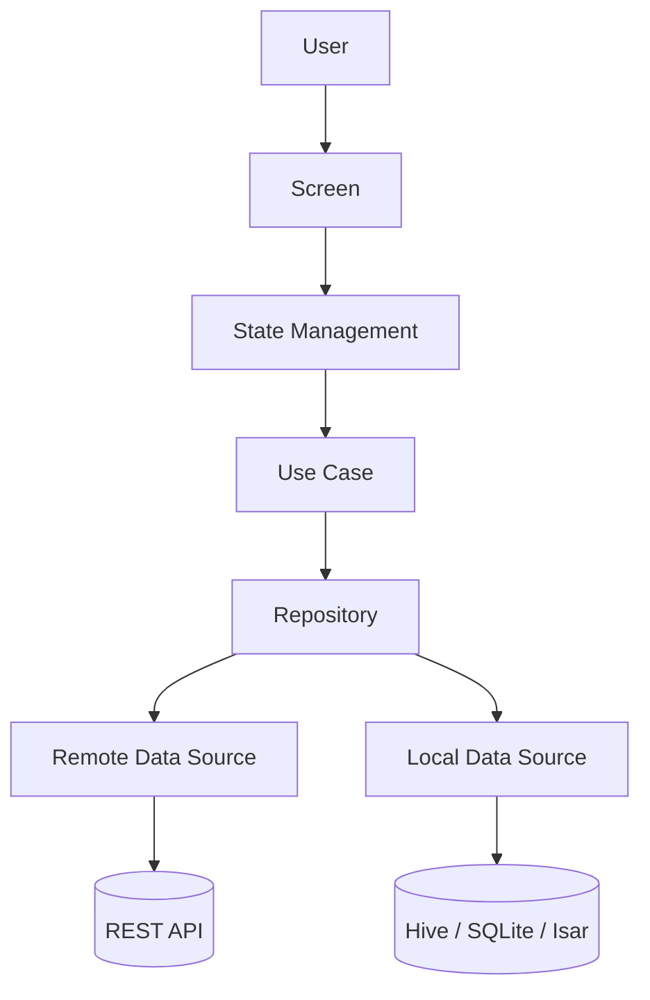
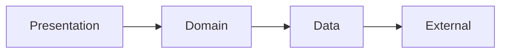
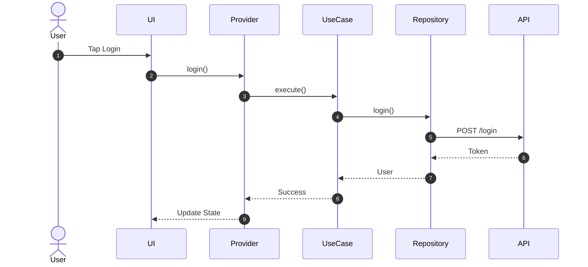
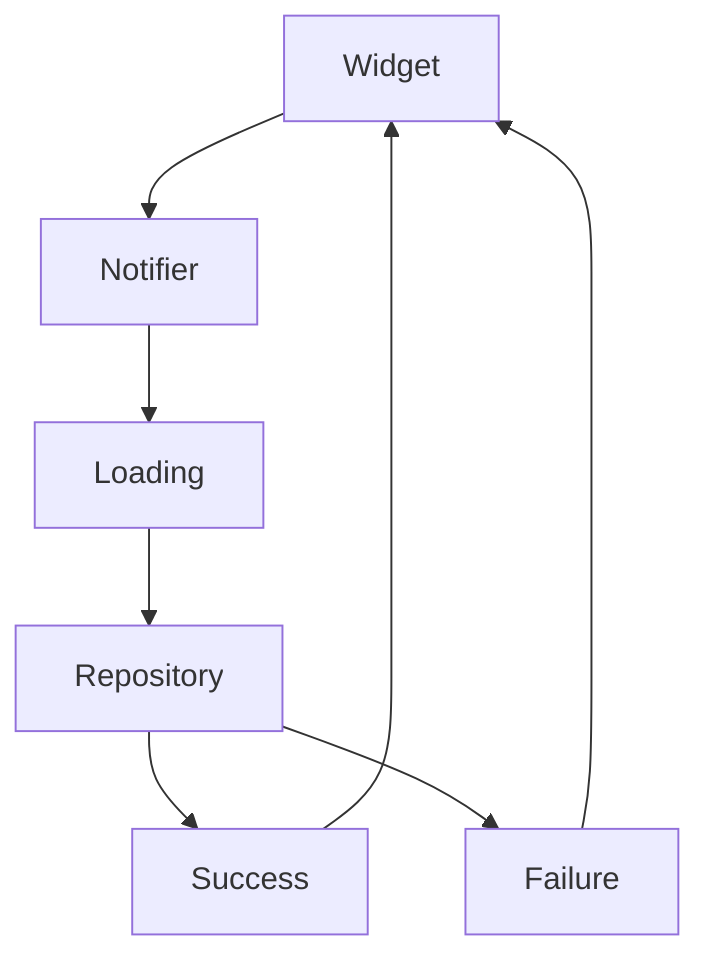

# 02. Architecture Overview

> **Goal:** Provide a complete overview of the architecture used throughout this Flutter project, explaining how every layer communicates, where code belongs, and how data flows from the user interface to external services.

---

# Overview

This project follows a **Feature-First Clean Architecture**, where each feature is self-contained and every architectural layer has a single responsibility.

The architecture is designed to:

* Scale as the application grows
* Keep business logic independent of Flutter widgets
* Make testing straightforward
* Support multiple developers working simultaneously
* Reduce coupling between components
* Improve code reuse

Every feature follows the exact same structure, making the application predictable and easy to maintain.

---

# Architecture Principles

The architecture is built around the following principles:

* Clean Architecture
* Feature-First Organization
* SOLID Principles
* Repository Pattern
* Dependency Injection
* Immutable State
* Separation of Concerns
* Testability
* Reusability

Every class should have **one responsibility**.

---

# High-Level Architecture

```text id="h7k2rp"
Presentation Layer

        │

        ▼

State Management

        │

        ▼

Use Cases

        │

        ▼

Repository

        │

        ▼

Data Sources

        │

        ▼

REST API

Firebase

SQLite

Hive
```

The Presentation layer never communicates directly with APIs or databases.

---

# Complete Architecture Diagram



---

# Layer Responsibilities

## Presentation Layer

Responsible for:

* Screens
* Pages
* Widgets
* Themes
* Navigation
* User interaction

Presentation should never contain business logic.

Examples:

```text id="f6n9wx"
LoginScreen

HomeScreen

ProductScreen

CartWidget
```

---

## State Management Layer

Responsible for:

* Managing UI state
* Calling Use Cases
* Exposing state to widgets
* Handling loading states
* Handling errors

Possible implementations:

* Riverpod
* Provider
* Bloc
* Cubit

Example responsibilities:

```text id="r5m3qc"
Loading

Success

Empty

Error
```

The state layer coordinates UI behavior without accessing APIs directly.

---

## Domain Layer

The Domain layer represents the business rules of the application.

Contains:

* Entities
* Use Cases
* Repository Contracts

The Domain layer is independent of Flutter.

---

## Use Cases

Each Use Case performs exactly one business operation.

Examples:

```text id="v8p2jy"
LoginUser

GetProducts

UpdateProfile

PlaceOrder

Logout
```

Benefits:

* Reusable
* Testable
* Independent of UI

---

## Repository Layer

Repositories abstract where data comes from.

```text id="u1q7nh"
Use Case

↓

Repository

↓

Remote

or

Local
```

The UI never knows whether data comes from:

* REST API
* Local Database
* Cache
* Firebase

---

## Data Sources

Responsible for retrieving and storing data.

Types:

* Remote Data Source
* Local Data Source

Examples:

```text id="c4w9tp"
REST API

SQLite

Hive

Isar

Firebase
```

---

# Feature-First Organization

Every feature contains everything it needs.

Example:

```text id="g2m6rv"
features/

authentication/

shopping/

orders/

profile/

settings/
```

Each feature can evolve independently.

---

# Feature Structure

```text id="z9k3pf"
authentication/

data/

domain/

presentation/

routes.dart
```

This structure should be consistent across every feature.

---

# Clean Architecture Structure



Dependencies always point inward toward the Domain layer.

---

# Data Flow

When a user performs an action:

```text id="t3p8km"
Button Tap

↓

Controller / Notifier

↓

Use Case

↓

Repository

↓

API

↓

Repository

↓

State

↓

Widget
```

The data flows back through the same path.

---

# Login Example



---

# Dependency Direction

```text id="p8m5wx"
Presentation

↓

Domain

↓

Data

↓

External Services
```

Never reverse this dependency direction.

---

# Why This Architecture?

Advantages include:

* Easier testing
* Better modularity
* Cleaner widgets
* Easier maintenance
* Independent features
* Lower coupling
* Better scalability

The architecture also supports future changes with minimal impact.

---

# Folder Organization

```text id="x6q2rd"
lib/

app/

core/

features/

shared/
```

Each folder has a clear purpose.

---

# Separation of Responsibilities

| Layer       | Responsibility   |
| ----------- | ---------------- |
| Screen      | UI               |
| State       | UI logic         |
| Use Case    | Business rule    |
| Repository  | Data abstraction |
| Data Source | API / Database   |
| Model       | Serialization    |
| Entity      | Business object  |

No layer should take on responsibilities that belong to another.

---

# State Flow



Always expose state changes through the state management layer.

---

# Error Flow

```text id="k1r7mv"
API Error

↓

Repository

↓

Failure

↓

State

↓

UI
```

Errors should be transformed into user-friendly states before reaching the UI.

---

# Dependency Injection

Dependencies should be created once and injected where needed.

Example flow:

```text id="n3w4qy"
GetIt

↓

Repository

↓

Use Case

↓

Notifier

↓

Screen
```

Avoid creating dependencies directly inside widgets.

---

# Scalability

As new features are added:

```text id="q2t9zp"
features/

users/

shopping/

payments/

notifications/

analytics/
```

No existing feature should require major restructuring.

---

# Best Practices

* Organize code by feature.
* Keep widgets focused on UI.
* Keep business logic in Use Cases.
* Use repositories for all data access.
* Use dependency injection.
* Write reusable components.
* Keep layers independent.
* Test each layer separately.

---

# Common Anti-Patterns

Avoid:

* API calls directly from widgets
* Business logic inside screens
* Global mutable state
* Large utility classes
* Tight coupling between layers
* Features sharing internal implementation details
* Skipping the repository layer

---

# Architecture Checklist

* [ ] Feature-first organization
* [ ] Clean Architecture implemented
* [ ] Repository Pattern used
* [ ] Dependency Injection configured
* [ ] State Management separated
* [ ] Business logic isolated
* [ ] Repositories abstract data sources
* [ ] Widgets remain lightweight
* [ ] Features independent
* [ ] Layers independently testable

---

# Summary

The architecture described in this chapter forms the foundation of every Flutter application built using this guide. By organizing the application into Presentation, Domain, and Data layers, following a Feature-First structure, and enforcing clear separation of responsibilities, teams can build scalable, maintainable, and testable applications. Every subsequent chapter expands on one part of this architecture, providing implementation guidance, examples, and best practices.
