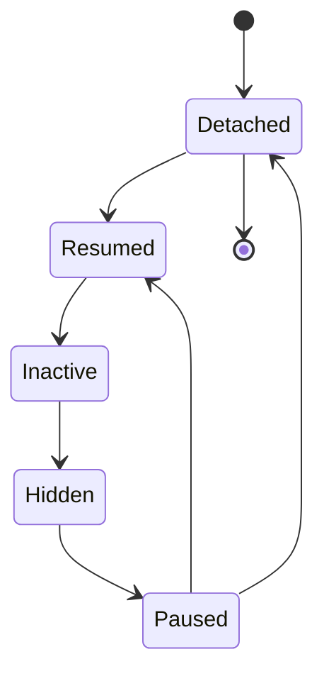
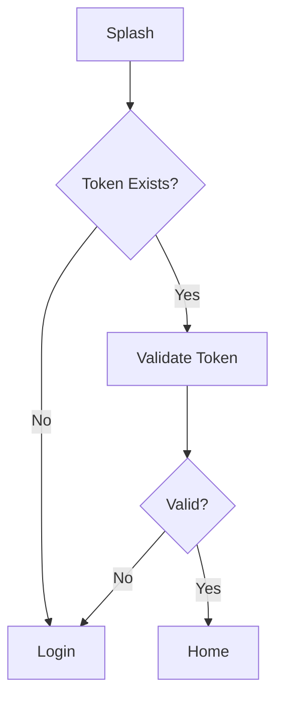

# 03. Application Lifecycle

> **Goal:** Understand how a Flutter application starts, initializes, runs, changes state, and terminates. This chapter explains the complete application lifecycle and where initialization logic should be placed in an enterprise Flutter application.

---

# Overview

Every Flutter application follows a lifecycle, from the moment the operating system launches it until it is terminated.

Understanding this lifecycle helps developers:

* Initialize dependencies correctly
* Manage authentication
* Restore user sessions
* Handle app backgrounding
* Release resources
* Improve performance
* Prevent memory leaks

A well-designed application performs initialization once and keeps lifecycle-specific logic organized.

---

# Application Startup Flow

```text
Operating System

↓

Flutter Engine

↓

main()

↓

WidgetsFlutterBinding

↓

Initialize Dependencies

↓

Initialize Services

↓

runApp()

↓

MaterialApp

↓

Router

↓

First Screen
```

---

# Complete Lifecycle

```mermaid
flowchart TD

A[Operating System]

A --> B[Flutter Engine]

B --> C[main()]

C --> D[WidgetsFlutterBinding.ensureInitialized()]

D --> E[Initialize Dependencies]

E --> F[Load Configuration]

F --> G[Initialize Services]

G --> H[runApp()]

H --> I[MaterialApp]

I --> J[Router]

J --> K[First Screen]
```

---

# Application Entry Point

Every Flutter application starts from:

```dart
void main() async {

  WidgetsFlutterBinding.ensureInitialized();

  await initializeApplication();

  runApp(
    const App(),
  );

}
```

The `main()` function should remain minimal and only coordinate application startup.

---

# Responsibilities of main()

The `main()` function should:

* Initialize Flutter
* Configure dependency injection
* Load environment configuration
* Initialize local storage
* Initialize Firebase (if used)
* Configure logging
* Configure crash reporting
* Start the application

It should **not** contain business logic.

---

# Startup Sequence

A recommended startup order:

```text
main()

↓

Flutter Binding

↓

Environment

↓

Dependency Injection

↓

Local Storage

↓

Secure Storage

↓

Database

↓

Firebase

↓

Networking

↓

Analytics

↓

runApp()
```

Each initialization step should complete before the application is displayed.

---

# Example Folder Structure

```text
lib/

app/
│
├── bootstrap/
│   └── app_initializer.dart
│
├── config/
│
├── dependency_injection/
│
└── router/

main.dart
```

Centralize startup logic instead of placing it directly in `main()`.

---

# Application Initializer

Create a dedicated initializer.

```text
main()

↓

AppInitializer

↓

Configure Everything

↓

runApp()
```

Example responsibilities:

* Register services
* Open databases
* Load cached settings
* Configure API client
* Initialize notifications

---

# App Lifecycle States

Flutter provides lifecycle callbacks through `AppLifecycleState`.

The common states are:

| State    | Description                                |
| -------- | ------------------------------------------ |
| detached | Engine running without a visible view      |
| resumed  | Application is active and visible          |
| inactive | Temporarily inactive                       |
| hidden   | Application is hidden (platform-dependent) |
| paused   | Application is in the background           |

---

# Lifecycle Diagram



---

# Observing Lifecycle

Flutter provides:

```dart
WidgetsBindingObserver
```

Implement this in services or controllers that need lifecycle awareness.

Typical use cases:

* Refresh tokens
* Pause animations
* Stop location updates
* Save unsaved data

---

# Lifecycle Flow

```text
Application Starts

↓

User Uses App

↓

Background

↓

Foreground

↓

Terminate
```

Each transition should be handled safely.

---

# Resume State

When the application resumes:

Recommended actions:

* Refresh session if needed
* Check authentication
* Refresh notifications
* Resume location tracking
* Resume sockets

Avoid performing expensive work every time the app resumes.

---

# Pause State

When entering the background:

Recommended actions:

* Save draft data
* Flush logs
* Pause streams
* Pause animations
* Save application state

---

# Background State

Applications may remain in memory.

Avoid assuming the application has terminated.

The operating system may:

* Kill the process
* Restore it later
* Keep it running

Always restore important state from persistent storage.

---

# Splash Screen Flow

A common startup sequence:

```text
Splash Screen

↓

Initialize Services

↓

Check Authentication

↓

Load User Profile

↓

Navigate

↓

Home

or

Login
```

The splash screen should only perform startup-related tasks.

---

# Authentication Flow



Keep authentication decisions outside UI widgets where possible.

---

# Dependency Injection Initialization

Register dependencies during startup.

Typical order:

```text
Logger

↓

Network

↓

Storage

↓

Repositories

↓

Use Cases

↓

Controllers
```

Dependencies should be registered once.

---

# Local Storage Initialization

Initialize before displaying the application.

Examples:

* Hive
* Isar
* SQLite
* SharedPreferences

Do not lazily initialize storage during the first screen unless required.

---

# Firebase Initialization

Typical sequence:

```text
Flutter Binding

↓

Firebase.initializeApp()

↓

Crashlytics

↓

Analytics

↓

Messaging
```

Initialize only the Firebase services your application requires.

---

# Routing Initialization

Configure routing once.

```text
Router

↓

Authentication Guard

↓

Navigation

↓

Screens
```

Navigation logic should remain centralized.

---

# Error Handling During Startup

Startup failures should be handled gracefully.

Possible failures:

* Database unavailable
* Secure storage failure
* Invalid configuration
* Firebase initialization failure

Present a user-friendly error or retry option instead of crashing without context.

---

# Startup Performance

Keep startup fast.

Recommended:

* Initialize only essential services.
* Defer optional work.
* Lazy-load non-critical features.
* Cache configuration.
* Avoid unnecessary synchronous operations.

---

# Application Shutdown

Flutter applications do not always receive a reliable "shutdown" callback.

Instead:

* Save state continuously.
* Persist important data immediately.
* Avoid relying on application termination events.

---

# Startup Architecture

```mermaid
flowchart TD

A[main()]

A --> B[AppInitializer]

B --> C[Dependency Injection]

C --> D[Storage]

D --> E[Services]

E --> F[Router]

F --> G[App]
```

This keeps initialization organized and maintainable.

---

# Best Practices

* Keep `main()` minimal.
* Centralize startup logic.
* Initialize dependencies once.
* Handle lifecycle events intentionally.
* Restore application state.
* Save critical data before backgrounding.
* Use dependency injection.
* Avoid business logic during startup.
* Optimize launch time.
* Monitor startup failures.

---

# Common Anti-Patterns

Avoid:

* Large `main()` functions
* Initializing services inside widgets
* Blocking the UI with unnecessary startup work
* Performing API calls before essential initialization
* Recreating singletons multiple times
* Ignoring lifecycle transitions
* Assuming the app always terminates cleanly

---

# Lifecycle Checklist

* [ ] `WidgetsFlutterBinding.ensureInitialized()` called
* [ ] Startup logic centralized
* [ ] Dependency injection initialized
* [ ] Storage initialized
* [ ] Firebase initialized (if required)
* [ ] Router configured
* [ ] Authentication restored
* [ ] Lifecycle observer implemented where needed
* [ ] Background state handled
* [ ] Startup optimized

---

# Summary

Understanding the Flutter application lifecycle is essential for building stable, responsive, and production-ready applications. By keeping the `main()` function minimal, centralizing initialization, handling lifecycle transitions correctly, and restoring application state consistently, developers can create applications that behave reliably across platforms and provide a smooth user experience from launch to termination.

The next chapter explores **Folder Structure**, explaining how to organize Flutter projects using a Feature-First architecture and maintain a scalable project layout.
