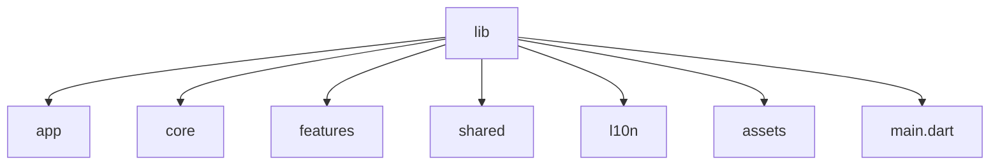
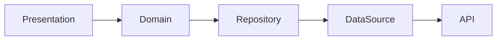

# 04. Folder Structure

> **Goal:** Define a standardized enterprise folder structure that promotes scalability, modularity, maintainability, and consistency across all Flutter applications.

---

# Overview

As Flutter applications grow, organizing files becomes increasingly important.

A poor folder structure often leads to:

* Large directories
* Duplicate code
* Tight coupling
* Difficult navigation
* Hard-to-maintain features

This project adopts a **Feature-First Clean Architecture**, where every feature is isolated and follows the same internal structure.

This approach makes the application:

* Easy to navigate
* Easy to scale
* Easy to maintain
* Easy to test
* Easy to onboard new developers

---

# Project Structure

```text
lib/

├── app/
├── core/
├── features/
├── shared/
├── assets/
├── l10n/
└── main.dart
```

Each directory has one responsibility.

---

# Folder Hierarchy



---

# Root Structure

```text
lib/

├── app/
│
├── core/
│
├── features/
│
├── shared/
│
├── l10n/
│
└── main.dart
```

---

# app/

Contains application-level configuration.

```text
app/

├── bootstrap/
│
├── config/
│
├── dependency_injection/
│
├── router/
│
├── theme/
│
├── localization/
│
└── app.dart
```

Responsibilities:

* Application initialization
* Global routing
* Theme
* Localization
* Dependency injection
* Global configuration

Business logic should never exist here.

---

# core/

Contains reusable infrastructure shared across every feature.

```text
core/

├── api/
│
├── cache/
│
├── constants/
│
├── database/
│
├── errors/
│
├── extensions/
│
├── helpers/
│
├── logger/
│
├── network/
│
├── services/
│
├── storage/
│
├── utils/
│
└── widgets/
```

The **core** directory should remain feature-independent.

---

# features/

Contains every business feature.

```text
features/

authentication/

home/

orders/

products/

profile/

settings/
```

Every feature should be completely self-contained.

---

# Feature Structure

Every feature follows the exact same structure.

```text
features/

authentication/

├── data/
│
├── domain/
│
├── presentation/
│
└── routes.dart
```

This consistency improves maintainability.

---

# Data Layer

```text
data/

├── datasource/
│
├── models/
│
├── repository/
│
└── mapper/
```

Responsibilities:

* API communication
* Local storage
* Serialization
* Repository implementation
* Model mapping

---

# datasource/

Contains classes responsible for retrieving data.

```text
datasource/

remote/

local/
```

Examples:

```text
auth_remote_datasource.dart

auth_local_datasource.dart
```

Data sources never contain business logic.

---

# models/

Contains JSON models.

```text
models/

user_model.dart

login_request.dart

login_response.dart
```

Responsibilities:

* JSON serialization
* API mapping

Models should never contain UI logic.

---

# repository/

Contains repository implementations.

```text
repository/

auth_repository_impl.dart
```

Responsibilities:

* Coordinate data sources
* Return domain entities
* Handle caching
* Handle offline support

---

# mapper/

Optional directory for converting:

```text
Model

↓

Entity
```

Useful when API models differ from domain entities.

---

# Domain Layer

```text
domain/

├── entities/
│
├── repositories/
│
└── usecases/
```

The Domain layer contains pure business logic.

It should have **no dependency on Flutter**.

---

# entities/

Contains business objects.

```text
entities/

user.dart

product.dart

order.dart
```

Entities represent business concepts.

---

# repositories/

Contains repository contracts.

```text
repositories/

auth_repository.dart
```

Use Cases depend on repository interfaces rather than implementations.

---

# usecases/

Contains business operations.

```text
usecases/

login.dart

logout.dart

register.dart

get_profile.dart
```

Each Use Case performs one business operation.

---

# Presentation Layer

```text
presentation/

├── controllers/
│
├── providers/
│
├── screens/
│
├── widgets/
│
└── states/
```

Responsible only for UI.

---

# screens/

Contains application pages.

```text
screens/

login_screen.dart

home_screen.dart

profile_screen.dart
```

Screens compose widgets and observe state.

---

# widgets/

Contains reusable widgets specific to the feature.

```text
widgets/

login_form.dart

profile_header.dart

product_card.dart
```

Keep widgets small and reusable.

---

# providers/

Contains state management.

Examples:

```text
Riverpod Notifier

Provider

Bloc

Cubit
```

Responsibilities:

* Manage state
* Call Use Cases
* Expose UI state

---

# states/

Optional directory.

```text
states/

login_state.dart

profile_state.dart
```

Contains immutable state objects.

---

# shared/

Contains reusable components shared across multiple features.

```text
shared/

widgets/

dialogs/

bottom_sheets/

animations/

components/
```

Only place code here if it is used by multiple features.

---

# assets/

```text
assets/

images/

icons/

fonts/

animations/

translations/
```

Example:

```text
assets/

images/logo.png

icons/home.svg

fonts/Inter.ttf
```

---

# l10n/

Contains localization resources.

```text
l10n/

app_en.arb

app_sw.arb
```

---

# Dependency Direction



Dependencies always point downward.

---

# Complete Project Structure

```text
lib/

├── app/
│   ├── bootstrap/
│   ├── config/
│   ├── dependency_injection/
│   ├── localization/
│   ├── router/
│   ├── theme/
│   └── app.dart
│
├── core/
│   ├── api/
│   ├── cache/
│   ├── constants/
│   ├── database/
│   ├── errors/
│   ├── extensions/
│   ├── helpers/
│   ├── logger/
│   ├── network/
│   ├── services/
│   ├── storage/
│   ├── utils/
│   └── widgets/
│
├── features/
│   ├── authentication/
│   ├── home/
│   ├── profile/
│   ├── products/
│   ├── orders/
│   └── settings/
│
├── shared/
│
├── l10n/
│
└── main.dart
```

---

# Why Feature-First?

Instead of:

```text
screens/

models/

services/

providers/
```

Use:

```text
features/

authentication/

shopping/

orders/

profile/
```

Benefits:

* Independent modules
* Easier maintenance
* Better scalability
* Reduced merge conflicts
* Easier code ownership

---

# Best Practices

* Organize by feature.
* Keep every feature independent.
* Separate Presentation, Domain, and Data layers.
* Share only truly reusable code.
* Keep widgets small.
* Keep business logic outside UI.
* Keep repositories focused on data access.
* Keep Use Cases focused on one operation.
* Use consistent naming across features.

---

# Common Anti-Patterns

Avoid:

* Putting every screen in one folder.
* Creating a global "utils" folder for unrelated code.
* Business logic inside widgets.
* Direct API calls from screens.
* Shared mutable state across unrelated features.
* Mixing models, entities, and UI objects.

---

# Folder Structure Checklist

* [ ] Feature-first organization
* [ ] Clean Architecture implemented
* [ ] Shared code isolated
* [ ] Features self-contained
* [ ] Consistent naming
* [ ] Business logic outside UI
* [ ] Repository layer implemented
* [ ] Domain layer independent
* [ ] Reusable widgets separated
* [ ] Easy project navigation

---

# Summary

A well-designed folder structure is the foundation of a scalable Flutter application. By organizing the project using a Feature-First approach and separating responsibilities into Presentation, Domain, and Data layers, developers can build applications that remain clean, maintainable, and easy to extend as new features are added. Every feature follows the same structure, making the entire codebase predictable and easier for teams to navigate.

The next chapter explores **Project Setup**, covering project creation, environment configuration, package organization, build flavors, and application configuration.
