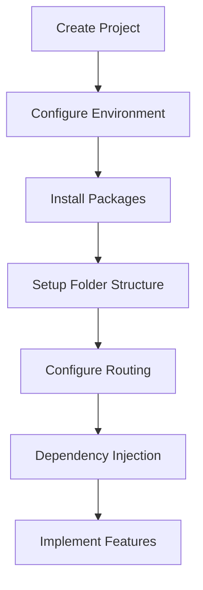

# 05. Project Setup

> **Goal:** Define the standard process for creating, configuring, and preparing a Flutter project for enterprise development. This chapter covers project creation, environment configuration, dependencies, flavors, assets, code generation, and recommended tooling.

---

# Overview

A well-configured project provides a strong foundation for development.

Project setup should be completed **before implementing features** to ensure:

* Consistent environments
* Predictable builds
* Easy onboarding
* Automated tooling
* Scalable architecture

Every Flutter project should follow the same initialization process.

---

# Project Creation

Create a new Flutter project.

```bash
flutter create my_app
```

For an organization:

```bash
flutter create \
    --org com.company \
    my_app
```

Use a meaningful application name and organization identifier.

---

# Verify Installation

Check Flutter installation.

```bash
flutter doctor
```

Ensure all required platforms are correctly configured.

Typical checks:

* Flutter SDK
* Dart SDK
* Android SDK
* Xcode (macOS)
* Chrome (Web)
* Connected devices

Resolve all issues before starting development.

---

# Recommended SDK

Use the latest stable Flutter release.

Example:

```text
Flutter Stable

Dart Stable
```

Keep the development team on the same Flutter version.

---

# Project Structure

Immediately organize the project.

```text
lib/

app/

core/

features/

shared/

main.dart
```

Avoid placing all code directly inside `lib/`.

---

# Configure Git

Initialize Git.

```bash
git init
```

Add the remote repository.

```bash
git remote add origin <repository-url>
```

Commit the initial project.

```bash
git add .

git commit -m "Initial Flutter project"
```

---

# Configure .gitignore

Flutter generates a default `.gitignore`.

Ensure it excludes:

```text
build/

.dart_tool/

.idea/

.vscode/

.flutter-plugins

.flutter-plugins-dependencies

pubspec.lock (optional for packages)

*.log
```

Do not commit generated files unless required.

---

# Environment Configuration

Create separate environments.

Example:

```text
development

staging

production
```

Configuration may include:

* API URL
* Logging level
* Feature flags
* Analytics
* Firebase project

Avoid hardcoding environment-specific values.

---

# Build Flavors

Recommended flavors.

```text
Development

Staging

Production
```

Each flavor should have:

* Separate API endpoint
* Separate app icon
* Separate package name
* Separate Firebase project

---

# Environment Files

Example.

```text
.env.development

.env.staging

.env.production
```

Typical values:

```text
API_BASE_URL

APP_NAME

ENABLE_LOGGING

ENABLE_ANALYTICS
```

Do not commit secrets to source control.

---

# pubspec.yaml

Organize dependencies.

Example categories:

```yaml
dependencies:

  # State Management

  # Networking

  # Dependency Injection

  # Storage

  # Firebase

  # UI

dev_dependencies:

  # Testing

  # Code Generation

  # Linting
```

Group packages logically.

---

# Recommended Packages

## State Management

* flutter_riverpod
* provider
* flutter_bloc

Choose one approach for the entire project.

---

## Networking

Recommended:

* dio

Optional:

* pretty_dio_logger

---

## Dependency Injection

Recommended:

* get_it

Optional:

* injectable

---

## Storage

Possible choices:

* hive
* isar
* shared_preferences
* flutter_secure_storage

Choose storage based on the data type.

---

## Serialization

Recommended:

* json_annotation
* json_serializable

Use code generation instead of manual JSON parsing.

---

# Code Generation

Run code generation.

```bash
flutter pub run build_runner build
```

Watch mode.

```bash
flutter pub run build_runner watch
```

Delete conflicting outputs.

```bash
flutter pub run build_runner build --delete-conflicting-outputs
```

---

# Dependency Installation

Install packages.

```bash
flutter pub get
```

Upgrade packages.

```bash
flutter pub upgrade
```

Remove unused dependencies regularly.

---

# Assets

Recommended structure.

```text
assets/

images/

icons/

fonts/

animations/

translations/
```

Register assets.

```yaml
flutter:

  assets:

    - assets/images/

    - assets/icons/

    - assets/animations/
```

---

# Fonts

Example.

```text
assets/fonts/

Inter-Regular.ttf

Inter-Bold.ttf
```

Register fonts in `pubspec.yaml`.

---

# Localization

Recommended directory.

```text
l10n/

app_en.arb

app_sw.arb
```

Enable localization before developing multilingual features.

---

# Application Icons

Use a generator package.

Example:

```text
flutter_launcher_icons
```

Generate platform icons instead of editing manually.

---

# Splash Screen

Recommended package.

```text
flutter_native_splash
```

Keep splash configuration automated.

---

# Linting

Recommended package.

```text
flutter_lints
```

Customize analysis options.

```text
analysis_options.yaml
```

Lint rules improve consistency across the team.

---

# Formatting

Format the project.

```bash
dart format .
```

Automate formatting before commits.

---

# Static Analysis

Analyze the project.

```bash
flutter analyze
```

Resolve warnings before merging code.

---

# Testing

Run tests.

```bash
flutter test
```

Run tests regularly during development.

---

# Build Commands

Android APK.

```bash
flutter build apk
```

Android App Bundle.

```bash
flutter build appbundle
```

iOS.

```bash
flutter build ios
```

Web.

```bash
flutter build web
```

Desktop.

```bash
flutter build windows
```

```bash
flutter build macos
```

```bash
flutter build linux
```

---

# Recommended Development Tools

| Tool             | Purpose            |
| ---------------- | ------------------ |
| VS Code          | Development        |
| Android Studio   | Emulator & Android |
| Xcode            | iOS Development    |
| Git              | Version Control    |
| Figma            | UI Design          |
| Postman / Bruno  | API Testing        |
| Firebase Console | Backend Services   |

---

# Development Workflow



---

# Team Setup

Every developer should:

* Use the same Flutter version.
* Use the same Dart version.
* Use identical lint rules.
* Follow the documented architecture.
* Keep dependencies synchronized.

Consistency reduces environment-related issues.

---

# Best Practices

* Configure the project before writing features.
* Use build flavors.
* Keep secrets out of Git.
* Organize dependencies.
* Use code generation.
* Format code automatically.
* Analyze code regularly.
* Keep Flutter up to date.
* Use consistent tooling across the team.

---

# Common Anti-Patterns

Avoid:

* Hardcoded API URLs.
* Different Flutter versions across developers.
* Manual JSON parsing.
* Manual app icon replacement.
* Large `pubspec.yaml` files without organization.
* Adding unnecessary packages.
* Ignoring analyzer warnings.
* Skipping code formatting.

---

# Project Setup Checklist

* [ ] Flutter installed
* [ ] Project created
* [ ] Git initialized
* [ ] Folder structure configured
* [ ] Dependencies installed
* [ ] Environment configuration added
* [ ] Build flavors configured
* [ ] Assets registered
* [ ] Fonts configured
* [ ] Localization enabled
* [ ] Code generation configured
* [ ] Static analysis passes
* [ ] Tests execute successfully

---

# Summary

A properly configured Flutter project lays the groundwork for successful application development. By standardizing project creation, dependency management, environment configuration, build flavors, code generation, and development tooling, teams can eliminate setup inconsistencies and focus on building high-quality features. With the foundation in place, the following chapters explore the implementation of the presentation layer, beginning with navigation and routing.
