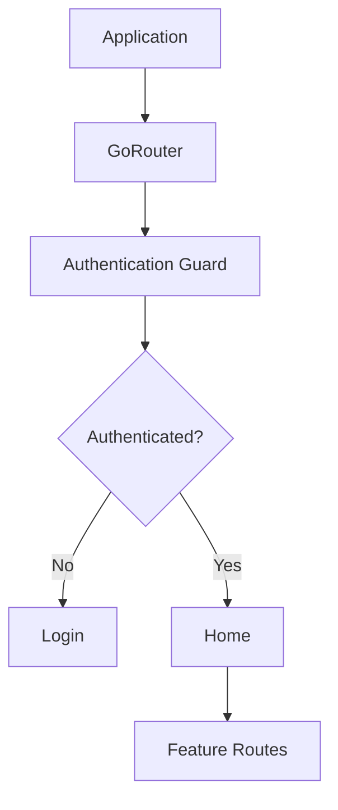
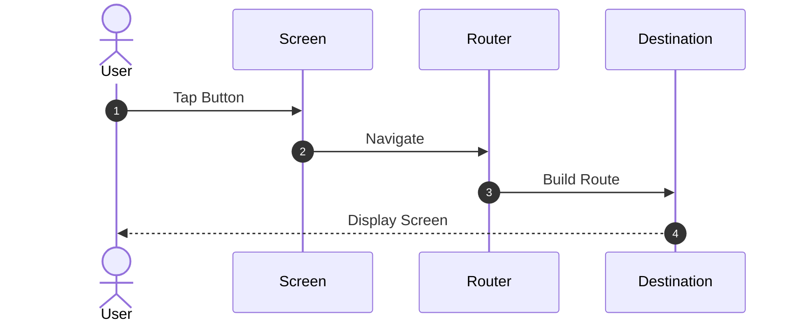
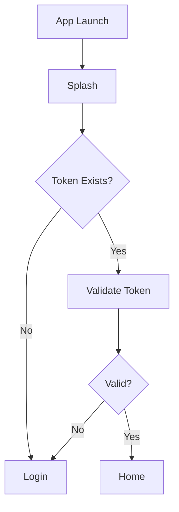
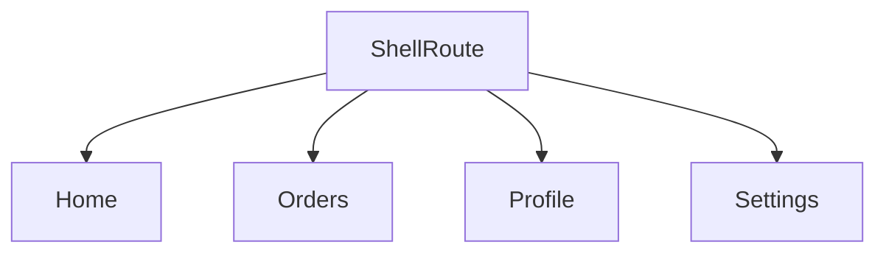
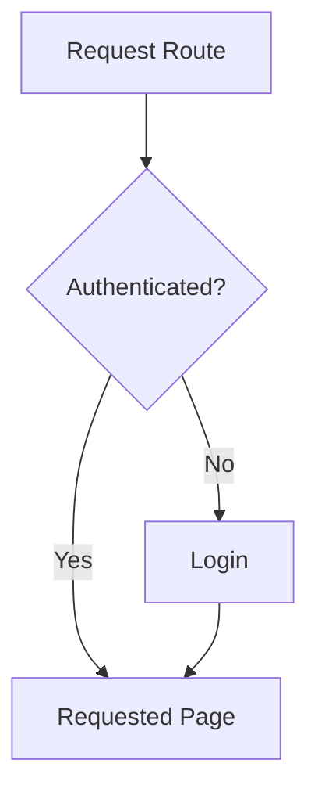
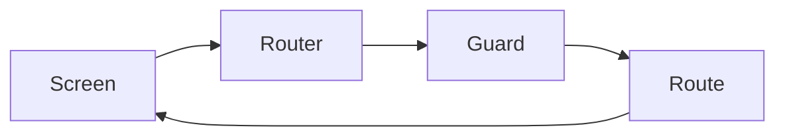

# 06. Navigation

> **Goal:** Design a scalable, maintainable, and testable navigation architecture using **GoRouter**. This chapter covers route organization, nested navigation, authentication guards, deep linking, shell routes, navigation patterns, and best practices for enterprise Flutter applications.

---

# Overview

Navigation is one of the most important parts of a Flutter application.

As applications grow, navigation becomes increasingly complex with:

* Authentication
* Nested routes
* Bottom navigation
* Deep links
* Feature modules
* Role-based routing
* Protected screens

A centralized routing architecture keeps navigation predictable and easy to maintain.

---

# Why GoRouter?

This documentation recommends **GoRouter** because it provides:

* Declarative routing
* URL support
* Deep linking
* Route guards
* Nested navigation
* Web compatibility
* ShellRoute support
* Type-safe navigation patterns

---

# Navigation Architecture

```text
User

↓

Screen

↓

GoRouter

↓

Route Guard

↓

Destination Screen
```

Navigation decisions should be centralized inside the router.

---

# High-Level Navigation



---

# Router Structure

Recommended project structure.

```text
lib/

app/

└── router/

    ├── app_router.dart

    ├── app_routes.dart

    ├── auth_guard.dart

    ├── route_names.dart

    └── redirects.dart
```

All navigation should be configured in one place.

---

# Route Constants

Avoid hardcoded strings.

Good example:

```dart
class RouteNames {

  static const login = '/login';

  static const home = '/';

  static const profile = '/profile';

  static const settings = '/settings';

}
```

Benefits:

* Autocomplete
* Refactoring support
* Reduced typos

---

# Feature Routes

Each feature should define its own routes.

Example:

```text
authentication/

routes.dart

shopping/

routes.dart

orders/

routes.dart

profile/

routes.dart
```

The main router imports feature routes instead of defining everything in one file.

---

# Navigation Flow



---

# Authentication Flow



Authentication should be handled by router redirects, not individual screens.

---

# Protected Routes

Protected routes require authentication.

Examples:

```text
/profile

/orders

/cart

/settings

/payments
```

Guests should never access these routes directly.

---

# Public Routes

Public routes are available without authentication.

Examples:

```text
/login

/register

/forgot-password

/privacy

/about
```

---

# Route Groups

Organize routes by feature.

```text
Authentication

Login

Register

Forgot Password
```

```text
Shopping

Products

Cart

Checkout
```

```text
Profile

Account

Settings

Notifications
```

---

# Nested Navigation

Useful for:

* Bottom Navigation
* Dashboard
* Admin Panel

Example:

```text
Home

├── Dashboard

├── Orders

├── Profile

└── Settings
```

Each tab maintains its own navigation stack.

---

# ShellRoute

Recommended for:

* Bottom navigation
* Drawer navigation
* Persistent layouts

Architecture:



The shell provides shared UI while child routes change independently.

---

# Navigation Methods

Common navigation patterns:

Push

```text
Current

↓

New Screen
```

Replace

```text
Current

↓

Replace Current Screen
```

Pop

```text
Previous Screen
```

Choose the appropriate method based on user flow.

---

# Navigation Stack

```text
Splash

↓

Login

↓

Home

↓

Product List

↓

Product Details
```

The stack determines back navigation behavior.

---

# Deep Linking

Deep links allow users to open specific content directly.

Examples:

```text
myapp://product/10

myapp://profile

https://example.com/product/10
```

GoRouter supports deep linking across supported platforms.

---

# Route Parameters

Example routes:

```text
/product/:id

/order/:orderId

/profile/:userId
```

Use path parameters for required identifiers.

---

# Query Parameters

Useful for:

```text
/products?page=2

/search?q=laptop

/orders?status=completed
```

Use query parameters for filtering and searching.

---

# Route Redirection

Example flow.



Redirect logic should remain centralized.

---

# Unknown Routes

Handle invalid routes gracefully.

Example:

```text
404 Page

↓

Back to Home
```

Never allow the application to crash because of an unknown route.

---

# Navigation Responsibilities

| Component | Responsibility      |
| --------- | ------------------- |
| Screen    | Request navigation  |
| Router    | Resolve destination |
| Guard     | Validate access     |
| Redirect  | Decide final route  |

Screens should never decide authentication logic.

---

# Navigation Diagram



---

# Modular Navigation

Each feature owns its routes.

Example:

```text
features/

authentication/

routes.dart

shopping/

routes.dart

profile/

routes.dart
```

This keeps navigation modular and scalable.

---

# Folder Structure

```text
app/

router/

app_router.dart

route_names.dart

auth_guard.dart

redirects.dart

route_extensions.dart
```

---

# Navigation Best Practices

* Centralize routing.
* Use route constants.
* Group routes by feature.
* Protect sensitive routes.
* Use ShellRoute for bottom navigation.
* Support deep linking.
* Keep screens unaware of routing logic.
* Handle unknown routes gracefully.
* Use named routes consistently.
* Keep redirect logic simple.

---

# Common Anti-Patterns

Avoid:

* Hardcoded route strings.
* Navigation inside business logic.
* Authentication checks inside every screen.
* Multiple router instances.
* Duplicate route definitions.
* Deep widget-based navigation chains.
* Feature routes scattered throughout the project.

---

# Navigation Checklist

* [ ] GoRouter configured
* [ ] Route constants created
* [ ] Authentication guards implemented
* [ ] Public routes defined
* [ ] Protected routes defined
* [ ] ShellRoute configured (if needed)
* [ ] Deep linking supported
* [ ] Unknown routes handled
* [ ] Feature routes separated
* [ ] Navigation tested

---

# Summary

A centralized navigation architecture is essential for building scalable Flutter applications. By using GoRouter, organizing routes by feature, implementing authentication guards, supporting nested navigation and deep links, and keeping navigation logic separate from business logic, applications remain easier to maintain and extend as they grow.

The next chapter explores **State Management**, covering application state, UI state, Riverpod architecture, providers, state notifiers, asynchronous state handling, and best practices for enterprise Flutter applications.
