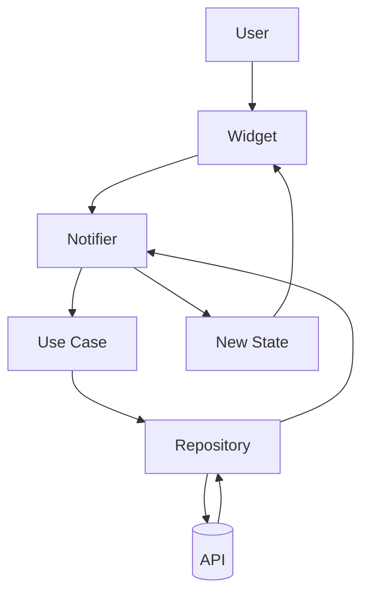
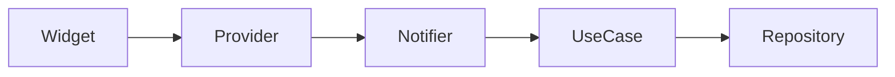
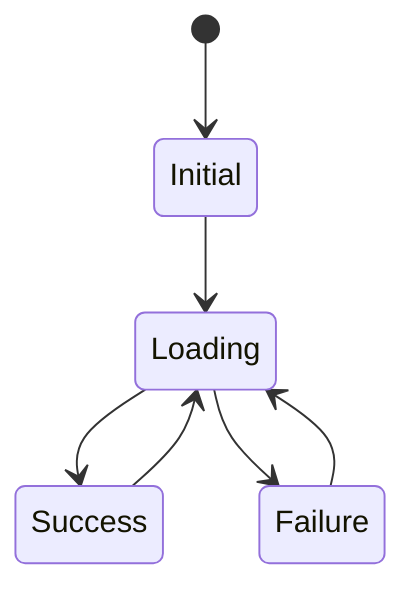
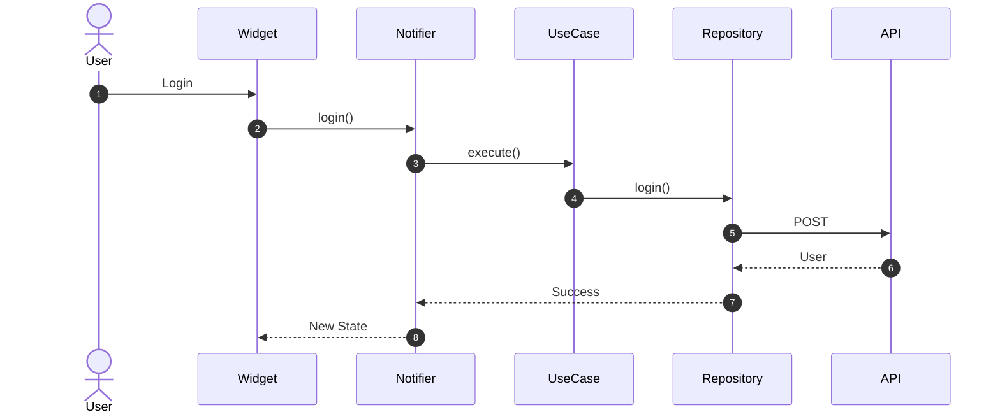
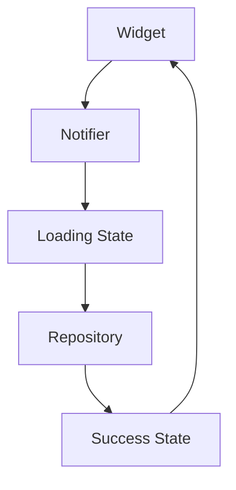

# 07. State Management

> **Goal:** Establish a scalable, predictable, and testable state management architecture for Flutter applications. This chapter explains how state flows through the application using **Riverpod** (recommended), while introducing concepts that also apply to Provider and Bloc.

---

# Overview

Everything displayed in a Flutter application is driven by **state**.

Examples include:

* User authentication
* Shopping cart
* Theme mode
* Loading indicators
* API responses
* Form validation
* User profile
* Notifications

Without a clear state management strategy, applications quickly become difficult to maintain.

This documentation recommends **Riverpod** because it offers:

* Compile-time safety
* Dependency injection
* Testability
* Immutable state
* Minimal boilerplate
* Excellent performance
* No dependency on BuildContext

---

# What is State?

State is any data that can change during the application's lifetime.

Examples:

```text
Current User

Loading

Shopping Cart

Theme

Language

Selected Product

Current Page

API Response
```

Whenever state changes, the UI should react automatically.

---

# State Architecture

```text
User Interaction

↓

State Notifier

↓

Use Case

↓

Repository

↓

Data Source

↓

API / Local Storage

↓

Updated State

↓

UI
```

Business logic should never be placed inside widgets.

---

# State Flow Diagram



The UI only observes state changes.

---

# Types of State

Flutter applications generally contain three categories of state.

| Type              | Example         |
| ----------------- | --------------- |
| Application State | Logged-in user  |
| Feature State     | Shopping cart   |
| UI State          | Loading spinner |

Each type should be managed appropriately.

---

# Application State

Application state exists throughout the application's lifetime.

Examples:

* Authentication
* Current user
* Theme
* Language
* Permissions

Usually initialized during application startup.

---

# Feature State

Feature state belongs to a single module.

Examples:

```text
Shopping Cart

Orders

Wishlist

Checkout

Profile
```

Feature state should remain inside its feature.

---

# UI State

UI state exists only while a screen is visible.

Examples:

* Loading
* Selected tab
* Expanded section
* Search query
* Dialog visibility

Avoid storing UI state globally.

---

# Riverpod Architecture



Each layer has a clear responsibility.

---

# Provider Types

Common Riverpod providers.

| Provider              | Purpose                    |
| --------------------- | -------------------------- |
| Provider              | Read-only dependencies     |
| StateProvider         | Simple mutable values      |
| FutureProvider        | One-time asynchronous data |
| StreamProvider        | Streams                    |
| StateNotifierProvider | Complex business state     |
| AsyncNotifierProvider | Async business state       |

Choose the simplest provider that meets your requirements.

---

# Recommended Provider

For enterprise applications:

```text
AsyncNotifier

or

StateNotifier
```

Avoid using `StateProvider` for complex business workflows.

---

# State Object

Use immutable state classes.

Example:

```text
LoginState

↓

Loading

↓

Success

↓

Failure
```

Immutable state improves predictability and debugging.

---

# State Lifecycle



Every feature should follow a predictable state lifecycle.

---

# Loading State

Before calling a Use Case:

```text
Initial

↓

Loading
```

Display:

* Progress indicator
* Skeleton loader
* Placeholder

Never leave users wondering whether the application is working.

---

# Success State

Successful operations return updated state.

Example:

```text
Loading

↓

Success

↓

Render UI
```

The UI rebuilds automatically.

---

# Error State

Errors should be represented as state.

Example:

```text
Loading

↓

Failure

↓

Show Error
```

Avoid throwing exceptions directly into widgets.

---

# State Flow Example

Login process.



---

# Separation of Responsibilities

| Layer       | Responsibility         |
| ----------- | ---------------------- |
| Widget      | Display UI             |
| Notifier    | Manage state           |
| Use Case    | Execute business rules |
| Repository  | Retrieve data          |
| Data Source | API or database        |

Each layer should perform only one responsibility.

---

# State Folder Structure

```text
presentation/

providers/

states/

controllers/

screens/

widgets/
```

Example:

```text
presentation/

providers/

auth_provider.dart

states/

auth_state.dart
```

---

# Feature Example

```text
authentication/

presentation/

├── providers/

├── states/

├── screens/

└── widgets/
```

Each feature owns its own state.

---

# State Updates

Recommended flow.

```text
User Action

↓

Notifier

↓

Use Case

↓

Repository

↓

New State

↓

UI
```

Avoid bypassing the Notifier.

---

# Dependency Injection

Inject dependencies.

```text
Notifier

↓

Use Case

↓

Repository
```

Never create repositories inside widgets.

---

# State Diagram



---

# Async State

Typical asynchronous flow.

```text
Idle

↓

Loading

↓

Success

or

Failure
```

Represent asynchronous work explicitly.

---

# Error Handling

Errors should be transformed.

```text
API Exception

↓

Repository

↓

Failure Object

↓

Notifier

↓

UI
```

The UI should receive user-friendly state, not raw exceptions.

---

# State Persistence

Persist only important state.

Examples:

* Authentication
* Theme
* Language
* User preferences

Avoid persisting temporary UI state.

---

# Performance

Minimize rebuilds.

Recommended:

* Small widgets
* Fine-grained providers
* Immutable state
* Selective listening

Only rebuild widgets that depend on changed state.

---

# Testing

Test:

* Notifiers
* Providers
* State transitions
* Loading state
* Error state
* Success state

Business logic should be testable without rendering widgets.

---

# Best Practices

* Use immutable state.
* Keep widgets stateless whenever possible.
* Keep business logic inside Notifiers and Use Cases.
* Keep providers small.
* Organize providers by feature.
* Use dependency injection.
* Handle loading explicitly.
* Handle failures consistently.
* Test state transitions.
* Avoid global mutable state.

---

# Common Anti-Patterns

Avoid:

* Business logic inside widgets.
* API calls directly from UI.
* Mutable state objects.
* One provider managing unrelated features.
* Global variables for application state.
* Nested `setState()` calls for business workflows.
* Passing state through multiple widget constructors unnecessarily.

---

# State Management Checklist

* [ ] Riverpod configured
* [ ] State objects immutable
* [ ] Providers organized by feature
* [ ] Business logic outside UI
* [ ] Loading states implemented
* [ ] Error states implemented
* [ ] Success states implemented
* [ ] Dependencies injected
* [ ] State transitions tested
* [ ] Performance optimized

---

# Summary

State management is the bridge between the user interface and business logic. By adopting Riverpod, immutable state, feature-based providers, and clear separation between widgets, notifiers, use cases, and repositories, Flutter applications become easier to understand, test, and maintain. Every feature should follow the same predictable state flow, ensuring consistency across the entire application.

The next chapter explores **UI Architecture**, covering screen organization, reusable widgets, layout composition, design systems, and scalable presentation patterns for enterprise Flutter applications.
