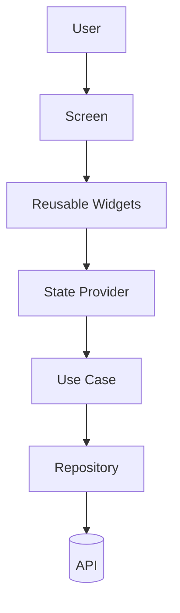
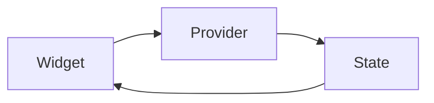
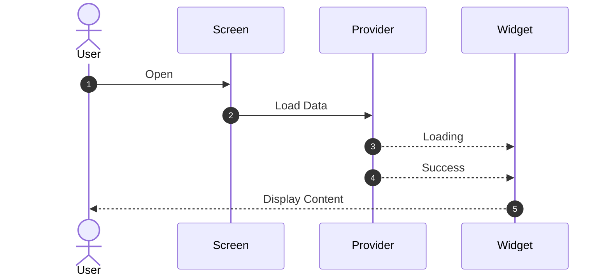

# 08. UI Architecture

> **Goal:** Define a scalable UI architecture that keeps widgets small, reusable, maintainable, and independent from business logic. This chapter explains how to organize screens, widgets, layouts, dialogs, and UI components in enterprise Flutter applications.

---

# Overview

The UI layer is responsible only for presenting information and collecting user input.

A well-designed UI architecture should:

* Separate UI from business logic
* Encourage reusable widgets
* Minimize widget rebuilds
* Improve readability
* Simplify testing
* Support responsive layouts
* Scale with application growth

The UI should **never** communicate directly with APIs or repositories.

---

# UI Layer Responsibilities

The Presentation Layer is responsible for:

* Displaying data
* Receiving user interactions
* Navigating between screens
* Showing loading indicators
* Showing error messages
* Showing dialogs
* Displaying animations

Everything else belongs to lower layers.

---

# UI Architecture

```text
User

↓

Screen

↓

Widgets

↓

State Provider

↓

Use Case

↓

Repository

↓

API / Local Storage
```

---

# Complete UI Flow



The UI reacts to state changes instead of managing business logic.

---

# UI Folder Structure

```text
presentation/

├── screens/
│
├── widgets/
│
├── dialogs/
│
├── bottom_sheets/
│
├── providers/
│
├── states/
│
└── controllers/
```

Each folder has a single responsibility.

---

# Screen Structure

A screen represents an application page.

Examples:

```text
LoginScreen

HomeScreen

ProfileScreen

CheckoutScreen

ProductDetailsScreen
```

A screen should compose widgets instead of implementing everything itself.

---

# Recommended Screen Layout

```text
LoginScreen

│

├── AppBar

├── LoginHeader

├── LoginForm

├── LoginButton

└── Footer
```

Breaking screens into reusable widgets improves readability and reuse.

---

# Widget Hierarchy

```mermaid
flowchart TD

Screen

↓

Section Widgets

↓

Small Widgets

↓

UI Components
```

Widgets should become progressively smaller and more focused.

---

# Widget Types

| Widget Type      | Responsibility         |
| ---------------- | ---------------------- |
| Screen           | Entire page            |
| Section Widget   | Logical section        |
| Component Widget | Reusable UI            |
| Shared Widget    | Global reusable widget |

---

# Screen Example

Instead of:

```text
LoginScreen

1000+ lines
```

Prefer:

```text
LoginScreen

↓

Header

↓

Form

↓

Button

↓

Footer
```

Small widgets are easier to maintain.

---

# Feature UI Structure

```text
authentication/

presentation/

├── screens/
│
│   └── login_screen.dart
│
├── widgets/
│
│   ├── login_form.dart
│
│   ├── login_header.dart
│
│   └── social_login.dart
│
├── providers/
│
└── states/
```

Every feature follows the same organization.

---

# Shared Widgets

Shared widgets belong outside features.

```text
shared/

widgets/

loading_indicator.dart

primary_button.dart

app_text_field.dart

empty_state.dart

error_view.dart
```

Only place widgets here if multiple features use them.

---

# Widget Responsibilities

Good widget responsibilities:

```text
ProductCard

CategoryChip

AvatarWidget

PrimaryButton

SearchBar
```

Avoid widgets that perform multiple unrelated tasks.

---

# Stateless vs Stateful

Prefer:

```text
StatelessWidget
```

Use `StatefulWidget` only when local UI state is required.

Examples:

* Animation
* Scroll controller
* Text controller
* Tab controller

Business state belongs in the state management layer.

---

# UI State Flow



Widgets observe state instead of storing business data.

---

# Loading UI

During asynchronous operations:

```text
Loading

↓

Skeleton

or

Progress Indicator
```

Avoid blank screens while waiting for data.

---

# Error UI

Show meaningful errors.

```text
Error

↓

Retry Button

↓

Support Message
```

Do not expose raw exception messages.

---

# Empty State

When no data exists:

```text
No Orders

↓

Illustration

↓

Description

↓

Call to Action
```

Every list should handle the empty state gracefully.

---

# Responsive Layout

Recommended approach:

```text
Phone

↓

Tablet

↓

Desktop
```

Avoid hardcoding screen sizes.

Use:

* LayoutBuilder
* MediaQuery
* Breakpoints

---

# Dialog Structure

Organize dialogs separately.

```text
dialogs/

confirmation_dialog.dart

logout_dialog.dart

delete_dialog.dart
```

Dialogs should be reusable and independent.

---

# Bottom Sheets

Separate bottom sheets.

```text
bottom_sheets/

filter_bottom_sheet.dart

sort_bottom_sheet.dart

payment_bottom_sheet.dart
```

Keep business logic outside bottom sheets.

---

# Forms

Forms should be separated.

Example:

```text
RegisterScreen

↓

RegisterForm

↓

Text Fields

↓

Submit Button
```

Validation belongs in dedicated validators or providers.

---

# UI Components

Reusable components.

Examples:

```text
PrimaryButton

SecondaryButton

AppCard

AppTextField

SearchBar

UserAvatar

StatusBadge

LoadingView
```

Create a design system for consistency.

---

# Theme Usage

Never hardcode:

* Colors
* Font sizes
* Border radius
* Padding

Always use the application's theme.

Example:

```text
Theme

↓

Colors

↓

Typography

↓

Spacing
```

---

# Animation

Animations should remain inside the presentation layer.

Examples:

* Page transitions
* Fade
* Slide
* Hero animations
* Loading animations

Avoid mixing animation logic with business logic.

---

# UI Flow Example



---

# UI Performance

Improve performance by:

* Splitting large widgets
* Using `const` constructors
* Avoiding unnecessary rebuilds
* Using lazy lists
* Reusing widgets
* Optimizing images

Performance starts with widget design.

---

# Accessibility

Support:

* Screen readers
* Large text
* Keyboard navigation
* Color contrast
* Semantic labels

Accessibility should be considered during development.

---

# Folder Example

```text
presentation/

screens/

widgets/

dialogs/

bottom_sheets/

providers/

states/

controllers/
```

Maintain this structure across every feature.

---

# Best Practices

* Keep screens small.
* Split UI into reusable widgets.
* Keep business logic outside widgets.
* Use shared components.
* Build responsive layouts.
* Support loading, empty, and error states.
* Use the application theme.
* Reuse dialogs and bottom sheets.
* Optimize widget rebuilds.
* Design with accessibility in mind.

---

# Common Anti-Patterns

Avoid:

* 1000-line screens.
* API calls inside widgets.
* Large reusable widgets with unrelated responsibilities.
* Duplicated UI components.
* Hardcoded colors and spacing.
* Mixing navigation and business logic.
* Complex nested widget trees without extraction.

---

# UI Architecture Checklist

* [ ] Screens organized
* [ ] Widgets reusable
* [ ] Shared components extracted
* [ ] Loading state implemented
* [ ] Error state implemented
* [ ] Empty state implemented
* [ ] Responsive layout supported
* [ ] Theme used consistently
* [ ] Accessibility considered
* [ ] Widget rebuilds optimized

---

# Summary

A well-structured UI architecture is essential for building maintainable Flutter applications. By separating screens into reusable widgets, keeping business logic out of the presentation layer, organizing shared components, and designing for responsiveness and accessibility, teams can create applications that are easier to develop, test, and evolve. A consistent UI architecture also improves collaboration and ensures a uniform user experience across the entire application.

The next chapter explores **Theme Management**, covering design systems, colors, typography, spacing, dark mode, and creating a scalable visual identity for enterprise Flutter applications.
